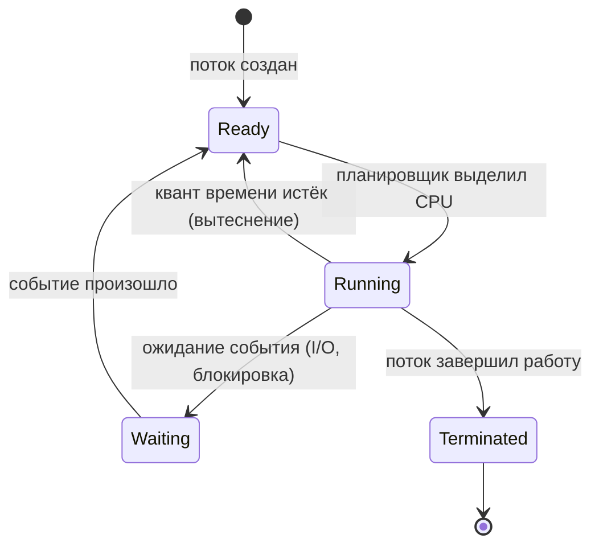
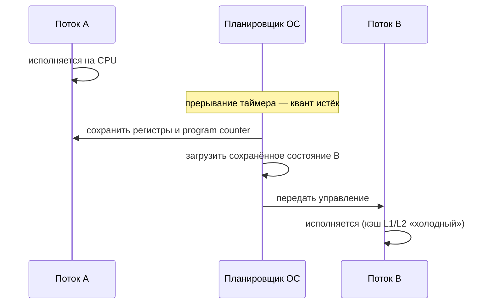

С нуля это на собеседовании не спрашивают, но без этого непонятно, почему JVM
ведёт себя именно так: почему context switch дорог, почему heap и stack
разделены, почему поток — это в первую очередь механизм ОС, на который Java
лишь надстраивает свою модель, и почему контейнер «убивает» Java-процесс с
кодом 137.

## Ключевые концепции

### Процессы и потоки

#### Процесс vs поток: изоляция памяти
Когда запускается программа, операционная система создаёт для неё процесс —
изолированное адресное пространство со своей памятью, файловыми дескрипторами
и переменными окружения. Один процесс не видит память другого напрямую: это
базовая единица изоляции в ОС.

Внутри процесса может работать несколько потоков — это единицы выполнения, а
не изоляции. Все потоки одного процесса разделяют его память (кучу,
статические данные) и файловые дескрипторы, но у каждого свой стек и свои
регистры, включая program counter. Из-за общей памяти между потоками и
возникают гонки данных (data race), а между процессами такая гонка без
специального механизма межпроцессного взаимодействия невозможна.

В Java обычный поток (`Thread`, platform thread) — это тонкая обёртка над
потоком ОС, один к одному. Виртуальные потоки (Java 21) устроены иначе: их
много, и JVM сама распределяет их по небольшому числу потоков ОС (раздел 8).

#### Состояния потока
В любой момент поток находится в одном из состояний, за которыми следит
планировщик ОС. Running — исполняется на ядре CPU прямо сейчас; ready —
готов исполняться, но ждёт своей очереди; waiting (blocked) — ждёт события:
ответа диска или сети, освобождения блокировки; terminated — завершил работу.


Переход `Running → Waiting → Ready` — поток сам уступает CPU, потому что ему
нечего делать до прихода данных. Переход `Running → Ready` — поток готов
работать дальше, но планировщик его принудительно вытеснил. У Java-потоков
свой набор состояний (`RUNNABLE`, `BLOCKED`, `WAITING`...), и он не совпадает
один к одному с состояниями ОС: например, поток, ждущий данных из сокета, в
Java числится `RUNNABLE`.

#### Переключение контекста (context switch)
Механизм, которым планировщик передаёт CPU от одного потока другому,
называется переключением контекста (context switch). Планировщик сохраняет
состояние текущего потока — регистры, program counter, указатель стека — и
загружает ранее сохранённое состояние следующего.

Само сохранение и восстановление регистров быстрое (порядка микросекунды
вместе со входом в ядро), но у переключения есть скрытая цена. Новый поток
начинает работать на «холодном» кэше процессора: данные предыдущего потока в
L1/L2 ему не нужны, а свои приходится подгружать заново. Поэтому потоков,
активно конкурирующих за CPU, не стоит делать сильно больше, чем ядер.

Переключение между потоками разных процессов дороже, чем внутри одного
процесса. Меняется адресное пространство, поэтому нужно сменить таблицы
страниц и сбросить TLB — кэш трансляции виртуальных адресов. Потоки одного
процесса делят адресное пространство, и этот шаг для них не нужен.



#### Сигналы и завершение процесса
Сигнал — асинхронное уведомление, которое ОС доставляет процессу. На практике
для backend-разработчика важны три. `SIGTERM` — вежливая просьба завершиться:
JVM запускает shutdown hooks, и Spring Boot корректно закрывает соединения и
дорабатывает запросы (graceful shutdown). Именно его посылают `docker stop` и
Kubernetes перед остановкой пода.

`SIGKILL` (`kill -9`) перехватить нельзя: процесс уничтожается немедленно, без
shutdown hooks и без закрытия ресурсов. Его посылают, если процесс не
завершился за отведённое время, и его же использует OOM killer, когда
контейнер превысил лимит памяти. Код выхода 137 = 128 + 9 — характерный
признак того, что процесс убит сигналом 9.

`SIGQUIT` (`kill -3`) JVM не завершает, а выводит thread dump — стеки всех
потоков в stdout. Это простой способ посмотреть, где «завис» сервис, без
подключения отладчика (подробнее про диагностику — раздел 9).

### Память и адресация

#### Виртуальная память и таблицы страниц
Каждый процесс видит собственное непрерывное адресное пространство — так
работает виртуальная память. Адреса, с которыми работает код, не совпадают с
физическими адресами в оперативной памяти: процессор транслирует их через
таблицы страниц (page tables), а результаты трансляции кэширует в TLB.

Из этого следуют два важных свойства. Первое — изоляция: процесс физически не
может обратиться к памяти другого, у него просто нет таких адресов. Второе —
гибкость: часть страниц может лежать на диске (swap) или ещё не быть выделена
вовсе. Обращение к такой странице вызывает page fault, и ядро подгружает или
выделяет её прозрачно для программы.

#### Сегментация vs страничная организация
Исторически было два способа организовать виртуальную память. Сегментация
делит память на сегменты переменной длины по смыслу — код, данные, стек — и
адрес состоит из номера сегмента и смещения. Проблема — внешняя
фрагментация: свободная память распадается на дыры разного размера, и
большой сегмент может не поместиться, хотя свободной памяти в сумме хватает.

Страничная организация (paging) делит память на страницы одинакового размера,
обычно 4 КБ. Любую виртуальную страницу можно положить в любой свободный
физический фрейм, поэтому внешней фрагментации нет — остаётся лишь небольшая
внутренняя, внутри последней страницы. Современные ОС на x86-64 используют
страничную организацию, а сегментация там фактически отключена.

С размером страниц связана и настройка JVM: для больших куч включают huge
pages (`-XX:+UseLargePages`, страницы по 2 МБ). Таблицы страниц становятся
меньше, а промахов TLB — реже.

#### Stack vs heap
Внутри адресного пространства процесс использует память по-разному. Стек —
область для локальных переменных и адресов возврата: память выделяется и
освобождается автоматически при входе и выходе из функции, это очень быстро,
но размер ограничен (обычно от сотен килобайт до нескольких мегабайт на
поток). Поэтому глубокая неконтролируемая рекурсия заканчивается
переполнением стека.

Куча (heap) — область для динамических данных, время жизни которых не
привязано к вызову функции. В C память в куче выделяют и освобождают явно
(`malloc`/`free`), и ошибка в этом даёт утечку или порчу памяти. JVM
резервирует большой кусок памяти процесса под свою кучу и управляет им сама:
объект живёт, пока на него есть достижимая ссылка, а освобождает его сборщик
мусора (раздел 9).

### Файловая система и планировщик

#### Файлы, inode и права доступа
Файл в Unix-подобных системах состоит из данных и метаданных. Метаданные
хранит inode: права доступа, владелец, размер, ссылки на блоки данных. Имя
файла хранится отдельно, в каталоге, поэтому один и тот же inode может быть
доступен под несколькими именами (жёсткие ссылки).

Права доступа `rwx` (read/write/execute) задаются для трёх категорий: владелец,
группа, все остальные. Запись `rwxr-x---` означает, что владелец может всё,
группа — читать и исполнять, остальные — ничего.

#### Файловые дескрипторы и их лимит
Когда процесс открывает файл или сокет, ОС выдаёт ему файловый дескриптор —
небольшое целое число, привязанное к процессу. В Unix «всё есть файл»: сокет
тоже получает дескриптор, поэтому каждое открытое соединение расходует их
так же, как открытый файл.

У числа открытых дескрипторов есть лимит (`ulimit -n`), и его превышение —
классическая проблема в проде. Сервис, который забывает закрывать соединения
или файлы, рано или поздно падает с `Too many open files`. В Java такие утечки
предотвращает try-with-resources.

#### Планировщик: вытесняющая многозадачность и приоритеты
Планировщик решает, какой поток и сколько времени будет исполняться на каждом
ядре. В кооперативной многозадачности поток работает, пока сам не отдаст
управление, и один зависший поток останавливает всю систему. Современные ОС
используют вытесняющую (preemptive) многозадачность: каждому потоку выдаётся
квант времени, по прерыванию таймера ядро забирает CPU и отдаёт его другому.

Приоритеты влияют на то, кому достаётся CPU чаще. В Linux обычный планировщик
(CFS, с ядра 6.6 — EEVDF) старается распределять процессорное время
справедливо с учётом веса потока, который задаётся значением `nice`. Методу
`Thread.setPriority` в Java на Linux по умолчанию верить не стоит: без
специальных флагов JVM приоритеты потоков игнорируются, и на корректность
программы они влиять не должны.

Кстати, виртуальные потоки Java — пример кооперативной модели внутри JVM:
виртуальный поток уступает поток-носитель, когда блокируется на I/O или
`sleep`, а не по таймеру. Поэтому долгие вычисления без блокировок в
виртуальном потоке занимают носитель целиком (раздел 8).

#### Системные вызовы и режимы процессора
Процессор работает в двух режимах. В пользовательском режиме (user mode)
исполняется код приложений, и ему запрещено напрямую обращаться к устройствам
и чужой памяти. В режиме ядра (kernel mode) исполняется код ОС с полным
доступом к железу.

Системный вызов (syscall) — единственный легальный переход из
пользовательского кода в ядро: открытие файла, чтение из сокета, выделение
памяти, создание потока. Переход стоит сотни наносекунд и больше, поэтому
код, который читает файл или сокет по одному байту, работает медленно — каждый
`read` идёт в ядро. Буферизация (`BufferedInputStream`) собирает много мелких
чтений в один системный вызов.

## Примеры

Потоки процесса в Linux:
```bash
ps -eLf
```
Пример вывода (сокращённо):
```
UID    PID  PPID  LWP  NLWP CMD
root      1    0     1     1  /sbin/init
alice   842  820   842     4  java -jar app.jar
alice   842  820   843     4  java -jar app.jar
alice   842  820   844     4  java -jar app.jar
```
`PID` — идентификатор процесса, `LWP` — идентификатор конкретного потока
(light-weight process), `NLWP` — сколько всего потоков у процесса. У процесса
`842` несколько разных `LWP` при одном `PID` — это и есть разделение «процесс
и его потоки». У реальной JVM потоков будет десятки: GC, JIT-компилятор,
служебные потоки.

Лимит файловых дескрипторов:
```bash
ulimit -n
```
```
1024
```
Это типичное значение по умолчанию для оболочки и запущенных из неё
процессов. Серверу с тысячами соединений его поднимают (в systemd —
`LimitNOFILE`, в Docker — `--ulimit nofile`).

Системные вызовы простой команды:
```bash
strace -c ls
```
Пример вывода (сокращённо):
```
% time     seconds  usecs/call     calls    errors syscall
------ ----------- ----------- --------- --------- ----------------
 35.20    0.000142          14        10           openat
 28.15    0.000114          11        10           read
 18.40    0.000074          12         6           mmap
 12.10    0.000049           8         6           close
100.00    0.000404                    54         1 total
```
`strace` перехватывает системные вызовы и считает их количество и время. Даже
`ls` делает несколько десятков вызовов: `openat` на каждый файл, `read`,
`mmap` для загрузки библиотек.

Thread dump Java-процесса через сигнал:
```bash
kill -3 842        # или jcmd 842 Thread.print
```
JVM не завершится, а напечатает в свой stdout стеки всех потоков — с их
Java-состояниями и тем, какие мониторы они держат или ждут.

## Частые вопросы на собеседовании

**Q: Почему переключение контекста дороже, чем кажется на первый взгляд?**
A: Само сохранение и восстановление регистров быстрое, но новый поток
работает на «холодном» кэше процессора и вынужден заново подгружать свои
данные. При переключении между процессами добавляется смена таблиц страниц и
сброс TLB. Поэтому избыток потоков, активно претендующих на CPU, ухудшает
производительность, а не улучшает её.

**Q: Чем поток отличается от процесса с точки зрения памяти?**
A: Процессы изолированы — у каждого своё виртуальное адресное пространство.
Потоки одного процесса разделяют кучу, статические данные и файловые
дескрипторы, но у каждого свой стек и регистры. Отсюда и возможность гонок
данных между потоками, и дешёвая передача данных между ними без копирования.

**Q: Что такое виртуальная память и зачем она нужна?**
A: Это механизм, при котором процесс работает с виртуальными адресами, а
процессор транслирует их в физические через таблицы страниц. Он даёт изоляцию
процессов, позволяет выделять память лениво, вытеснять редко используемые
страницы на диск и отображать файлы в память (`mmap`). Цена — промахи TLB и
page faults.

**Q: Почему Java-процесс в контейнере завершился с кодом 137?**
A: 137 = 128 + 9, то есть процесс убит сигналом `SIGKILL`. Чаще всего это OOM
killer: процесс превысил лимит памяти контейнера. Важно, что JVM потребляет не
только кучу (`-Xmx`), но и метаспейс, стеки потоков, кэш JIT, direct-буферы,
поэтому лимит контейнера должен быть заметно больше `-Xmx` (раздел 29).

**Q: Чем SIGTERM отличается от SIGKILL?**
A: `SIGTERM` можно обработать: JVM запускает shutdown hooks, приложение
закрывает соединения и дорабатывает текущие запросы. `SIGKILL` перехватить
нельзя, процесс уничтожается мгновенно. Поэтому оркестраторы сначала шлют
`SIGTERM`, ждут grace period, и только потом — `SIGKILL`.

## Ловушки и частые ошибки

#### «Чем больше потоков, тем быстрее»
Это верно, только пока потоки в основном ждут I/O или пока их не больше, чем
ядер CPU. Как только потоков, конкурирующих за процессор, становится
значительно больше, накладные расходы на переключения и вымывание кэша
(cache thrashing) перевешивают выигрыш от параллелизма. Для вычислительных
задач пул размером с число ядер почти всегда оптимален.

#### «Стек ничем не ограничен»
У стека каждого потока есть предел — платформозависимый по умолчанию и
настраиваемый в JVM через `-Xss`. Поэтому неконтролируемая рекурсия
заканчивается `StackOverflowError`, а не бесконечным ожиданием. Обратная
сторона: тысячи platform-потоков с большим `-Xss` резервируют много памяти
процесса.

#### «kill -9 — нормальный способ остановить сервис»
`SIGKILL` не даёт приложению ничего завершить: не закрываются соединения с
базой, не дописываются логи, не отдаются ответы на начатые запросы, не
отправляются сообщения из буферов. Останавливать сервис нужно через
`SIGTERM` и дать ему время на graceful shutdown.

## Связанные темы
- [Основы сетей](03-networking-basics/00-index.md) — сокет тоже является файловым дескриптором с точки зрения ОС.
- Области памяти JVM (раздел 9) — как куча, стек и метаспейс JVM ложатся на память процесса.
- Основы потоков (раздел 8) — Java-потоки поверх потоков ОС и их состояния.
- Виртуальные потоки (раздел 8) — M:N-модель поверх потоков ОС.
- Docker для Java-приложений (раздел 29) — лимиты памяти контейнера и OOM killer.

## Источники
- Andrew S. Tanenbaum, «Modern Operating Systems» — процессы, память, планирование.
- Remzi и Andrea Arpaci-Dusseau, [«Operating Systems: Three Easy Pieces»](https://pages.cs.wisc.edu/~remzi/OSTEP/) (бесплатная книга).
- `man 7 signal`, `man 2 syscalls`.
