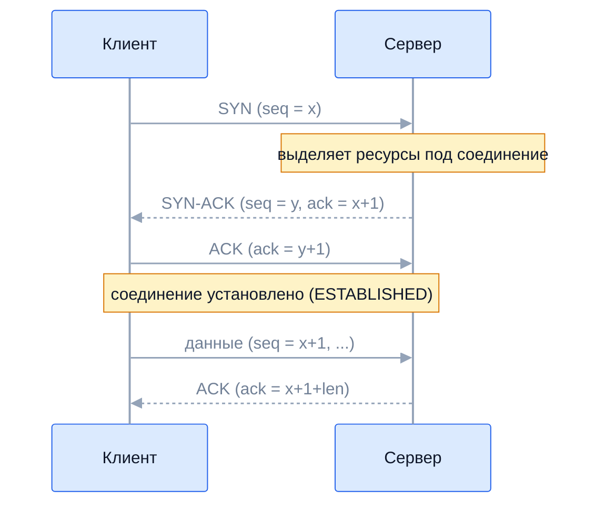
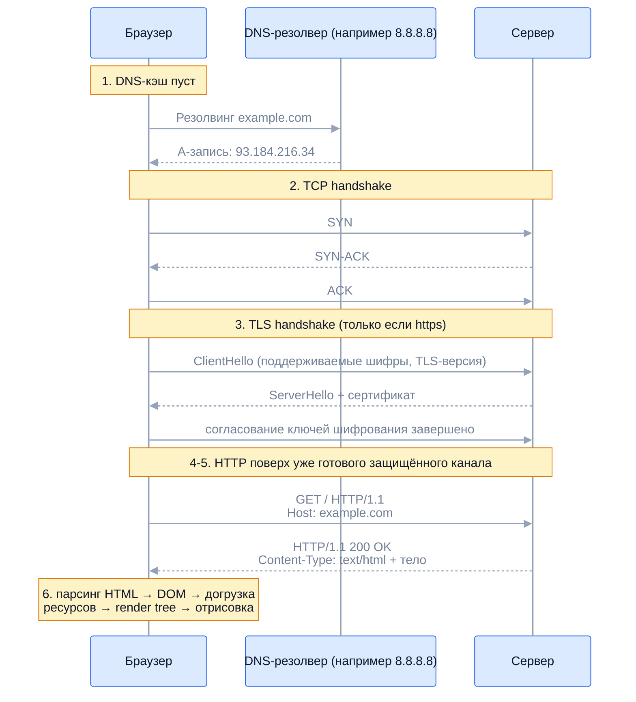

Сетевой стек — то, через что физически проходит любой запрос в распределённой
системе. На собеседовании редко просят объяснить сети «с нуля», но ожидают, что
вы уверенно оперируете терминами TCP/UDP, handshake, DNS и порты, когда
объясняете архитектурные решения и разбираете инциденты — например, почему
сервис «не видит» новый IP после переключения DNS или почему зависший
внешний вызов съел все потоки пула.

Этот файл — прикладной вход в тему: TCP/UDP, HTTP, DNS, порты, путь запроса
целиком. Он самодостаточен для большинства собеседований. Если нужно понимать
глубже, как физически ходит кадр по свитчу, как маршрутизатор выбирает
следующий узел или зачем нужен VLAN — в этой же папке есть пять файлов
углублённого курса (список — в конце, раздел «Материалы для углублённого
изучения»), которые разворачивают каждый уровень стека по отдельности.

## Ключевые концепции

### Зачем вообще уровни
#### Зачем нужны уровни
Сетевое взаимодействие принято описывать не одним монолитным протоколом, а
стопкой независимых уровней, каждый из которых решает свою узкую задачу и не
знает, как устроены соседние.

На практике это выглядит так: канальный уровень
доставляет кадр в пределах одного локального сегмента по MAC-адресам; сетевой
(IP) — маршрутизирует пакет между разными сетями по IP-адресам; транспортный
(TCP/UDP) — доставляет данные конкретному процессу через порт и решает, нужна
ли гарантия доставки; прикладной (HTTP, DNS) — придаёт байтам понятный
приложению смысл.

#### TCP/IP модель vs OSI
Такое разделение называют стеком TCP/IP — практической четырёхуровневой
моделью, которой инженеры пользуются в разговоре и проектировании. Академическая
модель OSI режет то же самое на семь уровней, например разделяет передачу битов
и доставку кадра.

OSI полезна как общий словарь: «уровень 3» — это сетевой уровень и IP, «уровень
4» — транспортный, TCP и UDP. В реальном стеке её семь уровней всё равно
схлопываются в те же четыре. Подробно об OSI, инкапсуляции и стандартах (IETF,
IEEE, ISO) — в `01-switching-and-osi.md`.

### TCP и UDP
#### TCP: three-way handshake
На транспортном уровне две задачи решаются принципиально по-разному. TCP перед
передачей данных сначала устанавливает соединение через three-way handshake:
клиент отправляет `SYN`, сервер отвечает `SYN-ACK`, клиент подтверждает `ACK` —
так обе стороны убеждаются, что канал работает в обе стороны, прежде чем
тратить ресурсы на передачу данных.


`seq` каждой стороны — это её собственная нумерация байтов, стартующая со
случайного начального значения (ISN), а `ack` — это подтверждение "получил
всё до этого байта включительно" по нумерации собеседника; после handshake обе
стороны просто продолжают передавать данные и подтверждать их этими же
номерами.

#### TCP: гарантия доставки и порядка
После этого TCP гарантирует доставку и порядок байтов: каждый байт
пронумерован (sequence number), а получатель подтверждает (ACK), что и до
какого номера он получил. Неподтверждённые данные отправитель через некоторое
время отправляет повторно.

Кроме надёжности, TCP регулирует скорость: управление потоком (flow control)
не даёт завалить медленного получателя, а управление перегрузкой (congestion
control) — саму сеть. Полный разбор — закрытие соединения, состояния
`TIME_WAIT` и `CLOSE_WAIT`, окна, slow start, алгоритм Найгла — в
`04-transport-layer.md`.

#### UDP и QUIC
UDP устроен ровно наоборот: соединение вообще не устанавливается, датаграмма
просто отправляется без гарантии доставки, порядка или дедупликации — либо
доходит целиком, либо теряется, и приложению об этом никак не сообщается. Взамен
— минимальная задержка и минимальные накладные расходы, поэтому UDP выбирают там,
где скорость важнее гарантий: DNS-запросы, стриминг видео и аудио, онлайн-игры, а
в последние годы и современный QUIC — основа HTTP/3, — который построен поверх
UDP, но реализует собственную надёжность уже в userspace, обходя классические
ограничения TCP вроде head-of-line blocking.

### HTTP: модель запрос-ответ
Поверх транспортного уровня работает прикладной протокол HTTP: он работает
поверх TCP (или поверх QUIC для HTTP/3) и добавляет к голому байтовому потоку
понятную структуру запрос-ответ.

#### Структура HTTP-запроса и ответа
Клиент отправляет запрос из трёх частей: стартовой строки (метод, путь, версия
протокола, например `GET /index.html HTTP/1.1`), заголовков (метаданные вида
`Host`, `Content-Type`, `Cookie`) и, опционально, тела запроса (например, JSON в
`POST`). Сервер отвечает симметрично: строкой статуса (версия, код, пояснение,
например `HTTP/1.1 200 OK`), заголовками ответа и, опционально, телом с самими
данными.

```bash
curl -v https://example.com
```
Пример вывода (сокращённо):
```
* Connected to example.com (93.184.216.34) port 443
* TLS handshake, Client hello (1):
* TLS handshake, Server hello (1):
> GET / HTTP/1.1
> Host: example.com
< HTTP/1.1 200 OK
< Content-Type: text/html
```
Флаг `-v` показывает ровно ту последовательность, что описана в разборе «под
капотом»: сначала TCP-соединение, затем TLS handshake (строки `TLS handshake`),
и только потом сам HTTP-запрос (`>`) и ответ сервера (`<`).

#### Коды статуса ответа
Код статуса ответа — не произвольное число: первая цифра сразу говорит, что
произошло.

`1xx` — промежуточный информационный ответ (используется редко);
`2xx` — запрос успешно обработан (`200 OK`, `201 Created`); `3xx` — нужно
обратиться в другое место (`301`/`302` redirect); `4xx` — ошибка на стороне
клиента (`404 Not Found`, `401 Unauthorized`); `5xx` — ошибка на стороне сервера
(`500 Internal Server Error`).

Этой классификации по первой цифре уже достаточно,
чтобы читать логи и понимать, в какую сторону смотреть при отладке, даже не
помня наизусть все конкретные коды. Подробный разбор методов и заголовков — в
разделе 23; здесь важна сама модель, а не список наизусть.

#### HTTP stateless
Ключевое архитектурное свойство HTTP — его stateless-природа: сервер не хранит
между запросами память о том, кто их прислал и что было раньше, в отличие,
например, от самого TCP-соединения, которое состояние как раз держит. Это
осознанное упрощение: благодаря ему любой сервер за балансировщиком может
обработать любой запрос клиента, не деля с другими серверами общее состояние
сессии. Плата за это — если приложению всё же нужна память о клиенте (кто
залогинен, что лежит в корзине), эту память приходится городить поверх
протокола отдельно, через cookies, токены или серверные сессии.

### DNS, порты и сокеты
#### DNS-резолвинг
Чтобы вообще открыть TCP-соединение до сервера, сначала нужно узнать его
IP-адрес — этим занимается DNS: распределённая иерархическая система, которая
переводит доменное имя (`example.com`) в IP-адрес. Сначала проверяется
локальный кэш и файл `hosts`, и только потом идёт сетевой запрос.

Резолвинг обычно выполняет
рекурсивный резолвер (у провайдера или, например, `8.8.8.8`), который берёт на
себя всю цепочку обращений: спрашивает корневой сервер → тот отвечает адресом
сервера зоны `.com`/`.ru` → тот отвечает адресом authoritative-сервера
конкретного домена → тот отдаёт финальную запись. С точки зрения самого
резолвера это итеративный обход (он сам ходит по цепочке серверов), а с точки
зрения клиента, который просто ждёт готовый ответ, — рекурсивный запрос.

```bash
dig +trace example.com
```
Пример вывода (сокращённо):
```
.            518400  IN  NS   a.root-servers.net.
com.         172800  IN  NS   a.gtld-servers.net.
example.com. 86400   IN  NS   a.iana-servers.net.
example.com. 86400   IN  A    93.184.216.34
```
Каждая строка — шаг делегирования из цепочки резолвинга, о которой шла речь
выше: сначала корневой сервер отвечает, кто обслуживает зону `.com`, затем
сервер зоны `.com` отвечает, кто обслуживает конкретно `example.com`, и только
последняя строка — реальный `A`-адрес, ради которого всё это затевалось.

#### Типы DNS-записей и TTL
Среди типов записей чаще всего встречаются `A`/`AAAA` (IPv4/IPv6 адрес), `CNAME`
(алиас на другое имя) и `MX` (почтовый сервер), а параметр `TTL` у записи
определяет, сколько времени результат хранится в кэше — короткий TTL и есть
источник классической проблемы «поменяли IP, а часть клиентов всё ещё бьёт в
старый». Это отдельное поле от TTL у IP-пакета (счётчик хопов через
маршрутизаторы, который защищает сеть от петель маршрутизации) — подробный
разбор IP TTL и того, как маршрутизация вообще устроена, в
`03-network-layer-ip.md`.

#### Кэш DNS в JVM
У Java есть собственный кэш DNS-ответов в `InetAddress`, поверх кэша ОС.
Успешные ответы по умолчанию хранятся 30 секунд, а если включён
SecurityManager — бесконечно (свойство безопасности `networkaddress.cache.ttl`).
Неудачные ответы кэшируются на 10 секунд (`networkaddress.cache.negative.ttl`).

На практике это значит, что после смены IP-адреса сервиса Java-клиент может
ещё какое-то время ходить на старый адрес — даже если TTL записи в DNS
короче. Вторая частая причина «не видит новый IP» — пулы соединений: уже
открытое TCP-соединение продолжает жить с тем адресом, с которым
устанавливалось, пока пул его не закроет.

#### Сокеты, порты и well-known порты
Порт — 16-битный номер, по которому ОС доставляет данные конкретному процессу
на машине. Пара `(IP-адрес, порт)` — это конечная точка, сокет. Само
TCP-соединение однозначно определяется пятёркой значений: протокол, IP и порт
клиента, IP и порт сервера (5-tuple). Поэтому сервер на одном порту `443`
может держать тысячи соединений одновременно — у них различаются адреса и
порты клиентов.

Часть портов закреплена по конвенции за конкретными сервисами (well-known
порты): 80 и 443 — HTTP/HTTPS, 22 — SSH, 5432 — PostgreSQL, 6379 — Redis,
9092 — Kafka. Клиентская сторона обычно получает случайный «эфемерный» порт
из динамического диапазона (в Linux по умолчанию 32768–60999).

```bash
ss -tnp
```
Пример вывода:
```
State  Recv-Q  Send-Q  Local Address:Port   Peer Address:Port    Process
ESTAB  0       0       10.0.0.5:51342       93.184.216.34:443    curl,pid=1234
```
Локальный порт (`51342`) — тот самый случайный "эфемерный" порт со стороны
клиента, а `443` на удалённой стороне — well-known порт HTTPS: наглядно видно,
что соединение определяется парой `(IP, порт)` с каждой стороны, а не просто
IP-адресом.

#### Таймауты сокетов в Java
У клиентского соединения два разных таймаута. Connect timeout ограничивает
установление соединения (handshake), read timeout (`SO_TIMEOUT`) — ожидание
очередной порции данных от уже подключённого собеседника. В `java.net.Socket`
read timeout по умолчанию равен нулю — ждать вечно.

Это одна из самых частых причин инцидентов: внешний сервис принял соединение,
но завис и не отвечает, а вызывающий поток ждёт бесконечно. Если таких вызовов
много, пул потоков заканчивается, и «зависает» уже весь сервис. Поэтому оба
таймаута нужно задавать явно в любом HTTP-клиенте и драйвере базы данных
(пример ниже).

Read timeout в Java — реальный запуск на JDK 21:
```java
try (ServerSocket server = new ServerSocket(0)) {        // сервер принимает, но молчит
    try (Socket client = new Socket()) {
        client.connect(new InetSocketAddress("127.0.0.1", server.getLocalPort()), 1000); // connect timeout
        client.setSoTimeout(500);                                                       // read timeout
        long start = System.nanoTime();
        try {
            client.getInputStream().read();
        } catch (SocketTimeoutException e) {
            System.out.println("read: " + e.getMessage() + " через " + (System.nanoTime() - start) / 1_000_000 + " мс");
        }
    }
}
try (Socket s = new Socket()) {
    System.out.println("по умолчанию: soTimeout=" + s.getSoTimeout() + " (0 = ждать вечно), tcpNoDelay=" + s.getTcpNoDelay());
}
```
```
read: Read timed out через 503 мс
по умолчанию: soTimeout=0 (0 = ждать вечно), tcpNoDelay=false
```
Соединение установилось (сервер принял его на уровне ядра, даже не вызывая
`accept`), но данных нет — и только явный `setSoTimeout` прервал ожидание.
Без него `read()` ждал бы бесконечно.

## Как это работает "под капотом"
Путь от ввода URL до отрисовки страницы (частый вопрос на собеседовании,
разберём по шагам):
1. Браузер парсит URL, проверяет DNS-кэш; если пусто — идёт DNS-резолвинг (см. выше).
2. Открывается TCP-соединение до полученного IP (three-way handshake).
3. Если `https://` — поверх TCP выполняется TLS-handshake (обмен сертификатами,
   согласование ключей шифрования; подробнее — раздел 32).
4. Браузер отправляет HTTP-запрос (заголовки, метод, путь).
5. Сервер обрабатывает запрос и возвращает HTTP-ответ.
6. Браузер парсит HTML, строит DOM, параллельно догружает CSS/JS/картинки (часто
   новые TCP/TLS-соединения или переиспользование через HTTP keep-alive/HTTP-2
   мультиплексирование), строит render tree и отрисовывает страницу.


Шаги 1-5 на диаграмме — это ровно то же самое, что видно во flag `-v` у `curl`
в примере из пункта «Структура HTTP-запроса и ответа» выше: сначала TCP-рукопожатие, потом (если https) TLS — с теми же
`ClientHello`/`ServerHello`, что и в реальном выводе curl, — и только
потом сам HTTP-запрос и ответ.

## Частые вопросы на собеседовании
**Q: Чем отличается TCP от UDP?**
A: TCP устанавливает соединение (handshake), гарантирует доставку и порядок
байтов, управляет скоростью через flow/congestion control — ценой
дополнительной задержки и накладных расходов. UDP отправляет пакеты без
соединения и без гарантий — быстрее и дешевле, но приложение само должно
заботиться о надёжности, если она нужна. Выбор зависит от того, что дороже:
потерять данные или потерять время (стриминг и игры — время дороже; банковская
транзакция — данные дороже).

**Q: Что происходит с момента ввода URL в браузере до отрисовки страницы?**
A: DNS-резолвинг → TCP handshake → (TLS handshake, если HTTPS) → отправка
HTTP-запроса → обработка на сервере → HTTP-ответ → парсинг HTML/построение DOM
→ догрузка ресурсов → построение render tree → отрисовка. См. разбор по шагам
выше.

**Q: Чем connect timeout отличается от read timeout и почему их нужно задавать?**
A: Connect timeout ограничивает установление соединения, read timeout —
ожидание данных от уже подключённого собеседника. У `java.net.Socket` read
timeout по умолчанию бесконечный, и у многих клиентов тоже. Если внешний
сервис принял соединение и завис, вызывающий поток ждёт вечно, и под
нагрузкой это исчерпывает пул потоков — один медленный сервис роняет
цепочку вызовов.

**Q: Почему после смены IP-адреса сервиса клиенты продолжают ходить на старый?**
A: Ответ кэшируется на нескольких уровнях: TTL записи в резолверах, кэш ОС,
собственный кэш DNS в JVM (`networkaddress.cache.ttl`, по умолчанию 30
секунд). Кроме того, пулы соединений держат уже открытые TCP-соединения к
старому адресу, пока не закроют их по таймауту простоя или максимального
времени жизни.

**Q: Зачем TCP-рукопожатию нужны именно три шага, а не два?**
A: Два шага подтвердили бы канал только в одну сторону. Третий `ACK` от клиента
подтверждает серверу, что клиент действительно получил `SYN-ACK` и канал
работает в обе стороны — иначе сервер мог бы начать выделять ресурсы на
соединение, которое клиент никогда не завершит (в чём и состоит атака SYN
flood).

## Ловушки и частые ошибки
#### UDP не значит «ненадёжно для всего»
Частая ошибка — считать, что раз UDP «ненадёжен», значит он в принципе не
подходит для важных данных. Это не так: современный QUIC/HTTP-3 построен именно
на UDP, но реализует собственную надёжность и порядок доставки поверх него,
обходя классические ограничения TCP.

#### TCP не гарантирует обработку на уровне приложения
Ещё одно заблуждение — думать, что TCP гарантирует доставку данных до
пользователя приложения. На самом деле TCP гарантирует доставку байтов только в
рамках соединения между сокетами, а не то, что приложение на сервере
действительно обработало запрос: это уже отдельный уровень ответственности, для
которого нужны свои application-level ack/retry и идемпотентность (см. раздел
25 про гарантии доставки в Kafka).

#### TTL DNS-записи vs TTL IP-пакета
Наконец, часто путают TTL DNS-записи и TTL IP-пакета — это два разных поля с
похожим названием и разной ролью: первое живёт в кэше резолвера и определяет
свежесть записи, второе — счётчик хопов внутри самого пакета и защищает сеть от
петель маршрутизации. Подробнее про IP TTL — в `03-network-layer-ip.md`.

## Материалы для углублённого изучения
Этот файл покрывает то, что спрашивают на senior-собеседовании по Java «в
среднем». Если нужно понимать сети глубже — как реально ходит кадр по
коммутатору, как ARP находит MAC-адрес, как маршрутизатор выбирает следующий
хоп, что такое VLAN и зачем нужен PMTUD, — в этой же папке есть отдельный
мини-курс, устроенный так же линейно, как этот файл: каждый следующий файл
опирается на предыдущий.

1. [Коммутация каналов, OSI, инкапсуляция](01-switching-and-osi.md) — почему
   сеть построена на пакетах, а не на выделенных каналах, и как устроена полная
   7-уровневая модель OSI.
2. [Ethernet и канальный уровень](02-ethernet-data-link.md) — как выглядит
   реальный кадр, чем хаб отличается от свитча.
3. [Сетевой уровень и IP](03-network-layer-ip.md) — IP-адреса, ARP,
   маршрутизация, NAT, IPv6.
4. [Транспортный уровень](04-transport-layer.md) — TCP изнутри: тонкости вроде
   алгоритма Найгла и window scaling, плюс ICMP.
5. [VLAN, VPN, DHCP и другие продвинутые темы](05-advanced-topics.md).

## Связанные темы
- [Как устроен компьютер и ОС](../01-os-basics.md) — сокеты и системные вызовы,
  через которые TCP/UDP выглядят с точки зрения ОС.
- HTTP протокол подробно (раздел 23) — методы, заголовки, HTTP/2 и HTTP/3
  поверх TCP и QUIC.
- Прикладная криптография (раздел 32) — TLS handshake, который добавляется
  поверх TCP handshake для HTTPS.

## Источники
- RFC 9293 — TCP (заменил RFC 793)
- RFC 1035 — DNS
- RFC 9110 — HTTP Semantics (методы, статус-коды, заголовки)
- MDN: "What happens when you navigate to a URL"
