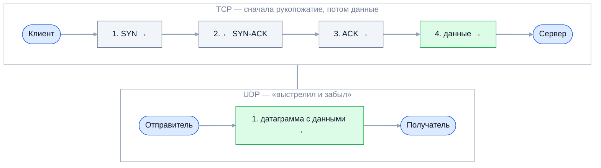
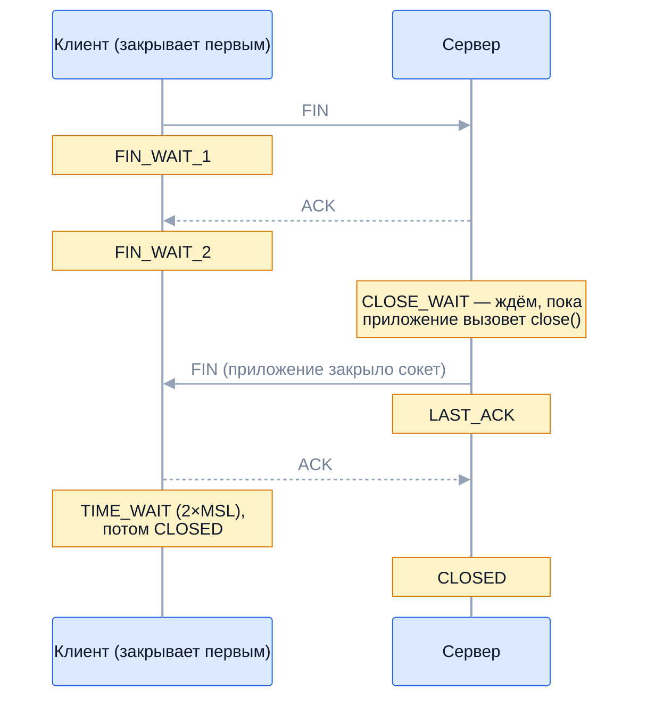
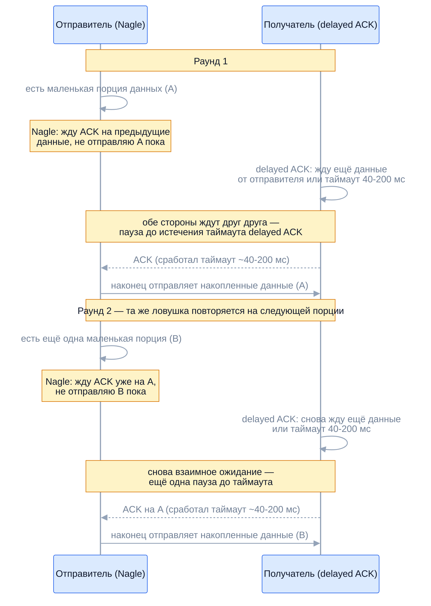

Четвёртый файл углублённого курса. IP (`03-network-layer-ip.md`) доставляет
пакет от машины к машине, но ничего не знает про приложения. Транспортный
уровень добавляет порты, чтобы доставить данные конкретному процессу, и решает,
нужна ли гарантия доставки.

Установление соединения (handshake) разобрано в `00-index.md`. Здесь — всё
остальное, что спрашивают на собеседовании и что всплывает в инцидентах: UDP,
закрытие TCP-соединения и состояния `TIME_WAIT` и `CLOSE_WAIT`, управление
потоком и перегрузкой, задержки из-за Nagle и delayed ACK, ICMP.

## Ключевые концепции

### UDP
#### Что такое UDP
UDP (User Datagram Protocol) — минималистичный транспортный протокол: он
добавляет к данным только порт отправителя, порт получателя, длину и
контрольную сумму — и всё, без какой-либо гарантии доставки, порядка или
контроля перегрузки. Датаграмма UDP либо доходит до получателя целиком, либо
теряется — приложению не сообщается ни то, ни другое, и разбираться с этим
(если нужно) обязано само приложение.

#### UDP vs TCP: время до первого байта данных
Главное практическое отличие от TCP — не в надёжности, а в том, сколько
времени проходит до отправки первого байта полезных данных:

У UDP данные уходят первым же пакетом — задержка до доставки равна одному
проходу по сети (one-way trip). У TCP тот же первый байт данных не может уйти
раньше четвёртого пакета — сначала нужно потратить полтора round-trip'а (SYN →
SYN-ACK → ACK) только на установление соединения. Именно эта разница в 1.5 RTT
"впустую" — а не сама по себе ненадёжность — и есть главная причина, почему
короткие запрос-ответ протоколы вроде DNS по умолчанию выбирают UDP: для
однократного маленького запроса цена рукопожатия оказывается сравнима с ценой
самого запроса или больше неё.

#### Когда выбирают UDP
Это не недостаток, а осознанный компромисс: у UDP почти нулевые накладные
расходы и нет задержки на установление соединения (в отличие от TCP с его
трёхсторонним рукопожатием), поэтому его выбирают там, где важнее скорость и
низкая задержка, чем гарантия каждого байта — потоковое видео и голос (потерянный
кадр за 20 мс лучше пропустить, чем ждать его пересылки), DNS-запросы (короткий
запрос-ответ, где проще повторить весь запрос, чем городить гарантию доставки),
онлайн-игры.

### TCP: надёжная доставка
#### Нумерация, подтверждения и повторная отправка
TCP гарантирует доставку и порядок байтов: каждый байт данных пронумерован
(sequence number), а получатель подтверждает (acknowledgment), до какого
номера он получил всё подряд. Пакеты, пришедшие не по порядку, получатель
держит в буфере, пока не придут недостающие, и приложению отдаёт уже
упорядоченный поток.

Если подтверждение не пришло за время RTO (retransmission timeout), сегмент
отправляется повторно; RTO вычисляется из измеренного RTT. Есть и быстрый
путь: три одинаковых ACK подряд (duplicate ACK) означают, что один сегмент
потерялся, а следующие дошли, и отправитель пересылает его сразу, не дожидаясь
таймаута (fast retransmit).

### TCP: закрытие соединения и состояния
#### Четырёхстороннее закрытие (FIN)
TCP-соединение двунаправленное, и каждая сторона закрывает своё направление
отдельно. Сторона, которая закончила отправку, шлёт `FIN`, вторая подтверждает
его `ACK` — после этого данные идут только в одну сторону (half-close). Когда
вторая сторона тоже закончила, она шлёт свой `FIN` и получает `ACK`.

Отсюда четыре сегмента вместо трёх, хотя на практике `ACK` и второй `FIN`
часто приходят одним пакетом. Сторона, инициировавшая закрытие, проходит
состояния `FIN_WAIT_1` → `FIN_WAIT_2` → `TIME_WAIT`, а вторая сторона —
`CLOSE_WAIT` → `LAST_ACK`.



#### TIME_WAIT
Сторона, закрывшая соединение первой, не освобождает его сразу, а держит в
состоянии `TIME_WAIT` в течение 2×MSL (максимальное время жизни сегмента в
сети; в Linux это фиксированные 60 секунд). Это нужно по двум причинам: чтобы
повторно отправить последний `ACK`, если он потерялся, и чтобы запоздавшие
сегменты старого соединения не попали в новое с теми же адресами и портами.

Проблема возникает у клиента, который открывает очень много коротких
соединений к одному и тому же серверу. Каждое закрытое соединение минуту
занимает пару «эфемерный порт — адрес сервера», и порты могут закончиться:
новые соединения начинают падать с ошибкой вида «cannot assign requested
address». Лечится это не настройками ядра, а переиспользованием соединений —
пулами и HTTP keep-alive.

#### CLOSE_WAIT — признак утечки
`CLOSE_WAIT` означает: собеседник уже закрыл соединение и прислал `FIN`, ядро
это подтвердило, но приложение на нашей стороне ещё не вызвало `close()`. В
отличие от `TIME_WAIT`, ядро само из этого состояния не выйдет — сокет висит,
пока приложение его не закроет.

Поэтому много соединений в `CLOSE_WAIT` — почти всегда баг в коде: соединение
не вернули в пул, не закрыли поток ответа, забыли try-with-resources. Сокеты
продолжают занимать файловые дескрипторы, и в итоге сервис падает с `Too many
open files`.

Соединение в `CLOSE_WAIT` — реальный запуск на JDK 21, Windows:
```java
ServerSocket server = new ServerSocket(18080);
Socket client = new Socket("127.0.0.1", 18080);
Socket accepted = server.accept();   // серверная сторона соединения
client.close();                      // клиент закрывает: FIN -> сервер
// сервер «забыл» закрыть accepted
Thread.sleep(500);
// печатаем строки netstat -an -p TCP с портом 18080
```
```
  TCP    0.0.0.0:18080          0.0.0.0:0              LISTENING
  TCP    127.0.0.1:18080        127.0.0.1:62717        CLOSE_WAIT
  TCP    127.0.0.1:62717        127.0.0.1:18080        FIN_WAIT_2
```
Клиент закрыл соединение и ждёт в `FIN_WAIT_2` второго `FIN`, а серверная
сторона застряла в `CLOSE_WAIT`: ядро получило `FIN`, но приложение не вызвало
`close()` у `accepted`. Пока это не произойдёт, сокет и его дескриптор так и
будут висеть. Именно так выглядит утечка соединений в проде, только строк —
тысячи.

#### RST — аварийный сброс
Вместо штатного закрытия соединение можно сбросить сегментом `RST`. Его
шлёт ядро, если пришёл сегмент на порт, где никто не слушает (отсюда
`Connection refused`), или если приложение закрыло сокет, не дочитав входящие
данные. На стороне Java это выглядит как `Connection reset` при чтении или
записи — собеседник оборвал соединение, а не закрыл его штатно.

### Управление потоком и перегрузкой
#### Flow control: окно получателя
Управление потоком защищает получателя. В каждом ACK получатель сообщает
размер окна (receive window) — сколько байт он ещё готов принять в свой
буфер. Отправитель не может иметь в полёте неподтверждённых данных больше этого
окна, поэтому медленный получатель, который не успевает читать из сокета,
автоматически притормаживает быстрого отправителя.

Если приложение совсем перестало читать, окно падает до нуля, и отправитель
останавливается. На стороне отправителя это проявляется как заблокированный
`write()` — частый эффект при «зависшем» потребителе.

#### Congestion control: окно перегрузки
Управление перегрузкой защищает сеть между отправителем и получателем.
Отправитель ведёт собственное окно перегрузки (congestion window, cwnd) и
одновременно в полёте держит не больше минимума из cwnd и окна получателя.
Сигналом перегрузки служит потеря пакетов (а в BBR — рост задержки).

Классическая схема такая. Новое соединение начинает с маленького окна и
удваивает его каждый RTT (slow start) — рост на самом деле экспоненциальный,
название историческое. Достигнув порога, окно растёт уже линейно, а при
потере пакета резко уменьшается (AIMD — additive increase, multiplicative
decrease). В Linux по умолчанию используется алгоритм CUBIC, в части
инфраструктуры — BBR от Google.

Практическое следствие для backend: новое TCP-соединение «разгоняется» не
сразу, первые килобайты идут медленнее, чем позволяет канал. Это ещё одна
причина переиспользовать соединения через пулы, а не открывать новое на каждый
запрос.

Внутренние параметры TCP-соединения в Linux через `ss -i` (пример вывода):
```
$ ss -tin
State      Recv-Q Send-Q   Local Address:Port    Peer Address:Port
ESTAB      0      0        10.0.0.5:52344        93.184.216.34:443
	 cubic wscale:7,7 rto:204 rtt:10.5/2.1 mss:1418 ...
```
`cubic` — используемый алгоритм управления перегрузкой, `rtt:10.5/2.1` —
сглаженный RTT и его разброс в миллисекундах, `rto:204` — текущий таймаут
повторной отправки. `mss:1418` — согласованный при handshake размер сегмента
(меньше 1460 — признак туннеля или PPPoE по пути), `wscale:7,7` — множитель
window scaling обеих сторон, то есть окно расширено сверх 65535 байт. Опцию
`TCP_NODELAY` `ss` не показывает — в Java её проверяют через
`Socket.getTcpNoDelay()`.

#### Head-of-line blocking
TCP отдаёт приложению байты строго по порядку. Если один сегмент потерялся,
все следующие, уже пришедшие, ждут в буфере его повторной отправки. Это
называется head-of-line blocking на транспортном уровне.

HTTP/2 мультиплексирует много запросов в одном TCP-соединении, поэтому
потеря одного пакета задерживает сразу все запросы. QUIC (основа HTTP/3)
решает это, реализуя независимые потоки поверх UDP: потеря пакета одного
потока не блокирует остальные.

### Тонкости работы TCP
TCP не просто "гарантированно доставляет байты" — у него есть ряд оптимизаций и
особенностей поведения, которые на практике сильно влияют на задержку и которые
любят спрашивать на собеседовании отдельно от базового handshake.

#### Алгоритм Найгла (Nagle's algorithm)
Отправка каждого небольшого пакета
данных отдельным TCP-сегментом расточительна — заголовок TCP+IP (около 40 байт)
может оказаться больше самих данных. Алгоритм Найгла накапливает небольшие
порции данных и отправляет их одним сегментом, если ждёт подтверждения на уже
отправленные данные, — это уменьшает число мелких пакетов в сети, но добавляет
задержку, поэтому в задачах, чувствительных к задержке (например, интерактивные
протоколы вроде SSH или realtime-игры), его часто отключают опцией сокета
`TCP_NODELAY`.

#### Отложенное подтверждение (delayed ACK)
Симметричная оптимизация со стороны
получателя: вместо того, чтобы подтверждать каждый полученный сегмент немедленно
отдельным ACK-пакетом, получатель может немного подождать (обычно 40-200 мс) — в
надежде либо получить ещё данные и подтвердить сразу несколько сегментов одним
ACK, либо "приклеить" ACK к своему собственному ответному пакету данных
(piggybacking), сэкономив отдельный пакет.

#### Nagle + delayed ACK: взаимная блокировка
Проблема в том, что Nagle и delayed ACK, включённые одновременно на двух концах
соединения, могут "заклинить" друг друга: отправитель ждёт ACK, чтобы отправить
накопленные данные, а получатель откладывает ACK, ожидая либо новых данных, либо
таймаута — в результате пауза может доходить до сотен миллисечунд на каждый такой
обмен. Именно поэтому для задержко-чувствительных соединений принято отключать
хотя бы Nagle на стороне отправителя.


Пауза не случайна: отправитель молчит в ожидании ACK, а получатель — в
ожидании новых данных или своего таймаута. Задержка возникает на каждой
мелкой порции данных, а не только на первой.

Если приложение шлёт поток мелких сообщений, например посимвольный ввод в
интерактивном протоколе, пауза в 40–200 мс повторяется на каждом сообщении. В
сумме это заметная и стабильно воспроизводимая задержка, поэтому для таких
сценариев Nagle отключают через `TCP_NODELAY` заранее.

#### MSS и MTU
MSS (Maximum Segment Size) — максимальный размер данных TCP,
который помещается в один сегмент без фрагментации на IP-уровне, — вычисляется
из MTU канала (`03-network-layer-ip.md`) минус размер заголовков TCP и IP
(обычно MSS = 1460 байт при типичном Ethernet MTU в 1500 байт). Значение MSS
стороны согласуют между собой прямо во время трёхстороннего рукопожатия — каждая
сторона сообщает своё максимальное значение, и используется меньшее из двух, а
несовпадение MSS и реального MTU где-то по пути — частая причина проблем с
фрагментацией, которые решает PMTUD (`05-advanced-topics.md`).

#### Keep-alive
TCP-соединение может оставаться открытым, но полностью неактивным сколь
угодно долго. Если собеседник внезапно пропал — потерял питание, исчез за
файрволом, который выбросил запись о соединении, — ни одна сторона об этом не
узнает, пока не попробует что-то отправить.

Механизм TCP keep-alive периодически отправляет пустой пробный сегмент и, если
ответа нет после нескольких попыток, закрывает соединение. Он выключен по
умолчанию (в Java — `Socket.setKeepAlive(true)`), а первая проверка в Linux
по умолчанию происходит только через 2 часа простоя, поэтому для коротких
таймаутов его настраивают или полагаются на проверки уровня приложения.

Не стоит путать его с HTTP keep-alive — это другое понятие с похожим
названием. HTTP keep-alive (persistent connections) означает переиспользование
одного TCP-соединения для нескольких HTTP-запросов вместо открытия нового на
каждый запрос; в HTTP/1.1 оно включено по умолчанию.

#### Управление окном (window scaling)
Размер окна (receive window) — сколько
неподтверждённых байт отправитель может передать, не дожидаясь ACK, — изначально
кодировался 16 битами в заголовке TCP, что ограничивало максимум 65535 байт. Для
высокоскоростных или высоко-задержанных каналов (спутник, трансконтинентальные
линии) этого мало — там пропускная способность канала простаивает, пока
отправитель ждёт ACK на уже переданные 64 КБ. Опция window scaling (согласуется
тоже во время handshake) позволяет эффективно расширить окно в тысячи раз,
устраняя это ограничение.

### ICMP
#### Что такое ICMP
ICMP (Internet Control Message Protocol) — не транспортный протокол в привычном
смысле (у него нет портов и концепции "соединения"), а служебный протокол
сетевого уровня, который используется для диагностики и сообщений об ошибках
между узлами и маршрутизаторами. Именно ICMP лежит в основе двух самых
привычных сетевых утилит.

#### ping, traceroute и другие ICMP-сообщения
`ping` отправляет ICMP Echo Request и ждёт Echo Reply: если ответ пришёл, узел
доступен, и можно измерить время в пути (RTT). `traceroute` построен на
сообщении «Time Exceeded», которое маршрутизатор отправляет, когда TTL пакета
достигает нуля; механизм с растущим TTL разобран в `03-network-layer-ip.md`.

Ещё два важных сообщения — «Destination Unreachable», когда пакет не может
быть доставлен (порт закрыт, маршрута нет), и «Fragmentation Needed», на
котором работает PMTUD (`05-advanced-topics.md`). Файрволы, которые
блокируют весь ICMP «ради безопасности», ломают именно эти механизмы.

Проверка доступности узла и приблизительной задержки через `ping`:
```
$ ping -c 3 example.com
PING example.com (93.184.216.34): 56 data bytes
64 bytes from 93.184.216.34: icmp_seq=0 ttl=56 time=11.234 ms
64 bytes from 93.184.216.34: icmp_seq=1 ttl=56 time=10.987 ms
64 bytes from 93.184.216.34: icmp_seq=2 ttl=56 time=11.102 ms
```
Каждая строка — это один цикл ICMP Echo Request/Reply. `time` — измеренный
RTT (round-trip time) для этого конкретного пакета, `ttl=56` — значение TTL,
с которым ответ дошёл обратно (см. разбор TTL и того, как на нём построен
`traceroute`, в `03-network-layer-ip.md`); стабильные
близкие значения времени говорят о ровном, не перегруженном канале.

## Частые вопросы на собеседовании
**Q: Когда стоит выбрать UDP вместо TCP, если TCP и так гарантирует доставку?**
A: Когда важнее низкая и предсказуемая задержка, чем гарантия каждого байта —
например, в потоковом видео или голосовой связи потерянный за 20 мс кадр лучше
пропустить, чем ждать повторной пересылки и тормозить весь поток. Также UDP
предпочтителен там, где протокол сам реализует свою логику надёжности проще,
чем общая TCP-модель (например, короткий запрос-ответ в DNS).

**Q: Что такое алгоритм Найгла и когда его стоит отключать?**
A: Это оптимизация TCP, которая накапливает небольшие порции данных в один
сегмент вместо отправки каждой отдельным пакетом, снижая накладные расходы на
заголовки — ценой добавленной задержки. Его стоит отключать (`TCP_NODELAY`) в
задержко-чувствительных сценариях с частой отправкой маленьких порций данных —
интерактивные протоколы, realtime-игры, — где важнее быстрая доставка каждого
сообщения, чем экономия на заголовках.

**Q: Что такое TIME_WAIT и почему соединений в нём бывает много?**
A: Это состояние стороны, закрывшей соединение первой: она ещё 2×MSL (в Linux
60 секунд) держит запись о соединении, чтобы повторить потерянный последний
ACK и не дать запоздавшим сегментам попасть в новое соединение. Много
`TIME_WAIT` — нормальное следствие частого открытия коротких соединений. Если
из-за этого заканчиваются эфемерные порты, правильное решение —
переиспользовать соединения через пул и keep-alive.

**Q: Много соединений в CLOSE_WAIT — что это значит?**
A: Собеседник закрыл соединение, а наше приложение — нет: ядро получило `FIN`,
но `close()` на сокете так и не вызван. Само это состояние не проходит, и
сокеты копятся, расходуя файловые дескрипторы. Это почти всегда баг: не
закрытый ответ HTTP-клиента, соединение, не возвращённое в пул, отсутствие
try-with-resources.

**Q: Чем flow control отличается от congestion control?**
A: Flow control защищает получателя: он объявляет окно — сколько байт ещё
готов принять, и отправитель не может его превысить. Congestion control
защищает сеть: отправитель сам оценивает допустимое окно по потерям пакетов
или росту задержки (slow start, AIMD, CUBIC, BBR). В полёте одновременно
может быть не больше минимума из этих двух окон.

**Q: Чем ICMP отличается от TCP и UDP?**
A: TCP и UDP — транспортные протоколы, которые доставляют данные конкретным
приложениям через порты. ICMP — служебный протокол сетевого уровня без портов и
концепции соединения, предназначенный для диагностики (`ping`) и сообщений об
ошибках доставки между узлами и маршрутизаторами (`traceroute`,
"Destination Unreachable", "Fragmentation Needed").

## Ловушки и частые ошибки
#### UDP не значит «часто теряет данные»
Частая ошибка — считать, что UDP «ненадёжен» в смысле «часто теряет данные».
В нормальной сети пакеты UDP теряются так же редко, как и IP-пакеты под ним.
Разница с TCP в том, что TCP потери обнаруживает и восстанавливает, а UDP —
нет.

Есть одна оговорка: у UDP нет управления потоком. Если получатель не успевает
читать, его буфер сокета переполняется, и новые датаграммы молча
отбрасываются. Поэтому под нагрузкой UDP теряет данные чаще, чем можно
ожидать по качеству сети, — например, при отправке метрик или логов.

#### «Соединение закрыто, значит ресурсы освобождены»
Закрытое соединение ещё некоторое время живёт в ядре: инициатор закрытия
держит его в `TIME_WAIT`, а сторона, не вызвавшая `close()`, — в `CLOSE_WAIT`
неограниченно долго. Оба состояния занимают ресурсы: первое — эфемерные порты,
второе — файловые дескрипторы. Проверять это стоит через `ss -tan` или
`netstat -an`, а не по логам приложения.

#### Nagle/delayed ACK — не баг, а компромисс
Другое заблуждение — думать, что Nagle и delayed ACK — это баг или недоработка
TCP. Обе оптимизации по отдельности снижают накладные расходы сети и вполне
разумны; проблема возникает только в их сочетании на медленных или редких
обменах мелкими пакетами, и решается она осознанным отключением одной из сторон
(`TCP_NODELAY`), а не тем, что "TCP плохо спроектирован".

## Связанные темы
- [Основы сетей — обзор](00-index.md) — TCP handshake, таймауты сокетов в
  Java, HTTP поверх TCP.
- [Как устроен компьютер и ОС](../01-os-basics.md) — файловые дескрипторы,
  которые расходует каждое соединение, включая висящие в `CLOSE_WAIT`.
- [Сетевой уровень и IP](03-network-layer-ip.md) — MTU и фрагментация, из
  которых выводится MSS.
- [VLAN, VPN, DHCP и другие продвинутые темы](05-advanced-topics.md) — PMTUD,
  который решает несовпадение MSS/MTU по пути следования пакета.

## Источники
- RFC 9293 — Transmission Control Protocol (заменил RFC 793)
- RFC 768 — User Datagram Protocol
- RFC 792 — Internet Control Message Protocol
- RFC 896 — Congestion Control in IP/TCP Internetworks (алгоритм Найгла)
- RFC 5681 — TCP Congestion Control (slow start, fast retransmit)
- RFC 7323 — TCP Extensions for High Performance (window scaling, заменил RFC 1323)
- RFC 9000 — QUIC
