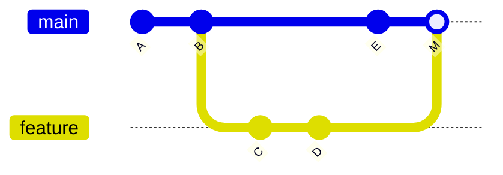
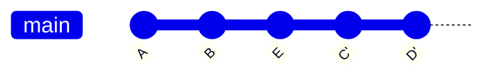
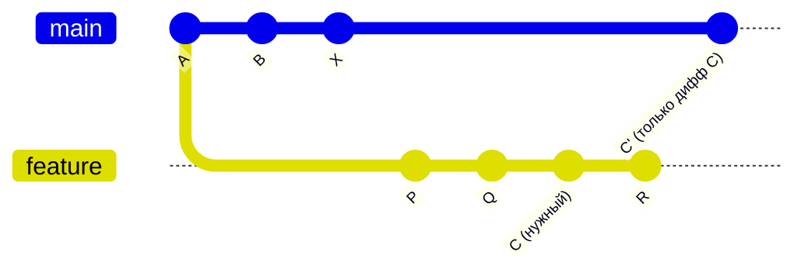

Команды знают все — на senior-собеседовании спрашивают модель: что реально
хранит коммит, чем merge отличается от rebase, что делают разные режимы
reset. И умение выйти из нештатной ситуации: потерянный коммит, конфликт
слияния, поиск коммита, который сломал сборку.

## Ключевые концепции

### Модель данных

#### Коммит — это снимок, а не diff
Многие представляют коммит как diff — набор изменений относительно предыдущей
версии. На самом деле коммит — это снимок (snapshot) всего дерева проекта на
момент коммита плюс метаданные: автор, время, сообщение и ссылка на
родительский коммит. Diff, который показывает `git diff` или `git show`,
вычисляется на лету сравнением двух снимков.

Хранится это экономно. Git — content-addressable хранилище: каждый объект
(содержимое файла — blob, каталог — tree, коммит — commit) адресуется хешем
своего содержимого, поэтому неизменившиеся файлы между коммитами просто
переиспользуются. А при упаковке объектов в pack-файлы git дополнительно
сжимает похожие объекты дельтами — но это оптимизация хранения, а не модель.

#### История — граф, ветка — указатель
У коммита есть указатель на родителя, у merge-коммита — на двух и более.
Поэтому история — направленный ациклический граф (DAG), а не прямая линия. Хеш
коммита вычисляется из всего его содержимого, включая хеш родителя, поэтому
изменить коммит в середине истории, не изменив хеши всех потомков, нельзя.

Ветка в git — просто подвижный указатель на коммит, файл с одним хешем. Новый
коммит сдвигает указатель текущей ветки вперёд, а `HEAD` указывает на текущую
ветку (или напрямую на коммит — это состояние detached HEAD). Поэтому создание
ветки бесплатно и мгновенно.

### Базовые операции

#### Три области: рабочая копия, индекс, репозиторий
Изменения в git проходят через три области. Рабочая копия (working tree) —
файлы на диске, которые вы редактируете. Индекс (staging area) — снимок того,
что попадёт в следующий коммит; туда изменения кладёт `git add`. Репозиторий —
уже зафиксированные коммиты.

Индекс позволяет закоммитить только часть изменений, а `git status` показывает
расхождения между всеми тремя областями. Отсюда и смысл команд: `add` — из
рабочей копии в индекс, `commit` — из индекса в репозиторий, `restore` —
откатить файл в рабочей копии или индексе.

#### clone, fetch, pull, push
`clone` копирует удалённый репозиторий целиком вместе с историей. Ветки
удалённого репозитория видны локально как remote-tracking ветки
(`origin/main`) — это снимок того, где были ветки на сервере в момент последней
синхронизации.

`fetch` скачивает новые коммиты и обновляет только remote-tracking ветки, не
трогая ваши локальные ветки и рабочую копию. `pull` — это `fetch` плюс слияние
`origin/main` в текущую ветку: `merge` по умолчанию или `rebase` с
`--rebase`. `push` отправляет локальные коммиты на сервер и отклоняется, если
на сервере есть коммиты, которых нет у вас.

#### log, diff, blame
`log` показывает историю коммитов (`--oneline --graph` — компактно и с
ветвлением), `diff` — разницу между двумя состояниями: рабочей копией,
индексом, коммитами. `blame` показывает, в каком коммите последний раз
менялась каждая строка файла — с него начинают, когда нужно понять, кто и
зачем написал конкретный код.

### Ветвление и слияние

#### Fast-forward и merge-коммит
Если целевая ветка не ушла вперёд с момента ответвления, `merge` просто
передвигает её указатель на последний коммит вливаемой ветки — это
fast-forward, новых коммитов не создаётся. Если обе ветки получили новые
коммиты, `merge` создаёт merge-коммит с двумя родителями.

Многие команды принудительно создают merge-коммит даже там, где возможен
fast-forward (`--no-ff`), чтобы в истории было видно, какие коммиты пришли из
одной ветки. Другой популярный вариант — squash merge в pull request: все
коммиты ветки схлопываются в один коммит в `main`.

#### merge vs rebase
Слить расходящиеся ветки можно двумя способами, и разница — в итоговой
истории. `merge` создаёт merge-коммит с двумя родителями и честно сохраняет
фактическую историю ветвления.

`rebase` переигрывает коммиты текущей ветки поверх новой базы: для каждого
создаётся новый коммит с тем же изменением, но новым родителем и, значит,
новым хешем. История становится линейной, но фактически переписанной. Поэтому
rebase уже опубликованной ветки, которую стянули другие, ломает им историю.

До слияния обе стратегии стартуют с одной картины: `feature` с коммитами C и
D растёт от B, а в `main` независимо появился E. После `merge` оба пути видны,
и есть merge-коммит M:


После `rebase` коммиты C и D переиграны как C' и D' поверх E — история
линейна. Штрих означает новые коммиты с новыми хешами: старые C и D остались
в базе объектов, но на них больше не указывает ни одна ветка.


#### Конфликты слияния
Конфликт возникает, когда обе ветки изменили одно и то же место файла, и git
не может решить, какую версию оставить. Он помечает спорный фрагмент
маркерами `<<<<<<<`, `=======`, `>>>>>>>` и останавливает операцию до ручного
решения.

При `merge` конфликт решается один раз, и результат фиксируется в
merge-коммите. При `rebase` коммиты переигрываются по одному, поэтому
конфликт может возникать на каждом из них: после правки нужно `git add` и
`git rebase --continue`, а прервать всё — `git rebase --abort`.

#### Стратегии ветвления
Git flow использует долгоживущие ветки `develop`, `release`, `hotfix` и
`feature`. Процесс тяжеловесный, но даёт контроль над тем, что попадает в
релиз, и подходит для продуктов с версионными релизами.

Trunk-based development держит один основной ствол и короткоживущие ветки
(часы или дни), которые часто вливаются в `main`. Незаконченная
функциональность прячется за feature flags. Это стандарт для команд с
непрерывной поставкой: меньше конфликтов и нет долгих интеграций. GitHub flow —
упрощённый вариант: ветка под задачу, pull request, ревью, слияние в `main` и
деплой.

### Продвинутые операции

#### cherry-pick
`cherry-pick` берёт один коммит из другой ветки и применяет его изменение —
разницу между ним и его родителем — поверх текущей ветки. Получается новый
коммит с тем же изменением в файлах, но другим родителем и, значит, другим
хешем. Удобно, когда нужен один конкретный фикс, например перенос исправления
в релизную ветку.


В `main` попадает только изменение коммита C. Коммиты P, Q и R туда не
переносятся — ни явно, ни неявно.

#### revert
`revert` создаёт новый коммит, который отменяет изменения указанного коммита.
История только растёт вперёд, ничего не переписывается, поэтому это
единственный безопасный способ отменить изменение в уже опубликованной
ветке. Откатить merge-коммит тоже можно, но нужно указать, какого родителя
считать основным (`git revert -m 1 <merge>`).

#### reset и его режимы
`reset` передвигает указатель текущей ветки на другой коммит, а режим
определяет, что происходит с индексом и рабочей копией. `--soft` двигает
только ветку: изменения «отменённых» коммитов остаются в индексе, готовые к
новому коммиту. `--mixed` (режим по умолчанию) дополнительно сбрасывает
индекс: изменения остаются только в рабочей копии.

`--hard` сбрасывает всё: и индекс, и рабочую копию приводит к состоянию
целевого коммита. Незакоммиченные изменения при этом теряются безвозвратно, а
отброшенные коммиты можно вернуть только через reflog. Типичное применение
`--soft` — переписать последние коммиты в один: `git reset --soft HEAD~3` и
новый `git commit`.

#### Interactive rebase
`git rebase -i HEAD~N` открывает список последних N коммитов, где для каждого
можно выбрать действие. `pick` — оставить как есть, `reword` — изменить
сообщение, `squash` — склеить с предыдущим, объединив сообщения, `fixup` —
склеить, отбросив сообщение, `drop` — удалить. Строки можно переставлять,
меняя порядок коммитов.

Это главный инструмент наведения порядка перед pull request: склеить «fix
typo» с основным коммитом, разбить историю на логичные шаги. Правило то же,
что и для любого rebase: переписывать только свою, ещё не опубликованную
историю. Для типового случая есть сокращение: `git commit --fixup <хеш>` и
затем `git rebase -i --autosquash`.

#### stash
`stash` откладывает незакоммиченные изменения рабочей копии и индекса в
отдельный стек и возвращает рабочую копию к состоянию `HEAD`. Удобно, когда
нужно срочно переключиться на другую ветку, не коммитя черновик. Вернуть
изменения — `git stash pop`; новые неотслеживаемые файлы по умолчанию не
откладываются, для них нужен `-u`.

#### reflog
`reflog` — локальный журнал перемещений `HEAD` и веток на этой машине. Он не
является частью истории и никуда не пушится. Именно он спасает после
ошибочного `reset --hard`, неудачного rebase или удалённой ветки: коммит,
пропавший из `log`, ещё лежит в базе объектов, а reflog показывает его хеш.

Записи reflog по умолчанию хранятся 90 дней, а недостижимые коммиты удаляет
сборщик мусора (`git gc`) не раньше чем через 30 дней. Так что у потерянного
локального коммита обычно есть недели на спасение.

#### bisect
`git bisect` ищет коммит, который внёс ошибку, бинарным поиском по истории.
Вы указываете «плохой» коммит (где ошибка есть) и «хороший» (где её нет), git
переключается на середину диапазона и спрашивает, хороший ли он. Среди тысячи
коммитов виновника можно найти примерно за 10 шагов.

Проверку можно автоматизировать: `git bisect run <команда>` сам проходит все
шаги, считая коммит хорошим, если команда завершилась с кодом 0. Обычно это
запуск конкретного теста, который воспроизводит баг.

#### Принудительный push
После rebase или amend локальная ветка расходится с серверной, и обычный
`push` отклоняется. `git push --force` перезапишет серверную ветку, уничтожив
коммиты, которые за это время успел запушить кто-то другой.

`--force-with-lease` безопаснее: он перезаписывает ветку, только если на
сервере она всё ещё указывает туда, где вы видели её при последнем fetch.
Если кто-то успел добавить коммиты, push будет отклонён.

## Примеры

Три области в `git status --short` (левая колонка — индекс, правая — рабочая
копия):
```
$ echo "v2" > app.txt && git status --short
 M app.txt
$ git add app.txt && echo "v3" > app.txt && git status --short
MM app.txt
```
После правки файл изменён только в рабочей копии. После `add` версия `v2`
ушла в индекс, а новая правка `v3` — снова только в рабочей копии. Поэтому
обе колонки показывают `M`: следующий коммит возьмёт `v2`, а не `v3`.

Режимы `reset` на коммите, добавившем файл `a.txt`:
```
$ git reset --soft HEAD~1 && git status --short
A  a.txt
$ git reset --mixed HEAD && git status --short
?? a.txt
$ git commit ... && git reset --hard HEAD~1
HEAD is now at 3f8956f v3
$ ls
app.txt
```
После `--soft` файл остался в индексе как добавленный. После `--mixed` он
выпал из индекса и стал неотслеживаемым. После `--hard` его нет даже на диске.

Восстановление через reflog:
```
$ git reflog -5
3f8956f HEAD@{0}: reset: moving to HEAD~1
4c46b9f HEAD@{1}: commit: add a
3f8956f HEAD@{2}: reset: moving to HEAD
3f8956f HEAD@{3}: reset: moving to HEAD~1
4c46b9f HEAD@{4}: commit: add a
$ git reset --hard 4c46b9f
$ git log --oneline -1
4c46b9f add a
```
`HEAD@{1}` — состояние до последнего `reset --hard`, и там виден «потерянный»
коммит `add a`. Сброс на его хеш возвращает и коммит, и файл.

Склейка коммитов через interactive rebase (`pick`, `fixup`, `fixup`):
```
$ git log --oneline -4
1ec8d75 fix another typo
9df30d4 fix typo
fb9ee3d feature: add f
4c46b9f add a
$ git rebase -i HEAD~3      # во 2-й и 3-й строке pick заменён на fixup
$ git log --oneline -3
981675d feature: add f
4c46b9f add a
3f8956f v3
```
Три коммита стали одним с сообщением первого. У него новый хеш (`981675d`
вместо `fb9ee3d`): это новый коммит, а не изменённый старый.

Fast-forward и `--no-ff`:
```
$ git merge --ff-only topic
Updating eebab21..5ee41dd
$ git merge --no-ff -m "Merge branch 'topic2'" topic2
$ git log --oneline --graph -4
*   3c5e1cd Merge branch 'topic2'
|\
| * 761ff4a topic2 work
|/
* 5ee41dd topic work
```
Первое слияние просто передвинуло `main` на коммит `topic work` — merge-коммита
нет. Второе создало merge-коммит, хотя fast-forward был возможен, и в графе
видно, что `topic2 work` пришёл из отдельной ветки.

`fetch` не трогает локальную ветку:
```
$ git fetch
$ git status -sb
## main...origin/main [behind 1]
$ git log --oneline -1 && git log --oneline -1 origin/main
3c5e1cd Merge branch 'topic2'
79134cb remote change
$ git merge --ff-only origin/main
$ git log --oneline -1
79134cb remote change
```
После `fetch` новый коммит есть только в `origin/main`, а локальный `main`
отстаёт на один коммит. Только слияние (то, что `pull` делает автоматически)
переносит его в локальную ветку.

Поиск сломавшего коммита среди восьми (в шагах 6–8 файл «сломан»):
```
$ git bisect start <step 8> <step 1>
Bisecting: 3 revisions left to test after this (roughly 2 steps)
[9d3162d...] step 4
$ git bisect run sh -c 'grep -q "^ok" calc.txt'
running 'sh' '-c' 'grep -q "^ok" calc.txt'
Bisecting: 1 revision left to test after this (roughly 1 step)
[75581f3...] step 6
running 'sh' '-c' 'grep -q "^ok" calc.txt'
Bisecting: 0 revisions left to test after this (roughly 0 steps)
[0999fda...] step 5
running 'sh' '-c' 'grep -q "^ok" calc.txt'
75581f3240ca574ee46d3a3fdca8512f67a002ed is the first 'bad' commit
```
Git проверил всего три коммита из шести промежуточных — середину, потом
середину половины — и нашёл `step 6`, где проверка впервые начала падать.
Полезная деталь: первая версия этого примера проверяла `grep -q ok` и нашла не
тот коммит, потому что слово `broken` тоже содержит `ok`. Bisect надёжен ровно
настолько, насколько точна проверка.

## Частые вопросы на собеседовании

**Q: Чем rebase отличается от merge и когда что уместно?**
A: `merge` сохраняет реальную историю через merge-коммит с двумя родителями и
безопасен для любой ветки. `rebase` переигрывает коммиты поверх новой базы,
создавая новые коммиты с новыми хешами, и даёт линейную историю. Rebase
уместен для своей неопубликованной ветки — подтянуть свежий `main` или
навести порядок перед pull request. Для общих веток — только merge.

**Q: Чем fetch отличается от pull?**
A: `fetch` скачивает новые коммиты и обновляет только remote-tracking ветки
вроде `origin/main`, не трогая локальные ветки и рабочую копию. `pull` — это
`fetch` плюс слияние в текущую ветку (merge по умолчанию или rebase с
`--rebase`). `fetch` безопасен всегда, и после него можно спокойно посмотреть,
что пришло, прежде чем сливать.

**Q: Чем отличаются reset --soft, --mixed и --hard?**
A: Все три двигают указатель ветки. `--soft` оставляет изменения в индексе,
`--mixed` — только в рабочей копии, `--hard` выбрасывает их полностью, вместе
с незакоммиченной работой. `--soft` и `--mixed` безопасны и используются,
чтобы переписать последние коммиты, `--hard` — когда изменения точно не нужны.

**Q: Как восстановить коммит после `git reset --hard`?**
A: Через `git reflog`: там видно, куда указывал `HEAD` до reset, и можно
вернуться командой `git reset --hard <хеш>` или создать ветку на этот коммит.
Это работает, пока сборщик мусора не удалил недостижимые объекты — по
умолчанию не меньше 30 дней. Незакоммиченные изменения так не вернуть: в
reflog есть только коммиты.

**Q: Как найти коммит, который сломал функциональность?**
A: `git bisect`: отмечаем заведомо хороший и плохой коммиты, и git бинарным
поиском переключается по истории, пока не найдёт первый плохой. Лучше всего
автоматизировать через `git bisect run` с тестом, который воспроизводит
проблему, — тогда поиск идёт без участия человека.

**Q: Как отменить изменение, которое уже в общей ветке?**
A: Через `git revert`: он создаёт новый коммит, отменяющий изменения
указанного, и не переписывает историю, поэтому у коллег ничего не ломается.
`reset` и rebase для опубликованной истории не подходят — они меняют хеши
коммитов, которые другие уже стянули.

## Ловушки и частые ошибки

#### «Коммит хранит diff»
Коммит — снимок всего дерева, а diff вычисляется при показе. Отсюда, например,
понятно, почему `cherry-pick` и rebase создают новые коммиты: тот же diff
поверх другого родителя даёт другой снимок и другой хеш.

#### «rebase теряет коммиты»
Rebase ничего не удаляет: старые коммиты остаются в базе объектов, просто на
них больше не указывает ветка, и в обычном `log` их не видно. Пока жив reflog,
к ним можно вернуться. «Потерянными» они кажутся только тому, кто не знает
про reflog.

#### cherry-pick не подтягивает предшествующие коммиты
При `cherry-pick` коммита C из середины чужой ветки изменения стоящих перед
ним коммитов P и Q в текущую ветку не попадают. Если изменение C зависит от
них — например, правит строку, которую добавил Q, — `cherry-pick` не
«дотянет» недостающий контекст, а выдаст конфликт, который придётся решать
вручную.

#### push --force в общую ветку
Обычный `--force` перезаписывает ветку на сервере, уничтожая коммиты, которые
кто-то успел запушить после вашего последнего fetch. Если переписывать
опубликованную ветку действительно нужно, используют `--force-with-lease`, а
`main` и релизные ветки защищают от force push в настройках репозитория.

#### Работа в detached HEAD
После `git checkout <хеш>` `HEAD` указывает на коммит, а не на ветку. Новые
коммиты в этом состоянии ни на какую ветку не попадают, и при переключении
обратно их легко потерять. Если нужно продолжить работу с этого места,
сначала создают ветку: `git switch -c fix-from-old`.

## Связанные темы
- CI/CD (раздел 31) — как ветки, pull request и проверки складываются в пайплайн поставки.
- Практики командной разработки (раздел 35) — code review, стратегии ветвления, trunk-based development.

## Источники
- Scott Chacon, Ben Straub, [«Pro Git»](https://git-scm.com/book/ru/v2) — бесплатная книга, есть русский перевод (глава 10 — внутреннее устройство).
- [Документация git](https://git-scm.com/docs): `git-reset`, `git-rebase`, `git-reflog`, `git-bisect`.
- [Trunk Based Development](https://trunkbaseddevelopment.com/).
