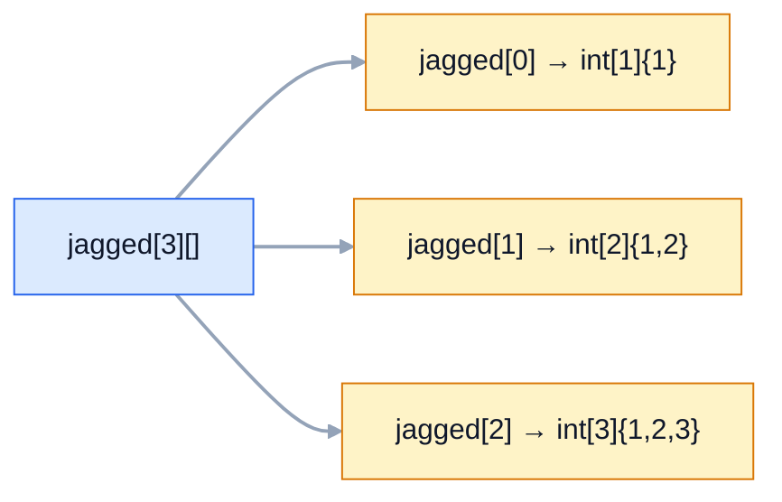

Самая простая структура данных в Java, но с деталями, которые регулярно
всплывают на собеседовании. Массив — полноценный объект в куче, а не
низкоуровневый блок памяти, как в C. Он ковариантен, в отличие от generics, и
сортируется разными алгоритмами для примитивов и объектов.

## Ключевые концепции

### Устройство

#### Массив как объект и фиксированная длина
Массив в Java — объект: он создаётся в куче через `new` (даже массив
примитивов), имеет заголовок объекта и одно доступное поле `length` — именно
поле, а не метод, как `size()` у коллекций. Класс массива создаётся JVM
автоматически (`int[].class`, `String[].class`) и наследует `Object`.

Длина фиксируется при создании и больше не меняется. «Увеличение» массива
всегда означает создание нового и копирование элементов — так работает
`ArrayList` (раздел 5), который хранит данные в массиве и пересоздаёт его при
заполнении. Отрицательная длина даёт `NegativeArraySizeException`, а
максимальная ограничена `Integer.MAX_VALUE` и размером кучи.

```java
int[] arr = {1, 2, 3};
System.out.println("length=" + arr.length);
int[] grown = Arrays.copyOf(arr, arr.length + 1);
grown[3] = 4;
System.out.println("arr=" + Arrays.toString(arr) + " (не изменился)");
System.out.println("grown=" + Arrays.toString(grown));
int[] neg = new int[-1];                // перехвачено
```
```
length=3
arr=[1, 2, 3] (не изменился)
grown=[1, 2, 3, 4]
new int[-1] -> java.lang.NegativeArraySizeException: -1
```
«Вырос» не исходный массив, а его копия: `copyOf` создал новый массив длиной 4
и перенёс в него элементы. Отрицательная длина проверяется только в рантайме.

#### Значения по умолчанию
Элементы нового массива заполнены значениями по умолчанию: `0` для чисел,
`false` для `boolean`, `'\u0000'` для `char` и `null` для ссылок. Поэтому
`new String[3]` — это три `null`, а не три пустые строки, и попытка вызвать на
элементе метод падает с `NullPointerException`.

```java
System.out.println("по умолчанию: " + Arrays.toString(new int[2]) + " " + Arrays.toString(new String[2]) + " " + Arrays.toString(new boolean[1]));
```
```
по умолчанию: [0, 0] [null, null] [false]
```
Массив строк заполнен `null`, а не пустыми строками: объекты в его ячейках ещё
никто не создавал.

#### Многомерные и рваные массивы
Многомерный массив в Java — массив массивов: `int[][] m` — одномерный массив
ссылок на отдельные `int[]`. Поэтому «строки» не обязаны быть одной длины:
можно создать `new int[3][]` и присвоить каждому элементу массив своей длины
(jagged array, рваный массив).


`jagged` — массив из трёх ссылок, а не прямоугольный блок памяти. Каждая
ссылка ведёт на отдельный `int[]` своей длины.

```java
int[][] jagged = new int[3][];
jagged[0] = new int[]{1};
jagged[1] = new int[]{1, 2};
jagged[2] = new int[]{1, 2, 3};
for (int[] row : jagged) {
    System.out.println("row: " + Arrays.toString(row));
}
```
```
row: [1]
row: [1, 2]
row: [1, 2, 3]
```
`new int[3][]` создал только внешний массив из трёх `null`; строки разной длины
появились отдельными `new`.

#### Примитивы и ссылки в массиве
Массив примитивов хранит сами значения подряд в непрерывном блоке памяти, без
заголовков объектов на каждый элемент. Это одна из причин, почему обход и
сортировка `int[]` заметно быстрее, чем `Integer[]` того же размера.

Массив объектов хранит ссылки (4 или 8 байт в зависимости от compressed
oops), а сами объекты лежат в куче отдельно и могут быть разбросаны по памяти.
Несколько элементов могут ссылаться на один и тот же объект.

Разница хорошо видна на `clone()`, который копирует содержимое ячеек:
```java
int[] prims = {1, 2, 3};
int[] primsCopy = prims.clone();
primsCopy[0] = 99;
System.out.println("prims=" + Arrays.toString(prims) + " primsCopy=" + Arrays.toString(primsCopy));

StringBuilder[] objs = {new StringBuilder("a"), new StringBuilder("b")};
StringBuilder[] objsCopy = objs.clone();
objsCopy[0].append("!");
System.out.println("objs[0]=" + objs[0] + " objsCopy[0]=" + objsCopy[0]);

String[] refs = {"a", "b"};
String[] refsCopy = refs.clone();
refsCopy[0] = "z";
System.out.println("refs after clone+mutate: " + Arrays.toString(refs) + " / " + Arrays.toString(refsCopy));
```
```
prims=[1, 2, 3] primsCopy=[99, 2, 3]
objs[0]=a! objsCopy[0]=a!
refs after clone+mutate: [a, b] / [z, b]
```
Для `int[]` скопированы сами значения, и копии независимы. В `StringBuilder[]`
скопированы ссылки: обе ячейки указывают на один объект, и `append` через копию
виден в оригинале. В `String[]` оригинал не изменился, потому что в копии
заменили ссылку в ячейке, а не изменили объект.

#### Ковариантность массивов
Массивы ковариантны: `String[]` является подтипом `Object[]`, поэтому
`Object[] objs = new String[2];` компилируется. Но массив помнит свой реальный
тип элементов, и при записи JVM его проверяет: `objs[0] = 42` бросает
`ArrayStoreException` уже во время выполнения.

Generics устроены противоположно — они инвариантны: `List<Object> list = new
ArrayList<String>()` не компилируется. Ошибку, которую массив обнаружит только
в рантайме, generics ловят на этапе компиляции. Это одна из причин совета
Effective Java предпочитать списки массивам в API и того, что нельзя создать
массив generic-типа `new T[]` (раздел 6).

```java
Object[] objs = new String[2];         // массивы ковариантны: String[] — это Object[]
objs[0] = 42;                          // перехвачено
```
```
ArrayStoreException: java.lang.Integer
```
Запись `Integer` в массив, который на самом деле `String[]`, прошла компиляцию
и упала в рантайме. Тот же приём с generics не компилируется:
```java
List<Object> objects = new ArrayList<String>();  // generics инвариантны
```
```
error: incompatible types: ArrayList<String> cannot be converted to List<Object>
```
Generics поймали ошибку на этапе компиляции, до всякой записи в коллекцию.

### API

#### Arrays.sort: Dual-Pivot Quicksort и TimSort
`java.util.Arrays` — набор статических утилит для массивов, и про `Arrays.sort`
обычно спрашивают «каким алгоритмом». Для примитивов используется Dual-Pivot
Quicksort — быстрая сортировка с двумя опорными элементами, которая работает на
месте. С JDK 14 реализация при слишком глубокой рекурсии переключается на
пирамидальную сортировку, поэтому худший случай тоже O(n log n).

Для объектов используется TimSort — гибрид сортировки слиянием и вставками,
изначально написанный для Python. Причина смены алгоритма — стабильность:
сортировка объектов идёт через `Comparable` или `Comparator`, и равные по
сравнению элементы должны сохранить исходный порядок. Для примитивов
стабильность не важна — два равных `int` неразличимы. `Arrays.parallelSort`
сортирует большие массивы параллельно через ForkJoin.

```java
int[] a = {5, 3, 8, 1, 9};
System.out.println("до сортировки: " + Arrays.toString(a));
Arrays.sort(a);
System.out.println("после Arrays.sort: " + Arrays.toString(a));
```
```
до сортировки: [5, 3, 8, 1, 9]
после Arrays.sort: [1, 3, 5, 8, 9]
```
Массив отсортирован на месте, без копии: `sort` ничего не возвращает и меняет
переданный массив.

#### binarySearch, copyOf и copyOfRange
`Arrays.binarySearch` ищет элемент в отсортированном массиве за O(log n).
На неотсортированном массиве метод не бросает исключение, а просто может
вернуть неверный результат. Если элемента нет, возвращается отрицательное
число `-(точка вставки) - 1`.

`Arrays.copyOf` создаёт новый массив заданной длины и копирует в него
элементы (лишние позиции заполняются значениями по умолчанию).
`Arrays.copyOfRange` копирует полуоткрытый диапазон `[from, to)`.

На отсортированном выше массиве `a = [1, 3, 5, 8, 9]`:
```java
int idx = Arrays.binarySearch(a, 8);
System.out.println("binarySearch(8) index = " + idx);
int[] copy = Arrays.copyOf(a, 3);
int[] range = Arrays.copyOfRange(a, 1, 4);
System.out.println("copyOf(a, 3) = " + Arrays.toString(copy));
System.out.println("copyOfRange(a, 1, 4) = " + Arrays.toString(range));
```
```
binarySearch(8) index = 3
copyOf(a, 3) = [1, 3, 5]
copyOfRange(a, 1, 4) = [3, 5, 8]
```
`binarySearch` нашёл индекс уже в отсортированном массиве. `copyOfRange(a, 1,
4)` взял индексы 1, 2 и 3 — правая граница не включается.

А вот что бывает без сортировки:
```java
int[] unsorted = {5, 1, 9, 3};
System.out.println("3 есть в массиве, но binarySearch(unsorted, 3) = " + Arrays.binarySearch(unsorted, 3));
```
```
3 есть в массиве, но binarySearch(unsorted, 3) = -3
```
Поиск сравнил 3 с серединой (`1`), ушёл вправо, сравнил с `9` и решил, что
элемента нет, — хотя он лежит в последней ячейке. `-3` означает «не найдено,
точка вставки 2».

#### Сравнение, печать и хеш массивов
Массив наследует `equals`, `hashCode` и `toString` от `Object`, поэтому
`a.equals(b)` — это `a == b`, а печать даёт строку вида `[I@1b6d3586` (`[I` —
внутреннее имя класса `int[]`). Для сравнения и вывода содержимого есть
`Arrays.equals`, `Arrays.hashCode` и `Arrays.toString`.

Для вложенных массивов нужны «глубокие» версии: `Arrays.equals` для `int[][]`
сравнивает ссылки на строки, а не их содержимое, поэтому используют
`Arrays.deepEquals` и `Arrays.deepToString`. С Java 9 есть ещё
`Arrays.compare` и `Arrays.mismatch` — лексикографическое сравнение и индекс
первого различия.

```java
int[] a = {1, 2}, b = {1, 2};
System.out.println("a == b: " + (a == b) + ", a.equals(b): " + a.equals(b) + ", Arrays.equals(a, b): " + Arrays.equals(a, b));
int[][] m1 = {{1}, {2}}, m2 = {{1}, {2}};
System.out.println("Arrays.equals(int[][]): " + Arrays.equals(m1, m2) + ", Arrays.deepEquals: " + Arrays.deepEquals(m1, m2));
System.out.println("String.valueOf(a) начинается с [I@: " + String.valueOf(a).startsWith("[I@")
        + ", Arrays.toString: " + Arrays.toString(a) + ", Arrays.deepToString: " + Arrays.deepToString(m1));
List<int[]> asList = Arrays.asList(a);
System.out.println("Arrays.asList(int[]).size() = " + asList.size());
```
```
a == b: false, a.equals(b): false, Arrays.equals(a, b): true
Arrays.equals(int[][]): false, Arrays.deepEquals: true
String.valueOf(a) начинается с [I@: true, Arrays.toString: [1, 2], Arrays.deepToString: [[1], [2]]
Arrays.asList(int[]).size() = 1
```
`Arrays.equals` для двумерных массивов вернул `false`, потому что сравнил
ссылки на строки. `Arrays.asList(int[])` дал список из одного элемента —
самого массива: varargs `T...` не может быть примитивным, поэтому `T` стал
`int[]`.

#### System.arraycopy
`System.arraycopy(src, srcPos, dest, destPos, length)` — низкоуровневое
копирование. Это native-метод, который HotSpot превращает в intrinsic —
блочное копирование памяти без поэлементного цикла в байткоде.
`Arrays.copyOf` и `copyOfRange` в итоге тоже вызывают его.

В отличие от `copyOf`, `arraycopy` копирует в уже существующий массив и
корректно работает, когда источник и приёмник — один массив с перекрывающимися
диапазонами. Так, например, `ArrayList.remove` сдвигает хвост массива на одну
позицию.

```java
int[] src = {1, 2, 3, 4, 5};
int[] dst = new int[5];
System.arraycopy(src, 1, dst, 0, 3);
System.out.println("System.arraycopy(src,1,dst,0,3) = " + Arrays.toString(dst));
```
```
System.arraycopy(src,1,dst,0,3) = [2, 3, 4, 0, 0]
```
`arraycopy` скопировал три элемента начиная с индекса 1 в начало `dst`, а два
последних остались нулями по умолчанию.

## Частые вопросы на собеседовании

**Q: Чем Arrays.sort для int[] отличается по реализации от Arrays.sort для объектов?**
A: Для примитивов — Dual-Pivot Quicksort на месте, без дополнительной памяти и
без гарантии стабильности, которая для примитивов не нужна. Для объектов —
TimSort, гарантированно стабильный, потому что равные по компаратору объекты
различимы, и их исходный порядок важен. Оба — O(n log n); TimSort при этом
использует до O(n) дополнительной памяти и особенно быстр на частично
упорядоченных данных.

**Q: Что такое ковариантность массивов и почему это проблема?**
A: `String[]` является подтипом `Object[]`, поэтому массив строк можно передать
туда, где ожидается массив объектов. Но запись в него элемента другого типа
падает в рантайме с `ArrayStoreException`. Generics инвариантны и ловят такую
ошибку при компиляции, поэтому в API лучше использовать `List<T>`, а не `T[]`.

**Q: Массив — это объект или примитивная конструкция, как в C?**
A: Объект в куче, даже для примитивов: у него есть заголовок, поле `length` и
класс (`int[].class`), наследующий `Object`. Отсюда фиксированная длина,
`equals` по ссылке и необходимость `Arrays.equals` для сравнения содержимого.

**Q: Чем System.arraycopy лучше Arrays.copyOf?**
A: `arraycopy` — native intrinsic, который копирует блок памяти напрямую и умеет
писать в существующий массив, в том числе со сдвигом внутри одного массива.
`Arrays.copyOf` удобнее, потому что сразу возвращает новый массив нужной длины,
но внутри тоже вызывает `arraycopy`.

## Ловушки и частые ошибки

#### int[][] — не настоящая матрица
`int[][]` — массив ссылок на независимые массивы, каждый со своей длиной. Код,
который предполагает одинаковую ширину строк, падает с
`ArrayIndexOutOfBoundsException` на рваных данных, формально допустимых для
этого типа.

#### clone() — поверхностная копия
`clone()` и `Arrays.copyOf` для массива объектов копируют ссылки, а не объекты.
Мутация объекта через один массив видна через другой — для независимой копии
нужно копировать каждый элемент.

#### equals и println для массивов
`a.equals(b)` сравнивает ссылки, а `System.out.println(a)` печатает `[I@...`.
Для содержимого нужны `Arrays.equals` и `Arrays.toString`, а для вложенных
массивов — `deepEquals` и `deepToString`.

#### binarySearch на неотсортированном массиве
`Arrays.binarySearch` не проверяет упорядоченность и не бросает исключение. На
неотсортированных данных он может вернуть неверный индекс или «не найдено»,
хотя элемент есть.

## Связанные темы
- [Переменные и типы данных](02-variables-and-types.md) — примитивы и обёртки, которые массив хранит по-разному.
- [Класс Object](../03-oop/06-object-class.md) — унаследованные массивом `equals`, `hashCode` и `toString`.
- [Comparable и Comparator](../03-oop/07-comparable-comparator.md) — TimSort и исключение при нарушении контракта компаратора.
- [Иерархия коллекций](../05-collections/01-collections-hierarchy.md) — `ArrayList` поверх массива и `Arrays.asList`.
- [Границы типов и wildcard](../06-generics/02-bounded-types-and-wildcards.md) — инвариантность generics и почему нельзя `new T[]`.
- Области памяти JVM (раздел 9) — заголовок объекта массива и compressed oops.

## Источники
- [JLS, глава 10: Arrays](https://docs.oracle.com/javase/specs/jls/se21/html/jls-10.html).
- [javadoc java.util.Arrays](https://docs.oracle.com/en/java/javase/21/docs/api/java.base/java/util/Arrays.html).
- Joshua Bloch, «Effective Java», 3rd ed.: Item 28 «Prefer lists to arrays».
