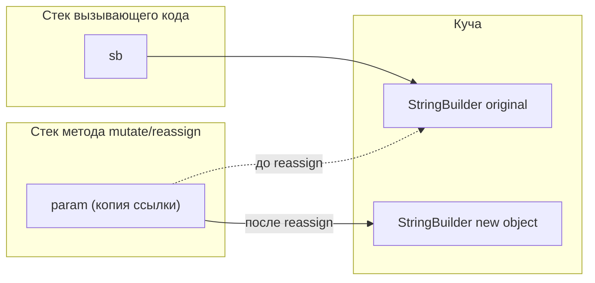

Формально простая тема, но здесь начинается одно из самых упорных заблуждений о
Java — «объекты передаются по ссылке». На самом деле параметры всегда
передаются по значению. Второй частый блок вопросов — как компилятор выбирает
перегруженный метод: на нём построены ловушки вроде `list.remove(1)`.

## Ключевые концепции

### Сигнатуры и перегрузка

#### Сигнатура метода и overloading
Сигнатура метода — имя плюс типы и порядок параметров. Возвращаемый тип в
сигнатуру не входит, поэтому два метода, различающиеся только им, — это не
перегрузка, а ошибка повторного объявления.

Перегрузка (overloading) — несколько методов с одним именем и разными
параметрами. Какой из них вызвать, решает компилятор по объявленным
(статическим) типам аргументов в точке вызова. Этим перегрузка отличается от
переопределения (overriding), которое выбирается в рантайме по реальному типу
объекта (тема «Полиморфизм» раздела 3).

```java
static void show(int x) { System.out.println("show(int): " + x); }
static void show(long x) { System.out.println("show(long): " + x); }
static void show(double x) { System.out.println("show(double): " + x); }
static void show(Object x) { System.out.println("show(Object): " + x); }
// ...
byte b = 5;
show(b);      // byte -> ближайшее расширение
show(5);      // int
show(5L);     // long
show(5.0);    // double
show("str");  // Object
```
```
show(int): 5
show(int): 5
show(long): 5
show(double): 5.0
show(Object): str
```
`byte` расширился до ближайшего подходящего `int`, а не до `long` или
`double`. Для строки подошёл только `show(Object)`.

#### Три фазы выбора перегрузки
Компилятор ищет подходящий метод в три фазы, и переходит к следующей только
если на текущей ничего не нашлось. Первая фаза — без упаковки и без varargs:
только точное совпадение и расширяющие преобразования примитивов (`int → long`)
и ссылок (подтип → супертип). Вторая — с упаковкой и распаковкой. Третья — с
varargs.

Отсюда следствие, которое удивляет многих: для аргумента `int` метод
`g(long)` выигрывает у `g(Integer)` и у `g(int...)`, хотя упаковка в
`Integer` кажется «ближе». Расширение примитива находится на первой фазе,
упаковка — только на второй.

```java
static void g(long x) { System.out.println("g(long) — расширение"); }
static void g(Integer x) { System.out.println("g(Integer) — упаковка"); }
static void g(int... xs) { System.out.println("g(int...) — varargs"); }
// ...
g(5);
```
```
g(long) — расширение
```
`g(5)` выбрал расширение до `long` на первой фазе — до упаковки и varargs дело
не дошло.

На тех же фазах держится ловушка с `List.remove`:
```java
List<Integer> list = new ArrayList<>(List.of(10, 20, 30));
list.remove(1);                     // remove(int index)
System.out.println("list.remove(1): " + list);
list.remove(Integer.valueOf(10));   // remove(Object o)
System.out.println("list.remove(Integer.valueOf(10)): " + list);
```
```
list.remove(1): [10, 30]
list.remove(Integer.valueOf(10)): [30]
```
`remove(1)` удалил элемент по индексу 1 (число 20), а не число 1: аргумент `int`
подходит к `remove(int)` на первой фазе, без упаковки. Чтобы удалить значение,
нужно явно передать объект.

#### Наиболее специфичный метод
Если на одной фазе подходит несколько методов, выбирается наиболее
специфичный — тот, чьи параметры можно передать в любой другой кандидат.
Например, `String` специфичнее `Object`, поэтому вызов `f(null)` при
перегрузках `f(Object)` и `f(String)` выберет `f(String)`.

Если наиболее специфичного нет, компиляция падает с ошибкой `reference to ...
is ambiguous`. Так происходит с `p(null)` при перегрузках `p(String)` и
`p(Integer)`: ни один тип не является подтипом другого. Решение — явное
приведение: `p((String) null)`.

```java
static void f(Object o) { System.out.println("f(Object)"); }
static void f(String s) { System.out.println("f(String)"); }
// ...
f(null);
```
```
f(String)
```
`null` подходит к обоим методам, и компилятор выбрал более специфичный
`f(String)`. Если же типы не связаны наследованием, выбрать не из чего:
```java
static void p(String s) {}
static void p(Integer i) {}
// ...
p(null);
```
```
error: reference to p is ambiguous
        p(null);
        ^
  both method p(String) in OverloadFail and method p(Integer) in OverloadFail match
```
`String` и `Integer` не подтипы друг друга, поэтому наиболее специфичного
метода нет, и это ошибка компиляции, а не выбор «первого попавшегося».

### Передача параметров и рекурсия

#### Java всегда pass-by-value
В Java есть только передача по значению, и для примитивов, и для объектов. Для
примитива в метод копируется само значение, и изменения параметра снаружи не
видны.

Для объекта копируется значение ссылки — адрес объекта в куче. Поэтому метод
может изменить состояние того же объекта, вызвав его мутирующий метод, и
вызывающий код это увидит. Но если внутри метода переприсвоить параметр
(`param = new SomeType()`), изменится только локальная копия ссылки, а
переменная вызывающего кода продолжит указывать на старый объект.


`sb` и `param` сначала указывают на один объект, поэтому мутация через `param`
видна через `sb`. `reassign` перевешивает только собственную копию ссылки.

```java
static void mutate(StringBuilder sb) { sb.append("-mutated"); }
static void reassign(StringBuilder sb) { sb = new StringBuilder("new object"); }
// ...
StringBuilder sb = new StringBuilder("original");
mutate(sb);
System.out.println("after mutate: " + sb);
reassign(sb);
System.out.println("after reassign: " + sb);
```
```
after mutate: original-mutated
after reassign: original-mutated
```
Изменение через `append` видно снаружи, а переприсваивание параметра — нет.
Это и есть передача ссылки по значению.

#### Varargs
Varargs (`Type... args`) — синтаксический сахар для переменного числа
аргументов. Компилятор превращает такой параметр в массив `Type[]`, а в месте
вызова создаёт массив нужной длины: `sum(1, 2, 3)` становится
`sum(new int[]{1, 2, 3})`.

Отсюда правила: varargs-параметр может быть только последним, метод можно
вызвать с готовым массивом, а вызов без аргументов передаёт пустой массив, а не
`null`. С `null` нужно быть внимательным: `h((Object[]) null)` передаёт сам
`null` вместо массива, а `h((Object) null)` — массив из одного элемента `null`.

```java
static int sum(int... nums) {
    int total = 0;
    for (int n : nums) total += n;
    return total;
}
// ...
System.out.println("sum() = " + sum());
System.out.println("sum(1,2,3) = " + sum(1, 2, 3));
System.out.println("sum(array) = " + sum(new int[]{10, 20}));
```
```
sum() = 0
sum(1,2,3) = 6
sum(array) = 30
```
Вызов без аргументов получил пустой массив, а готовый массив передался как есть.

Varargs и `null`:
```java
static void h(Object... xs) {
    System.out.println("h: " + (xs == null ? "xs == null" : "length = " + xs.length));
}
// ...
h();
h((Object[]) null);
h((Object) null);
```
```
h: length = 0
h: xs == null
h: length = 1
```
Три вызова `h` дали три разных результата: пустой массив, `null` вместо
массива и массив из одного `null`.

#### Рекурсия и StackOverflowError
Рекурсия — вызов метода самим собой напрямую или через цепочку других методов.
Она работает потому, что каждый вызов получает собственный кадр стека
(stack frame) со своими локальными переменными и параметрами.

Стек потока ограничен (флаг `-Xss`, обычно около 1 МБ на поток), и каждый
рекурсивный вызов добавляет кадр. Без корректного базового случая стек
заканчивается, и JVM бросает `StackOverflowError` — это `Error`, а не
`Exception` (раздел 4). Хвостовую рекурсию Java не оптимизирует, поэтому
глубокую рекурсию по большим данным переписывают в цикл с явным стеком.

```java
static long factorial(long n) {
    return n * factorial(n - 1); // нет базового случая
}
// вызов: factorial(10)
```
```
Exception in thread "main" java.lang.StackOverflowError
	at Sof.factorial(Sof.java:3)
	at Sof.factorial(Sof.java:3)
	at Sof.factorial(Sof.java:3)
	...
```
По длине стектрейса нельзя судить о глубине рекурсии: JVM обрезает трейс до
1024 строк (`-XX:MaxJavaStackTraceDepth`). Реальную глубину измеряет счётчик:
```java
static int depth = 0;
static long factorial(long n) {
    depth++;
    return n * factorial(n - 1);
}
// try { factorial(10); } catch (StackOverflowError e) { печатаем depth и длину трейса }
```
```
$ java Sof.java
глубина рекурсии: 11549
кадров в стектрейсе: 1024

$ java -Xss4m Sof.java
глубина рекурсии: 137829
кадров в стектрейсе: 1024
```
Глубина зависит от размера стека и размера кадра. Интерпретируемый кадр больше,
чем кадр уже скомпилированного JIT метода, поэтому при увеличении стека в 4 раза
глубина выросла больше чем в 10 раз.

## Частые вопросы на собеседовании

**Q: Java — pass-by-value или pass-by-reference?**
A: Всегда pass-by-value. Для примитивов копируется значение, для объектов —
значение ссылки. Метод может изменить объект через полученную ссылку, но не
может заставить внешнюю переменную указывать на другой объект: переприсваивание
параметра меняет только локальную копию.

**Q: Как компилятор выбирает перегруженный метод?**
A: Статически, по объявленным типам аргументов, в три фазы: сначала без
упаковки и varargs, потом с упаковкой, потом с varargs. На каждой фазе из
подходящих выбирается наиболее специфичный метод; если его нет — ошибка
неоднозначности. Поэтому для `int` аргумента `g(long)` выигрывает у
`g(Integer)`.

**Q: Что удалит list.remove(1) у List<Integer>?**
A: Элемент по индексу 1, а не число 1. У `List` две перегрузки — `remove(int
index)` и `remove(Object o)`, и `int` подходит к первой без упаковки, то есть
на первой фазе выбора. Чтобы удалить значение, передают
`Integer.valueOf(1)`.

**Q: Почему бесконечная рекурсия даёт StackOverflowError, а не зависание?**
A: Каждый вызов добавляет кадр в стек потока ограниченного размера. Без
базового случая стек быстро заканчивается, и JVM бросает `StackOverflowError`.
Размер стека задаётся `-Xss`; глубина зависит ещё и от размера кадров, а длина
стектрейса ограничена 1024 строками и о глубине ничего не говорит.

## Ловушки и частые ошибки

#### «Java передаёт объекты по ссылке»
Передаётся значение ссылки, то есть её копия. Разница видна ровно в одном
сценарии — переприсваивании параметра: при настоящей передаче по ссылке
`reassign(sb)` поменял бы, куда указывает внешняя переменная, а этого не
происходит.

#### Overloading выбирается по объявленному типу
Если переменная объявлена как `Object`, а хранит `String`, вызов перегруженного
метода пойдёт в вариант для `Object`. Компилятор смотрит на объявленный тип, а
не на реальный. Выбор по реальному типу — это переопределение, и он работает
только для объекта, у которого вызывается метод.
```java
static void show(String s) { System.out.println("show(String): " + s); }
static void show(Object o) { System.out.println("show(Object): " + o); }
// ...
Object obj = "hello";
show(obj);
show((String) obj);
```
```
show(Object): hello
show(String): hello
```
В обоих вызовах в переменной лежит одна и та же строка, но выбор сделан по
объявленному типу выражения: `Object` в первом вызове и `String` после
приведения во втором.

#### Перегрузки с упаковкой и примитивами
Пары методов вроде `remove(int)` и `remove(Object)` или `add(long)` и
`add(Integer)` легко вызвать не тот. Effective Java советует не создавать
перегрузки с одинаковым числом параметров, если их типы могут
преобразовываться друг в друга, — лучше дать методам разные имена.

#### Перехват StackOverflowError
`catch (StackOverflowError e)` скомпилируется и даже сработает, но состояние
программы после переполнения стека ненадёжно: исключение могло прервать любой
код посередине. Правильный подход — не допускать неограниченной рекурсии:
корректный базовый случай или итеративный алгоритм.
```java
static void recurse(int depth) { recurse(depth + 1); }
// ...
try {
    recurse(0);
} catch (StackOverflowError e) {
    System.out.println("поймали StackOverflowError, но состояние потока уже ненадёжно");
}
System.out.println("программа продолжила работу дальше");
```
```
поймали StackOverflowError, но состояние потока уже ненадёжно
программа продолжила работу дальше
```
Здесь всё обошлось, потому что `recurse` ничего не меняет. В реальном коде
переполнение могло случиться внутри захвата блокировки, записи в коллекцию или
инициализации класса — и такая «починка» оставит их в полусостоянии.

## Связанные темы
- [Массивы](04-arrays.md) — во что компилятор превращает varargs.
- [Переменные и типы данных](02-variables-and-types.md) — расширяющие преобразования и упаковка, на которых строится выбор перегрузки.
- [Полиморфизм](../03-oop/03-polymorphism.md) — динамический выбор при переопределении.
- Области памяти JVM (раздел 9) — устройство кадра стека.
- [Иерархия исключений](../04-exceptions/01-exception-hierarchy.md) — чем `Error` отличается от `Exception`.

## Источники
- [JLS §15.12.2: Compile-Time Step 2 — Determine Method Signature](https://docs.oracle.com/javase/specs/jls/se21/html/jls-15.html#jls-15.12.2) — фазы выбора перегрузки.
- [JLS §8.4.1: Formal Parameters](https://docs.oracle.com/javase/specs/jls/se21/html/jls-8.html#jls-8.4.1) — varargs.
- Joshua Bloch, «Effective Java», 3rd ed.: Item 52 «Use overloading judiciously», Item 53 «Use varargs judiciously».
