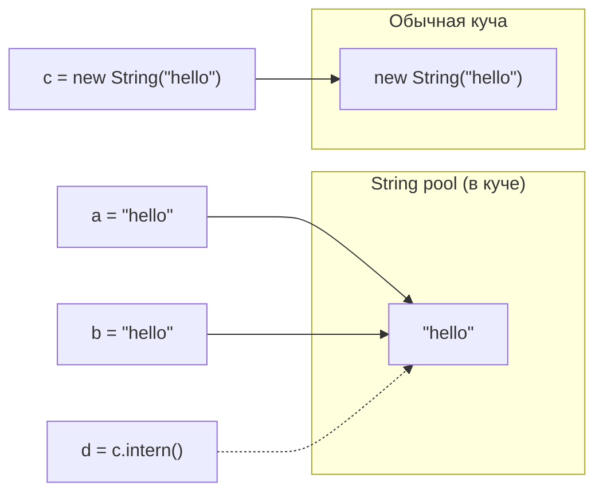

`String` — самый часто используемый тип в Java-коде, поэтому детали его
устройства спрашивают чаще почти любой другой темы синтаксиса. Неизменяемость,
пул строк и разница `==`/`equals` — это уровень junior. На senior-собеседовании
добавляются вопросы «почему»: свёртка констант, Compact Strings, `hashCode` и
локаль в `toLowerCase`.

## Ключевые концепции

### Неизменяемость

#### Почему String неизменяем
Ни один публичный метод `String` не меняет уже созданный объект: `substring`,
`replace`, `toUpperCase` и другие возвращают новую строку. Сам класс объявлен
`final`, чтобы наследник не мог добавить изменяемость.

Это сознательное решение по нескольким причинам. Безопасность: строки
служат путями к файлам, именами классов, URL и SQL, и если бы строку можно было
изменить после проверки, открылся бы класс атак time-of-check/time-of-use.
Кэширование `hashCode`: содержимое не меняется, поэтому хеш вычисляется один раз
— важно для ключей `HashMap`.

Ещё одна причина — потокобезопасность без синхронизации: неизменяемый объект
нельзя испортить гонкой данных. И наконец, неизменяемость делает возможным пул
строк: одинаковые литералы безопасно разделяют один объект.

#### Пул строк и intern()
Пул строк (string pool) — таблица уникальных строк в куче (до Java 7 — в
PermGen). Строковые литералы попадают в пул, поэтому два одинаковых литерала в
разных местах кода — один и тот же объект, и `==` для них истинно.

`new String("hello")` намеренно создаёт новый объект в куче вне пула, даже если
такая строка там уже есть. Метод `intern()` возвращает ссылку на строку из пула
с тем же содержимым, добавляя её туда при необходимости.



#### Свёртка констант
Компилятор вычисляет выражения из констант времени компиляции заранее:
`"hel" + "lo"` превращается в литерал `"hello"` прямо в байткоде, поэтому
`("hel" + "lo") == "hello"` — `true`. То же происходит, если часть выражения —
`final`-переменная с константным инициализатором.

Если же одна из частей — обычная переменная, конкатенация выполняется в
рантайме и создаёт новый объект вне пула, и `==` возвращает `false`. Этот
вопрос часто дают на собеседовании, чтобы проверить понимание разницы между
константой и переменной.

#### Сколько объектов создаёт new String("a")
Классический вопрос. Литерал `"a"` попадает в пул при первом выполнении кода,
который на него ссылается (при разрешении константы из пула констант класса), а
`new` создаёт ещё один объект в куче. Итого один или два объекта: два, если
строки `"a"` в пуле ещё не было, и один, если она уже там.

### Устройство и производительность

#### Compact Strings (Java 9)
До Java 9 `String` хранил символы в массиве `char[]` — по 2 байта на символ
даже для латиницы. С Java 9 (JEP 254) внутри лежит `byte[]` и поле `coder`:
если все символы строки укладываются в Latin-1, строка хранится по одному
байту на символ, иначе — по два байта в UTF-16.

Для типичных приложений, где большинство строк — латиница, это заметно
сокращает потребление памяти кучей. API при этом не изменился и работает в
терминах UTF-16: `length()` и `charAt()` по-прежнему считают `char`.

#### hashCode строки
`String.hashCode()` вычисляется по формуле `s[0]*31^(n-1) + s[1]*31^(n-2) + ...
+ s[n-1]` и кэшируется в поле объекта после первого вызова. Множитель 31 —
нечётное простое число, умножение на которое JIT заменяет на сдвиг и
вычитание.

Формула детерминирована и известна, поэтому коллизии легко подобрать:
`"Aa"` и `"BB"` имеют одинаковый хеш. На этом основаны атаки hash flooding, от
которых `HashMap` с Java 8 защищается превращением длинных цепочек в
красно-чёрные деревья (раздел 5).

#### substring и утечка памяти
До Java 7u6 `substring` не копировал символы, а ссылался на массив исходной
строки со смещением. Маленькая подстрока огромного текста удерживала весь
массив в памяти — известная утечка. С 7u6 `substring` копирует нужный
фрагмент, поэтому операция стала O(n), но утечки больше нет.

#### StringBuilder и StringBuffer
Для накопления строки по частям используют изменяемый `StringBuilder`: он
держит расширяемый массив и дописывает данные на месте, не создавая объект на
каждую операцию. `StringBuffer` — старый аналог, у которого все методы
`synchronized`.

Синхронизация `StringBuffer` почти всегда лишняя: буфер обычно живёт внутри
одного метода и не разделяется между потоками. Поэтому выбор по умолчанию —
`StringBuilder`, а `StringBuffer` встречается в основном в старом коде.

#### Конкатенация через + и invokedynamic
Конкатенация `+` в одном выражении эффективна. До Java 9 `javac`
разворачивал её в цепочку `new StringBuilder().append(...).toString()`, а с
Java 9 (JEP 280) генерирует `invokedynamic` с `StringConcatFactory`, и
стратегию склейки выбирает JVM в рантайме.

Проблема остаётся с `+=` в цикле. Каждая итерация создаёт новую строку и
копирует в неё всё накопленное, поэтому общая сложность квадратичная. Явный
`StringBuilder`, созданный до цикла, решает это: компилятор не умеет сливать
итерации цикла в одну операцию сам.

### API

#### equals, substring, split, replace, format
Содержимое строк сравнивают через `equals` или `equalsIgnoreCase`, а не `==`:
результат `==` зависит от пула и способа создания объекта. Для сравнения с
константой удобно писать `"ok".equals(status)` — так нет риска
`NullPointerException`.

`substring(from, to)` возвращает полуоткрытый диапазон, `split(regex)`
разбивает по регулярному выражению (тема «Регулярные выражения»), `replace`
заменяет буквальную подстроку, а `replaceAll` — по регулярному выражению.
`String.format` и метод `formatted` (Java 15) форматируют по спецификаторам в
стиле `printf`.

#### Методы Java 11 и склейка
В Java 11 появились `isBlank()`, `strip()`, `stripLeading()`, `stripTrailing()`,
`repeat(n)` и `lines()`. `strip` отличается от старого `trim`: `trim` убирает
только символы с кодом не больше пробела (ASCII), а `strip` — любые пробельные
символы Unicode.

Для склейки коллекции строк через разделитель есть `String.join` и
`StringJoiner` (с префиксом и суффиксом), а в стримах —
`Collectors.joining`.

#### Регистр и локаль
`toLowerCase()` и `toUpperCase()` без аргументов используют локаль по умолчанию.
В турецкой локали заглавная `I` превращается в `ı` без точки, поэтому
`"TITLE".toLowerCase()` на машине с турецкой локалью даёт `"tıtle"`, и
сравнение с `"title"` ломается.

Для технических строк — ключей, имён заголовков, enum — используют
`toLowerCase(Locale.ROOT)`. Локаль по умолчанию нужна только там, где строка
показывается пользователю.

#### Text blocks (Java 15)
Text block — многострочный литерал в тройных кавычках `"""` для JSON, SQL и
HTML-шаблонов. Он сохраняет форматирование, автоматически убирает общий
отступ строк и остаётся обычным `String` после компиляции. Поддерживает
экранирование `\` в конце строки (склейка без перевода строки) и `\s`
(значимый пробел).

#### Строки и секреты
Пароли рекомендуют хранить в `char[]`, а не в `String`. Строку нельзя
очистить — она живёт в куче до сборки мусора, может попасть в пул и в дамп
памяти. Массив `char[]` можно затереть сразу после использования, поэтому
`JPasswordField.getPassword()` и `Console.readPassword()` возвращают именно его.

## Примеры

Пул строк, `new` и `intern`:
```java
String a = "hello";
String b = "hello";
String c = new String("hello");
String d = c.intern();
System.out.println("a == b (оба литерала из пула): " + (a == b));
System.out.println("a == c (c создан через new): " + (a == c));
System.out.println("a.equals(c): " + a.equals(c));
System.out.println("a == d (d = c.intern()): " + (a == d));
```
```
a == b (оба литерала из пула): true
a == c (c создан через new): false
a.equals(c): true
a == d (d = c.intern()): true
```

Свёртка констант, `hashCode` и коллизии:
```java
String hello = "hello";
String folded = "hel" + "lo";      // свёртка констант на этапе компиляции
final String fin = "hel";
String notFinal = "hel";
System.out.println("\"hel\" + \"lo\" == \"hello\": " + (folded == hello)
        + ", final + \"lo\": " + ((fin + "lo") == hello)
        + ", не final + \"lo\": " + ((notFinal + "lo") == hello)
        + ", intern(): " + ((notFinal + "lo").intern() == hello));
System.out.println("\"ab\".hashCode() = " + "ab".hashCode() + ", 'a' * 31 + 'b' = " + ('a' * 31 + 'b'));
System.out.println("\"Aa\".hashCode() == \"BB\".hashCode(): " + ("Aa".hashCode() == "BB".hashCode()));
```
```
"hel" + "lo" == "hello": true, final + "lo": true, не final + "lo": false, intern(): true
"ab".hashCode() = 3105, 'a' * 31 + 'b' = 3105
"Aa".hashCode() == "BB".hashCode(): true
```
С `final`-переменной выражение осталось константой и было свёрнуто
компилятором, а с обычной переменной конкатенация произошла в рантайме.

Методы Java 11, локаль и склейка:
```java
String spaced = "  text  ";  // em space — пробел Unicode, но не ASCII
System.out.println("trim(): [" + spaced.trim() + "], strip(): [" + spaced.strip() + "]");
System.out.println("isBlank(): " + "  \t".isBlank() + ", repeat(3): " + "ab".repeat(3) + ", lines().count(): " + "a\nb\r\nc".lines().count());
System.out.println("\"TITLE\".toLowerCase(tr) = " + "TITLE".toLowerCase(Locale.forLanguageTag("tr"))
        + ", ROOT = " + "TITLE".toLowerCase(Locale.ROOT)
        + ", equals(\"title\"): " + "TITLE".toLowerCase(Locale.forLanguageTag("tr")).equals("title"));
System.out.println("String.join: " + String.join(", ", List.of("a", "b", "c")));
StringJoiner sj = new StringJoiner(", ", "[", "]");
sj.add("x").add("y");
System.out.println("StringJoiner: " + sj);
```
```
trim(): [  text  ], strip(): [text]
isBlank(): true, repeat(3): ababab, lines().count(): 3
"TITLE".toLowerCase(tr) = tıtle, ROOT = title, equals("title"): false
String.join: a, b, c
StringJoiner: [x, y]
```
`trim` не тронул em space (U+2003), потому что его код больше пробела, а
`strip` его убрал. В турецкой локали `I` превратилась в `ı`.

Неизменяемость:
```java
String s1 = "abc";
String s2 = s1.concat("def");
System.out.println("s1 после concat: " + s1);
System.out.println("s2 (новый объект): " + s2);
```
```
s1 после concat: abc
s2 (новый объект): abcdef
```

Конкатенация в байткоде (`javap -c`, Java 21):
```java
static String plusConcat(String a, String b) {
    return a + b + "!";
}
```
```
static java.lang.String plusConcat(java.lang.String, java.lang.String);
    Code:
       0: aload_0
       1: aload_1
       2: invokedynamic #7,  0   // InvokeDynamic #0:makeConcatWithConstants:
       7: areturn
```
Явных вызовов `StringBuilder` нет: одна инструкция `invokedynamic` делегирует
склейку `StringConcatFactory`.

`split`, `substring`, `replace`, `formatted`:
```java
String text = "2026-09-10";
String[] parts = text.split("-");
System.out.println("split: год=" + parts[0] + " месяц=" + parts[1] + " день=" + parts[2]);
System.out.println("substring(0,4): " + text.substring(0, 4));
System.out.println("replace: " + text.replace("-", "."));
String formatted = "Итого: %,.2f руб.".formatted(1234.5);
System.out.println("formatted: " + formatted);
```
```
split: год=2026 месяц=09 день=10
substring(0,4): 2026
replace: 2026.09.10
formatted: Итого: 1,234.50 руб.
```
Разделители в `%,.2f` зависят от локали: здесь JVM работала в английской
локали, поэтому тысячи отделены запятой, а дробная часть — точкой.

Text block:
```java
String json = """
        {
          "name": "Java",
          "year": 1995
        }""";
System.out.println(json);
```
```
{
  "name": "Java",
  "year": 1995
}
```
Общий отступ, появившийся из-за вложенности в метод, убран автоматически.

## Частые вопросы на собеседовании

**Q: Почему String неизменяемый?**
A: Безопасность (строки — это пути, URL, имена классов, и их нельзя подменить
после проверки), кэширование `hashCode` для быстрых ключей `HashMap`,
потокобезопасность без синхронизации и возможность пула строк, где одинаковые
литералы разделяют один объект. Класс `final`, чтобы наследник не нарушил эти
гарантии.

**Q: Что вернёт == для двух строк из пула и для строки, созданной через new?**
A: Для двух одинаковых литералов — `true`, это один объект пула. Для
`new String("...")` и литерала — `false`: `new` всегда создаёт отдельный объект.
Для `"hel" + "lo" == "hello"` — `true` из-за свёртки констант, а при
конкатенации с обычной переменной — `false`. Содержимое сравнивают через
`equals`.

**Q: Сколько объектов создаёт new String("hello")?**
A: Один или два. Литерал `"hello"` попадает в пул при первом выполнении кода,
который на него ссылается, если его там ещё нет, а `new` всегда создаёт
дополнительный объект в куче. Если литерал уже был в пуле, новый объект один.

**Q: Когда стоит использовать StringBuilder вместо +?**
A: Одна конкатенация, даже длинная, оптимизируется компилятором и JVM
(`invokedynamic` с Java 9). `StringBuilder` нужен при накоплении строки в
цикле: `+=` на каждой итерации копирует всю накопленную строку, и сложность
становится квадратичной.

**Q: Что такое Compact Strings?**
A: Оптимизация Java 9 (JEP 254): строка хранится в `byte[]`, по одному байту на
символ, если все символы укладываются в Latin-1, и по два байта (UTF-16) иначе.
Это уменьшает расход памяти на строки, а API не меняется — он по-прежнему
работает в терминах `char`.

## Ловушки и частые ошибки

#### == вместо equals
Сравнение через `==` «случайно работает» в тестах, где строки — литералы из
пула, и ломается в проде на строках, прочитанных из файла, сети или
полученных через `substring`. Единственный надёжный способ сравнить
содержимое — `equals`.

#### += в цикле
Накопление строки через `+=` в цикле из тысяч итераций квадратично по времени и
создаёт массу мусора. Для таких случаев — `StringBuilder` или
`Collectors.joining`.

#### toLowerCase без локали
Технические строки, приведённые к регистру с локалью по умолчанию, ломаются на
машинах с турецкой (и некоторыми другими) локалями. Для ключей и
идентификаторов используют `Locale.ROOT`.

#### replace vs replaceAll
`replace` заменяет буквальную подстроку, `replaceAll` принимает регулярное
выражение. `"1.0.5".replaceAll(".", "-")` заменит каждый символ, потому что
точка в regex означает «любой символ», а в строке замены особый смысл имеет
`$`.

## Связанные темы
- [Переменные и типы данных](02-variables-and-types.md) — неизменяемые обёртки устроены по тому же принципу.
- [Регулярные выражения](07-regex.md) — `split`, `replaceAll` и `matches` поверх `Pattern`.
- [Системы счисления и кодировки](../01-fundamentals/02-number-systems-encodings.md) — UTF-16, суррогатные пары и кодировка по умолчанию.
- Map: HashMap изнутри (раздел 5) — кэшированный `hashCode` строк и защита от коллизий.
- Байткод, invokedynamic и Instrumentation API (раздел 9) — `StringConcatFactory`.

## Источники
- [JEP 254: Compact Strings](https://openjdk.org/jeps/254), [JEP 280: Indify String Concatenation](https://openjdk.org/jeps/280), [JEP 378: Text Blocks](https://openjdk.org/jeps/378).
- [JLS §15.29: Constant Expressions](https://docs.oracle.com/javase/specs/jls/se21/html/jls-15.html#jls-15.29) — когда конкатенация сворачивается компилятором.
- [javadoc java.lang.String](https://docs.oracle.com/en/java/javase/21/docs/api/java.base/java/lang/String.html).
