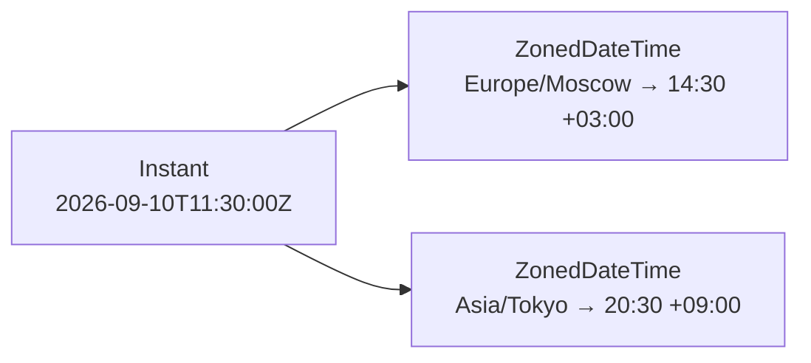

`java.time` (Java 8, JSR-310) — обязательный минимум для современного
Java-кода. Старые `Date`, `Calendar` и `SimpleDateFormat` считаются legacy:
они изменяемы, не потокобезопасны и путают момент времени с его отображением
в зоне. На senior-собеседовании важно не перечислить классы, а понимать, какой
из них для какой задачи, и знать ловушки: переход на летнее время, `YYYY` в
шаблоне и время в тестах.

## Ключевые концепции

### Основные типы

#### LocalDate, LocalTime, LocalDateTime
«Локальные» типы вообще не содержат информации о зоне: `LocalDate` — только
дата, `LocalTime` — только время суток, `LocalDateTime` — их комбинация. Слово
«локальный» здесь означает не «зона этого компьютера», а «без привязки к
какой-либо зоне».

Они подходят для понятий, у которых зоны нет по смыслу: день рождения, дата
договора, время открытия магазина «в 9:00» в любом городе. Для момента, который
произошёл в конкретную секунду для всего мира, локальные типы не подходят.

```java
LocalDate date = LocalDate.of(2026, 9, 10);
LocalTime time = LocalTime.of(14, 30);
LocalDateTime dateTime = LocalDateTime.of(date, time);
System.out.println("LocalDate: " + date);
System.out.println("LocalTime: " + time);
System.out.println("LocalDateTime: " + dateTime);
```
```
LocalDate: 2026-09-10
LocalTime: 14:30
LocalDateTime: 2026-09-10T14:30
```
В выводе нет ни зоны, ни смещения: это «14:30 10 сентября» вообще, без
указания, где именно.

#### ZonedDateTime и OffsetDateTime
`ZonedDateTime` — дата-время с часовой зоной (`ZoneId`, например
`Europe/Moscow`). Зона — это не просто смещение, а набор правил, включая
переходы на летнее и зимнее время и исторические изменения. Один и тот же
момент в разных зонах через `withZoneSameInstant` показывает разное локальное
время.

`OffsetDateTime` хранит только фиксированное смещение от UTC (`+03:00`) без
правил зоны. Он однозначно задаёт момент и удобен для форматов обмена вроде
ISO 8601 и для колонок `timestamptz` в JDBC, но не знает, когда в этом месте
переводят часы.



```java
ZonedDateTime moscow = dateTime.atZone(ZoneId.of("Europe/Moscow"));
ZonedDateTime tokyo = moscow.withZoneSameInstant(ZoneId.of("Asia/Tokyo"));
System.out.println("ZonedDateTime Moscow: " + moscow);
System.out.println("ZonedDateTime Tokyo (тот же момент): " + tokyo);

OffsetDateTime offsetDateTime = dateTime.atOffset(ZoneOffset.of("+03:00"));
System.out.println("OffsetDateTime: " + offsetDateTime);
```
```
ZonedDateTime Moscow: 2026-09-10T14:30+03:00[Europe/Moscow]
ZonedDateTime Tokyo (тот же момент): 2026-09-10T20:30+09:00[Asia/Tokyo]
OffsetDateTime: 2026-09-10T14:30+03:00
```
14:30 в Москве и 20:30 в Токио — один и тот же момент. У `OffsetDateTime`
в квадратных скобках нет имени зоны: известно только смещение `+03:00`, но не
правила, по которым оно может измениться.

#### Instant
`Instant` — точка на шкале времени UTC: секунды и наносекунды от эпохи Unix
(1970-01-01T00:00:00Z). Календарных понятий у него нет. Это правильный тип для
меток событий, `createdAt` в базе и логов распределённой системы, где «раньше» и
«позже» должны быть однозначны для всех.

```java
Instant instant = moscow.toInstant();   // moscow из примера выше
System.out.println("Instant: " + instant);
System.out.println("секунд от эпохи: " + instant.getEpochSecond());
```
```
Instant: 2026-09-10T11:30:00Z
секунд от эпохи: 1789039800
```
Московские 14:30 превратились в `11:30Z` по UTC, а внутри это просто число
секунд от 1970 года — одинаковое для любой зоны.

#### Переходы на летнее и зимнее время
Переход на летнее время создаёт «дыру» (gap): в Европе 29 марта 2026 года
после 01:59:59 сразу наступает 03:00, и времени 02:30 в этот день не
существует. `LocalDateTime.atZone` в таком случае сдвигает время вперёд на
длину перехода, и 02:30 превращается в 03:30.

Переход на зимнее время создаёт «перекрытие» (overlap): час с 02:00 до 03:00
проходит дважды. По умолчанию выбирается более раннее смещение, а
`withLaterOffsetAtOverlap()` переключает на позднее. Код, который планирует
задачи на «02:30 каждый день», должен явно решать, что делать в эти два дня.

```java
ZoneId berlin = ZoneId.of("Europe/Berlin");
System.out.println("переход на летнее время, 02:30 -> " + LocalDateTime.of(2026, 3, 29, 2, 30).atZone(berlin));
ZonedDateTime overlap = LocalDateTime.of(2026, 10, 25, 2, 30).atZone(berlin);
System.out.println("переход на зимнее время, 02:30 -> " + overlap + ", позднее: " + overlap.withLaterOffsetAtOverlap());

ZonedDateTime noon = ZonedDateTime.of(2026, 3, 28, 12, 0, 0, 0, berlin);
System.out.println("plusDays(1):   " + noon.plusDays(1));
System.out.println("plusHours(24): " + noon.plusHours(24));
System.out.println("часов в «сутках» перехода: " + Duration.between(noon, noon.plus(Period.ofDays(1))).toHours());
```
```
переход на летнее время, 02:30 -> 2026-03-29T03:30+02:00[Europe/Berlin]
переход на зимнее время, 02:30 -> 2026-10-25T02:30+02:00[Europe/Berlin], позднее: 2026-10-25T02:30+01:00[Europe/Berlin]
plusDays(1):   2026-03-29T12:00+02:00[Europe/Berlin]
plusHours(24): 2026-03-29T13:00+02:00[Europe/Berlin]
часов в «сутках» перехода: 23
```
Несуществующее 02:30 стало 03:30. «Плюс сутки» по календарю и «плюс 24 часа»
дали разное время, потому что сутки перехода длятся 23 часа.

### Периоды и длительности

#### Duration, Period и ChronoUnit
`Duration` — точное количество времени в секундах и наносекундах, без
календаря. `Period` — разница в календарных единицах: годах, месяцах и днях.
Это разные вещи: день перехода на летнее время длится 23 часа, поэтому
`plusDays(1)` и `plusHours(24)` дают разный результат.

`Period.between` двух дат возвращает разложение вида «2 года 7 месяцев 26
дней» с учётом реальной длины месяцев. `ChronoUnit.DAYS.between(d1, d2)` даёт
расстояние одним числом — удобно для сортировки и вывода «прошло N дней».

```java
LocalDateTime start = LocalDateTime.of(2026, 9, 10, 9, 0);
LocalDateTime end = LocalDateTime.of(2026, 9, 10, 17, 45);
Duration duration = Duration.between(start, end);
System.out.println("Duration between: " + duration + " (часы=" + duration.toHours() + " минуты=" + duration.toMinutesPart() + ")");

LocalDate d1 = LocalDate.of(2024, 1, 15);
LocalDate d2 = LocalDate.of(2026, 9, 10);
Period period = Period.between(d1, d2);
System.out.println("Period between: " + period.getYears() + "y " + period.getMonths() + "m " + period.getDays() + "d");
System.out.println("ChronoUnit.DAYS.between: " + ChronoUnit.DAYS.between(d1, d2));
```
```
Duration between: PT8H45M (часы=8 минуты=45)
Period between: 2y 7m 26d
ChronoUnit.DAYS.between: 969
```
`Duration` печатается в формате ISO 8601 (`PT8H45M`). Одна и та же разница
дат — это «2 года 7 месяцев 26 дней» в `Period` и 969 дней в `ChronoUnit`.

#### Арифметика с месяцами
Прибавление месяцев «прижимает» день к концу месяца: 31 января плюс месяц — 28
февраля, а 29 февраля 2024 плюс год — 28 февраля 2025. Из-за этого `d.plusMonths(1).minusMonths(1)` не всегда возвращает исходную дату.

Для типовых календарных операций есть `TemporalAdjusters` (последний день
месяца, следующий понедельник), а для понятий «месяц» и «день недели» —
`YearMonth` и `DayOfWeek`.

```java
System.out.println("31 января + 1 месяц = " + LocalDate.of(2026, 1, 31).plusMonths(1)
        + ", 29 февраля 2024 + 1 год = " + LocalDate.of(2024, 2, 29).plusYears(1));
```
```
31 января + 1 месяц = 2026-02-28, 29 февраля 2024 + 1 год = 2025-02-28
```
Исключения нет: несуществующие 31 февраля и 29 февраля 2025 года молча
заменены последним днём месяца.

### Форматирование и конвертация

#### DateTimeFormatter vs SimpleDateFormat
`SimpleDateFormat` изменяем: внутри хранится рабочий `Calendar`, который меняется
в процессе разбора и форматирования. Общий экземпляр без синхронизации в
нескольких потоках даёт непредсказуемые ошибки — неправильные даты или
исключения при разборе.

`DateTimeFormatter` неизменяем и потокобезопасен: всё нужное зафиксировано при
создании, и форматирование не трогает общего состояния. Поэтому его хранят в
`static final` константе. Названия месяцев и дней недели зависят от локали —
её задают явно через `withLocale` или `ofPattern(pattern, locale)`.

```java
DateTimeFormatter formatter = DateTimeFormatter.ofPattern("dd.MM.yyyy HH:mm");
System.out.println("formatted: " + dateTime.format(formatter));
System.out.println("parsed back: " + LocalDateTime.parse("10.09.2026 14:30", formatter));
```
```
formatted: 10.09.2026 14:30
parsed back: 2026-09-10T14:30
```
Один и тот же форматтер работает в обе стороны: форматирует объект в строку и
разбирает строку обратно. `toString()` при этом всегда выводит ISO-формат.

Общий `SimpleDateFormat` в 20 потоках:
```java
// один и тот же SimpleDateFormat, 20 потоков, по 200 форматирований и разборов каждый
SimpleDateFormat sdf = new SimpleDateFormat("yyyy-MM-dd");
// ... 4000 параллельных вызовов sdf.format(d) / sdf.parse(...) без синхронизации
```
```
Общих вызовов: 4000, ошибок парсинга/формата: 403
```
Около 10% вызовов закончились ошибкой, и их число меняется от запуска к
запуску — типичный признак гонки данных в общем изменяемом состоянии.

#### Шаблоны: YYYY, hh и uuuu
Буквы шаблона чувствительны к регистру, и несколько из них — классические
источники багов. `YYYY` — год недели (week-based year), а не календарный год:
29–31 декабря часто относятся к первой неделе следующего года, и дата
`2025-12-29` форматируется как `2026-12-29`. Календарный год — `yyyy` или
`uuuu`.

`hh` — 12-часовой формат (`15:05` превращается в `03:05`), 24-часовой — `HH`.
По умолчанию разбор идёт в режиме `SMART` и молча исправляет несуществующую дату
`2026-02-30` на `2026-02-28`. Строгий режим `ResolverStyle.STRICT` бросает
исключение, но в нём `yyyy` означает год эры и требует ещё и эру, поэтому со
`STRICT` используют `uuuu`.

```java
LocalDate d = LocalDate.of(2025, 12, 29);
System.out.println("YYYY-MM-dd: " + DateTimeFormatter.ofPattern("YYYY-MM-dd").format(d) + ", yyyy-MM-dd: " + DateTimeFormatter.ofPattern("yyyy-MM-dd").format(d));
LocalTime t = LocalTime.of(15, 5);
System.out.println("hh:mm: " + DateTimeFormatter.ofPattern("hh:mm").format(t) + ", HH:mm: " + DateTimeFormatter.ofPattern("HH:mm").format(t));

System.out.println("SMART, 2026-02-30 -> " + LocalDate.parse("2026-02-30", DateTimeFormatter.ofPattern("uuuu-MM-dd")));
LocalDate.parse("2026-02-30", DateTimeFormatter.ofPattern("uuuu-MM-dd").withResolverStyle(ResolverStyle.STRICT)); // перехвачено
LocalDate.parse("2026-02-10", DateTimeFormatter.ofPattern("yyyy-MM-dd").withResolverStyle(ResolverStyle.STRICT)); // перехвачено
```
```
YYYY-MM-dd: 2026-12-29, yyyy-MM-dd: 2025-12-29
hh:mm: 03:05, HH:mm: 15:05
SMART, 2026-02-30 -> 2026-02-28
STRICT, 2026-02-30 -> Text '2026-02-30' could not be parsed: Invalid date 'FEBRUARY 30'
STRICT + yyyy -> Text '2026-02-10' could not be parsed: Unable to obtain LocalDate from TemporalAccessor: {YearOfEra=2026, MonthOfYear=2, DayOfMonth=10},ISO of type java.time.format.Parsed
```
`YYYY` превратил 29 декабря 2025 года в 2026-й: эта дата уже относится к первой
неделе 2026 года. Режим `SMART` молча исправил 30 февраля, а `STRICT` с `yyyy` не
смог собрать дату без эры.

#### Конвертация с legacy Date и хранение в БД
Мост между старым и новым API — `Instant`: `Date.toInstant()`,
`Date.from(instant)`, `Instant.atZone(zoneId)`. Так работают с библиотеками,
которые всё ещё принимают `java.util.Date`.

В JDBC 4.2 драйверы поддерживают `java.time` напрямую через
`getObject(column, OffsetDateTime.class)` и `setObject`: `LocalDate` ↔ `date`,
`LocalDateTime` ↔ `timestamp`, `OffsetDateTime` ↔ `timestamp with time zone`.
`timestamp without time zone` хранит «сырые» дату и время без зоны, а
`timestamptz` в PostgreSQL хранит момент в UTC и переводит в зону сессии при
чтении. Смешение подходов в одной системе — частая причина расхождений на
несколько часов.

```java
Date legacyDate = Date.from(instant);   // instant = 2026-09-10T11:30:00Z
Instant backToInstant = legacyDate.toInstant();
System.out.println("Date -> Instant round-trip equal: " + instant.equals(backToInstant));
```
```
Date -> Instant round-trip equal: true
```
Совпадение здесь потому, что у `instant` нет долей миллисекунды: `Date` хранит
только миллисекунды, и более точный `Instant` при переводе туда и обратно
потерял бы наносекунды.

#### Неизменяемость
Все классы `java.time` неизменяемы: `plusDays`, `withZoneSameInstant`,
`withDayOfMonth` возвращают новый объект, оставляя исходный без изменений. Это
даёт потокобезопасность без синхронизации, но требует присваивать результат —
`date.plusDays(1);` без присваивания ничего не делает.

```java
LocalDate original = LocalDate.of(2026, 9, 10);
LocalDate plusOne = original.plusDays(1);
System.out.println("original: " + original);
System.out.println("plusOne (новый объект): " + plusOne);

LocalDate date = LocalDate.of(2026, 9, 10);
date.plusDays(1);
System.out.println("date после 'plusDays(1)' без присвоения: " + date);
```
```
original: 2026-09-10
plusOne (новый объект): 2026-09-11
date после 'plusDays(1)' без присвоения: 2026-09-10
```
`plusDays` вернул новую дату, а исходная не изменилась. Во втором случае
результат никуда не сохранён, и строка вообще ничего не сделала.

### Время в коде и тестах

#### Clock
Код, который вызывает `LocalDate.now()` или `Instant.now()` напрямую, трудно
тестировать: результат зависит от того, когда запущен тест. Решение — получать
текущее время через `java.time.Clock`, переданный зависимостью, и вызывать
`LocalDate.now(clock)`.

В проде используют `Clock.systemUTC()` или `Clock.systemDefaultZone()`, в
тестах — `Clock.fixed(...)` для неподвижного времени или `Clock.offset(...)`
для сдвига. В Spring `Clock` обычно объявляют бином и внедряют в сервисы.

```java
Clock fixed = Clock.fixed(Instant.parse("2026-01-01T10:00:00Z"), ZoneOffset.UTC);
System.out.println("Clock.fixed: " + LocalDateTime.now(fixed) + ", Clock.offset(+1h): " + LocalDateTime.now(Clock.offset(fixed, Duration.ofHours(1))));
```
```
Clock.fixed: 2026-01-01T10:00, Clock.offset(+1h): 2026-01-01T11:00
```
Сколько бы раз ни запускался тест, «сейчас» будет одним и тем же.

#### currentTimeMillis и nanoTime
`System.currentTimeMillis()` и `Instant.now()` показывают время по системным
часам, которые могут прыгнуть назад или вперёд при синхронизации NTP. Для
измерения длительности используют `System.nanoTime()` — монотонный счётчик,
который не связан с календарём и не идёт назад. Его абсолютное значение
бессмысленно, имеет смысл только разность двух вызовов.

## Частые вопросы на собеседовании

**Q: Почему SimpleDateFormat не потокобезопасен, а DateTimeFormatter — да?**
A: `SimpleDateFormat` хранит рабочее состояние (внутренний `Calendar`) в полях и
меняет его в процессе работы, поэтому параллельные вызовы портят друг другу
данные. `DateTimeFormatter` неизменяем, и форматирование не трогает общего
состояния, поэтому один экземпляр безопасно разделять между потоками.

**Q: В чём разница между Instant, LocalDateTime и ZonedDateTime?**
A: `Instant` — момент на шкале UTC без календаря. `LocalDateTime` — дата и время
без зоны, само по себе неоднозначное: «15:00» не говорит, в каком городе.
`ZonedDateTime` — дата-время с зоной и её правилами перехода на летнее время,
то есть однозначный момент с человекочитаемым представлением.

**Q: Как тестировать код, который зависит от текущего времени?**
A: Не вызывать `now()` без аргументов, а получать время через внедрённый
`java.time.Clock` и передавать его в `now(clock)`. В тестах подставляют
`Clock.fixed` или `Clock.offset`, и результат перестаёт зависеть от момента
запуска.

**Q: Чем YYYY отличается от yyyy в шаблоне даты?**
A: `yyyy` — календарный год, `YYYY` — год недели по ISO. В последние дни декабря
и первые дни января они расходятся, и дата отображается с соседним годом. Баг
проявляется несколько дней в году, поэтому его часто пропускают тестами.

**Q: Почему выбор между timestamp with и without time zone — частая ошибка?**
A: `timestamp without time zone` хранит дату и время без информации о том,
какой это момент в UTC, — правильность зависит от дисциплины приложения.
`timestamptz` в PostgreSQL хранит момент в UTC и переводит в зону сессии при
чтении. Если разные части системы пишут и читают по-разному, время у
пользователей расходится на разницу часовых поясов.

## Ловушки и частые ошибки

#### LocalDateTime вместо однозначного момента
`LocalDateTime` для метки события, `createdAt` или времени в распределённой
системе неоднозначен: «15:00» без зоны может означать любой момент в пределах
суток по миру. Для моментов используют `Instant` или
`OffsetDateTime`/`ZonedDateTime`.

#### Duration вместо Period
`Duration` — точное количество секунд, `Period` — календарная разница.
Прибавлять «месяц» или «сутки» через `Duration` технически можно, но в дни
перехода на летнее время и для месяцев разной длины результат будет неверным.

#### Расписание в часы перехода
Задача «каждый день в 02:30 по Берлину» в день перехода на летнее время
выполнится в 03:30, а в день перехода на зимнее время — дважды, если
планировщик ориентируется на локальное время. Такие задачи планируют в UTC
или на время вне окна перехода.

#### Забыть присвоить результат
`date.plusDays(1);` ничего не меняет: метод вернул новый объект, а он нигде не
сохранён. Это тот же класс ошибок, что и `s.trim();` без присваивания у строк.

## Связанные темы
- [Строки](06-strings.md) — тот же принцип неизменяемости и та же ошибка с неприсвоенным результатом.
- Реляционная модель: ключи, ограничения и нормализация (раздел 15) — типы `timestamp` и `timestamptz` в PostgreSQL.
- Основы потоков (раздел 8) — гонка данных в общем `SimpleDateFormat`.
- JUnit 5 (раздел 13) — тесты с подменённым `Clock`.

## Источники
- [javadoc пакета java.time](https://docs.oracle.com/en/java/javase/21/docs/api/java.base/java/time/package-summary.html).
- [javadoc DateTimeFormatter](https://docs.oracle.com/en/java/javase/21/docs/api/java.base/java/time/format/DateTimeFormatter.html) — буквы шаблонов и режимы разбора.
- [JSR 310: Date and Time API](https://jcp.org/en/jsr/detail?id=310).
- [IANA Time Zone Database](https://www.iana.org/time-zones) — источник правил зон в JDK.
