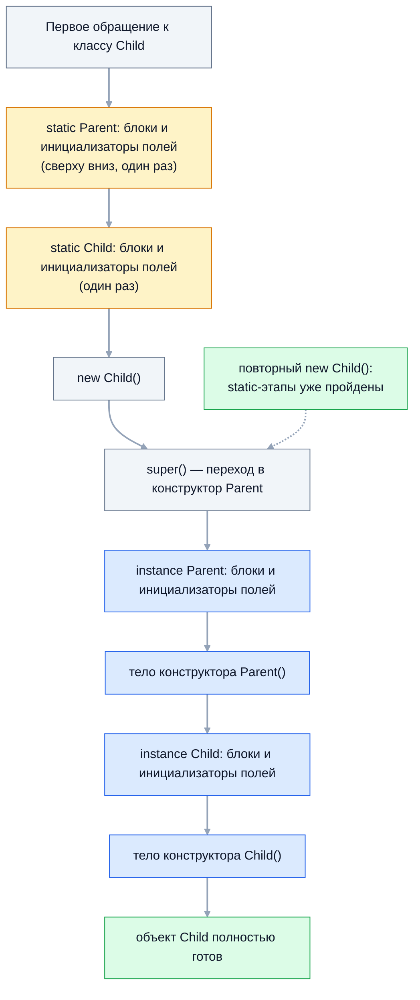

Классическая ловушка на собеседовании — «в каком порядке выполнится этот код»,
если в цепочке наследования несколько static- и instance-блоков. Это
продолжение темы «Классы и объекты», но наследование добавляет отдельный класс
ошибок: вызов переопределяемого метода из конструктора родителя, порядок
static-полей и момент, когда класс вообще инициализируется.

## Ключевые концепции

### Instance initializer block — то, что часто путают со static-блоком

#### instance-блок vs static-блок
Instance initializer block — блок `{ ... }` прямо в теле класса без слова
`static`. Внешне он почти не отличается от `static { ... }`, но семантика
противоположная: static-блок выполняется один раз при инициализации класса, а
instance-блок — при каждом создании объекта.

Instance-блоки и инициализаторы полей выполняются в порядке их объявления в
классе, как один слитый фрагмент кода. С наследованием важно, где он
вставляется: после вызова конструктора родителя и до тела конструктора
текущего класса.

```java
static class Counter {
    static { System.out.println("static-блок Counter (один раз)"); }
    { System.out.println("instance-блок Counter (на каждый new)"); }
    Counter() { System.out.println("тело конструктора Counter()"); }
}
// ...
new Counter();
new Counter();
```
```
static-блок Counter (один раз)
instance-блок Counter (на каждый new)
тело конструктора Counter()
instance-блок Counter (на каждый new)
тело конструктора Counter()
```
Static-блок отработал один раз перед первым `new`, а instance-блок — перед
телом конструктора при каждом создании объекта.

#### Double brace initialization
Instance-блок лежит в основе приёма double brace initialization:
`new ArrayList<String>() {{ add("a"); add("b"); }}`. Внешние скобки создают
анонимный подкласс `ArrayList`, внутренние — его instance-блок, который сразу
добавляет элементы.

В реальном коде приём не рекомендуют. Каждое такое выражение — отдельный
`.class`-файл, а в нестатическом контексте анонимный объект хранит ссылку на
внешний экземпляр и может удерживать его от сборки мусора. Сегодня для этого
есть `List.of` и `Map.of`.

```java
public class DoubleBrace {
    public static void main(String[] args) {
        List<String> names = new ArrayList<String>() {{
            add("Аня");
            add("Борис");
        }};
        System.out.println("names: " + names);
        System.out.println("реальный класс names: " + names.getClass().getName());
        System.out.println("суперкласс: " + names.getClass().getSuperclass().getName());
    }
}
```
```
names: [Аня, Борис]
реальный класс names: DoubleBrace$1
суперкласс: java.util.ArrayList
```
Список выглядит обычным, но его класс — анонимный `DoubleBrace$1`, наследник
`ArrayList`, и после компиляции рядом лежит отдельный файл
`DoubleBrace$1.class`.

### Полный порядок при иерархии классов

#### Четыре этапа: static → super() → instance → конструктор
Первые два этапа происходят один раз на класс. При первой инициализации класса
выполняются static-блоки и static-инициализаторы полей — сначала у родителя,
потом у потомка: JVM не инициализирует класс, пока не инициализирован его
родитель.

Два следующих этапа повторяются при каждом `new`. Конструктор потомка
вызывает конструктор родителя через `super(...)` (до Java 25 — строго первой
инструкцией, с Java 25 перед ним допустим пролог без обращения к `this`), и
цепочка разворачивается до `Object`. Затем выполняются instance-часть и тело
конструктора родителя, и только после них — instance-часть и тело
конструктора потомка.


При повторном `new` static-этапы не повторяются: класс уже инициализирован.

Итог одной строкой: static родителя → static потомка (один раз) → на каждое
`new` — instance родителя → конструктор родителя → instance потомка →
конструктор потомка. Эту строку стоит уметь воспроизвести без запинки.

```java
class Parent {
    static { System.out.println("1. static-блок Parent"); }
    { System.out.println("3. instance-блок Parent"); }
    int parentField = initParentField();
    int initParentField() { System.out.println("4. instance-инициализатор Parent.parentField"); return 0; }
    Parent() { System.out.println("5. тело конструктора Parent()"); }
}

public class Child extends Parent {
    static { System.out.println("2. static-блок Child"); }
    { System.out.println("6. instance-блок Child"); }
    int childField = initChildField();
    int initChildField() { System.out.println("7. instance-инициализатор Child.childField"); return 0; }
    Child() { System.out.println("8. тело конструктора Child()"); }

    public static void main(String[] args) {
        System.out.println("=== new Child() #1 ===");
        new Child();
        System.out.println("=== new Child() #2 ===");
        new Child();
    }
}
```
```
1. static-блок Parent
2. static-блок Child
=== new Child() #1 ===
3. instance-блок Parent
4. instance-инициализатор Parent.parentField
5. тело конструктора Parent()
6. instance-блок Child
7. instance-инициализатор Child.childField
8. тело конструктора Child()
=== new Child() #2 ===
3. instance-блок Parent
4. instance-инициализатор Parent.parentField
5. тело конструктора Parent()
6. instance-блок Child
7. instance-инициализатор Child.childField
8. тело конструктора Child()
```
Строки 1 и 2 вывелись один раз, ещё до первого `new`, — класс `Child` с
`main` инициализировался при запуске. При каждом `new` повторяется
последовательность 3–8.

### Когда класс инициализируется

#### Что запускает инициализацию
Класс инициализируется лениво — при первом активном использовании. Это
создание объекта через `new`, вызов статического метода, чтение или запись
статического поля (кроме констант), вызов `Class.forName(name)` и
инициализация подкласса. Подробно этапы загрузки, линковки и инициализации
разобраны в теме «Загрузка классов» раздела 9.

Не запускают инициализацию обращение к литералу класса (`Config.class`),
создание массива (`new Config[10]`) и чтение константы времени компиляции.
Инициализация класса потокобезопасна: JVM выполняет её под внутренней
блокировкой ровно один раз. На этом основана идиома ленивого singleton через
вложенный holder-класс.

#### Константы времени компиляции
Поле `static final` примитивного типа или `String`, инициализированное
константным выражением, — константа времени компиляции. Компилятор
подставляет её значение прямо в код, который её читает. Поэтому чтение такой
константы не запускает инициализацию класса: static-блок не выполнится.

Поле `static final Integer BOXED = 7` или `static final int X =
Integer.parseInt("5")` константой уже не является, и его чтение инициализирует
класс. Та же подстановка значения объясняет, почему изменённую константу нужно
перекомпилировать вместе со всеми, кто её читает (тема «final и static»).

```java
static class Config {
    static { System.out.println("  static-блок Config выполнен"); }
    static final int COMPILE_TIME = 42;               // константа времени компиляции
    static final Integer BOXED = 7;                   // не константа: обёртка
}
// ...
System.out.println("Config.COMPILE_TIME = " + Config.COMPILE_TIME);
System.out.println("Config.BOXED = " + Config.BOXED);
```
```
Config.COMPILE_TIME = 42
  static-блок Config выполнен
Config.BOXED = 7
```
Чтение константы не инициализировало `Config` — static-блок сработал только при
чтении `BOXED`.

#### Порядок static-полей
Static-инициализаторы выполняются строго сверху вниз. Если статическое поле
создаёт экземпляр своего же класса (`static final Singleton INSTANCE = new
Singleton()`) раньше, чем объявлены другие статические поля, конструктор
увидит их в значениях по умолчанию.

Классическая головоломка: конструктор увеличивает `counter`, объявленный ниже
`INSTANCE`. Сначала конструктор делает `counter` равным 1, потом выполняется
инициализатор `static int counter = 0` и затирает его нулём. Константы при
этом уже имеют свои значения — их подставил компилятор.

```java
static class Singleton {
    static final Singleton INSTANCE = new Singleton(); // создаётся первым
    static int counter = 0;                            // присваивается после конструктора
    static final int LIMIT = 10;                       // константа — известна заранее
    static int initialized = 5;

    Singleton() {
        counter++;
        System.out.println("  конструктор: counter = " + counter + ", LIMIT = " + LIMIT + ", initialized = " + initialized);
    }
}
// ...
Singleton s = Singleton.INSTANCE;
System.out.println("после инициализации класса: counter = " + Singleton.counter + ", initialized = " + Singleton.initialized);
```
```
  конструктор: counter = 1, LIMIT = 10, initialized = 0
после инициализации класса: counter = 0, initialized = 5
```
Конструктор успел увеличить `counter` до 1, но следующий инициализатор
`counter = 0` затёр его. Константа `LIMIT` уже была равна 10, а обычное поле
`initialized` ещё было нулём.

#### Ошибка в static-инициализаторе
Если static-инициализатор бросает исключение, первое обращение к классу
получает `ExceptionInInitializerError` с настоящей причиной внутри. Класс
помечается как непригодный, и все следующие обращения получают
`NoClassDefFoundError: Could not initialize class` — уже без исходной причины.
Пример — в ловушках темы «Установка окружения и первая программа».

### Типичная ловушка

#### Вызов overridable-метода из конструктора родителя
Самая коварная ошибка, вытекающая из этого порядка, — вызов переопределяемого
метода (не `final`, не `private`, не `static`) из конструктора родителя.
Полиморфизм работает и во время конструирования: если `describe()`
переопределён в потомке, из конструктора `Base` вызовется версия потомка.

Но поля потомка на этот момент ещё не инициализированы — instance-часть
потомка выполняется после конструктора родителя. Переопределённый метод
увидит значения по умолчанию (`0`, `false`, `null`), а не заданные при
объявлении. Поэтому Effective Java (Item 19) советует не вызывать
переопределяемые методы из конструктора.

```java
class Base {
    Base() {
        System.out.println("Base() вызывает переопределённый describe():");
        describe();
    }
    void describe() { System.out.println("  Base.describe"); }
}

public class Overridable extends Base {
    private String name = "инициализировано";
    Overridable() {
        super();
        System.out.println("Overridable() после super(): name = " + name);
    }
    @Override
    void describe() {
        System.out.println("  Overridable.describe: name = " + name);
    }
    public static void main(String[] args) {
        new Overridable();
    }
}
```
```
Base() вызывает переопределённый describe():
  Overridable.describe: name = null
Overridable() после super(): name = инициализировано
```
Динамическая диспетчеризация сработала, хотя объект ещё не достроен, а `name`
в этот момент — `null`: инициализатор поля потомка выполнится только после
конструктора родителя.

В Java 25 (JEP 513) у этой ловушки появилось решение на уровне языка: поле
потомка без инициализатора можно присвоить в прологе конструктора, до
`super()`:
```java
public class Flex extends Base {
    private final String name;
    Flex(String name) {
        if (name == null || name.isBlank())        // проверка аргумента до super()
            throw new IllegalArgumentException("name");
        this.name = name;                          // поле присвоено до super()
        super();
        System.out.println("Flex() после super(): name = " + this.name);
    }
    @Override
    void describe() { System.out.println("  Flex.describe: name = " + name); }
    // main: new Flex("инициализировано");
}
```
```
Base() вызывает describe():
  Flex.describe: name = инициализировано
Flex() после super(): name = инициализировано
```
Поле с инициализатором при объявлении (`String name = "..."`) так присвоить
нельзя — компилятор выдаст ошибку. На Java 21 этот код не скомпилируется вовсе:
`call to super must be first statement in constructor`. Совет не вызывать
переопределяемые методы из конструктора остаётся в силе.

## Частые вопросы на собеседовании

**Q: В каком порядке выполнятся static- и instance-блоки в цепочке из двух-трёх классов?**
A: Static-блоки и static-инициализаторы — один раз, сверху вниз по иерархии,
при первой инициализации класса. Затем при каждом `new` — instance-часть и
тело конструктора каждого класса, тоже сверху вниз: сначала полностью
родитель, потом следующий уровень, и так до самого конкретного класса.

**Q: Что вернёт переопределённый метод, если вызвать его из конструктора родителя?**
A: Вызовется переопределённая версия — виртуальная диспетчеризация не ждёт
окончания конструирования. Но поля потомка ещё не инициализированы, поэтому
метод увидит `0`, `false` или `null`. С Java 25 поле без инициализатора можно
присвоить в прологе конструктора до `super()`, но лучше вообще не вызывать
переопределяемые методы из конструктора.

**Q: Когда выполняется static-блок класса?**
A: При первом активном использовании класса: `new`, вызов статического метода,
обращение к статическому полю, не являющемуся константой, `Class.forName`,
инициализация подкласса. Чтение константы времени компиляции, литерал
`Config.class` и создание массива `new Config[10]` инициализацию не запускают.
Инициализация выполняется один раз и потокобезопасна.

**Q: Что будет, если static-инициализатор бросит исключение?**
A: Первое обращение получит `ExceptionInInitializerError` с причиной внутри, а
класс станет непригодным. Все следующие обращения получат
`NoClassDefFoundError: Could not initialize class` без исходной причины,
поэтому при разборе логов ищут самое первое `ExceptionInInitializerError`.

## Ловушки и частые ошибки

#### «final починит overridable-вызов»
Если метод, который вызывает конструктор родителя, объявить `final` или
`private`, потомок не сможет его переопределить, и ловушка с
неинициализированными полями потомка исчезнет. Но только если этот метод сам не
вызывает переопределяемые методы — иначе проблема просто переедет на уровень
ниже. Надёжное правило — не вызывать из конструктора ничего, что можно
переопределить.

`final` нужно ставить именно в родителе. Объявить `final` уже переопределённый
метод потомка бесполезно:
```java
static class Base {
    Base() {
        System.out.println("Base() вызывает describe():");
        describe();
    }
    void describe() { System.out.println("  Base.describe"); }
}

static class FinalOverride extends Base {
    private String name = "инициализировано";
    @Override
    final void describe() { System.out.println("  FinalOverride.describe: name = " + name); }
}
// ...
new FinalOverride();
```
```
Base() вызывает describe():
  FinalOverride.describe: name = null
```
`final` в потомке лишь запрещает дальнейшее переопределение ниже по иерархии.
Конструктор `Base` всё равно вызывает версию потомка до инициализации `name`.

#### Путаница instance-блока со static-блоком
Одно слово `static` полностью меняет, когда выполняется блок: один раз на класс
или при каждом создании объекта. Перепутав их, получают логику, которая
выполняется не тогда, когда ожидается, — например, один раз на все объекты
вместо каждого.

#### super() — не первое, что выполняется в объекте
Раз `super()` вызывается первым, кажется, что конструктор родителя — первое,
что происходит. На самом деле до тела конструктора родителя выполняется его
instance-часть, а в абсолютном порядке первой оказывается instance-часть
самого верхнего класса иерархии.

#### Статическое поле со ссылкой на свой класс
`static final Foo INSTANCE = new Foo()` в начале класса создаёт объект до
инициализации остальных статических полей. Конструктор, читающий или
меняющий эти поля, увидит значения по умолчанию, а изменения затрутся
следующими инициализаторами. Такие поля объявляют последними или переходят на
holder-класс либо enum.

## Связанные темы
- [Классы и объекты](09-classes-and-objects.md) — порядок инициализации внутри одного класса и пролог конструктора в Java 25.
- [final и static](11-final-and-static.md) — константы времени компиляции и их подстановка в чужой код.
- [Наследование](../03-oop/02-inheritance.md) — переопределение и цепочка конструкторов.
- [Установка окружения и первая программа](01-environment-setup.md) — `ExceptionInInitializerError` и `NoClassDefFoundError` на примере.
- Загрузка классов (раздел 9) — этапы загрузки, линковки и инициализации класса.

## Источники
- [JLS §12.4: Initialization of Classes and Interfaces](https://docs.oracle.com/javase/specs/jls/se21/html/jls-12.html#jls-12.4) — когда и как инициализируется класс.
- [JLS §12.5: Creation of New Class Instances](https://docs.oracle.com/javase/specs/jls/se21/html/jls-12.html#jls-12.5).
- [JEP 513: Flexible Constructor Bodies](https://openjdk.org/jeps/513).
- Joshua Bloch, «Effective Java», 3rd ed.: Item 19 «Design and document for inheritance or else prohibit it».
