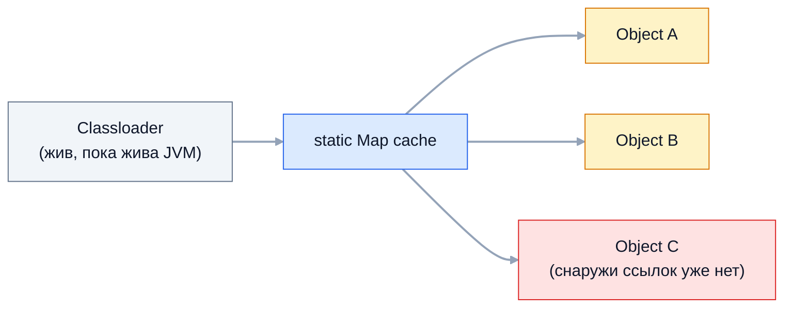

Два коротких ключевых слова, которые встречаются в коде каждый день, но за
простотой скрывают несколько тонкостей уровня senior. Чем `final`-переменная
отличается от неизменяемого объекта, почему `static`-метод нельзя
переопределить, почему изменённая константа «не доходит» до другого модуля и
как безобидное `static`-поле превращается в утечку памяти.

## Ключевые концепции

### final

#### final-переменная: ссылка, а не объект
`final`-переменной можно присвоить значение ровно один раз. Делать это при
объявлении не обязательно: blank final получает значение позже, например в
конструкторе. Компилятор проверяет, что на любом пути исполнения
присваивание происходит ровно один раз — для поля это должно произойти в
каждом конструкторе.

Для ссылочного типа `final` фиксирует ссылку, а не содержимое объекта. `final
List<String> list = new ArrayList<>()` нельзя переприсвоить на другой список,
но элементы в него можно добавлять и удалять. `final` и неизменяемость —
разные понятия: первое про переменную, второе про объект.

```java
final List<String> mutable = new ArrayList<>(List.of("a", "b"));
mutable.add("c");
System.out.println("final ArrayList после add: " + mutable);

final List<String> immutable = List.of("a", "b");
immutable.add("c");   // перехвачено
```
```
final ArrayList после add: [a, b, c]
List.of() бросает UnsupportedOperationException на add()
```
Обе переменные `final`, но первый список меняется свободно: `final` запретил
только переприсвоить `mutable`. Неизменяемым список делает не модификатор
переменной, а сама реализация `List.of`.

#### final-поля и многопоточность
У `final`-полей есть особая гарантия модели памяти Java. Если конструктор не
«утёк» ссылкой на `this` наружу, любой поток, получивший ссылку на объект,
увидит `final`-поля полностью инициализированными, даже без синхронизации.

Обычные поля такой гарантии не имеют: без `volatile` или синхронизации другой
поток может увидеть объект с ещё нулевыми полями. Поэтому неизменяемые объекты
с `final`-полями можно безопасно передавать между потоками (раздел 8).

#### final-локальные переменные и effectively final
Локальная переменная тоже может быть `final`. С Java 8 лямбды, анонимные и
локальные классы могут захватывать и переменные, которые формально не
объявлены `final`, но после инициализации не меняются — effectively final.
Подробнее про захват переменных — в разделе 7.

#### final-метод и final-класс
`final`-метод нельзя переопределить в наследнике: попытка не скомпилируется.
Это инструмент проектирования API, когда от конкретной реализации метода
зависит корректность класса — например, шаблонный метод, задающий порядок
шагов.

`final`-класс нельзя унаследовать вовсе. Самый известный пример — `String`:
наследник мог бы нарушить неизменяемость и всё, что на ней построено, — пул
строк и кэшированный `hashCode`. Классы-значения и `record` (неявно `final`)
закрывают от наследования по той же причине.

```java
class Base {
    final void greet() { System.out.println("hi"); }
}
public class FinalMethodFail extends Base {
    void greet() { System.out.println("bye"); } // нельзя переопределить final
}
```
```
FinalMethodFail.java:5: error: greet() in FinalMethodFail cannot override greet() in Base
    void greet() { System.out.println("bye"); }
         ^
  overridden method is final
1 error
```
То же для класса:
```java
public class ExtendStringFail extends String { // String — final класс
}
```
```
ExtendStringFail.java:1: error: cannot inherit from final String
public class ExtendStringFail extends String {
                                      ^
1 error
```
Оба запрета срабатывают на этапе компиляции: до рантайма такой код не
доходит.

### static

#### static-поле и static-метод
`static`-поле принадлежит классу, а не объекту: все экземпляры разделяют одну
ячейку, и изменение видно через любой объект и через имя класса. У обычного
поля своя копия в каждом объекте.

`static`-метод не привязан к экземпляру и не имеет `this`: его можно вызвать,
не создав ни одного объекта. Вызов компилируется в `invokestatic`, поэтому даже
вызов через ссылку, равную `null`, не бросает `NullPointerException` — сама
ссылка не используется. Писать так не стоит: компилятор и IDE предупреждают,
что статический метод вызван через экземпляр.

`final` и `static` в одном классе:
```java
public class FinalStatic {
    static int instanceCount = 0; // одно поле на класс
    final int id;                 // blank final - присваивается в конструкторе

    FinalStatic() {
        id = ++instanceCount;     // присвоение final один раз, не в момент объявления
    }

    public static void main(String[] args) {
        FinalStatic a = new FinalStatic();
        FinalStatic b = new FinalStatic();
        FinalStatic c = new FinalStatic();
        System.out.println("a.id=" + a.id + " b.id=" + b.id + " c.id=" + c.id);
        System.out.println("instanceCount (общий на класс) = " + FinalStatic.instanceCount);
    }
}
```
```
a.id=1 b.id=2 c.id=3
instanceCount (общий на класс) = 3
```
У каждого объекта свой `id`, присвоенный один раз, а `instanceCount` один на
весь класс.

Статический метод через `null`-ссылку:
```java
public class NullStatic {
    static String hello() { return "static-метод вызван через null-ссылку"; }

    public static void main(String[] args) {
        NullStatic ref = null;
        System.out.println(ref.hello());   // компилируется в invokestatic, ref не используется
    }
}
```
```
static-метод вызван через null-ссылку
```
`NullPointerException` нет: для вызова нужен только класс, известный из
объявленного типа `ref`, а значение ссылки не читается.

#### Hiding, а не overriding
`static`-метод нельзя переопределить, только скрыть (method hiding) методом с
той же сигнатурой в подклассе. Выбор между версиями происходит при компиляции,
по объявленному типу переменной, а не в рантайме по реальному типу объекта —
по тем же правилам, что и перегрузка.

```java
class Animal {
    static String kind() { return "Animal"; }
    String sound() { return "..."; }
}
class Dog extends Animal {
    static String kind() { return "Dog"; } // hiding, не overriding
    @Override String sound() { return "Woof"; } // настоящее overriding
}
// main:
Animal ref = new Dog();
System.out.println("ref.kind() [по объявленному типу Animal]: " + ref.kind());
System.out.println("ref.sound() [по фактическому типу Dog]: " + ref.sound());
```
```
ref.kind() [по объявленному типу Animal]: Animal
ref.sound() [по фактическому типу Dog]: Woof
```
Объект один и тот же, но статический метод выбран по типу переменной, а
обычный — по реальному типу объекта.

#### static-блок инициализации
`static`-блок выполняется один раз при инициализации класса. Его используют,
когда static-состояние нельзя задать одной строкой: заполнить статическую
`Map`, загрузить нативную библиотеку, прочитать конфигурацию. Порядок
выполнения в цепочке наследования разобран в теме «Порядок инициализации при
наследовании».

```java
static class Config {
    static final Map<String, String> DEFAULTS = new HashMap<>();
    static {
        DEFAULTS.put("timeout", "30s");
        DEFAULTS.put("retries", "3");
        System.out.println("static-блок Config: заполнили DEFAULTS (" + DEFAULTS.size() + " записи)");
    }
}
// ...
System.out.println("timeout=" + Config.DEFAULTS.get("timeout"));
```
```
static-блок Config: заполнили DEFAULTS (2 записи)
timeout=30s
```
Блок выполнился при первом обращении к `Config.DEFAULTS`, до того как
`get` вернул значение. Для такой задачи сегодня чаще пишут
`Map.of("timeout", "30s", "retries", "3")` — одной строкой и сразу
неизменяемо.

#### Константы и их подстановка
`static final` поле примитивного типа или `String` с константным
инициализатором — константа времени компиляции. Компилятор подставляет её
значение прямо в байткод каждого класса, который её читает, а не ссылку на
поле.

Отсюда неприятное следствие для библиотек. Если изменить значение константы и
перекомпилировать только класс, где она объявлена, остальные классы продолжат
использовать старое значение, пока их тоже не перекомпилируют. Для значений,
которые могут меняться между версиями, используют не константы, а
`static final` поля с неконстантным инициализатором или методы.

```java
public class Consts {
    public static final int VERSION = 1;
}
public class App {
    public static void main(String[] args) {
        System.out.println("Consts.VERSION = " + Consts.VERSION);
    }
}
```
```
$ javac Consts.java App.java && java App
Consts.VERSION = 1
$ # меняем VERSION на 2 и перекомпилируем только Consts
$ javac Consts.java && java App
Consts.VERSION = 1
```
`App` по-прежнему печатает 1: значение было подставлено в его байткод при
компиляции, и к полю `Consts.VERSION` он не обращается вовсе.

#### import static
`import static java.lang.Math.max;` позволяет вызывать статический член без
имени класса: `max(a, b)`. Это удобно для DSL и тестов (`assertThat`,
`Comparator.comparing`), но злоупотребление делает непонятным, откуда взялся
метод. Effective Java не рекомендует «интерфейсы констант» ради коротких имён —
для этого и есть `import static`.

#### static-поля и утечки памяти


`static`-поле живёт в объекте `Class` своего класса, а тот достижим от
загрузчика классов. Для классов системного загрузчика это означает «до конца
работы JVM».

Если в такое поле складывать объекты — кэш без ограничения размера, список
слушателей, от которых забыли отписаться, — но никогда не удалять, они
остаются достижимыми, и сборщик мусора их не освободит. Это классическая
утечка памяти в языке со сборкой мусора: память не потеряна, как в C, но
приложение постепенно растёт до `OutOfMemoryError`.

В серверах приложений и при горячей перезагрузке похожая проблема возникает с
загрузчиками классов. Одна статическая ссылка из системного класса на объект
приложения удерживает весь его загрузчик со всеми классами (classloader leak).

```java
static class LeakyCache {
    static final List<byte[]> cache = new ArrayList<>();
    static void handleRequest() { cache.add(new byte[1_000_000]); }   // ~1 МБ на запрос
}
// ...
for (int i = 1; i <= 3; i++) {
    LeakyCache.handleRequest();
    System.out.println("после запроса " + i + ": cache.size()=" + LeakyCache.cache.size());
}
```
```
после запроса 1: cache.size()=1
после запроса 2: cache.size()=2
после запроса 3: cache.size()=3
```
Каждый запрос оставляет в статическом списке ещё мегабайт, и ничто его не
удаляет. На трёх запросах это незаметно, на миллионе — `OutOfMemoryError`.

## Частые вопросы на собеседовании

**Q: Чем final-переменная отличается от неизменяемого объекта?**
A: `final` запрещает переприсвоить переменную, но объект, на который она
указывает, может оставаться изменяемым: `final List` не мешает `add`.
Неизменяемость — свойство самого объекта: у него нет способа поменять
состояние после создания. Эти понятия ортогональны и часто используются вместе.

**Q: Почему static-метод нельзя переопределить?**
A: Он не привязан к объекту и не участвует в виртуальной диспетчеризации:
вызов компилируется в `invokestatic`. Метод с той же сигнатурой в подклассе
скрывает родительский, и выбор делается при компиляции по объявленному типу
переменной.

**Q: Почему после изменения константы другой модуль видит старое значение?**
A: `static final` примитив или строка с константным инициализатором —
константа времени компиляции, и её значение подставляется в байткод
использующих классов. Пока их не перекомпилируют, они работают со старым
значением. Для значений, которые меняются между версиями библиотеки,
константы не используют.

**Q: Как static-поле может привести к утечке памяти?**
A: Оно живёт, пока жив класс, то есть обычно до конца работы JVM. Если в него
складывать объекты и не удалять — кэш без вытеснения, забытые подписки, — они
остаются достижимыми и не собираются, и потребление памяти растёт до
`OutOfMemoryError`.

## Ловушки и частые ошибки

#### final-коллекция — не неизменяемая коллекция
`final List<...> list` защищает только переменную. Для защиты содержимого нужна
неизменяемая коллекция (`List.of`, `List.copyOf`) или защитное копирование
(тема «Инкапсуляция» раздела 3).

#### static сам по себе не про потокобезопасность
`static`-поле — просто общая для всех потоков память. Его конкурентное
изменение без синхронизации подвержено гонкам так же, как любое разделяемое
состояние. Потокобезопасность обеспечивают `synchronized`, атомарные классы и
неизменяемость, а не модификатор `static`.
```java
static class RaceCounter {
    static int total = 0;
    static void increment() { total++; }   // чтение, +1, запись — не атомарно
}
// ...
int threadsCount = 8, perThread = 100_000;
Thread[] threads = new Thread[threadsCount];
for (int i = 0; i < threadsCount; i++) {
    threads[i] = new Thread(() -> { for (int j = 0; j < perThread; j++) RaceCounter.increment(); });
    threads[i].start();
}
for (Thread t : threads) t.join();
System.out.println("ожидалось: " + (threadsCount * perThread));
System.out.println("реально:   " + RaceCounter.total);
```
```
ожидалось: 800000
реально:   104804
```
Потерялось почти 90% инкрементов, и число меняется от запуска к запуску (в
пяти прогонах — от 104 тысяч до 120 тысяч). Исправляют через `AtomicInteger`,
`LongAdder` или `synchronized` (раздел 8).

#### Константы в публичном API
Публичная константа, которая может измениться в следующей версии библиотеки,
— ловушка для клиентов: их код продолжит работать со старым значением до
перекомпиляции. Такие значения отдают через метод или поле с неконстантным
инициализатором.

#### «Это не настоящая утечка»
Неограниченно растущий `static`-кэш или забытая подписка ведут себя для
приложения так же плохо, как утечка в C: память растёт до `OutOfMemoryError`.
Отличается только механизм — не потерянный указатель, а забытая, но
достижимая ссылка.

## Связанные темы
- [Классы и объекты](09-classes-and-objects.md) — модификаторы и структура класса.
- [Порядок инициализации при наследовании](10-initialization-order.md) — когда выполняется static-блок и почему константы не запускают инициализацию.
- [Инкапсуляция](../03-oop/01-encapsulation.md) — неизменяемые объекты и защитное копирование.
- Java Memory Model и volatile (раздел 8) — гарантии видимости `final`-полей.
- GC Roots, типы ссылок и утечки памяти (раздел 9) — почему статические ссылки удерживают объекты.

## Источники
- [JLS §4.12.4: final Variables](https://docs.oracle.com/javase/specs/jls/se21/html/jls-4.html#jls-4.12.4), [§17.5: final Field Semantics](https://docs.oracle.com/javase/specs/jls/se21/html/jls-17.html#jls-17.5).
- [JLS §13.1: The Form of a Binary](https://docs.oracle.com/javase/specs/jls/se21/html/jls-13.html#jls-13.1) — подстановка констант в использующие классы.
- Joshua Bloch, «Effective Java», 3rd ed.: Item 17 «Minimize mutability», Item 22 «Use interfaces only to define types».
