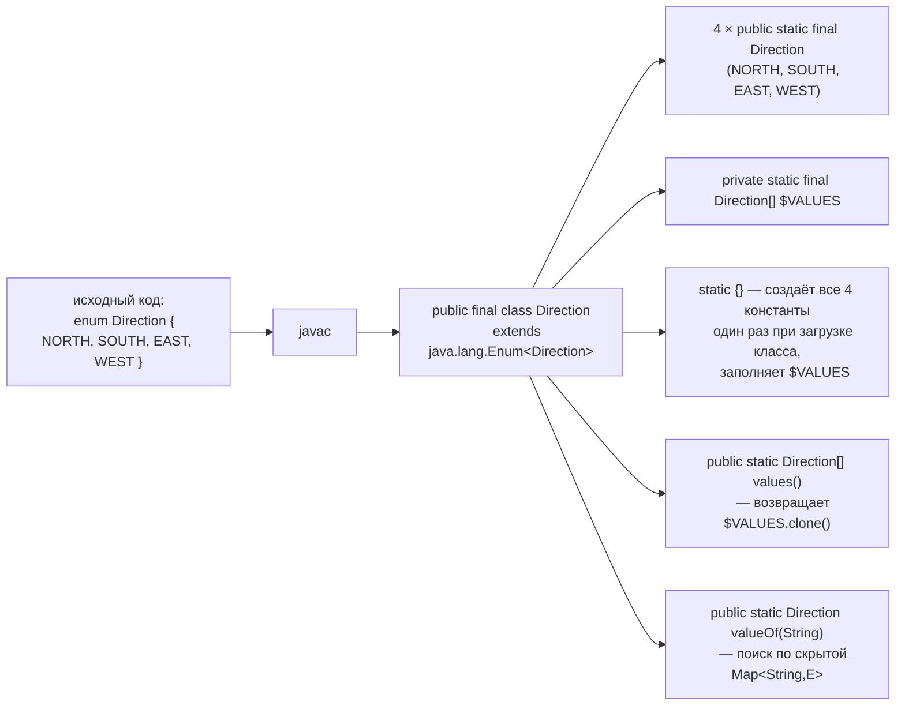

Углублённый разбор того, во что компилятор превращает `enum`. Именно это
отличает кандидата, который умеет пользоваться enum, от того, кто понимает,
почему enum — самый надёжный singleton и почему `switch` по enum не сравнивает
строки. Все утверждения ниже проверены дизассемблированием реального байткода
(`javap`, JDK 21): детали компиляции могут отличаться между версиями JDK, но
принцип неизменен много лет.

## Ключевые концепции

### От enum к final-классу

#### enum наследует java.lang.Enum
Компилятор превращает объявление `enum` в обычный класс: `final`-класс,
неявно наследующий `java.lang.Enum<E>`, где `E` — сам этот enum. Это пример
рекурсивного ограничения типа (curiously recurring generic pattern), благодаря
которому `compareTo` у enum принимает только константы того же типа.

Из этого следуют два ограничения языка. Enum не может наследовать другой класс:
единственное место родителя занято `java.lang.Enum`. И enum нельзя
унаследовать: класс помечен `final`, чтобы набор экземпляров оставался
фиксированным. Реализовывать интерфейсы enum при этом может, как любой класс.

#### Константы — static final поля
Каждая константа компилируется в `public static final` поле этого класса: на
уровне JVM `Direction.NORTH` ничем не отличается от любого другого статического
поля-объекта. Объекты констант создаются один раз в статическом
инициализаторе (`static {}`), который компилятор генерирует автоматически.

Отсюда потокобезопасность enum-констант без единой строки синхронизации.
Инициализация класса выполняется JVM ровно один раз под внутренней
блокировкой (раздел 9) — тот же механизм, на котором держится идиома
ленивого singleton через holder-класс.



Вывод `javap -p` для `enum Direction { NORTH, SOUTH, EAST, WEST }` подтверждает
эту структуру буквально:
```
public final class Direction extends java.lang.Enum<Direction> {
  public static final Direction NORTH;
  public static final Direction SOUTH;
  public static final Direction EAST;
  public static final Direction WEST;
  private static final Direction[] $VALUES;
  public static Direction[] values();
  public static Direction valueOf(java.lang.String);
  private Direction();
  private static Direction[] $values();
  static {};
}
```
Конструктор сгенерирован `private` даже без явного модификатора: создавать
экземпляры enum снаружи запрещено языком. Имена с `$` — `$VALUES` и
`$values()` — по соглашению обозначают синтетические элементы, созданные
компилятором.

### values(), valueOf() и константы с телом

#### values() клонирует массив
`values()` не просто возвращает поле: байткод показывает `$VALUES.clone()` перед
возвратом:
```
public static Direction[] values();
    Code:
       0: getstatic     #16    // Field $VALUES:[LDirection;
       3: invokevirtual #20    // Method "[LDirection;".clone:()Ljava/lang/Object;
       6: checkcast     #21    // class "[LDirection;"
       9: areturn
```
Причина — защита: массив изменяем, и если бы `values()` отдавал внутренний
массив, любой код мог бы записать `Direction.values()[0] = null` и испортить
состояние для всего приложения. Цена — новый массив на каждый вызов, поэтому
в горячем цикле результат `values()` сохраняют в переменную или поле.

#### valueOf() ищет через Map
`valueOf(String)` делегирует в `Enum.valueOf(Class, String)`, который ищет
константу по имени в карте `имя → константа`. Карту лениво строит и кэширует
сам класс через `enumConstantDirectory()`. Поиск по имени идёт через
хеш-таблицу, а не перебором всех констант.

#### Константы с телом — анонимные подклассы
Константа может иметь собственное тело (constant-specific class body),
например `PLUS { public int apply(int a, int b) { return a + b; } }` в enum с
абстрактным методом `apply`. Такая константа компилируется в объект отдельного
анонимного подкласса enum, и у каждой из них свой `.class`-файл:
```java
enum Op {
    PLUS  { public int apply(int a, int b) { return a + b; } },
    MINUS { public int apply(int a, int b) { return a - b; } };
    public abstract int apply(int a, int b);
}
```
```
PLUS: class=Op$1 apply(5,3)=8
MINUS: class=Op$2 apply(5,3)=2

$ ls Op*.class
Op$1.class   Op$2.class   Op.class
```
`PLUS.getClass()` возвращает синтетический подкласс `Op$1`, а не `Op`. Это тот
же механизм, что у анонимных классов вообще (раздел 3). Поэтому для получения
enum-типа константы используют `getDeclaringClass()`, а не `getClass()`.

### Иммунитет к рефлексии и сериализации, switch без строк

#### Иммунитет к рефлексии
Классический singleton (приватный конструктор и статическое поле) уязвим к
рефлексии: `Constructor.setAccessible(true)` позволяет вызвать приватный
конструктор и создать второй экземпляр. С enum так не выйдет: JVM запрещает
рефлексивное создание экземпляров enum, и `newInstance` бросает исключение
независимо от `setAccessible`.

```java
enum Singleton { INSTANCE }
// ...
Constructor<Singleton> ctor = Singleton.class.getDeclaredConstructor(String.class, int.class);
ctor.setAccessible(true);
ctor.newInstance("FAKE", 99);   // перехвачено
```
```
newInstance -> IllegalArgumentException: Cannot reflectively create enum objects
```
Сам приватный конструктор нашёлся — у enum он неявно принимает имя и
`ordinal`, поэтому параметры `(String, int)`. Но `Constructor.newInstance`
проверяет, что класс — enum, и отказывается создавать объект.

#### Иммунитет к сериализации
Обычная сериализация создаёт при каждой десериализации новый объект в обход
конструктора, что тоже ломает singleton. Enum сериализуется особым образом:
в поток пишется только имя константы, а при чтении она восстанавливается через
`valueOf`. Возвращается существующий экземпляр, а не новый.

Поэтому Effective Java (Item 3) называет enum с одной константой самым
надёжным способом сделать singleton. Ограничение одно — такой singleton не
может наследовать другой класс.

#### switch по enum: ordinal() и tableswitch
`switch` по enum не сравнивает строки, как можно подумать по аналогии со
`switch` по `String`. Компилятор берёт `ordinal()` константы и делает переход
по таблице:
```java
enum Color { RED, GREEN, BLUE }
static String describe(Color c) {
    switch (c) {
        case RED: return "warm";
        case GREEN: return "nature";
        default: return "cold";
    }
}
```
```
static java.lang.String describe(Color);
    Code:
       0: aload_0
       1: invokevirtual #7   // Method Color.ordinal:()I
       4: tableswitch   { // 0 to 2
                     0: 32
                     1: 35
               default: 41
          }
      32: ldc  #13  // String warm
      34: areturn
      35: ldc  #15  // String nature
      37: areturn
      41: ldc  #17  // String cold
      43: areturn
}
```
`tableswitch` — переход по индексу в таблице за O(1), без последовательных
сравнений. Здесь enum и `switch` лежат в одном исходном файле. Если enum
объявлен в другом файле, компилятор дополнительно строит синтетический массив
соответствия `ordinal` → номер ветки (`Use$1.$SwitchMap$Color`), чтобы
перестановка констант в enum не ломала уже скомпилированный код:
```
static java.lang.String describe(Color);
    Code:
       0: getstatic     #7                  // Field Use$1.$SwitchMap$Color:[I
       3: aload_0
       4: invokevirtual #13                 // Method Color.ordinal:()I
       7: iaload
       8: lookupswitch  { // 2
```

## Частые вопросы на собеседовании

**Q: Почему enum считается самым надёжным способом сделать singleton?**
A: Ручной singleton можно сломать рефлексией (вызвать приватный конструктор) и
сериализацией (десериализация создаёт новый объект). Enum защищён от обоих
способов на уровне платформы: JVM запрещает рефлексивное создание экземпляров
enum, а сериализация восстанавливает константу по имени через `valueOf`.
Потокобезопасность создания обеспечивает инициализация класса.

**Q: Почему у enum-константы с телом свой .class-файл?**
A: Такая константа — объект анонимного подкласса enum, который переопределяет
метод своей реализацией. Отсюда отдельный синтетический класс (`Op$1`,
`Op$2`), и `getClass()` возвращает его, а не сам enum. Тип константы надёжно
получают через `getDeclaringClass()`.

**Q: Как устроен switch по enum на уровне байткода?**
A: Компилятор вызывает `ordinal()` у константы и делает `tableswitch` или
`lookupswitch` по полученному числу — переход по индексу без сравнения строк.
Если enum объявлен в другом файле, `ordinal` сначала переводится через
синтетическую таблицу `$SwitchMap$`, устойчивую к перестановке констант.

## Ловушки и частые ошибки

#### ordinal() — нестабильный идентификатор
`ordinal()` — позиция константы в текущем порядке объявления. Если константы
переставить или вставить новую в середину, номера остальных молча изменятся, и
сохранённые во внешних системах значения начнут указывать не на те константы.
Для хранения подходят `name()` (если имена не переименовывают) или явное поле с
кодом.
```java
enum StatusV1 { NEW, ACTIVE, DONE }
enum StatusV2 { NEW, PENDING, ACTIVE, DONE }   // PENDING вставили в середину
// ...
int stored = StatusV1.ACTIVE.ordinal();   // в базе сохранили ordinal
System.out.println("сохранили ordinal ACTIVE в V1: " + stored);
System.out.println("прочитали тот же ordinal в V2: " + StatusV2.values()[stored]);
```
```
сохранили ordinal ACTIVE в V1: 1
прочитали тот же ordinal в V2: PENDING
```
Ни ошибки, ни предупреждения: старая запись «активен» после релиза тихо стала
«в ожидании».

#### values() клонирует массив, но не константы
Каждый вызов `values()` возвращает новый массив, поэтому сравнивать два таких
массива через `==` бессмысленно. Но элементы внутри — те же единственные
объекты констант: `values()[0] == Direction.NORTH` истинно при любом вызове.
```java
Direction[] v1 = Direction.values();
Direction[] v2 = Direction.values();
System.out.println("v1 == v2: " + (v1 == v2));
System.out.println("v1[0] == v2[0]: " + (v1[0] == v2[0]) + ", v1[0] == NORTH: " + (v1[0] == Direction.NORTH));
```
```
v1 == v2: false
v1[0] == v2[0]: true, v1[0] == NORTH: true
```
Массивы разные — это работа `$VALUES.clone()`, а константы в них одни и те же:
клонируется только массив ссылок.

#### getClass() у константы с телом
`Op.PLUS.getClass() == Op.class` ложно: класс константы с телом — анонимный
подкласс. Код, который определяет тип enum через `getClass()`, например при
сериализации или в `EnumMap` вручную, ломается на таких константах. Нужен
`getDeclaringClass()`.

## Связанные темы
- [Enum и аннотации](00-index.md) — базовое использование enum, `EnumMap` и `EnumSet`.
- [Абстракция: abstract class vs interface](../../03-oop/04-abstract-vs-interface.md) — почему enum реализует интерфейсы, но не наследует класс.
- [Вложенные и анонимные классы](../../03-oop/08-nested-classes.md) — анонимные подклассы, в которые компилируются константы с телом.
- Байткод, invokedynamic и Instrumentation API (раздел 9) — как `javac` транслирует конструкции языка в байткод.

## Источники
- [JLS §8.9: Enum Classes](https://docs.oracle.com/javase/specs/jls/se21/html/jls-8.html#jls-8.9).
- [Java Object Serialization Specification §1.12: Serialization of Enum Constants](https://docs.oracle.com/en/java/javase/21/docs/specs/serialization/serial-arch.html#serialization-of-enum-constants).
- Joshua Bloch, «Effective Java», 3rd ed.: Item 3 «Enforce the singleton property with a private constructor or an enum type».
