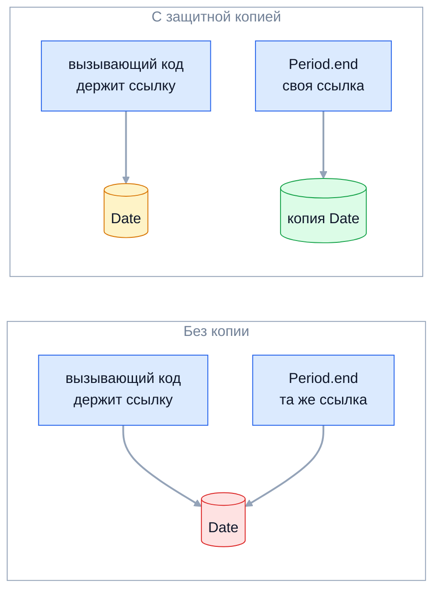

Инкапсуляция — это способность объекта самому охранять своё состояние: снаружи
доступно только поведение, а данные меняются лишь так, чтобы инварианты объекта
оставались истинными. На senior-собеседовании ответ «private-поля плюс геттеры и
сеттеры» считается ответом junior-уровня — ждут разговора про инварианты,
неизменяемость, защитное копирование и анемичную модель.

## Ключевые концепции

### Механизмы

#### Инвариант — то, что охраняет инкапсуляция
У любого содержательного объекта есть условия, которые должны быть истинны на
протяжении всей его жизни: баланс счёта не отрицателен, начало периода не позже
конца, у заказа есть идентификатор. Такие условия называют инвариантами. Если
любой код в программе может напрямую записать что угодно в поля объекта, то
гарантировать инвариант невозможно — его соблюдение размазано по всем местам,
которые трогают эти поля.

Инкапсуляция решает именно эту проблему: она сводит все изменения состояния к
небольшому набору методов самого класса. Тогда проверить инвариант достаточно в
этих методах, и он становится свойством класса, а не дисциплиной каждого
вызывающего. Сокрытие данных (information hiding) — средство, а цель —
корректность объекта, которую нельзя сломать снаружи.

#### private-поля и методы доступа
Базовый механизм в Java — модификатор `private` у полей: к ним может обратиться
только код этого же класса. Всё взаимодействие с внешним миром идёт через методы,
причём уровень их видимости подбирается по принципу «минимально достаточный»:
`public` — только то, что действительно является контрактом, вспомогательное —
`private` или package-private. Четыре уровня видимости подробно разобраны в теме
«Классы и объекты» раздела 2.

Важно, что `private` — это граница класса, а не объекта. Метод `equals` спокойно
читает `other.balance` у другого экземпляра того же класса, и это не нарушение
инкапсуляции: обе стороны находятся под контролем одного и того же кода, который
знает инварианты. Граница проводится там, где заканчивается ответственность
автора класса.

#### Иммутабельный объект
Максимальная форма инкапсуляции — объект, состояние которого вообще нельзя
изменить после создания. Его инвариант достаточно проверить один раз в
конструкторе, и дальше он истинен навсегда. Классические примеры из JDK —
`String`, `Integer`, `BigDecimal`, все классы `java.time`.

Рецепт неизменяемого класса (Effective Java, пункт «Минимизируйте изменяемость»)
такой: не давать методов, меняющих состояние; запретить наследование (`final`
класс или приватный конструктор с фабрикой), чтобы подкласс не добавил
изменяемость; сделать все поля `private final`; обеспечить эксклюзивный доступ к
изменяемым компонентам через защитное копирование. Последний пункт чаще всего и
забывают.

Бонусы неизменяемости выходят далеко за рамки ООП. Такой объект можно свободно
разделять между потоками без синхронизации: модель памяти Java гарантирует, что
корректно сконструированный объект с `final`-полями будет виден другим потокам
полностью инициализированным (раздел 8). Его можно безопасно использовать
ключом в `HashMap` и кэшировать `hashCode`, как это делает `String`.

#### Records (Java 16+)
`record` — языковая конструкция для неизменяемых носителей данных: компилятор
сам генерирует `private final` поля, канонический конструктор, методы-аксессоры,
`equals`, `hashCode` и `toString`. Класс record неявно `final`, и наследоваться от
него нельзя.

Но неизменяемость record — поверхностная (shallow). Поле `List<String> items`
нельзя переприсвоить, однако сам список остаётся тем объектом, который передал
вызывающий, и тот может его менять. Поэтому в компактном конструкторе record
нужно делать то же, что в обычном классе: валидировать аргументы и копировать
изменяемые компоненты (`items = List.copyOf(items)`).

Record защищает только свои поля, а не объекты внутри них:
```java
record Order(String id, List<String> items) {
    Order {
        Objects.requireNonNull(id, "id");
        if (id.isBlank()) throw new IllegalArgumentException("id is blank");
        items = List.copyOf(items); // глубже record сам не защищает
    }
}
record LeakyOrder(String id, List<String> items) {}

List<String> items = new ArrayList<>(List.of("book"));
LeakyOrder leaky = new LeakyOrder("o-1", items);
Order safe = new Order("o-2", items);
items.add("hacked");
System.out.println(leaky);
System.out.println(safe);
new Order(" ", List.of()); // бросит исключение
```
```
LeakyOrder[id=o-1, items=[book, hacked]]
Order[id=o-2, items=[book]]
rejected: id is blank
```
`LeakyOrder` формально неизменяем, но его содержимое поменялось снаружи. В
компактном конструкторе `Order` присваивание параметру `items` подменяет то, что
будет записано в поле, — так делаются и валидация, и защитная копия.

#### Защитное копирование (defensive copy)
Если класс хранит ссылку на изменяемый объект (`Date`, массив, `ArrayList`),
модификатор `private` защищает только поле, но не сам объект. Ссылка на тот же
объект может остаться у вызывающего, передавшего его в конструктор, или утечь
наружу через геттер — и тогда состояние меняется в обход всех проверок класса.
Это явление называют aliasing: две независимые части программы держат ссылку на
один и тот же изменяемый объект.

Защита — копировать на входе и на выходе. В конструкторе или сеттере класс
сохраняет собственную копию аргумента, а геттер возвращает копию либо
неизменяемое представление. Если компонент сам неизменяем (`String`, `Instant`,
`BigDecimal`, результат `List.copyOf`), копировать ничего не нужно — поэтому
переход с `Date` на `java.time` заодно убирает целый класс таких ошибок.



Две тонкости, которые отличают внимательный ответ. Копию нужно делать до
проверки инварианта и проверять уже её: иначе другой поток может изменить
аргумент между проверкой и копированием (атака time-of-check/time-of-use). И для
копирования аргумента, тип которого не `final`, нельзя полагаться на `clone()`:
злоумышленник может передать подкласс `Date` с переопределённым `clone()`,
который вернёт ссылку на объект под своим контролем.

Защитное копирование на примере класса-периода с `java.util.Date`. Первый вариант
хранит переданные ссылки как есть, второй — копирует на входе (до проверки) и на
выходе:
```java
static final class NaivePeriod {
    private final Date start;
    private final Date end;
    NaivePeriod(Date start, Date end) {
        if (start.after(end)) throw new IllegalArgumentException(start + " after " + end);
        this.start = start;
        this.end = end;
    }
    Date end() { return end; }
}

static final class SafePeriod {
    private final Date start;
    private final Date end;
    SafePeriod(Date start, Date end) {
        this.start = new Date(start.getTime()); // сначала копия...
        this.end = new Date(end.getTime());
        if (this.start.after(this.end))          // ...потом проверка копии
            throw new IllegalArgumentException(this.start + " after " + this.end);
    }
    Date end() { return new Date(end.getTime()); }
}

// main:
Date s = new Date(1000), e = new Date(2000);
NaivePeriod naive = new NaivePeriod(s, e);
e.setTime(0);                 // атака через ссылку на аргумент
System.out.println("naive after arg mutation:  " + naive);
naive.end().setTime(500);     // атака через геттер
System.out.println("naive after getter mutation: " + naive);
// то же самое для SafePeriod
```
```
naive after arg mutation:  1000..0
naive after getter mutation: 1000..500
safe after both attacks:    1000..2000
```
У `NaivePeriod` оба поля `private final`, и всё равно инвариант «начало не позже
конца» нарушен дважды: через ссылку, оставшуюся у вызывающего, и через ссылку,
отданную геттером. `final` запрещает переприсвоить поле, но не менять объект, на
который оно указывает; `SafePeriod` эту дыру закрывает копированием.

### Практика

#### Геттеры и сеттеры — не по умолчанию
Привычка генерировать для каждого поля пару `getX/setX` создаёт видимость
инкапсуляции, но по сути делает поле публичным с лишним шагом: любой код может
записать любое значение, а правила, когда и как это допустимо, оказываются
где-то снаружи. Такую модель называют анемичной (anemic domain model, термин
Мартина Фаулера): объекты — просто мешки данных, а вся логика живёт в
сервисах, которые эти данные двигают.

Анемичная модель считается антипаттерном для предметной логики, потому что
инварианты в ней ничем не защищены, а одна и та же проверка дублируется в
нескольких сервисах. Альтернатива — богатая модель, где у объекта есть методы с
бизнес-смыслом (`withdraw`, `ship`, `cancel`), и каждый из них сам проверяет,
допустим ли переход. Принцип «Tell, Don't Ask» формулирует это так: говорите
объекту, что сделать, а не спрашивайте его данные, чтобы решить за него.

При этом геттеры и сеттеры не зло сами по себе. DTO, JPA-сущности и объекты
конфигурации, которыми управляют фреймворки, честно являются носителями данных,
и там они уместны. Senior-ответ — не «никогда», а «не по умолчанию, только когда
у поля действительно нет инвариантов или его требует инструмент».

Анемичная и богатая модель для одного и того же счёта:
```java
static class AnemicAccount {
    private BigDecimal balance = BigDecimal.ZERO;
    public BigDecimal getBalance() { return balance; }
    public void setBalance(BigDecimal balance) { this.balance = balance; }
}

static class Account {
    private BigDecimal balance = BigDecimal.ZERO;

    public void deposit(BigDecimal amount) {
        requirePositive(amount);
        balance = balance.add(amount);
    }
    public void withdraw(BigDecimal amount) {
        requirePositive(amount);
        if (balance.compareTo(amount) < 0)
            throw new IllegalStateException("insufficient funds: balance=" + balance + ", requested=" + amount);
        balance = balance.subtract(amount);
    }
    public BigDecimal balance() { return balance; } // BigDecimal неизменяем — копия не нужна
    private static void requirePositive(BigDecimal amount) {
        if (amount.signum() <= 0) throw new IllegalArgumentException("amount must be > 0: " + amount);
    }
}

AnemicAccount anemic = new AnemicAccount();
anemic.setBalance(anemic.getBalance().subtract(new BigDecimal("100")));
System.out.println("anemic balance: " + anemic.getBalance());

Account acc = new Account();
acc.deposit(new BigDecimal("50"));
acc.withdraw(new BigDecimal("100")); // перехвачено, печатаем сообщение
System.out.println("rich balance: " + acc.balance());
```
```
anemic balance: -100
insufficient funds: balance=50, requested=100
rich balance: 50
```
У анемичного счёта поле тоже `private`, но сеттер пропускает отрицательный
баланс — проверять обязан каждый вызывающий. У `Account` инвариант охраняет сам
объект, и после отказа в списании баланс остаётся прежним (failure atomicity).

#### Валидация инвариантов в конструкторе и методах
Конструктор — единственная точка, через которую объект появляется на свет,
поэтому именно там нужно проверить, что начальное состояние корректно. Если
аргументы неверны, конструктор бросает исключение (`IllegalArgumentException`,
`NullPointerException` через `Objects.requireNonNull`), и некорректный объект
просто не возникает. Это принцип fail-fast: ошибка проявляется в месте, где её
допустили, а не через десять вызовов в непонятном месте.

Те же правила действуют для каждого метода, меняющего состояние: сначала
проверить аргументы и допустимость операции, потом изменить поля. Хорошая
практика — делать изменение атомарным по отношению к исключению: если проверка
не прошла, объект остаётся ровно в прежнем состоянии (failure atomicity).
Неверный аргумент принято сигнализировать `IllegalArgumentException`, а
недопустимое для текущего состояния действие — `IllegalStateException`.

## Частые вопросы на собеседовании

**Q: Что такое инкапсуляция и зачем она нужна?**
A: Это объединение данных и поведения в одном объекте с сокрытием внутреннего
состояния, чтобы менять его можно было только через методы самого класса. Цель —
не спрятать поля ради формальности, а гарантировать инварианты: если все
изменения проходят через несколько методов, проверку достаточно написать в них.
Побочный выигрыш — свобода менять внутреннее представление, не ломая клиентов,
потому что они зависят только от публичного контракта.

**Q: Нарушают ли геттеры и сеттеры инкапсуляцию?**
A: Сеттер без проверок для каждого поля фактически делает поле публичным, и
инварианты перестают зависеть от класса — это анемичная модель. Геттер, отдающий
ссылку на изменяемый внутренний объект, тоже открывает состояние наружу. Сами по
себе методы доступа инкапсуляцию не нарушают: проблема в том, чтобы
генерировать их по умолчанию, не думая, какие операции у объекта на самом деле
есть. Для DTO и сущностей, которыми управляет фреймворк, они вполне уместны.

**Q: Как сделать класс неизменяемым?**
A: Не давать методов, меняющих состояние; сделать класс `final` (или закрыть
конструкторы и использовать фабрику), чтобы подкласс не добавил изменяемость;
все поля — `private final`; изменяемые компоненты копировать в конструкторе и не
отдавать наружу ссылки на них. В современном коде для носителей данных удобен
`record`, но защитное копирование изменяемых компонентов в нём всё равно
пишется вручную в компактном конструкторе.

**Q: Зачем нужно защитное копирование и почему копию делают до проверки?**
A: Даже `private final` поле не защищает объект, на который указывает: если
ссылка осталась у вызывающего или ушла через геттер, состояние можно изменить в
обход всех проверок. Копия на входе и на выходе разрывает эту связь. Проверять
нужно уже копию, потому что между проверкой оригинала и его копированием другой
поток может успеть его изменить (TOCTOU), и в объект попадёт непроверенное
значение.

**Q: Чем Collections.unmodifiableList отличается от List.copyOf?**
A: `unmodifiableList` возвращает представление поверх исходного списка: писать
через него нельзя, но изменения оригинала в нём видны, поэтому как защитная
копия оно не работает, если оригинал остался у кого-то ещё. `List.copyOf` создаёт
независимую неизменяемую копию, к тому же запрещает `null`-элементы и не копирует
повторно уже неизменяемый список. Для поля класса правильный выбор обычно
`List.copyOf`.

## Ловушки и частые ошибки

#### «private + геттеры/сеттеры = инкапсуляция»
Самый частый неверный ответ — определять инкапсуляцию через синтаксис. Если для
каждого поля есть открытый сеттер без проверок, объект ничего не охраняет, и
любой код может перевести его в недопустимое состояние. Инкапсуляция измеряется
не наличием `private`, а тем, может ли внешний код нарушить инвариант.

#### «final-поле — значит неизменяемый объект»
`final` гарантирует только то, что ссылку нельзя переприсвоить. Объект, на
который она указывает (`Date`, массив, `ArrayList`), по-прежнему изменяем, как
показывает пример с `NaivePeriod`. То же касается record: он неизменяем ровно на
глубину своих полей.

#### «unmodifiableList — это копия»
Обёртка `Collections.unmodifiable*` запрещает запись только через себя. Если
класс сохранил такую обёртку над списком, переданным снаружи, вызывающий может
продолжать менять исходный список, и изменения будут видны внутри объекта. Нужна
копия (`List.copyOf`, `new ArrayList<>(...)`), а обёртка годится разве что для
отдачи наружу собственного, никому не переданного списка.

Неизменяемое представление и неизменяемая копия коллекции — не одно и то же:
```java
List<String> source = new ArrayList<>(List.of("a", "b"));
List<String> view = Collections.unmodifiableList(source);
List<String> copy = List.copyOf(source);

source.add("c");
System.out.println("view = " + view);
System.out.println("copy = " + copy);
try {
    view.add("x");
} catch (UnsupportedOperationException ex) {
    System.out.println("view.add -> " + ex.getClass().getSimpleName());
}
System.out.println("copyOf(copy) is same object: " + (List.copyOf(copy) == copy));
```
```
view = [a, b, c]
copy = [a, b]
view.add -> UnsupportedOperationException
copyOf(copy) is same object: true
```
`unmodifiableList` — обёртка-представление: через неё нельзя писать, но изменения
исходного списка в ней видны. `List.copyOf` делает настоящую неизменяемую копию,
а для уже неизменяемого списка возвращает его же без копирования — поэтому
вызывать его «на всякий случай» в конструкторе дёшево.

#### «private защищает от всего»
Рефлексия с `setAccessible(true)` позволяет читать и писать приватные поля
собственных классов приложения, так что `private` — это граница для честного
кода, а не механизм безопасности. С Java 9 модули добавили строгую
инкапсуляцию: начиная с Java 16–17 внутренности JDK закрыты, и
`String.class.getDeclaredField("value").setAccessible(true)` бросает
`InaccessibleObjectException`, если пакет явно не открыт через `--add-opens`.

## Связанные темы
- [Классы и объекты](../02-java-core/09-classes-and-objects.md) — четыре уровня видимости, на которых строится инкапсуляция.
- [final и static](../02-java-core/11-final-and-static.md) — почему final-ссылка не делает объект неизменяемым.
- [Строки](../02-java-core/06-strings.md) — String как образцовый неизменяемый класс и причины его неизменяемости.
- [Дата и время: java.time](../02-java-core/08-date-time.md) — неизменяемые типы времени, которые убирают нужду в защитном копировании Date.
- Наследование (раздел 3) — как глубокая иерархия и protected-поля размывают инкапсуляцию.
- [Неизменяемые и утилитарные коллекции](../05-collections/07-immutable-collections.md) — List.of, List.copyOf, unmodifiable-обёртки подробнее.
- [Java Memory Model и volatile](../08-concurrency/01-threads-and-memory-model/03-jmm-and-volatile.md) — гарантии видимости final-полей и безопасная публикация неизменяемых объектов.

## Источники
- Joshua Bloch, «Effective Java», 3rd ed.: Item 15 «Minimize the accessibility of classes and members», Item 17 «Minimize mutability», Item 50 «Make defensive copies when needed».
- Martin Fowler, [AnemicDomainModel](https://martinfowler.com/bliki/AnemicDomainModel.html).
- Martin Fowler, [TellDontAsk](https://martinfowler.com/bliki/TellDontAsk.html).
- [JEP 395: Records](https://openjdk.org/jeps/395).
- [JEP 403: Strongly Encapsulate JDK Internals](https://openjdk.org/jeps/403).
