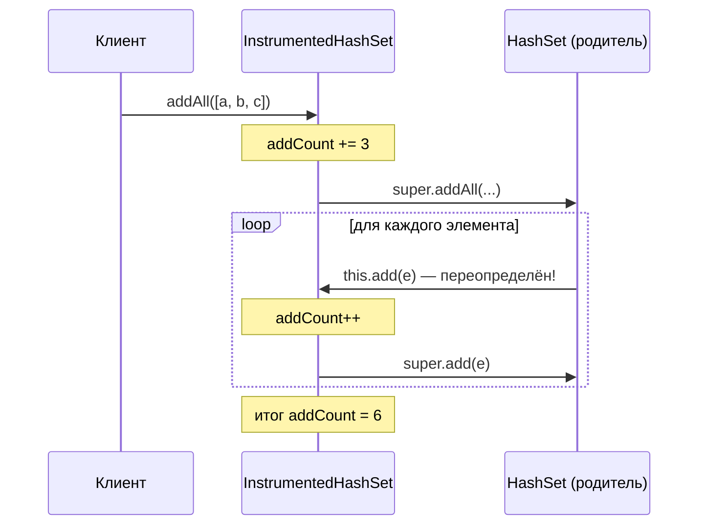

Наследование позволяет классу получить поля и поведение родителя и уточнить
или расширить их. На senior-собеседовании механику `extends` знают все, поэтому
спрашивают о другом: какие правила действуют при переопределении, почему в Java
одиночное наследование классов и чем наследование опасно — fragile base class,
утечка инкапсуляции, вызовы из конструктора.

## Ключевые концепции

### Механика

#### extends и вызов super()
Класс объявляет родителя через `extends` и получает все его доступные члены:
поля, методы и вложенные типы. Конструкторы не наследуются — у каждого класса
свои. Если `extends` не указан, родителем неявно становится `Object`.

Любой конструктор наследника начинается с вызова конструктора родителя через
`super(...)`. Если вызов не написан явно, компилятор подставляет `super()` без
аргументов — и если у родителя нет конструктора без параметров, код не
скомпилируется. До Java 25 вызов обязан стоять первой инструкцией, с Java 25
перед ним допустим пролог без обращения к `this` (подробно — в темах «Классы и
объекты» и «Порядок инициализации при наследовании» раздела 2).

#### Правила переопределения
Переопределение (overriding) — объявление в наследнике метода с той же
сигнатурой, что и у родителя: то же имя и те же типы параметров. Тогда вызов
через ссылку на родителя попадёт в реализацию наследника — это основа
полиморфизма (следующая тема). Аннотация `@Override` не обязательна, но
заставляет компилятор проверить, что метод действительно что-то переопределяет.

Остальные части объявления подчиняются принципу «наследник не может обещать
меньше родителя». Видимость можно расширить, но не сузить: `protected` можно
сделать `public`, а `public` сделать `protected` нельзя. Checked-исключений
можно бросать меньше или более узкие, но не новые и не более широкие.
`private`, `static` и `final` методы не переопределяются: первые не видны
наследнику, вторые скрываются, третьи запрещены.

#### Ковариантный возвращаемый тип
Возвращаемый тип при переопределении может быть подтипом исходного: если
`Animal.copy()` возвращает `Animal`, то `Dog.copy()` вправе возвращать `Dog`.
Это называется ковариантным возвращаемым типом (Java 5+). Вызывающему коду,
который знает, что работает с `Dog`, не нужно приведение типа.

Для примитивов и `void` ковариантности нет — тип должен совпадать точно. На
уровне байткода JVM различает методы по полному дескриптору, включая
возвращаемый тип, поэтому компилятор генерирует в наследнике синтетический
bridge-метод со старой сигнатурой, который просто вызывает новый (см. «под
капотом»).

#### Одиночное наследование классов
Класс в Java может наследовать ровно один класс, а реализовывать — сколько
угодно интерфейсов. Причина — состояние. Если два родителя содержат поля и
реализации одного метода, наследнику непонятно, чью версию брать и сколько
копий общего предка хранить (классическая diamond problem, как в C++).

Интерфейсы до Java 8 не имели реализаций вовсе, а после появления
`default`-методов по-прежнему не имеют полей экземпляра. Конфликт двух
`default`-методов компилятор требует разрешить явно, а конфликта состояния
быть не может. Подробности — в теме «Абстракция: abstract class vs interface».

### Проблемы

#### Fragile base class
Наследник зависит не только от публичного контракта родителя, но и от деталей
его реализации: какие методы вызывают какие. Если родитель меняет эти детали,
не меняя контракта, наследник может сломаться без единой строчки изменений в
своём коде. Эту проблему называют хрупким базовым классом (fragile base class).

Классический пример из Effective Java — счётчик добавлений, унаследованный от
`HashSet`. Наследник переопределяет и `add`, и `addAll`, а `HashSet.addAll`
внутри вызывает `add` — поэтому каждый элемент считается дважды. Наследник
опирался на то, о чём в документации `HashSet` не сказано, и это может
измениться в любой версии JDK.

#### Нарушение инкапсуляции
Наследование — самая сильная связь между классами: наследник видит
`protected`-члены родителя и обязан учитывать его внутренние вызовы. Поэтому
говорят, что наследование нарушает инкапсуляцию: граница родителя проходит
не по публичному API, а по его реализации.

С ростом глубины иерархии проблема усиливается. Чтобы понять поведение класса
пятого уровня, приходится читать все пять, а изменение где-то посередине
затрагивает всё, что ниже. Отсюда два практических правила Effective Java:
проектировать класс для наследования и документировать самоиспользование
методов — либо запрещать наследование (`final`), а для повторного
использования кода брать композицию.

#### Вызов переопределяемого метода из конструктора
Конструктор родителя выполняется раньше, чем инициализируются поля
наследника. Если родитель вызывает из конструктора метод, который наследник
переопределил, этот метод увидит поля наследника в значениях по умолчанию —
`null`, `0`, `false`. Механика и пример подробно разобраны в теме «Порядок
инициализации при наследовании» раздела 2.

## Как это работает "под капотом"

Ковариантный возвращаемый тип — языковая возможность, которой у JVM нет: в
байткоде метод идентифицируется именем и полным дескриптором, включая тип
результата. Поэтому `Dog copy()` и `Animal copy()` для JVM — два разных метода.
Чтобы вызов через ссылку `Animal` попал в реализацию `Dog`, компилятор
добавляет в `Dog` синтетический bridge-метод:
```
$ javap -p -c Dog
class Dog extends Animal {
  Dog copy();
    Code:
       0: new           #7                  // class Dog
       3: dup
       4: invokespecial #9                  // Method "<init>":()V
       7: areturn

  Animal copy();
    Code:
       0: aload_0
       1: invokevirtual #10                 // Method copy:()LDog;
       4: areturn
}
```
Второй метод `Animal copy()` в исходном коде не написан — это и есть bridge.
Он переопределяет метод родителя на уровне JVM и делегирует в настоящий
`Dog copy()`. Тот же механизм используется при переопределении generic-методов
после стирания типов (раздел 6).

Последовательность вызовов в примере с fragile base class (ниже):


`HashSet.addAll` вызывает `add` через `this`, а `this` — это наследник. Поэтому
управление возвращается в переопределённый `add`, и каждый элемент
учитывается второй раз.

## Примеры

Ковариантный возвращаемый тип:
```java
class Animal {
    Animal copy() { return new Animal(); }
}
class Dog extends Animal {
    @Override
    Dog copy() { return new Dog(); } // ковариантный возвращаемый тип
}
// main:
Dog d = new Dog().copy();          // без приведения типа
Animal a = new Dog();
System.out.println(a.copy().getClass().getSimpleName());
```
```
Dog
```
Через ссылку `Animal` вызвалась реализация `Dog` — переопределение работает,
хотя возвращаемые типы разные. А `new Dog().copy()` сразу даёт `Dog` без
приведения.

Нарушение правил переопределения ловит компилятор:
```java
class Base {
    public void open() throws IOException {}
}
class Narrow extends Base {
    @Override void open() {}                           // сужение видимости
}
class Broad extends Base {
    @Override public void open() throws Exception {}  // более широкое checked-исключение
}
```
```
Rules.java:6: error: open() in Narrow cannot override open() in Base
    @Override void open() {}                           // сужение видимости
                   ^
  attempting to assign weaker access privileges; was public
Rules.java:9: error: open() in Broad cannot override open() in Base
    @Override public void open() throws Exception {}  // более широкое checked-исключение
                          ^
  overridden method does not throw Exception
2 errors
```
Обе ошибки следуют из одного принципа: код, работающий с `Base`, должен
продолжать работать с любым наследником. Он вправе вызвать `open()` откуда
угодно и обрабатывает только `IOException` — наследник не может это нарушить.

Fragile base class в действии:
```java
static class InstrumentedHashSet<E> extends HashSet<E> {
    private int addCount = 0;
    @Override public boolean add(E e) {
        addCount++;
        return super.add(e);
    }
    @Override public boolean addAll(Collection<? extends E> c) {
        addCount += c.size();
        return super.addAll(c);   // HashSet.addAll внутри вызывает add()
    }
    int getAddCount() { return addCount; }
}
// main:
InstrumentedHashSet<String> s = new InstrumentedHashSet<>();
s.addAll(List.of("a", "b", "c"));
System.out.println("addCount = " + s.getAddCount());
```
```
addCount = 6
```
Добавлено три элемента, а счётчик показывает шесть. «Починить» это, убрав
переопределение `addAll`, — значит снова завязаться на реализацию `HashSet`.
Надёжное решение — композиция вместо наследования (тема «Композиция vs
наследование»).

Поля не переопределяются, а скрываются:
```java
class Parent {
    String name = "parent";
    String getName() { return name; }
}
class Child extends Parent {
    String name = "child";             // скрывает поле, а не переопределяет
    @Override String getName() { return name; }
}
// main:
Parent p = new Child();
System.out.println("p.name      = " + p.name);
System.out.println("p.getName() = " + p.getName());
System.out.println("((Child) p).name = " + ((Child) p).name);
```
```
p.name      = parent
p.getName() = child
((Child) p).name = child
```
Обращение к полю разрешается по статическому типу ссылки (`Parent`), а вызов
метода — по реальному типу объекта (`Child`). В объекте `Child` при этом живут
оба поля `name`, родительское и собственное.

## Частые вопросы на собеседовании

**Q: Почему в Java нельзя наследовать два класса?**
A: Из-за конфликта состояния и реализаций. Если оба родителя содержат поля и
одноимённые методы, непонятно, какую реализацию получает наследник и сколько
копий полей общего предка в нём хранить — это diamond problem. Java решает её
радикально: реализация с состоянием наследуется только от одного класса, а
множественным может быть только наследование контрактов через интерфейсы,
у которых нет полей экземпляра.

**Q: Что можно и что нельзя менять при переопределении метода?**
A: Имя и типы параметров должны совпадать, иначе это перегрузка, а не
переопределение. Возвращаемый тип может быть подтипом исходного (ковариантный
возврат), видимость — только расширяться, checked-исключения — только
сужаться или исчезать. Это прямое следствие принципа подстановки Лисков: код,
написанный для родителя, должен корректно работать с наследником.

**Q: Что такое fragile base class problem?**
A: Это ситуация, когда наследник ломается от изменения реализации родителя,
хотя публичный контракт родителя не менялся. Наследник неявно зависит от
того, какие методы родитель вызывает внутри себя — например, вызывает ли
`addAll` метод `add`. Защита — либо проектировать класс для наследования и
документировать самоиспользование, либо запрещать наследование и
использовать композицию.

**Q: Переопределяются ли поля?**
A: Нет, поле в наследнике с тем же именем скрывает поле родителя (field
hiding), и в объекте живут оба. Какое из них прочитается, решает статический
тип ссылки на этапе компиляции, а не реальный тип объекта. Поэтому
полиморфное поведение строят на методах, а поля делают `private`.

## Ловушки и частые ошибки

#### equals(Point) вместо equals(Object)
Метод `public boolean equals(Point other)` в классе `Point` не переопределяет
`Object.equals(Object)`, а перегружает его — сигнатура другая. Коллекции
вызывают `equals(Object)` и получают реализацию `Object` со сравнением ссылок.
Код компилируется и даже работает в тестах, где сравнивают переменные типа
`Point`. Аннотация `@Override` превращает эту ошибку в ошибку компиляции —
поэтому её стоит писать всегда.

#### «private-метод можно переопределить»
Метод `private` не виден наследнику, поэтому одноимённый метод в наследнике —
это новый независимый метод. Если родитель вызывает свой `private`-метод, он
всегда вызовет собственную версию, что бы ни объявил наследник. С `@Override`
такой «переопределённый» метод не скомпилируется.

#### protected — это не «только для наследников»
В Java `protected` открывает доступ ещё и всему пакету родителя. Поэтому
`protected`-поле — это часть API, доступная широкому кругу кода, а не тайна
между родителем и детьми. Для изменяемого состояния лучше `private`-поле и
`protected`-метод с проверками.

## Связанные темы
- [Порядок инициализации при наследовании](../02-java-core/10-initialization-order.md) — порядок static/instance-инициализации и ловушка с вызовом overridable-метода из конструктора.
- [Инкапсуляция](01-encapsulation.md) — почему наследование ослабляет границы класса.
- [Полиморфизм](03-polymorphism.md) — как JVM выбирает переопределённую реализацию в рантайме.
- [Абстракция: abstract class vs interface](04-abstract-vs-interface.md) — одиночное наследование классов и множественная реализация интерфейсов.
- [Композиция vs наследование](05-composition-vs-inheritance.md) — как решить fragile base class обёрткой.
- Generics (раздел 6) — bridge-методы после стирания типов.

## Источники
- Joshua Bloch, «Effective Java», 3rd ed.: Item 18 «Favor composition over inheritance», Item 19 «Design and document for inheritance or else prohibit it».
- [JLS §8.4.8: Inheritance, Overriding, and Hiding](https://docs.oracle.com/javase/specs/jls/se21/html/jls-8.html#jls-8.4.8).
- [The Java Tutorials: Inheritance](https://docs.oracle.com/javase/tutorial/java/IandI/subclasses.html).
