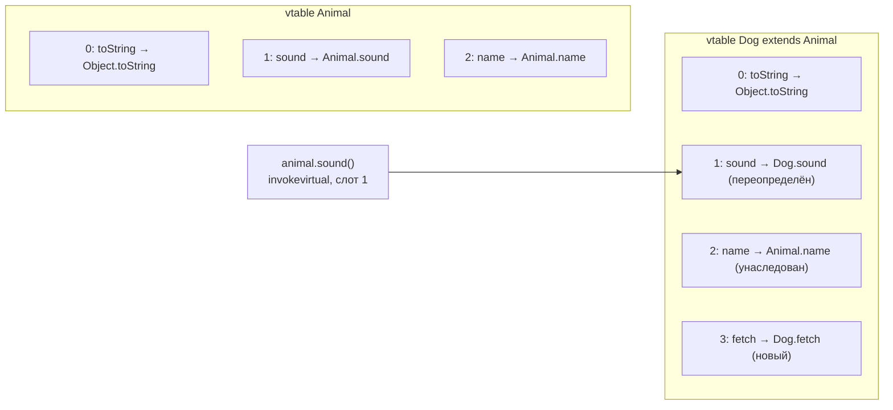

Полиморфизм — способность одного и того же вызова работать с объектами разных
типов и выбирать для каждого свою реализацию. Это один из самых частых
теоретических вопросов: от senior ждут не только «overloading и overriding»,
но и объяснения, когда именно принимается решение и как JVM находит нужный
метод — vtable, инструкции `invoke*` и что с этим делает JIT.

## Ключевые концепции

### Виды

#### Статический полиморфизм: overloading
Статический (compile-time) полиморфизм — это перегрузка методов: несколько
методов с одним именем и разными параметрами. Какой из них вызвать, решает
компилятор, и решает по статическим (объявленным) типам аргументов в точке
вызова. В байткод попадает уже конкретная выбранная сигнатура.

Отсюда главное свойство: реальный тип аргумента в рантайме на выбор перегрузки
не влияет. Если переменная объявлена как `Object`, а хранит `String`, будет
вызвана перегрузка с параметром `Object`. Правила выбора наиболее подходящей
перегрузки (точное совпадение, расширение, боксинг, varargs) разобраны в теме
«Методы» раздела 2.

#### Динамический полиморфизм: overriding
Динамический (runtime) полиморфизм — это переопределение: наследник объявляет
метод с той же сигнатурой, что и родитель. Компилятор фиксирует в байткоде
только сигнатуру, а конкретную реализацию JVM выбирает в момент вызова — по
реальному классу объекта, на который указывает ссылка. Это и называют
динамической диспетчеризацией (dynamic dispatch).

Благодаря этому код может работать с абстракцией (`List`, `Shape`,
`PaymentGateway`), не зная конкретных классов, а новые реализации добавляются
без изменения вызывающего кода. Именно на этом стоят принцип открытости-
закрытости, паттерн «Стратегия» и вся идея программирования через интерфейсы.

#### Выбор по одному аргументу (single dispatch)
Важная деталь: Java выбирает реализацию динамически только по одному объекту —
тому, у которого вызывается метод (receiver). Типы остальных аргументов
учитываются лишь статически, через перегрузку. Такую модель называют single
dispatch.

Если нужно выбирать поведение по реальным типам двух объектов сразу (double
dispatch), язык этого не делает. Классический обходной путь — паттерн Visitor,
где два последовательных виртуальных вызова эмулируют выбор по двум типам.
С Java 21 часто проще использовать `switch` с pattern matching по sealed-
иерархии.

Перегрузка и переопределение в одном вызове:
```java
class Printer {
    void print(Object o) { System.out.println("Printer.print(Object)"); }
    void print(String s) { System.out.println("Printer.print(String)"); }
}
class FancyPrinter extends Printer {
    @Override void print(Object o) { System.out.println("FancyPrinter.print(Object)"); }
    @Override void print(String s) { System.out.println("FancyPrinter.print(String)"); }
}
// main:
Printer p = new FancyPrinter();   // статический тип Printer, реальный — FancyPrinter
Object arg = "hello";             // статический тип Object, реальный — String
p.print(arg);
p.print("hello");
```
```
FancyPrinter.print(Object)
FancyPrinter.print(String)
```
В первом вызове работают оба механизма, и каждый по своему правилу. Перегрузку
`print(Object)` выбрал компилятор по статическому типу `arg`, хотя там лежит
строка. Реализацию `FancyPrinter` выбрала JVM по реальному типу `p`, хотя
переменная объявлена как `Printer`.

### Механизм в JVM

#### Раннее и позднее связывание
Связывание (binding) — сопоставление вызова и конкретного кода метода. При
раннем (статическом) связывании реализация известна до исполнения: так
вызываются `static`-методы, конструкторы, вызовы через `super.` и методы,
которые нельзя переопределить (`private`, `final`). При позднем (динамическом)
связывании реализация выбирается в рантайме по классу объекта — так работают
все остальные методы экземпляра, которые в Java виртуальны по умолчанию.

В байткоде это видно по инструкциям вызова. `invokestatic` — статический
метод, `invokespecial` — конструктор и `super.`-вызов, `invokevirtual` —
виртуальный метод класса, `invokeinterface` — метод через ссылку на интерфейс,
`invokedynamic` — лямбды и конкатенация строк (раздел 9). Нюанс современных
JDK: вызов `private`- и `final`-метода компилируется в `invokevirtual`, но
JVM при разрешении видит, что метод не может быть переопределён, и связывает
его напрямую, без поиска в таблице.

Инструкции вызова в байткоде:
```java
interface Greeter { void greet(); }
class Calls implements Greeter {
    static void util() {}
    private void secret() {}
    final void locked() {}
    void open() {}
    public void greet() {}

    void demo(Greeter g) {
        util();           // static
        secret();         // private
        locked();         // final
        open();           // обычный виртуальный
        g.greet();        // через интерфейс
        super.toString(); // явный вызов реализации родителя
    }
}
```
```
$ javap -c Calls     (метод demo, JDK 21)
       0: invokestatic  #7                  // Method util:()V
       3: aload_0
       4: invokevirtual #12                 // Method secret:()V
       7: aload_0
       8: invokevirtual #15                 // Method locked:()V
      11: aload_0
      12: invokevirtual #18                 // Method open:()V
      15: aload_1
      16: invokeinterface #21,  1           // InterfaceMethod Greeter.greet:()V
      21: aload_0
      22: invokespecial #26                 // Method java/lang/Object.toString:()Ljava/lang/String;
```
Видно, что `private`- и `final`-методы вызываются той же инструкцией
`invokevirtual`, что и обычный метод. До Java 11 `private`-методы вызывались
через `invokespecial`, но после введения nestmates (JEP 181) javac перешёл на
`invokevirtual`. Статическое связывание для них никуда не делось — его
обеспечивает JVM при разрешении метода, а не выбор инструкции.

#### vtable — таблица виртуальных методов
Чтобы позднее связывание было быстрым, HotSpot строит для каждого загруженного
класса vtable (virtual method table) — массив ссылок на реализации всех его
виртуальных методов. Метод получает в таблице фиксированный индекс (слот), и
наследник наследует раскладку родителя: унаследованные методы стоят в тех же
слотах, переопределённые подменяют ссылку в своём слоте, новые методы
добавляются в конец.

Поэтому `invokevirtual` не ищет метод по имени. JVM берёт класс объекта из его
заголовка, открывает vtable этого класса и переходит по заранее известному
индексу — это O(1). Для `invokeinterface` так не получается: один и тот же
интерфейс может занимать в разных классах разные позиции, поэтому
используется отдельная itable (подробнее — в теме «Абстракция: abstract class
vs interface»).


Ссылка имеет тип `Animal`, но объект — `Dog`, поэтому вызов `sound()` идёт по
слоту 1 в таблице `Dog`. Слоты унаследованных методов совпадают, поэтому один
и тот же индекс корректен для любого наследника.

#### Что с этим делает JIT
На практике виртуальный вызов в горячем коде часто стоит столько же, сколько
обычный. JIT-компилятор собирает профиль: какие классы реально встречаются в
конкретном месте вызова. Если там всегда один класс (мономорфный вызов), JIT
подставляет проверку типа и встраивает (inline) тело метода прямо в место
вызова; для двух классов делает то же с двумя ветками (биморфный вызов).

Только когда классов три и больше (мегаморфный вызов), остаётся честный
переход через vtable или itable без инлайнинга. Кроме того, если по иерархии
загруженных классов видно, что у метода всего одна реализация (class
hierarchy analysis), JIT девиртуализирует вызов. Если позже загрузится
переопределяющий класс, скомпилированный код откатится (деоптимизация).
Подробно — в теме про JIT в разделе 9.

## Частые вопросы на собеседовании

**Q: В чём разница между overloading и overriding?**
A: Перегрузка — несколько методов с одним именем и разными параметрами в
одном классе или иерархии; выбор делает компилятор по статическим типам
аргументов. Переопределение — замена реализации метода родителя в наследнике
с той же сигнатурой; выбор делает JVM в рантайме по реальному типу объекта.
Первое — статический полиморфизм, второе — динамический. Они могут
сочетаться в одном вызове: перегрузка выбирает сигнатуру, переопределение —
реализацию этой сигнатуры.

**Q: Как работает динамическая диспетчеризация методов в JVM?**
A: Компилятор кладёт в байткод `invokevirtual` (или `invokeinterface`) с
сигнатурой метода. При первом исполнении JVM разрешает символьную ссылку и
определяет индекс метода в vtable. Дальше на каждом вызове она берёт класс
объекта из заголовка, смотрит в его vtable по этому индексу и переходит на
найденную реализацию — за O(1). В горячем коде JIT обычно ещё и встраивает
реализацию, если в месте вызова встречается один-два класса.

**Q: Являются ли static-методы полиморфными?**
A: Нет. Static-метод не привязан к объекту и вызывается через
`invokestatic`, реализация известна на этапе компиляции. Метод с той же
сигнатурой в наследнике не переопределяет, а скрывает родительский (method
hiding), и вызов через ссылку выбирает версию по объявленному типу ссылки
(тема «final и static» раздела 2).

**Q: Медленнее ли виртуальный вызов, чем обычный?**
A: В интерпретаторе — немного: нужен переход через vtable. Но после
JIT-компиляции мономорфные и биморфные вызовы встраиваются и стоят как
прямые, а final/private-методы связываются статически. Заметные расходы
остаются только на мегаморфных местах вызова, где встречается много разных
классов, — и то это обычно единицы наносекунд.

## Ловушки и частые ошибки

#### «Перегрузка выбирается по реальному типу аргумента»
Самое частое заблуждение — ожидать, что `print(arg)` с `Object arg = "hello"`
вызовет `print(String)`. Перегрузка всегда выбирается по статическому типу.
Если нужен выбор по реальному типу аргумента, это задача для
переопределения, Visitor или `switch` с pattern matching, а не для перегрузки.

#### «private и final вызываются через invokespecial»
Это верно для старых JDK и до сих пор встречается в статьях. С Java 11 javac
генерирует для них `invokevirtual`, как видно в примере. Правильная
формулировка для собеседования: эти методы связываются статически, потому что
их нельзя переопределить, а не потому, что используется особая инструкция.

#### «Виртуальные вызовы — повод делать всё final ради скорости»
Объявлять методы `final` ради производительности бессмысленно: JIT сам
девиртуализирует вызов, если реализация одна, и сам откатит оптимизацию,
если появится вторая. `final` — инструмент проектирования (запрет
переопределения), а не микрооптимизация.

## Связанные темы
- [Методы](../02-java-core/05-methods.md) — правила выбора перегрузки и почему overloading решается статически.
- [final и static](../02-java-core/11-final-and-static.md) — method hiding у static-методов.
- [Наследование](02-inheritance.md) — правила переопределения и bridge-методы.
- [Абстракция: abstract class vs interface](04-abstract-vs-interface.md) — invokeinterface и itable.
- JIT-компиляция и оптимизации (раздел 9) — inline caches, девиртуализация, деоптимизация.
- Байткод, invokedynamic и Instrumentation API (раздел 9) — все инструкции вызова подробнее.

## Источники
- [JVM Specification §6.5: invokevirtual, invokeinterface, invokespecial, invokestatic](https://docs.oracle.com/javase/specs/jvms/se21/html/jvms-6.html#jvms-6.5).
- [JEP 181: Nest-Based Access Control](https://openjdk.org/jeps/181).
- [OpenJDK HotSpot Wiki: VirtualCalls](https://wiki.openjdk.org/display/HotSpot/VirtualCalls).
- Aleksey Shipilev, [The Black Magic of (Java) Method Dispatch](https://shipilev.net/blog/2015/black-magic-method-dispatch/).
