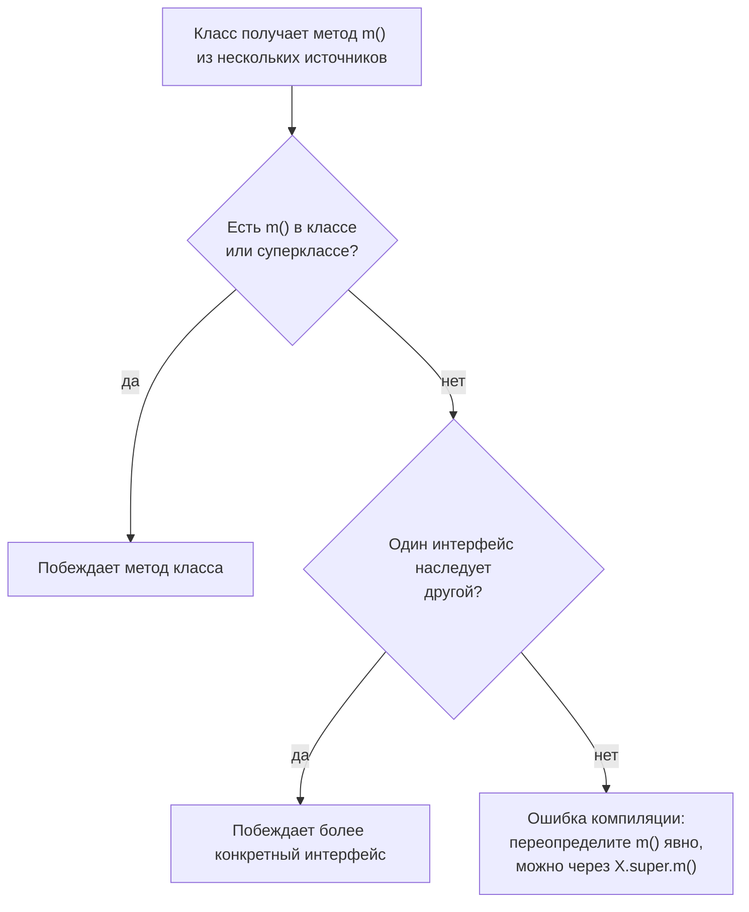

Абстракция — выделение существенного контракта и сокрытие деталей реализации.
В Java для этого есть два инструмента: абстрактный класс и интерфейс, и вопрос
«когда что выбрать» звучит на собеседовании любого уровня. Хороший ответ не
перечисляет отличия, а объясняет, откуда они берутся: состояние, одиночное
наследование, эволюция API и то, как вызовы устроены в JVM.

## Ключевые концепции

### Abstract class: что это такое

#### Нельзя создать, можно наследовать
Абстрактный класс объявляется с модификатором `abstract`, и компилятор
запрещает создавать его экземпляры через `new`. Он существует, чтобы его
наследовали: это неполная реализация, которую достраивает конкретный
наследник. При этом переменная типа абстрактного класса вполне законна и
указывает на объект какого-то наследника.

#### Состояние, конструктор и частичная реализация
В отличие от интерфейса, абстрактный класс — полноценный класс. У него могут
быть поля с состоянием, конструкторы, обычные реализованные методы и
абстрактные методы без тела. Конструктор нельзя вызвать через `new`, но он
вызывается через `super(...)` из конструктора наследника и инициализирует
общее состояние.

Типичное применение — паттерн «Шаблонный метод» (Template Method).
Абстрактный класс задаёт `final`-метод со скелетом алгоритма, а отдельные шаги
объявляет абстрактными или даёт им реализацию по умолчанию. Наследник
реализует только шаги и не может сломать общий порядок.

#### Обязанность наследника
Конкретный (не абстрактный) наследник обязан реализовать все абстрактные
методы, иначе код не скомпилируется. Если реализовать их все невозможно или
не нужно, наследник сам объявляется `abstract`, и обязанность переходит дальше
по иерархии.

#### Любые модификаторы доступа
Члены абстрактного класса могут иметь любую видимость: `private`-поля,
`protected`-методы для наследников, package-private помощники. Это ещё одно
отличие от интерфейса, где всё по умолчанию `public`, а `private` допустимо
только для вспомогательных методов (Java 9+).

### Interface: что это такое

#### Контракт поведения
Интерфейс описывает, что умеет объект, но не как он это делает. Класс,
объявивший `implements`, обязуется реализовать все абстрактные методы
интерфейса. Вызывающий код зависит только от контракта и работает с любой
реализацией — на этом стоят `List`, `Comparator`, `Runnable` и почти весь
современный дизайн API.

#### Интерфейс до Java 8
До Java 8 интерфейс мог содержать только абстрактные методы и константы.
Модификаторы подставлялись неявно: методы — `public abstract`, поля —
`public static final`. Поэтому поле в интерфейсе всегда константа, а не
состояние объекта.

#### Ни состояния, ни конструктора
У интерфейса нет полей экземпляра и нет конструктора — инициализировать в нём
нечего. Создать интерфейс через `new` нельзя. Запись `new Runnable() { ... }`
создаёт не интерфейс, а объект анонимного класса, который его реализует.

### Ключевое структурное отличие

#### Один класс, много интерфейсов
Класс может наследовать только один класс — абстрактный или обычный. Это
ограничение против diamond problem с состоянием: если два родителя несут поля
и реализации, у наследника возникает конфликт, который нельзя разрешить
корректно в общем случае (подробнее — в теме «Наследование»).

Интерфейсов класс может реализовывать сколько угодно (`implements A, B, C`).
Так Java получает множественное наследование поведения без множественного
наследования состояния. Конфликт возможен только между `default`-методами, и
компилятор требует разрешить его явно.

#### is-a против can-do
Практическое правило выбора такое. Абстрактный класс — для связанной иерархии
«является» (is-a) с общим состоянием и частично готовой реализацией: `Report`
и его виды, `AbstractList` и конкретные списки. Интерфейс — для способности
«умеет» (can-do), не привязанной к конкретной иерархии: `Comparable`,
`AutoCloseable`, `Serializable` реализуют совершенно несвязанные классы.

На практике их часто комбинируют. Публичный тип — интерфейс, а для удобства
реализаций рядом лежит абстрактный класс со скелетной реализацией
(`List` + `AbstractList`, `Map` + `AbstractMap`). Клиенты зависят от
интерфейса, а реализация может наследовать скелет или не наследовать.

### Интерфейсы после Java 8

#### default-методы
`default`-метод — метод интерфейса с реализацией по умолчанию. Главная причина
появления — эволюция API: добавить новый абстрактный метод в опубликованный
интерфейс значит сломать все существующие реализации. Так в Java 8 в
`Collection` появились `stream()` и `removeIf()`, а в `Iterable` — `forEach()`,
и миллионы чужих реализаций продолжили компилироваться.

`default`-метод может вызывать другие методы интерфейса, но не имеет доступа к
состоянию — полей у интерфейса нет. Поэтому это не полноценные трейты, как в
Scala: поведение по умолчанию можно выразить только через абстрактные методы
того же контракта.

#### static-методы интерфейса
Статические методы интерфейса — утилиты, привязанные к самому контракту:
фабрики и комбинаторы вроде `List.of()`, `Map.entry()`, `Comparator.comparing()`.
Раньше для этого заводили отдельный класс-компаньон (`Collections`, `Arrays`).
Такие методы не наследуются реализациями и вызываются только через имя
интерфейса.

#### private-методы (Java 9+)
`private`-методы интерфейса позволяют вынести общий код нескольких
`default`- или `static`-методов, не делая его частью публичного контракта. До
Java 9 такой помощник пришлось бы сделать `default`, и он стал бы доступен и
переопределяем всеми реализациями.

#### Diamond problem у default-методов
Если класс получает два `default`-метода с одинаковой сигнатурой из разных
интерфейсов, возникает неоднозначность. Компилятор разрешает её по трём
правилам, по порядку. Первое: метод класса или суперкласса всегда побеждает
`default`-метод. Второе: если один интерфейс наследует другой, побеждает более
конкретный.

Третье: если ни одно правило не сработало, класс обязан переопределить метод
сам, иначе ошибка компиляции. Внутри переопределения можно явно вызвать
нужную версию через `ИмяИнтерфейса.super.метод()`.



### Функциональные интерфейсы

#### SAM: ровно один абстрактный метод
Функциональный интерфейс — интерфейс ровно с одним абстрактным методом (SAM,
Single Abstract Method). `default`- и `static`-методы не считаются, как и
абстрактные методы, совпадающие с публичными методами `Object` (поэтому в
`Comparator` есть `equals(Object)`, и он всё равно функциональный).

#### @FunctionalInterface
Аннотация `@FunctionalInterface` не обязательна: любой интерфейс с одним
абстрактным методом и так годится для лямбды. Её смысл — защита контракта.
Если кто-то добавит второй абстрактный метод, компилятор выдаст ошибку прямо
в интерфейсе, а не во всех местах, где он использовался с лямбдами.

#### Лямбды и method reference
Только функциональному интерфейсу можно присвоить лямбду или ссылку на метод:
компилятор знает, какой единственный метод реализует лямбда. Реализация
создаётся не анонимным классом на этапе компиляции, а в рантайме: в байткоде
стоит `invokedynamic`, который при первом вызове через `LambdaMetafactory`
генерирует класс-реализацию. Подробнее — в разделах 7 и 9.

### Sealed-иерархии (Java 17)

#### sealed и permits
`sealed`-класс или интерфейс явно перечисляет в `permits`, кто может его
наследовать или реализовывать. Никто другой не сможет — компилятор и JVM это
проверяют. Так иерархия становится закрытой: набор вариантов известен
полностью, как у enum, но каждый вариант может быть отдельным типом со своими
полями.

#### final, sealed, non-sealed у наследников
Каждый разрешённый наследник обязан выбрать один из трёх модификаторов.
`final` закрывает ветку окончательно (records неявно `final`). `sealed`
продолжает закрытую иерархию со своим `permits`. `non-sealed` снова открывает
эту ветку для любого наследования — это осознанный выход из закрытой иерархии.

#### Исчерпывающий switch
Главная практическая ценность — `switch` по sealed-типу без `default`.
Компилятор знает все варианты и проверяет, что каждый обработан. Если позже
добавить новый вариант в `permits`, все такие `switch` перестанут
компилироваться — забыть обработать новый случай невозможно, в отличие от
цепочки `instanceof` с `else`.

### Под капотом в JVM

#### invokeinterface и invokevirtual
Вызов метода через ссылку на интерфейс компилируется в `invokeinterface`, через
ссылку на класс (в том числе абстрактный) — в `invokevirtual`. Разница не в
том, где метод объявлен, а в статическом типе ссылки в точке вызова (пример
байткода — в теме «Полиморфизм»).

#### vtable и itable
Для `invokevirtual` JVM использует vtable: у метода фиксированный индекс,
одинаковый во всех наследниках, поэтому поиск — O(1) по индексу. С
интерфейсами так не получается: класс реализует несколько интерфейсов, и
методы одного интерфейса оказываются в разных классах на разных позициях.

Поэтому у каждого класса есть ещё itable — список реализуемых интерфейсов, для
каждого из которых хранится своя таблица методов. `invokeinterface` сначала
находит в itable нужный интерфейс, затем метод в его таблице, то есть делает
больше работы. Исторически это было медленнее, но JIT убирает разницу: inline
cache запоминает класс объекта и прямой адрес реализации, и в мономорфном
месте вызова оба вида вызова становятся одинаково дешёвыми.

## Примеры

Абстрактный класс с состоянием, конструктором и шаблонным методом:
```java
abstract class Report {
    private final String title;                            // состояние
    protected Report(String title) { this.title = title; } // конструктор
    public final String render() {                         // шаблонный метод: скелет алгоритма
        return "== " + title + " ==\n" + body() + "\n-- " + footer();
    }
    protected abstract String body();                      // шаг, который обязан задать наследник
    protected String footer() { return "конец"; }          // шаг с реализацией по умолчанию
}
class SalesReport extends Report {
    SalesReport() { super("Продажи"); }
    @Override protected String body() { return "итого: 42"; }
}
// main: System.out.println(new SalesReport().render());
```
```
== Продажи ==
итого: 42
-- конец
```
Здесь используется всё, чего нет у интерфейса: `private`-поле, конструктор,
вызываемый через `super(...)`, и `final`-метод, который наследник не может
переопределить. Интерфейсом этот дизайн не выразить.

Конфликт default-методов и его разрешение:
```java
interface Walker  { default String move() { return "walk"; } }
interface Swimmer { default String move() { return "swim"; } }

class Duck implements Walker, Swimmer {
    @Override
    public String move() {                     // без этого метода — ошибка компиляции
        return Walker.super.move() + "+" + Swimmer.super.move();
    }
}

class Animal { public String move() { return "Animal.move"; } }
class Robot extends Animal implements Walker {} // метод класса побеждает default-метод
// main:
System.out.println(new Duck().move());
System.out.println(new Robot().move());
```
```
walk+swim
Animal.move
```
`Robot` ничего не переопределяет, но получает `Animal.move`, а не
`Walker.move` — правило «класс побеждает интерфейс». Если же убрать из `Duck`
явное переопределение, компилятор откажется:
```
DiamondFail.java:3: error: types Walker and Swimmer are incompatible;
class Duck implements Walker, Swimmer {}
^
  class Duck inherits unrelated defaults for move() from types Walker and Swimmer
1 error
```

Sealed-иерархия и исчерпывающий switch (Java 21):
```java
sealed interface Shape permits Circle, Square, Rect {}
record Circle(double r) implements Shape {}
record Square(double side) implements Shape {}
non-sealed class Rect implements Shape {          // открыт для дальнейшего наследования
    final double w, h;
    Rect(double w, double h) { this.w = w; this.h = h; }
}

static double area(Shape s) {
    return switch (s) {                          // default не нужен: компилятор знает все варианты
        case Circle c -> Math.PI * c.r() * c.r();
        case Square q -> q.side() * q.side();
        case Rect r   -> r.w * r.h;
    };
}
// main: System.out.printf("%.2f %.2f %.2f%n", area(new Circle(1)), area(new Square(2)), area(new Rect(2, 3)));
```
```
3,14 4,00 6,00
```
(Запятая в дробях — от русской локали по умолчанию в `printf`.) Если из
`switch` убрать ветки и оставить только `Circle`, код не скомпилируется:
```
SealedFail.java:6: error: the switch expression does not cover all possible input values
        return switch (s) {
               ^
1 error
```

`@FunctionalInterface` охраняет контракт:
```java
@FunctionalInterface
interface Validator {
    boolean validate(String s);
    boolean strict(String s);
}
```
```
FuncFail.java:1: error: Unexpected @FunctionalInterface annotation
@FunctionalInterface
^
  Validator is not a functional interface
    multiple non-overriding abstract methods found in interface Validator
1 error
```
Без аннотации интерфейс скомпилировался бы, а ошибки появились бы во всех
местах, где ему присваивают лямбды.

## Частые вопросы на собеседовании

**Q: Почему в Java нельзя наследовать два класса, но можно реализовывать много интерфейсов?**
A: Проблема множественного наследования — в состоянии и реализациях. Если оба
родителя имеют поля и одноимённые методы, неясно, какую реализацию берёт
наследник и сколько копий полей общего предка он хранит. У интерфейсов нет
полей экземпляра, поэтому конфликт состояния невозможен. Конфликт
`default`-методов возможен, но компилятор требует разрешить его явно
переопределением — неоднозначность не остаётся в коде.

**Q: Что изменится в байткоде, если метод объявлен в интерфейсе, а не в abstract-классе?**
A: Вызов через ссылку на интерфейс компилируется в `invokeinterface`, через
ссылку на класс — в `invokevirtual`. Для `invokevirtual` JVM берёт метод из
vtable по фиксированному индексу, а для `invokeinterface` сначала ищет
интерфейс в itable класса, потому что у разных классов один интерфейс лежит на
разных позициях. Исторически это было медленнее, но JIT с inline cache
делает мономорфные вызовы одинаково быстрыми, так что выбирать по этому
критерию не стоит.

**Q: Когда выбрать abstract class, а когда interface, если оба подходят?**
A: По умолчанию — интерфейс: он не занимает единственное место родителя, его
можно реализовать в любой иерархии, его легко подменить в тестах. Абстрактный
класс нужен, когда у реализаций есть общее состояние, конструктор с
инвариантами, `protected`-помощники или шаблонный метод, который нельзя
переопределять. Частый компромисс — интерфейс как публичный тип плюс
абстрактный класс со скелетной реализацией (`List` + `AbstractList`).

**Q: Зачем в Java 8 добавили default-методы?**
A: Чтобы развивать опубликованные интерфейсы без поломки всех реализаций.
Добавление абстрактного метода в `Collection` сломало бы каждую стороннюю
коллекцию, а `default`-метод даёт реализацию сразу всем. Побочный эффект —
появилась возможность конфликта одинаковых `default`-методов, для которого
есть правила разрешения.

**Q: Чем sealed-иерархия лучше обычного интерфейса с instanceof?**
A: Компилятор знает полный список вариантов и проверяет исчерпывающий
`switch` без `default`. При добавлении нового варианта все непокрытые `switch`
перестают компилироваться. С обычным интерфейсом новый класс молча попадёт в
`default` или `else`, и ошибка проявится только в рантайме.

## Ловушки и частые ошибки

#### «default-методы делают интерфейс абстрактным классом»
`default`-методы дали интерфейсам поведение, но не состояние: полей
экземпляра, конструкторов и `protected`-членов у интерфейса по-прежнему нет.
Поведение по умолчанию может опираться только на другие методы контракта.
Если реализациям нужно общее состояние, это всё ещё работа для абстрактного
класса.

#### Поле в интерфейсе — всегда константа
Поле, объявленное в интерфейсе, неявно `public static final`, даже если
модификаторы не написаны. Отсюда антипаттерн «интерфейс констант»: класс
реализует интерфейс только ради коротких имён констант, и они навсегда
становятся частью его публичного API. Для констант используют
`final`-класс или enum и `import static`.

#### Добавление абстрактного метода ломает реализации
Новый абстрактный метод в опубликованном интерфейсе — несовместимое изменение:
все существующие реализации перестанут компилироваться, а уже
скомпилированные получат `AbstractMethodError` при вызове. Для эволюции
публичных интерфейсов добавляют `default`-методы.

#### «У абстрактного класса нет конструктора»
Конструктор у абстрактного класса есть и выполняется при каждом создании
наследника через цепочку `super(...)`. Нельзя только вызвать его через `new`.
Поэтому в абстрактном классе можно и нужно проверять инварианты общего
состояния в конструкторе.

## Связанные темы
- [Наследование](02-inheritance.md) — одиночное наследование классов и diamond problem.
- [Полиморфизм](03-polymorphism.md) — vtable, invokevirtual и пример байткода с invokeinterface.
- [Композиция vs наследование](05-composition-vs-inheritance.md) — когда вместо абстрактного класса лучше интерфейс и делегирование.
- Лямбда-выражения и замыкания (раздел 7) — функциональные интерфейсы на практике.
- Байткод, invokedynamic и Instrumentation API (раздел 9) — LambdaMetafactory и invokedynamic.
- Java 21 (LTS) и далее (раздел 10) — pattern matching в switch и record patterns по sealed-иерархиям.

## Источники
- Joshua Bloch, «Effective Java», 3rd ed.: Item 20 «Prefer interfaces to abstract classes», Item 21 «Design interfaces for posterity», Item 22 «Use interfaces only to define types».
- [JLS §9: Interfaces](https://docs.oracle.com/javase/specs/jls/se21/html/jls-9.html), [§9.4.1.3: Inheriting Methods with Override-Equivalent Signatures](https://docs.oracle.com/javase/specs/jls/se21/html/jls-9.html#jls-9.4.1.3).
- [JEP 409: Sealed Classes](https://openjdk.org/jeps/409).
- [JEP 441: Pattern Matching for switch](https://openjdk.org/jeps/441).
