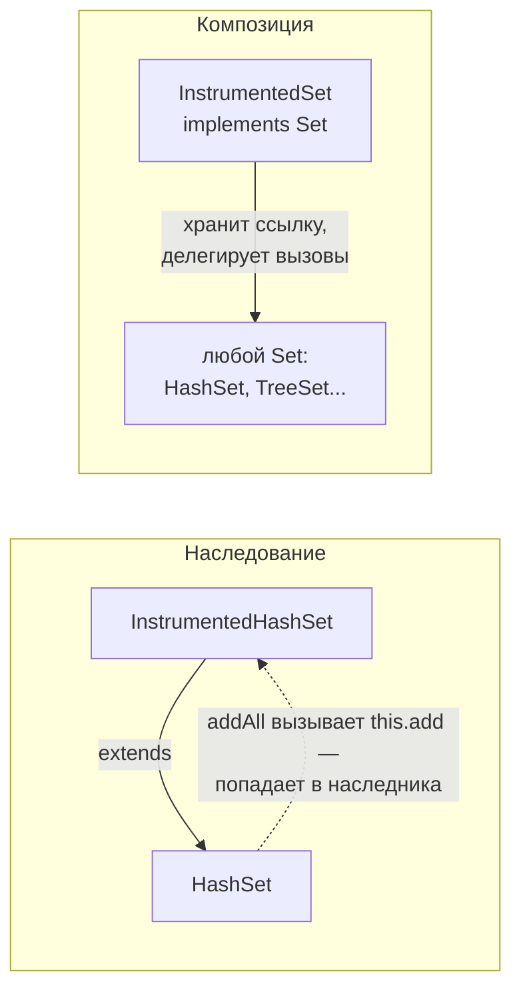

«Предпочитайте композицию наследованию» — один из самых цитируемых принципов
объектного дизайна. На собеседовании его мало назвать: нужно объяснить, какие
именно проблемы наследования решает композиция, когда наследование всё же
уместно и как выглядит делегирование в коде.

## Ключевые концепции

### Принцип

#### «Предпочитайте композицию наследованию»
Наследование реализации — самая сильная связь между классами: наследник
зависит от внутреннего поведения родителя, видит его `protected`-члены и
ломается при изменении деталей, не затрагивающих контракт (fragile base class,
тема «Наследование»). Effective Java (Item 18) формулирует вывод прямо:
наследовать стоит только тогда, когда это действительно отношение «является»,
а для повторного использования кода — брать композицию.

Композиция — это когда класс не наследует нужную функциональность, а хранит
ссылку на объект, который её предоставляет, и вызывает его методы. Новый класс
зависит только от публичного API вложенного объекта, а не от его
реализации. Вложенный объект можно заменить другой реализацией того же
интерфейса — даже во время выполнения.

#### has-a против is-a
Наследование выражает отношение «является» (is-a): `Dog` является `Animal`, и
везде, где ожидается `Animal`, можно подставить `Dog`. Композиция выражает
отношение «имеет» (has-a): `Car` имеет `Engine`, но не является двигателем, и
подставлять машину вместо двигателя бессмысленно.

Проверка «является ли это настоящим is-a» — принцип подстановки Лисков (LSP,
буква L в SOLID). Наследник должен соблюдать все обещания родителя: не
усиливать предусловия, не ослаблять постусловия, не нарушать инварианты. Если
наследник вынужден бросать `UnsupportedOperationException` на части
унаследованных методов или игнорировать их, это не is-a, и наследование было
ошибкой.

Ошибка наследования в самом JDK — `Stack extends Vector`:
```java
Stack<String> stack = new Stack<>();   // Stack extends Vector
stack.push("first");
stack.push("second");
stack.add(0, "sneaky");                // метод Vector: вставка в «дно» стека
stack.remove("first");                 // и удаление из середины
System.out.println("stack = " + stack + ", pop() = " + stack.pop());

Deque<String> deque = new ArrayDeque<>(); // рекомендуемая замена
deque.push("first");
deque.push("second");
System.out.println("deque = " + deque + ", pop() = " + deque.pop());
```
```
stack = [sneaky, second], pop() = second
deque = [second, first], pop() = second
```
Стек «является» вектором только с точки зрения реализации, но не поведения:
через унаследованные `add(int, E)` и `remove(Object)` можно вставлять и
удалять элементы в любом месте, разрушая LIFO. Стек должен был иметь вектор,
а не быть им. Та же ошибка — `Properties extends Hashtable`, через которую
можно положить в настройки нестроковые ключи и значения.

#### Делегирование вместо переопределения
При композиции новый класс реализует нужный интерфейс и перенаправляет
(forwarding) каждый вызов вложенному объекту, при необходимости добавляя своё
поведение до или после. Такой класс называют обёрткой (wrapper), а приём в
целом — паттерном «Декоратор» (раздел 12), если обёртка добавляет
функциональность, сохраняя интерфейс.

Ключевое отличие от наследования — внутренние вызовы обёрнутого объекта
больше не возвращаются в наш код. Если `HashSet.addAll` внутри вызывает
`add`, он вызовет свой собственный `add`, а не метод обёртки. Поэтому
обёртке не важно, как устроена реализация внутри, и она работает с любой
реализацией интерфейса: `HashSet`, `TreeSet`, `ConcurrentSkipListSet`.



Счётчик добавлений через композицию (сравните с примером в теме
«Наследование», где наследник `HashSet` насчитал 6 вместо 3):
```java
static class InstrumentedSet<E> implements Set<E> {
    private final Set<E> inner;
    private int addCount = 0;
    InstrumentedSet(Set<E> inner) { this.inner = inner; }

    @Override public boolean add(E e) { addCount++; return inner.add(e); }
    @Override public boolean addAll(Collection<? extends E> c) {
        addCount += c.size();
        return inner.addAll(c);   // внутренние вызовы inner нас больше не касаются
    }
    int getAddCount() { return addCount; }

    // остальные методы Set — простое делегирование
    @Override public int size() { return inner.size(); }
    @Override public boolean contains(Object o) { return inner.contains(o); }
    @Override public Iterator<E> iterator() { return inner.iterator(); }
    // ... ещё 9 методов того же вида
}
// main:
InstrumentedSet<String> s = new InstrumentedSet<>(new HashSet<>());
s.addAll(List.of("a", "b", "c"));
System.out.println("addCount = " + s.getAddCount());

InstrumentedSet<String> sorted = new InstrumentedSet<>(new TreeSet<>());
sorted.addAll(List.of("c", "a", "b"));
System.out.println("TreeSet внутри: " + sorted + ", addCount = " + sorted.getAddCount());
```
```
addCount = 3
TreeSet внутри: [a, b, c], addCount = 3
```
Счётчик теперь верный: `HashSet.addAll` вызывает свой `add`, а не метод
обёртки. Та же обёртка без изменений работает с `TreeSet` — наследник
`HashSet` так не смог бы.

#### Когда наследование всё-таки уместно
Композиция — не догма. Наследование безопасно, когда родитель и наследник
находятся под контролем одних и тех же людей (например, в одном пакете), когда
родитель спроектирован и задокументирован для расширения (`AbstractList`,
шаблонный метод), и когда отношение действительно is-a. В этих случаях
наследование даёт меньше шаблонного кода, чем обёртка.

Цена композиции — делегирующие методы. Для интерфейса с двадцатью методами
нужно двадцать строк вида `return inner.x();`. Обычно эту проблему решают
один раз: пишут переиспользуемый класс-пересыльщик (forwarding class) и
наследуют от него конкретные обёртки — так сделано в Effective Java. В Kotlin
для этого есть ключевое слово `by`, а в Java иногда используют Lombok
`@Delegate`.

## Частые вопросы на собеседовании

**Q: Почему стоит предпочитать композицию наследованию?**
A: Наследование связывает класс с реализацией родителя: наследник ломается,
когда родитель меняет внутренние вызовы (fragile base class), и получает весь
API родителя, даже ненужный. Композиция зависит только от публичного
интерфейса вложенного объекта, позволяет подменить реализацию и скрыть
лишние методы. Кроме того, через композицию можно комбинировать поведение
нескольких объектов, а наследоваться можно только от одного класса.

**Q: Когда наследование всё-таки оправдано?**
A: Когда отношение действительно is-a и соблюдается принцип подстановки
Лисков, когда родитель спроектирован для расширения и документирует свои
самовызовы, или когда обе стороны контролирует одна команда. Пример
хорошего наследования — скелетные реализации вроде `AbstractList`, созданные
именно для этого.

**Q: Какие классы JDK — пример неудачного наследования?**
A: `Stack extends Vector` позволяет вставлять элементы в середину стека через
методы `Vector`, а `Properties extends Hashtable` позволяет положить в
настройки нестроковые пары и сломать `getProperty`. Оба класса должны были
использовать композицию. Вместо `Stack` сегодня рекомендуют `ArrayDeque` через
интерфейс `Deque`.

**Q: Чем делегирование отличается от наследования с вызовом super?**
A: При вызове `super.method()` внутренние вызовы родителя через `this`
попадают обратно в переопределённые методы наследника — отсюда двойной
счёт в примере с `HashSet`. При делегировании вложенный объект ничего не
знает об обёртке, его внутренние вызовы остаются внутри него. Обёртка
полностью контролирует, что и когда добавляется к поведению.

## Ловушки и частые ошибки

#### «Композиция всегда лучше»
Принцип говорит «предпочитайте», а не «запрещено». Для иерархии, которая
спроектирована для расширения, наследование проще и короче. Обёртка вокруг
интерфейса с десятками методов, ради одного переопределения, — тоже
переусложнение, если наследование здесь безопасно.

#### Проблема SELF у обёрток
Обёртка не подходит для фреймворков с обратными вызовами. Если вложенный
объект передаёт ссылку на себя (`this`) куда-то наружу — например,
регистрирует себя как слушатель, — обратные вызовы придут ему напрямую, минуя
обёртку. Такую ситуацию называют SELF problem, и её нужно учитывать при
оборачивании объектов, которые сами себя публикуют.

#### equals и hashCode у обёртки
Обёртка, делегирующая `equals` вложенному объекту, легко нарушает симметрию:
`wrapper.equals(inner)` может вернуть `true`, а `inner.equals(wrapper)` —
`false`. Нужно осознанно решить, равна ли обёртка тому, что она оборачивает, и
реализовать `equals` согласованно (тема «Класс Object»).

## Связанные темы
- [Наследование](02-inheritance.md) — fragile base class и пример с двойным счётом.
- [Абстракция: abstract class vs interface](04-abstract-vs-interface.md) — интерфейс как основа для делегирования, скелетные реализации.
- SOLID (раздел 12) — принцип подстановки Лисков как проверка is-a.
- Структурные паттерны (раздел 12) — Decorator, Adapter, Proxy как формы композиции.

## Источники
- Joshua Bloch, «Effective Java», 3rd ed.: Item 18 «Favor composition over inheritance».
- Gamma, Helm, Johnson, Vlissides, «Design Patterns» (GoF), глава 1: «Favor object composition over class inheritance».
- [javadoc java.util.Stack](https://docs.oracle.com/en/java/javase/21/docs/api/java.base/java/util/Stack.html) — рекомендация использовать Deque.
