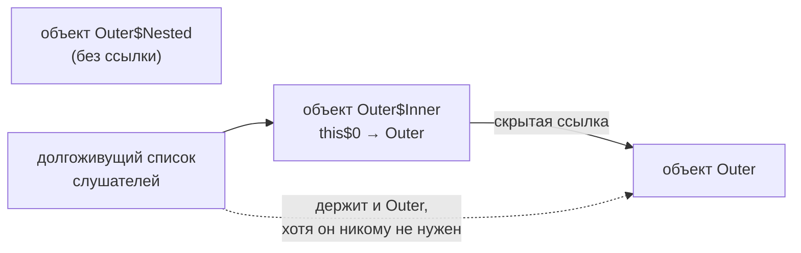

Java позволяет объявлять классы внутри других классов и даже внутри методов.
Видов таких классов четыре, и главный вопрос на собеседовании — чем
static nested отличается от inner: скрытая ссылка на внешний объект влияет и
на способ создания, и на утечки памяти. Вторая частая тема — чем анонимный
класс отличается от лямбды, которая его во многом заменила.

## Ключевые концепции

### Виды

#### Static nested class
Статический вложенный класс объявляется внутри другого класса с модификатором
`static`. По сути это обычный класс верхнего уровня, просто помещённый внутрь
другого ради группировки и видимости: он не хранит ссылку на экземпляр
внешнего класса и создаётся без него — `new Outer.Nested()`. При этом у него
есть доступ к `private`-членам внешнего класса, включая статические.

Это вариант по умолчанию, когда вложенному классу не нужен конкретный
внешний объект: билдеры (`Pizza.Builder`), узлы структур данных
(`HashMap.Node`), вспомогательные DTO и реализации, которые незачем делать
публичными на уровне пакета. Effective Java (Item 24) советует делать
вложенный класс `static` всегда, когда это возможно.

#### Inner class
Внутренний (inner) класс — вложенный класс без `static`. Каждый его экземпляр
неявно привязан к экземпляру внешнего класса: компилятор добавляет в него
скрытое поле `this$0` и передаёт внешний объект через конструктор. Поэтому
внутренний класс может обращаться к полям и методам внешнего объекта
напрямую, а явно — через `Outer.this`.

Создать его без внешнего объекта нельзя: внутри методов экземпляра достаточно
`new Inner()`, а снаружи нужна непривычная запись `outer.new Inner()`. Inner
классы уместны, когда вложенный объект действительно является частью
внешнего и работает с его состоянием, — классический пример — итератор
коллекции, которому нужен доступ к её внутреннему массиву.

#### Local class
Локальный класс объявляется внутри блока кода, обычно метода, и виден только
в нём. Если метод не статический, локальный класс, как и inner, хранит ссылку
на внешний объект. Кроме того, он может использовать локальные переменные и
параметры метода — но только `final` или effectively final, то есть такие,
которые после инициализации не меняются.

Ограничение связано с тем, что объект локального класса может пережить вызов
метода, а локальные переменные живут на стеке и исчезают по его завершении.
Поэтому класс получает копии их значений, и если бы переменная потом
менялась, копия и оригинал разошлись бы. Подробнее про захват переменных — в
разделе 7.

#### Anonymous class
Анонимный класс — локальный класс без имени, который объявляется и
создаётся одним выражением: `new Runnable() { public void run() { ... } }`. Он
либо реализует интерфейс, либо наследует класс (и тогда может передать
аргументы его конструктору), но не то и другое сразу и только один тип.

Своего конструктора у анонимного класса быть не может — у него нет имени.
Инициализацию делают в instance initializer block — отсюда приём double brace
initialization (тема «Порядок инициализации при наследовании»). Правила
захвата переменных и ссылка на внешний объект — те же, что у локального
класса.

Захват изменяемой локальной переменной:
```java
int counter = 0;
Runnable r = new Runnable() {
    public void run() { System.out.println(counter); }
};
counter++;
```
```
Capture.java:5: error: local variables referenced from an inner class must be final or effectively final
            public void run() { System.out.println(counter); }
                                                   ^
1 error
```
Переменная `counter` меняется после объявления класса, поэтому она не
effectively final, и захватить её нельзя. Для лямбды ошибка будет такой же по
смыслу. Если нужно изменяемое общее состояние, используют поле или объект-
обёртку, например `AtomicInteger`.

### Современная альтернатива

#### Лямбды вместо анонимных классов
С Java 8 для реализации функционального интерфейса (интерфейса с одним
абстрактным методом) используют лямбды и ссылки на методы. Они короче и
решают типичную проблему анонимного класса — путаницу с `this`. Внутри
анонимного класса `this` — это сам анонимный объект, и он может затенять
поля и методы внешнего класса. Внутри лямбды `this` — это внешний объект, как
будто код написан прямо в методе.

Отличается и реализация. Каждый анонимный класс — отдельный `.class`-файл
(`Outer$1.class`) и новый объект на каждое выполнение выражения. Лямбда
компилируется в `private`-метод внешнего класса и `invokedynamic`, а класс-
реализацию JVM генерирует в рантайме. Лямбда, которая ничего не захватывает,
обычно переиспользует один и тот же объект.

Анонимные классы при этом не исчезли. Они нужны, когда интерфейс содержит
несколько абстрактных методов, когда нужно наследовать абстрактный класс,
когда объекту нужно собственное состояние (поля) или когда `this` должен
ссылаться на сам объект.

Все виды в одном классе:
```java
public class Outer {
    private String secret = "outer-secret";

    class Inner {                                   // inner: держит ссылку на Outer
        String reveal() { return secret + " via " + Outer.this.getClass().getSimpleName(); }
    }
    static class Nested {                           // static nested: ссылки нет
        String hello() { return "nested"; }
    }

    Runnable anonymous() {
        return new Runnable() {
            @Override public void run() { System.out.println("anonymous this: " + this.getClass().getName()); }
        };
    }
    Runnable lambda() {
        return () -> System.out.println("lambda this:    " + this.getClass().getName());
    }

    public static void main(String[] args) {
        Outer outer = new Outer();
        Outer.Inner inner = outer.new Inner();      // нужен экземпляр Outer
        Outer.Nested nested = new Outer.Nested();   // не нужен
        System.out.println(inner.reveal() + ", " + nested.hello());

        for (Field f : Inner.class.getDeclaredFields())
            System.out.println("Inner field: " + f.getType().getSimpleName() + " " + f.getName() + " synthetic=" + f.isSynthetic());
        System.out.println("Nested fields: " + Nested.class.getDeclaredFields().length);

        outer.anonymous().run();
        outer.lambda().run();

        class Local {                               // локальный класс
            String describe() { return "local " + getClass().getName(); }
        }
        System.out.println(new Local().describe());
    }
}
```
```
outer-secret via Outer, nested
Inner field: Outer this$0 synthetic=true
Nested fields: 0
anonymous this: Outer$1
lambda this:    Outer
local Outer$1Local
```
Рефлексия показывает синтетическое поле `this$0` у inner-класса и полное
отсутствие полей у static nested. `this` в анонимном классе — сам анонимный
объект `Outer$1`, а в лямбде — внешний объект `Outer`.

## Как это работает "под капотом"

Для JVM вложенных классов не существует: компилятор превращает каждый из них
в отдельный класс верхнего уровня со служебным именем. Static nested и inner
получают имя `Outer$Nested`, анонимные — `Outer$1`, `Outer$2` по порядку,
локальные — `Outer$1Local`. Связь с внешним классом сохраняется атрибутами в
`.class`-файлах.

Внутреннему классу компилятор добавляет поле `final Outer this$0` и параметр
конструктора, через который оно заполняется:
```
$ javap -p Outer$Inner
class Outer$Inner {
  final Outer this$0;
  Outer$Inner(Outer);
  java.lang.String reveal();
}
```

Отдельный вопрос — доступ к `private`-членам. Раз это разные классы, по
правилам JVM вложенный класс не мог бы читать `private`-поле внешнего. До
Java 11 компилятор обходил это синтетическими методами-мостиками
(`access$000`), которые раскрывали доступ к `private`-полю всему пакету.
Начиная с Java 11 (JEP 181, nestmates) классы одной вложенной группы
объявляются «соседями по гнезду» в атрибутах `NestHost`/`NestMembers`, и JVM
сама разрешает им доступ к `private`-членам друг друга:
```
$ javap -v Outer | grep -A4 NestMembers
NestMembers:
  Outer$Nested
  Outer$Inner
  Outer$1Local
  Outer$1
```


Схема объясняет главную опасность inner-классов: пока жив объект inner-
класса, жив и внешний объект, на который он ссылается через `this$0`. Если
inner-объект попал в долгоживущую структуру (кэш, список слушателей,
статическое поле), сборщик мусора не освободит и внешний объект со всем его
состоянием.

## Частые вопросы на собеседовании

**Q: Чем static nested class отличается от inner class?**
A: Inner-класс неявно хранит ссылку на экземпляр внешнего класса (поле
`this$0`), поэтому создаётся только через внешний объект (`outer.new Inner()`)
и имеет прямой доступ к его полям. Static nested не хранит такой ссылки,
создаётся сам по себе и видит только статические члены внешнего класса (плюс
`private`-члены любого его объекта, если тот передан явно). Если ссылка на
внешний объект не нужна, класс стоит делать `static`.

**Q: Почему inner-класс может стать причиной утечки памяти?**
A: Через скрытую ссылку `this$0` он удерживает внешний объект. Если inner-объект
(часто — анонимный слушатель или callback) сохранён в долгоживущей структуре,
внешний объект со всеми его полями не может быть собран GC, даже если больше
нигде не используется. Решение — static nested class с явной слабой или
обычной ссылкой только на то, что действительно нужно, и своевременная
отписка.

**Q: Чем анонимный класс отличается от лямбды?**
A: Анонимный класс может реализовать интерфейс с несколькими методами или
наследовать класс, иметь поля, и `this` в нём указывает на сам анонимный
объект. Лямбда реализует только функциональный интерфейс, не имеет состояния,
а `this` в ней — внешний объект. Технически анонимный класс — отдельный
`.class`-файл и новый объект при каждом выполнении, а лямбда создаётся через
`invokedynamic`, и незахватывающая лямбда обычно переиспользуется.

**Q: Почему локальный и анонимный класс могут захватывать только effectively final переменные?**
A: Объект класса может пережить вызов метода, а локальные переменные живут в
кадре стека и исчезают с ним. Поэтому класс получает копию значения
переменной в момент создания. Если бы переменную разрешили менять, копия и
оригинал расходились бы, и код вёл бы себя неочевидно — язык запрещает это на
этапе компиляции.

**Q: Может ли вложенный класс обращаться к private-полям внешнего?**
A: Да, в обе стороны: внешний и вложенные классы видят `private`-члены друг
друга. До Java 11 это реализовывалось синтетическими методами доступа, которые
ослабляли инкапсуляцию на уровне пакета. С Java 11 (nestmates) JVM разрешает
такой доступ напрямую по атрибутам `NestHost`/`NestMembers`.

## Ловушки и частые ошибки

#### Inner вместо static nested по привычке
Вложенный класс без `static` по умолчанию — самая распространённая ошибка.
Каждый его объект тратит память на лишнюю ссылку и удерживает внешний объект,
а создать его без внешнего нельзя. Если класс не обращается к полям внешнего
объекта, ему нужен `static`.

#### this в анонимном классе
Внутри анонимного класса `this`, `toString()`, `equals()` и любые
одноимённые методы относятся к анонимному объекту, а не к внешнему.
Код вида `log.info(this + " started")` внутри анонимного `Runnable` выведет
что-то вроде `Outer$1@5e2de80c`. Для внешнего объекта нужно писать
`Outer.this`, а при переходе на лямбду поведение `this` меняется.

#### Сериализация inner и анонимных классов
Сериализовать inner, локальные и анонимные классы не рекомендуется: в
сериализованную форму попадает синтетическое поле `this$0` с
компиляторо-зависимым именем, и форма может измениться при перекомпиляции.
Кроме того, вместе с объектом сериализуется весь внешний объект. Для
сериализуемых вложенных типов используют static nested классы.

#### «В inner-классе нельзя объявить static-члены»
Это правило устарело. До Java 16 inner-класс не мог содержать статические
поля (кроме констант) и методы. Начиная с Java 16 (JEP 395, вместе с records)
ограничение снято: внутри inner-класса можно объявлять статические поля,
методы и вложенные records.

## Связанные темы
- [Порядок инициализации при наследовании](../02-java-core/10-initialization-order.md) — double brace initialization и скрытая ссылка анонимного класса.
- [Инкапсуляция](01-encapsulation.md) — вложенные классы как способ скрыть реализацию.
- [Абстракция: abstract class vs interface](04-abstract-vs-interface.md) — функциональные интерфейсы, которые реализуют лямбды.
- Лямбда-выражения и замыкания (раздел 7) — захват effectively final переменных.
- GC Roots, типы ссылок и утечки памяти (раздел 9) — как скрытые ссылки удерживают объекты.

## Источники
- Joshua Bloch, «Effective Java», 3rd ed.: Item 24 «Favor static member classes over nonstatic», Item 42 «Prefer lambdas to anonymous classes».
- [JLS §8.1.3: Inner Classes and Enclosing Instances](https://docs.oracle.com/javase/specs/jls/se21/html/jls-8.html#jls-8.1.3).
- [JEP 181: Nest-Based Access Control](https://openjdk.org/jeps/181).
- [JEP 395: Records](https://openjdk.org/jeps/395) — снятие ограничения на static-члены inner-классов.
