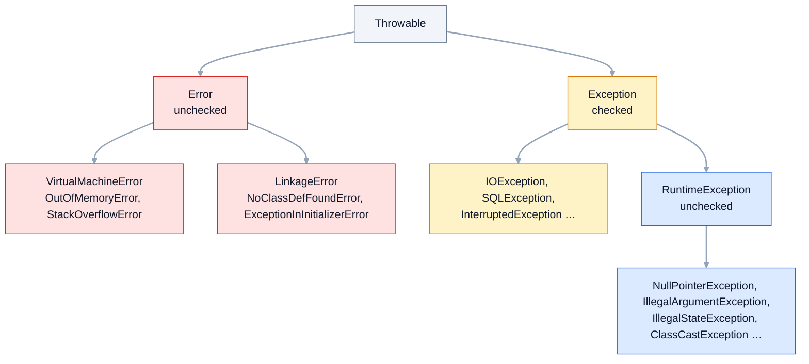

Иерархия исключений кажется заученной схемой из учебника, но на ней проверяют
понимание контракта между методом и вызывающим кодом. Senior-кандидат должен
объяснить не только «checked надо объявлять», но и почему это правило
существует только для компилятора, когда `Error` всё-таки ловят и почему
современный код всё чаще уходит от checked-исключений.

## Ключевые концепции

### Иерархия

#### Throwable: общий корень
Бросить через `throw` и поймать через `catch` можно только объект класса
`Throwable` или его наследника. `Throwable` хранит сообщение, причину (cause),
стектрейс и список подавленных исключений. Стектрейс снимается в момент
создания объекта, в конструкторе через `fillInStackTrace()`, а не в момент
`throw`.

От `Throwable` идут две ветви. `Error` — сбои среды исполнения, с которыми
приложение обычно ничего сделать не может. `Exception` — ошибки, которые
программа может ожидать и обрабатывать. Внутри `Exception` есть особая ветка
`RuntimeException`, и именно граница между ней и остальными наследниками
`Exception` делит исключения на checked и unchecked.


Checked — вся ветка `Exception`, кроме поддерева `RuntimeException`. Ветки
`Error` и `RuntimeException` — unchecked.

Цепочки наследования конкретных классов:
```java
static String chain(Class<?> c) {
    StringBuilder sb = new StringBuilder(c.getSimpleName());
    for (Class<?> p = c.getSuperclass(); p != null; p = p.getSuperclass()) {
        sb.append(" → ").append(p.getSimpleName());
    }
    return sb.toString();
}
// ...
System.out.println(chain(OutOfMemoryError.class));
System.out.println(chain(StackOverflowError.class));
System.out.println(chain(FileNotFoundException.class));
System.out.println(chain(NumberFormatException.class));
System.out.println(chain(NullPointerException.class));
```
```
OutOfMemoryError → VirtualMachineError → Error → Throwable → Object
StackOverflowError → VirtualMachineError → Error → Throwable → Object
FileNotFoundException → IOException → Exception → Throwable → Object
NumberFormatException → IllegalArgumentException → RuntimeException → Exception → Throwable → Object
NullPointerException → RuntimeException → Exception → Throwable → Object
```
`NumberFormatException` — наследник `IllegalArgumentException`, поэтому
`catch (IllegalArgumentException e)` поймает и ошибку разбора числа. От
положения в иерархии зависит, какой `catch` сработает.

#### Error: сбои, которые не ловят
`Error` сигнализирует о проблемах уровня JVM и окружения:
`VirtualMachineError` (`OutOfMemoryError`, `StackOverflowError`),
`LinkageError` (`NoClassDefFoundError`, `ExceptionInInitializerError`) и
`AssertionError`. Код приложения не может их исправить: после переполнения
стека или исчерпания памяти состояние программы ненадёжно, исключение могло
прервать любую операцию посередине.

Поэтому `Error` не перехватывают в бизнес-логике. Исключение — граница
приложения: обработчик верхнего уровня, который логирует сбой и завершает
процесс или поток. В проде для `OutOfMemoryError` обычно включают
`-XX:+HeapDumpOnOutOfMemoryError` и `-XX:+ExitOnOutOfMemoryError`, чтобы
получить дамп и перезапустить сервис, а не работать в полусломанном состоянии.

`OutOfMemoryError` при этом не всегда означает конец JVM. Запуск с `-Xmx64m`:
```java
try {
    int[] huge = new int[Integer.MAX_VALUE];
} catch (OutOfMemoryError e) {
    System.out.println("1: " + e);
}

List<long[]> hog = new ArrayList<>();
try {
    while (true) hog.add(new long[1_000_000]);   // ~8 МБ за шаг
} catch (OutOfMemoryError e) {
    int blocks = hog.size();
    hog = null;                                   // отпускаем память
    System.out.println("2: " + e + " после " + blocks + " блоков");
}
System.out.println("JVM продолжила работу");
```
```
1: java.lang.OutOfMemoryError: Requested array size exceeds VM limit
2: java.lang.OutOfMemoryError: Java heap space после 7 блоков
JVM продолжила работу
```
Первая ошибка — единичный абсурдный запрос, куча при этом свободна. Во второй
программа смогла продолжить только потому, что сама освободила всю занятую
память. В реальном сервисе `Java heap space` может прилететь в любом потоке и
в любой строке, поэтому «поймать и работать дальше» — не стратегия.

#### Checked-исключения
Checked-исключения — наследники `Exception`, кроме ветки `RuntimeException`:
`IOException`, `SQLException`, `InterruptedException`, `TimeoutException`.
Компилятор требует правила catch-or-specify: метод либо обрабатывает такое
исключение в `catch`, либо объявляет его в `throws`. Так ожидаемая ошибка
становится частью сигнатуры, и вызывающий код не может её не заметить.

То же правило действует при переопределении. Метод потомка не может объявить
checked-исключение шире, чем у родителя: код, работающий через ссылку на
родителя, рассчитан только на родительский `throws`. Сузить список или вовсе
убрать `throws` можно.

```java
static String load(Path p) {
    return Files.readString(p);                 // IOException не обработан и не объявлен
}

class Repository {
    void save(String s) throws IOException { }
}

class SqlRepository extends Repository {
    @Override
    void save(String s) throws Exception { }        // шире, чем у родителя
}
```
```
CheckedFail.java:8: error: unreported exception IOException; must be caught or declared to be thrown
        return Files.readString(p);
                               ^
CheckedFail.java:24: error: save(String) in SqlRepository cannot override save(String) in Repository
    void save(String s) throws Exception { }
         ^
  overridden method does not throw Exception
```
Обе ошибки — на этапе компиляции. Первая требует решить судьбу
`IOException`, вторая не даёт потомку нарушить обещание родителя.

#### Checked — правило компилятора, а не JVM
JVM ничего не знает о checked-исключениях: в байткоде `athrow` бросает любой
`Throwable`, а список `throws` хранится лишь как метаданные метода. Проверку
делает только `javac`. Поэтому Kotlin, Groovy и Scala спокойно вызывают Java-API
без обработки `IOException`, а Lombok `@SneakyThrows` бросает checked без
объявления.

Тот же трюк вручную — «sneaky throw» через generics:
```java
@SuppressWarnings("unchecked")
static <E extends Throwable> void sneakyThrow(Throwable e) throws E {
    throw (E) e;
}

static void readConfig() {   // в сигнатуре нет throws IOException
    Hierarchy.<RuntimeException>sneakyThrow(new IOException("config.yml не найден"));
}
// ...
try {
    readConfig();
} catch (Exception e) {
    System.out.println("поймали " + e.getClass().getName() + ": " + e.getMessage());
    System.out.println("это checked? " + !(e instanceof RuntimeException));
}
```
```
поймали java.io.IOException: config.yml не найден
это checked? true
```
Компилятор решил, что `sneakyThrow` бросает `RuntimeException`, а в рантайме
вылетел настоящий `IOException`. Поймать его можно только через
`catch (Exception)`: `catch (IOException)` не скомпилируется, потому что по
мнению компилятора в `try` его быть не может.

#### Unchecked: RuntimeException и наследники
Unchecked-исключения компилятор не заставляет ни ловить, ни объявлять. Формально
к ним относятся и `RuntimeException`, и `Error`, но в разговоре под unchecked
обычно имеют в виду ветку `RuntimeException`. Она сигнализирует об ошибке в
самой программе: вызове метода на `null`, неверном аргументе, неправильном
приведении типа, выходе за границы массива.

```java
static void show(Runnable r) {
    try {
        r.run();
    } catch (RuntimeException e) {
        System.out.println(e.getClass().getSimpleName() + ": " + e.getMessage());
    }
}
// ...
show(() -> { String s = null; s.length(); });
show(() -> { Object o = "42"; Integer i = (Integer) o; });
show(() -> { int zero = 0; int x = 10 / zero; });
show(() -> { int[] a = new int[3]; a[3] = 1; });
show(() -> Integer.parseInt("12a"));
show(() -> List.of(1, 2).add(3));
show(() -> { Iterator<String> it = new ArrayList<String>().iterator(); it.remove(); });
```
```
NullPointerException: Cannot invoke "String.length()" because "<local0>" is null
ClassCastException: class java.lang.String cannot be cast to class java.lang.Integer (java.lang.String and java.lang.Integer are in module java.base of loader 'bootstrap')
ArithmeticException: / by zero
ArrayIndexOutOfBoundsException: Index 3 out of bounds for length 3
NumberFormatException: For input string: "12a"
UnsupportedOperationException: null
IllegalStateException: null
```
Сообщение у JDK-исключений бывает подробным (Helpful NullPointerExceptions,
Java 14), а бывает пустым: у `UnsupportedOperationException` и
`IllegalStateException` здесь `getMessage()` вернул `null`. `<local0>` вместо
имени переменной — класс собран без отладочной информации `-g`.

### Проектирование

#### Checked — для восстановимых ситуаций
Effective Java (Item 70) формулирует правило так: checked-исключения — для
ситуаций, из которых вызывающий код может разумно восстановиться. Файл не
найден — спросить другой путь; сеть не ответила — повторить запрос; платёж
отклонён — показать пользователю причину. Тип в `throws` заставляет автора
вызывающего кода принять решение.

Обратная сторона — Item 71: не злоупотреблять checked. Если вызывающему нечего
сделать, кроме как залогировать и пробросить дальше, checked-исключение
становится шумом: его заворачивают, пробрасывают через десятки сигнатур или
глотают. В таких случаях честнее unchecked-исключение или возврат
`Optional`/результата.

#### Unchecked — для ошибок программиста и нарушений контракта
Нарушение предусловия метода — ошибка вызывающего кода, а не внешнее
обстоятельство: её не «обрабатывают», а исправляют. Для этого служат
`IllegalArgumentException` (неверный аргумент), `NullPointerException` (`null`
там, где он запрещён), `IndexOutOfBoundsException` и `IllegalStateException`
(метод вызван не вовремя). Проверку делают в начале метода — принцип fail fast.

```java
static void transfer(String accountId, long amount) {
    Objects.requireNonNull(accountId, "accountId");
    if (amount <= 0) throw new IllegalArgumentException("amount должен быть > 0, получено " + amount);
}
// ...
transfer(null, 100);        // перехвачено
transfer("ACC-1", -5);      // перехвачено
Objects.checkIndex(5, 3);   // перехвачено
```
```
NPE: accountId
IAE: amount должен быть > 0, получено -5
IOOBE: Index 5 out of bounds for length 3
```
Ошибка поймана на входе, с понятным сообщением, до того как неверные данные
испортили состояние. Без проверки тот же `null` упал бы глубже, где уже
непонятно, откуда он пришёл.

#### Checked-исключения и лямбды
Функциональные интерфейсы из `java.util.function` не объявляют `throws`, поэтому
лямбда внутри `map` или `forEach` не может выпустить checked-исключение
наружу. `throws IOException` у внешнего метода не помогает: исключение
бросается из тела лямбды, а её сигнатура — `apply` интерфейса `Function`.

```java
static List<String> loadAll(List<Path> paths) throws IOException {
    return paths.stream()
            .map(p -> Files.readString(p))      // throws в сигнатуре метода не помогает лямбде
            .toList();
}
```
```
CheckedFail.java:13: error: unreported exception IOException; must be caught or declared to be thrown
                .map(p -> Files.readString(p))
                                          ^
```
Стандартное решение — завернуть checked в unchecked с сохранением причины, для
ввода-вывода в JDK есть готовый `UncheckedIOException`:
```java
static String readUnchecked(Path p) {
    try {
        return Files.readString(p);
    } catch (IOException e) {
        throw new UncheckedIOException(e);
    }
}
// ...
List.of(Path.of("missing.txt")).stream().map(Contract::readUnchecked).toList();   // перехвачено
```
```
UncheckedIOException, cause = java.nio.file.NoSuchFileException: missing.txt
```
Исходная ошибка не потерялась — она в `getCause()`. Тот же подход использует
Spring: `SQLException` переводится в unchecked-иерархию `DataAccessException`.

## Частые вопросы на собеседовании

**Q: Чем checked-исключения отличаются от unchecked?**
A: Checked — наследники `Exception`, кроме `RuntimeException`; компилятор
требует их поймать или объявить в `throws`. Unchecked — `RuntimeException` и
`Error` с наследниками, для них такого требования нет. По смыслу checked
описывают ожидаемые внешние сбои, из которых можно восстановиться, а unchecked
— ошибки программиста и сбои среды.

**Q: Можно ли поймать OutOfMemoryError и стоит ли?**
A: Технически можно — это обычный `Throwable`. Но после `Java heap space`
состояние приложения непредсказуемо: ошибка могла прервать любую операцию в
любом потоке. Ловят его только на границе — чтобы залогировать и завершить
процесс; в проде для этого есть `-XX:+ExitOnOutOfMemoryError` и дамп кучи.
Исключение — единичная гигантская аллокация, после которой куча свободна.

**Q: Проверяет ли JVM checked-исключения?**
A: Нет, это правило только компилятора `javac`. В байткоде `throws` — лишь
метаданные, а `athrow` бросает любой `Throwable`. Поэтому другие
JVM-языки игнорируют checked, а приём sneaky throw или Lombok `@SneakyThrows`
бросают `IOException` из метода без `throws`.

**Q: Какие ограничения на исключения при переопределении метода?**
A: Переопределяющий метод не может объявить новые или более широкие
checked-исключения, чем родительский, — иначе код, работающий через ссылку на
родителя, получил бы необъявленную ошибку. Сузить список или убрать `throws`
можно. Unchecked-исключения этим правилом не ограничены.

**Q: Почему современный код уходит от checked-исключений?**
A: Они плохо сочетаются с лямбдами и стримами: функциональные интерфейсы не
объявляют `throws`. Кроме того, большинство вызывающих не может
восстановиться и лишь пробрасывает ошибку дальше, раздувая сигнатуры. Поэтому
Spring и многие библиотеки переводят checked в собственные unchecked-иерархии,
сохраняя исходную причину в `cause`.

## Ловушки и частые ошибки

#### catch (Exception) ловит и RuntimeException
`catch (Exception e)` перехватывает не только объявленные checked-исключения, но
и все unchecked: `NullPointerException`, `IllegalArgumentException`,
`ClassCastException`. Обработчик, написанный «на случай сбоя сети», молча
обработает и баг в собственном коде.

#### catch (Throwable) в прикладном коде
`Throwable` включает `Error`, и такой `catch` перехватывает
`OutOfMemoryError`, `StackOverflowError` и `LinkageError` вместе с обычными
ошибками. Программа продолжает работать в состоянии, которое уже нельзя
считать корректным. Ловить `Throwable` уместно только на самой границе —
в обработчике верхнего уровня, который логирует и завершает работу.

#### «Unchecked можно не обрабатывать»
Компилятор не заставляет, но это не значит, что unchecked-исключение некому
обработать. Его документируют в javadoc (`@throws IllegalArgumentException`) и
перехватывают на границе — в обработчике HTTP-запроса или задачи, — превращая в
понятный ответ и запись в лог.

#### getMessage() может вернуть null
У многих исключений сообщения нет, как у `IllegalStateException()` из примера
выше. Код вида `log.error(e.getMessage())` в таких случаях пишет в лог `null`
без типа исключения и стектрейса. Логируют само исключение, а не его сообщение
(подробнее — в теме «Свои исключения и best practices»).

## Связанные темы
- [Механизм try-catch-finally](02-try-catch-finally.md) — как исключение перехватывается и что выполняется по пути.
- [Свои исключения и best practices](03-custom-exceptions.md) — проектирование собственной иерархии и логирование.
- [Методы](../02-java-core/05-methods.md) — `StackOverflowError` при рекурсии.
- [Установка окружения и первая программа](../02-java-core/01-environment-setup.md) — `NoClassDefFoundError` и `ExceptionInInitializerError` на примерах.
- [Наследование](../03-oop/02-inheritance.md) — правила переопределения методов.
- Лямбда-выражения и замыкания (раздел 7) — функциональные интерфейсы и их сигнатуры.
- Области памяти JVM (раздел 9) — откуда берутся `OutOfMemoryError` и `StackOverflowError`.

## Источники
- [JLS, глава 11: Exceptions](https://docs.oracle.com/javase/specs/jls/se21/html/jls-11.html).
- [javadoc java.lang.Throwable](https://docs.oracle.com/en/java/javase/21/docs/api/java.base/java/lang/Throwable.html).
- [JEP 358: Helpful NullPointerExceptions](https://openjdk.org/jeps/358).
- Joshua Bloch, «Effective Java», 3rd ed.: Item 70 «Use checked exceptions for recoverable conditions and runtime exceptions for programming errors», Item 71 «Avoid unnecessary use of checked exceptions», Item 72 «Favor the use of standard exceptions».
