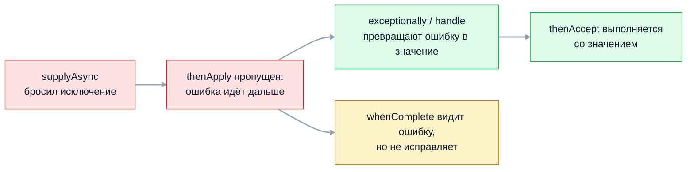

В однопоточном коде исключение поднимается по стеку вызовов до ближайшего
`catch`. В многопоточном у каждого потока свой стек, и исключение из рабочего
потока не может «долететь» до кода, который эту работу запустил. Отсюда
типичные инциденты: задача в пуле упала, а в логах пусто; периодическая задача
тихо перестала выполняться; ошибка в цепочке `CompletableFuture` пришла
завёрнутой в чужой тип.

## Ключевые концепции

### Механизмы

#### Исключение в потоке и UncaughtExceptionHandler
Необработанное исключение завершает только тот поток, в котором возникло:
остальные потоки и JVM продолжают работать. Перед завершением потока JVM
передаёт исключение обработчику. Если у потока есть свой обработчик
(`setUncaughtExceptionHandler`), вызывается он; если нет — `ThreadGroup`
потока, которая по умолчанию передаёт исключение глобальному обработчику
`Thread.setDefaultUncaughtExceptionHandler`.

Если глобальный обработчик тоже не задан, исключение просто печатается в `System.err` строкой
`Exception in thread "имя"`. В сервисе это значит, что ошибка не попадёт в
логгер и систему мониторинга. Поэтому на старте приложения часто
регистрируют глобальный обработчик, который пишет такие ошибки в лог.

```java
Thread worker = new Thread(() -> { throw new IllegalStateException("сбой в worker"); }, "worker");
worker.start();
worker.join();
System.out.println("main жив, worker.isAlive() = " + worker.isAlive());

Thread handled = new Thread(() -> { throw new IllegalStateException("сбой в handled"); }, "handled");
handled.setUncaughtExceptionHandler((t, e) ->
        System.out.println("обработчик: поток " + t.getName() + " упал с " + e));
handled.start();
handled.join();
```
```
Exception in thread "worker" java.lang.IllegalStateException: сбой в worker
	at Threads.lambda$main$0(Threads.java:11)
	at java.base/java.lang.Thread.run(Thread.java:1583)
main жив, worker.isAlive() = false
обработчик: поток handled упал с java.lang.IllegalStateException: сбой в handled
```
`worker` завершился, а `main` продолжил работу — исключение до него не дошло.
Для второго потока сработал собственный обработчик вместо печати по умолчанию.

#### ExecutorService: исключение прячется в Future
`submit()` заворачивает задачу в `FutureTask`, который перехватывает любое
исключение и сохраняет его внутри `Future`. В консоль ничего не печатается,
обработчики потока не вызываются. Ошибка всплывёт только при вызове
`future.get()` — как `ExecutionException` с исходным исключением в
`getCause()`.

`execute()` ведёт себя иначе: задача выполняется как есть, исключение
вылетает из рабочего потока и попадает к его `UncaughtExceptionHandler`. Сам
рабочий поток при этом умирает, и пул создаёт новый взамен. Поэтому обработчик,
заданный через `ThreadFactory`, ловит ошибки задач из `execute()`, но не из
`submit()`.

```java
ExecutorService pool = Executors.newFixedThreadPool(2);
Future<?> future = pool.submit(() -> { throw new IllegalStateException("сбой в submit"); });
sleep(200);
System.out.println("после submit: в консоли тихо, future.isDone() = " + future.isDone());
try {
    future.get();
} catch (ExecutionException e) {
    System.out.println("future.get(): " + e.getClass().getSimpleName() + ", cause = " + e.getCause());
}
pool.execute(() -> { throw new IllegalStateException("сбой в execute"); });
```
```
после submit: в консоли тихо, future.isDone() = true
future.get(): ExecutionException, cause = java.lang.IllegalStateException: сбой в submit
Exception in thread "pool-1-thread-2" java.lang.IllegalStateException: сбой в execute
	at Threads.lambda$main$4(Threads.java:33)
	at java.base/java.util.concurrent.ThreadPoolExecutor.runWorker(ThreadPoolExecutor.java:1144)
	at java.base/java.util.concurrent.ThreadPoolExecutor$Worker.run(ThreadPoolExecutor.java:642)
	at java.base/java.lang.Thread.run(Thread.java:1583)
```
Задача из `submit` завершилась с ошибкой, но узнать об этом можно только через
`get()`. Если результат никто не запрашивает, исключение потеряно навсегда.
Ошибка из `execute` напечаталась сразу, как необработанная в потоке пула.

Надёжные способы не терять ошибки: всегда забирать результат `Future` (или
хотя бы проверять его), оборачивать тело задачи в `try/catch` с логированием,
переопределить `ThreadPoolExecutor.afterExecute`, который получает исключение
задачи. В Spring для `@Async`-методов без возвращаемого значения есть
`AsyncUncaughtExceptionHandler`.

#### CompletableFuture: распространение по цепочке
В `CompletableFuture` исключение завершает этап «исключительно» и
передаётся по цепочке: зависимые этапы вроде `thenApply`, `thenAccept`,
`thenCompose` пропускаются и тоже завершаются с ошибкой. Цепочка «ломается»
до первого этапа, который умеет обработать ошибку: `exceptionally`, `handle`
или `whenComplete`.


По пути исключение заворачивается в `CompletionException`, поэтому исходный
тип достают через `getCause()`.

Три способа реагировать на ошибку различаются результатом. `exceptionally(fn)`
вызывается только при ошибке и подставляет запасное значение. `handle(fn)`
вызывается всегда, получает и значение, и ошибку и возвращает новое значение.
`whenComplete(action)` тоже видит оба, но результат не меняет: ошибка идёт
дальше по цепочке.

```java
CompletableFuture<Integer> cf = CompletableFuture
        .supplyAsync(() -> { if (true) throw new IllegalStateException("сбой в supplyAsync"); return 1; })
        .thenApply(x -> { System.out.println("thenApply не вызовется"); return x * 2; });
CompletableFuture<Integer> recovered = cf.exceptionally(e -> {
    System.out.println("exceptionally получил: " + e);
    return -1;
});
System.out.println("recovered.join() = " + recovered.join());
cf.join();   // перехвачено: CompletionException
cf.get();    // перехвачено: ExecutionException

String handled2 = CompletableFuture
        .supplyAsync(() -> { if (true) throw new IllegalArgumentException("плохой id"); return "заказ"; })
        .handle((value, error) -> error == null ? value : "запасной результат (" + error.getCause().getMessage() + ")")
        .join();
System.out.println("handle: " + handled2);
```
```
exceptionally получил: java.util.concurrent.CompletionException: java.lang.IllegalStateException: сбой в supplyAsync
recovered.join() = -1
cf.join(): CompletionException, cause = сбой в supplyAsync
cf.get(): ExecutionException, cause = сбой в supplyAsync
handle: запасной результат (плохой id)
```
`thenApply` не выполнился, а `exceptionally` получил ошибку уже обёрнутой в
`CompletionException`. `join()` бросает unchecked `CompletionException`, `get()`
— checked `ExecutionException`; исходное исключение в обоих случаях лежит в
`getCause()`.

`whenComplete` подходит для логирования, но не для восстановления:
```java
CompletableFuture<String> logged = CompletableFuture
        .supplyAsync(() -> { if (true) throw new IllegalStateException("сбой"); return "ok"; })
        .whenComplete((value, error) -> System.out.println("whenComplete видит: " + error));
logged.join();   // перехвачено: CompletionException
```
```
whenComplete видит: java.util.concurrent.CompletionException: java.lang.IllegalStateException: сбой
join() после whenComplete: сбой
```
Ошибка прошла через `whenComplete` и долетела до `join()`.

#### InterruptedException и флаг прерывания
Прерывание в Java кооперативное: `thread.interrupt()` не останавливает поток, а
выставляет флаг. Блокирующие методы — `sleep`, `wait`, `join`,
`BlockingQueue.take` — замечают флаг, сбрасывают его и бросают
`InterruptedException`. Так поток узнаёт, что его просят завершиться: пул при
`shutdownNow()`, отмена `Future` через `cancel(true)`.

Если `InterruptedException` проглотить, просьба об остановке теряется: флаг уже
сброшен, и код выше по стеку считает, что всё в порядке. Правильно — пробросить
исключение дальше или, если сигнатура не позволяет, восстановить флаг через
`Thread.currentThread().interrupt()`.

```java
Thread swallow = new Thread(() -> {
    try {
        Thread.sleep(10_000);
    } catch (InterruptedException e) {
        // проглотили
    }
    System.out.println("проглотили: isInterrupted() = " + Thread.currentThread().isInterrupted());
});
Thread restore = new Thread(() -> {
    try {
        Thread.sleep(10_000);
    } catch (InterruptedException e) {
        Thread.currentThread().interrupt();   // восстанавливаем флаг
    }
    System.out.println("восстановили: isInterrupted() = " + Thread.currentThread().isInterrupted());
});
// для каждого: start(), interrupt(), join()
```
```
проглотили: isInterrupted() = false
восстановили: isInterrupted() = true
```
В первом потоке след прерывания исчез: цикл обработки выше по стеку продолжит
работать, и `shutdownNow()` не сможет его остановить. Во втором флаг
восстановлен, и следующая проверка `isInterrupted()` или блокирующий вызов
увидят просьбу об остановке.

## Частые вопросы на собеседовании

**Q: Что происходит с исключением, которое не поймали в потоке?**
A: Поток завершается, остальные потоки и JVM продолжают работать. Исключение
передаётся `UncaughtExceptionHandler`: собственному обработчику потока, а если
его нет — `ThreadGroup`, которая делегирует глобальному обработчику по
умолчанию. Если и его нет, исключение печатается в `System.err` как
`Exception in thread "..."`.

**Q: Почему исключение в задаче ExecutorService «пропадает»?**
A: `submit()` заворачивает задачу в `FutureTask`, который сохраняет исключение
внутри `Future` и ничего не печатает. Оно всплывёт только при `future.get()` в
виде `ExecutionException`. Если результат никто не запрашивает, ошибка
теряется; `execute()`, наоборот, отдаёт исключение обработчику потока.

**Q: Чем отличаются exceptionally, handle и whenComplete?**
A: `exceptionally` вызывается только при ошибке и подставляет значение, восстанавливая
цепочку. `handle` вызывается всегда, получает значение или ошибку и возвращает
новый результат. `whenComplete` тоже видит оба, но результат не меняет — ошибка
идёт дальше, поэтому он подходит для логирования, а не для восстановления.

**Q: Чем join() отличается от get() у CompletableFuture при ошибке?**
A: `get()` пришёл из интерфейса `Future` и бросает checked
`ExecutionException`, а ещё `InterruptedException`. `join()` бросает unchecked
`CompletionException`, поэтому удобен в лямбдах и стримах. В обоих случаях
исходное исключение — в `getCause()`.

**Q: Как правильно обрабатывать InterruptedException?**
A: Не глотать. Если метод может объявить `throws InterruptedException` —
пробросить. Если нет (например, внутри `Runnable.run`), восстановить флаг через
`Thread.currentThread().interrupt()` и корректно завершить работу. Иначе пул
потоков и код выше по стеку не узнают, что поток просили остановиться.

## Ловушки и частые ошибки

#### submit без get
Задачи, отправленные через `submit()` в режиме «запустил и забыл», теряют свои
исключения: `Future` никто не читает, а `UncaughtExceptionHandler` для них не
вызывается. Если результат не нужен, используют `execute()` с обработчиком
потока или ловят исключения внутри самой задачи.

#### Периодическая задача тихо останавливается
У `scheduleAtFixedRate` и `scheduleWithFixedDelay` исключение в одном запуске
отменяет все последующие — без записи в лог. Сервис продолжает работать, а
синхронизация или очистка кэша молча перестали выполняться.

```java
ScheduledExecutorService scheduler = Executors.newSingleThreadScheduledExecutor();
AtomicInteger runs = new AtomicInteger();
ScheduledFuture<?> task = scheduler.scheduleAtFixedRate(() -> {
    int n = runs.incrementAndGet();
    System.out.println("запуск " + n);
    if (n == 3) throw new IllegalStateException("сбой на запуске 3");
}, 0, 100, TimeUnit.MILLISECONDS);
sleep(800);
System.out.println("через 800 мс: запусков = " + runs.get() + ", isDone = " + task.isDone());
task.get();   // перехвачено: ExecutionException
```
```
запуск 1
запуск 2
запуск 3
через 800 мс: запусков = 3, isDone = true
task.get(): cause = java.lang.IllegalStateException: сбой на запуске 3
```
За 800 мс задача должна была выполниться около восьми раз, но после третьего
запуска остановилась навсегда. Тело периодической задачи всегда оборачивают в
`try/catch` с логированием.

#### Проверка типа без getCause()
В `exceptionally` и `handle` приходит не исходное исключение, а
`CompletionException`, которое его оборачивает. Проверка
`e instanceof IllegalArgumentException` поэтому ложна, и обработчик уходит в
общую ветку. Тип проверяют у `e.getCause()` (или разворачивают все уровни
`CompletionException`).

#### Обработчик потока и submit
`UncaughtExceptionHandler`, заданный через `ThreadFactory` пула, кажется
универсальной страховкой, но для `submit()` он не срабатывает: исключение
перехвачено внутри `FutureTask` и до потока не доходит. Страховка работает
только для `execute()` или для ошибок вне задач.

## Связанные темы
- [Свои исключения и best practices](03-custom-exceptions.md) — пустой `catch`, логирование и цепочки причин.
- [Иерархия исключений](01-exception-hierarchy.md) — checked `ExecutionException` и unchecked `CompletionException`.
- Основы потоков (раздел 8) — жизненный цикл потока и прерывание.
- Пулы потоков: java.util.concurrent (раздел 8) — устройство `ThreadPoolExecutor` и `afterExecute`.
- Future и CompletableFuture (раздел 8) — композиция асинхронных вычислений.
- Планирование задач: @Scheduled и Quartz (раздел 18) — периодические задачи в Spring и обработка их ошибок.

## Источники
- [javadoc Thread.UncaughtExceptionHandler](https://docs.oracle.com/en/java/javase/21/docs/api/java.base/java/lang/Thread.UncaughtExceptionHandler.html).
- [javadoc ScheduledExecutorService](https://docs.oracle.com/en/java/javase/21/docs/api/java.base/java/util/concurrent/ScheduledExecutorService.html) — что происходит с периодической задачей после исключения.
- [javadoc CompletableFuture](https://docs.oracle.com/en/java/javase/21/docs/api/java.base/java/util/concurrent/CompletableFuture.html) — правила `CompletionException`.
- Brian Goetz и др., «Java Concurrency in Practice»: глава 7 «Cancellation and Shutdown» — прерывание и обработка `InterruptedException`.
