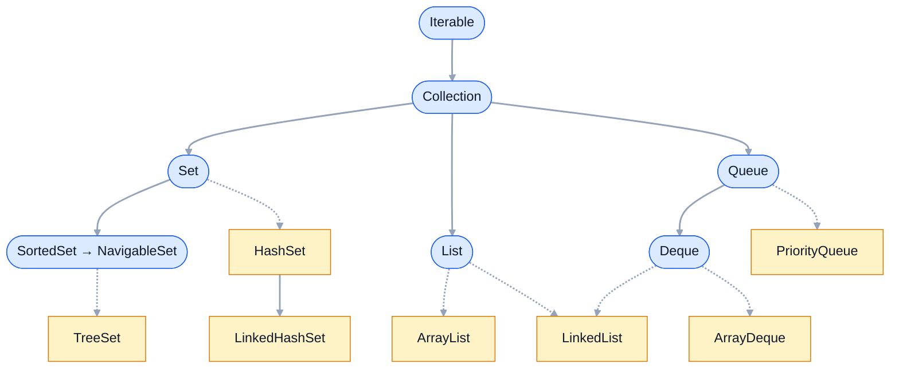
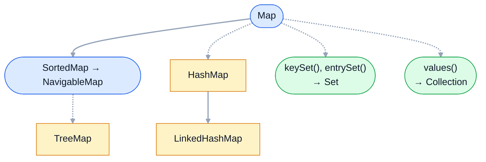

Java Collections Framework — набор интерфейсов и реализаций, с которым
работает почти любой Java-код. Карта интерфейсов кажется простой, но на ней
проверяют понимание: почему `Map` не наследует `Collection`, что такое
«необязательные операции» и что изменилось в иерархии с Java 21 (sequenced
collections).

## Ключевые концепции

### Структура

#### Collection и её ветви: List, Set, Queue
`Collection<E>` — корень иерархии для групп элементов. Он задаёт общие операции:
`add`, `remove`, `contains`, `size`, `isEmpty`, `stream`, `iterator`. Дальше иерархия
расходится по смыслу: `List` — упорядоченная последовательность с доступом по
индексу и дубликатами, `Set` — множество без дубликатов, `Queue` — очередь на
обработку с операциями над «головой».

У каждой ветви есть уточнения. `SortedSet` и `NavigableSet` добавляют к `Set`
порядок и поиск ближайшего элемента, `Deque` расширяет `Queue` операциями с обоих
концов. Конкретные классы реализуют интерфейсы: `ArrayList` и `LinkedList` —
`List`, `HashSet` и `TreeSet` — `Set`, `ArrayDeque` и `PriorityQueue` — `Queue`.


Синие скруглённые блоки — интерфейсы, жёлтые прямоугольные — классы. Сплошная
стрелка — наследование (`extends`), пунктирная — реализация интерфейса
(`implements`). `LinkedList` реализует сразу `List` и `Deque`, а
`LinkedHashSet` — наследник `HashSet`.

```java
System.out.println("ArrayList: " + Arrays.toString(ArrayList.class.getInterfaces()));
```
```
ArrayList: [interface java.util.List, interface java.util.RandomAccess, interface java.lang.Cloneable, interface java.io.Serializable]
```
Кроме `List`, класс реализует маркерные интерфейсы: `RandomAccess` сообщает, что
доступ по индексу быстрый, а `Cloneable` и `Serializable` разрешают копирование и
сериализацию.

#### Необязательные операции
Интерфейсы коллекций проектировались широкими: в `Collection` есть `add` и
`remove`, но не каждая реализация обязана их поддерживать. Такие методы javadoc
называет необязательными операциями (optional operations): реализация может
бросить `UnsupportedOperationException`. Так устроены неизменяемые коллекции,
представления и коллекции фиксированного размера.

Это сознательный компромисс авторов JCF: иначе понадобились бы отдельные
интерфейсы `ImmutableList`, `FixedSizeList` и десятки их комбинаций. Цена —
ошибка вызова изменяющего метода обнаруживается только в рантайме, а не при
компиляции.

```java
List<String> fixed = Arrays.asList("a", "b");
fixed.set(0, "z");
System.out.println("set на Arrays.asList: " + fixed);
fixed.add("c");   // перехвачено
```
```
set на Arrays.asList: [z, b]
add на Arrays.asList: java.lang.UnsupportedOperationException
```
Тип переменной — обычный `List`, и компилятор не возражает против `add`. Список
поддерживает замену элемента, но не изменение размера.

#### Map — отдельная иерархия
`Map<K, V>` хранит пары «ключ — значение» и не наследует `Collection`. Причина в
сигнатурах: `Collection.add(E)` принимает один элемент, а карте нужны два —
ключ и значение. Делать элементом карты `Map.Entry` было бы неудобно: тогда
`contains` искал бы пару целиком, а не ключ.

Вместо наследования `Map` даёт три представления-коллекции: `keySet()`,
`values()` и `entrySet()`. Это не копии, а «окна» в саму карту: удаление через
представление удаляет запись из карты. Поэтому коллекционные операции к карте
применяются через них.


Обозначения те же, что на схеме коллекций. Зелёные блоки — не наследники, а
представления: через них карта отдаёт свои ключи, записи и значения как обычные
коллекции.

```java
System.out.println("Map extends Collection? " + Collection.class.isAssignableFrom(Map.class));
System.out.println("Map extends Iterable?   " + Iterable.class.isAssignableFrom(Map.class));

Map<String, Integer> stock = new HashMap<>(Map.of("apple", 5, "pear", 0, "plum", 3));
stock.values().removeIf(q -> q == 0);
stock.keySet().remove("plum");
System.out.println("после правок через keySet()/values(): " + stock);
```
```
Map extends Collection? false
Map extends Iterable?   false
после правок через keySet()/values(): {apple=5}
```
Карту нельзя напрямую обойти в for-each, но через представления она поддерживает
все коллекционные операции. Удаление из `values()` и `keySet()` изменило саму
карту.

#### Iterable — основа for-each
`Iterable<T>` стоит выше `Collection` и содержит один абстрактный метод
`iterator()`. Любой класс, реализующий `Iterable`, можно использовать в
for-each — компилятор разворачивает цикл в вызовы `hasNext()` и `next()`. С
Java 8 у `Iterable` есть default-метод `forEach(Consumer)` и `spliterator()`,
на котором строятся стримы.

```java
record Range(int from, int to) implements Iterable<Integer> {
    public Iterator<Integer> iterator() {
        return new Iterator<>() {
            int next = from;
            public boolean hasNext() { return next < to; }
            public Integer next() {
                if (!hasNext()) throw new NoSuchElementException();
                return next++;
            }
        };
    }
}
// ...
for (int i : new Range(1, 4)) System.out.print(i + " ");
```
```
1 2 3 
```
`Range` не хранит элементов и не является коллекцией, но работает в for-each:
значения вычисляются по требованию в `next()`. По контракту `next()` на
исчерпанном итераторе бросает `NoSuchElementException`.

#### Sequenced collections (Java 21)
До Java 21 у коллекций с определённым порядком не было общего интерфейса.
Последний элемент `List` брали через `list.get(list.size() - 1)`, у `Deque` —
`getLast()`, у `LinkedHashSet` — только перебором. JEP 431 добавил интерфейсы
`SequencedCollection`, `SequencedSet` и `SequencedMap` с единым API.

Новые методы: `getFirst`/`getLast`, `addFirst`/`addLast`,
`removeFirst`/`removeLast` и `reversed()`, а у карт — `firstEntry`, `lastEntry`,
`pollFirstEntry`. `reversed()` возвращает не копию, а представление в обратном
порядке. `HashSet` и `HashMap` в эту иерархию не входят: порядка у них нет.

```java
List<Integer> list = new ArrayList<>(List.of(1, 2, 3));
LinkedHashSet<String> set = new LinkedHashSet<>(List.of("x", "y", "z"));
LinkedHashMap<String, Integer> map = new LinkedHashMap<>();
map.put("one", 1); map.put("two", 2);
System.out.println("list:  first=" + list.getFirst() + " last=" + list.getLast() + " reversed=" + list.reversed());
System.out.println("set:   first=" + set.getFirst() + " reversed=" + set.reversed());
System.out.println("map:   firstEntry=" + map.firstEntry() + " reversed=" + map.reversed());
List<Integer> rev = list.reversed();
list.add(4);
System.out.println("reversed — представление: " + rev);
System.out.println("SequencedCollection в иерархии ArrayList: " + SequencedCollection.class.isAssignableFrom(ArrayList.class)
        + ", HashSet: " + SequencedCollection.class.isAssignableFrom(HashSet.class));
```
```
list:  first=1 last=3 reversed=[3, 2, 1]
set:   first=x reversed=[z, y, x]
map:   firstEntry=one=1 reversed={two=2, one=1}
reversed — представление: [4, 3, 2, 1]
SequencedCollection в иерархии ArrayList: true, HashSet: false
```
Один и тот же API работает для списка, упорядоченного множества и карты.
Элемент, добавленный в `list` после вызова `reversed()`, виден и в представлении.

## Частые вопросы на собеседовании

**Q: Почему Map не наследует Collection?**
A: Коллекция — группа отдельных элементов с методом `add(E)`, а карта хранит
пары «ключ — значение» и ищет по ключу. Сигнатуры не совпадают, а сделать
элементом `Map.Entry` неудобно: `contains` искал бы пару, а не ключ. Поэтому
`Map` — отдельная иерархия, а с коллекциями связана через представления
`keySet()`, `values()` и `entrySet()`.

**Q: Чем Iterable отличается от Collection?**
A: `Iterable` умеет только выдавать итератор и поэтому подходит для for-each.
`Collection` добавляет к нему размер, проверку наличия, добавление и удаление
элементов. Класс может быть `Iterable`, не храня элементов вовсе, — например,
генерировать их на лету.

**Q: Что такое необязательные операции в Collection?**
A: Изменяющие методы интерфейса, которые реализация вправе не поддерживать,
бросая `UnsupportedOperationException`. Так ведут себя неизменяемые коллекции
(`List.of`), представления (`Collections.unmodifiableList`) и списки
фиксированного размера (`Arrays.asList`). Это компромисс ради небольшого числа
интерфейсов: ошибка обнаруживается в рантайме, а не при компиляции.

**Q: Что такое sequenced collections в Java 21?**
A: Интерфейсы `SequencedCollection`, `SequencedSet` и `SequencedMap`, которые
объединили коллекции с определённым порядком: `List`, `Deque`, `LinkedHashSet`,
`SortedSet`, `LinkedHashMap`, `SortedMap`. Они дают единые методы `getFirst`,
`getLast`, `addFirst`, `addLast`, `removeFirst`, `removeLast` и `reversed()`,
который возвращает представление, а не копию.

## Ловушки и частые ошибки

#### Тип переменной не обещает изменяемость
`List<String> list` может оказаться и `ArrayList`, и `List.of(...)`, и
`Arrays.asList(...)`. Метод, который получил список параметром и вызывает у него
`add`, может упасть с `UnsupportedOperationException`. Если методу нужна
изменяемая коллекция, он делает свою копию, а не меняет чужую.

#### Представления — не копии
`keySet()`, `values()`, `entrySet()`, `subList()`, `reversed()` возвращают окна в
исходную коллекцию. Изменения в них видны в оригинале и наоборот. Если нужен
независимый снимок, его создают явно: `new ArrayList<>(map.keySet())` или
`List.copyOf(...)`.

#### for-each по Map
`for (var x : map)` не компилируется: `Map` не реализует `Iterable`. Перебирают
`map.entrySet()` — так сразу доступны и ключ, и значение, без повторного поиска
`get(key)` на каждой итерации.

## Связанные темы
- [List: ArrayList, LinkedList, Vector](02-list-implementations.md) — реализации списка.
- [Set: HashSet, LinkedHashSet, TreeSet](03-set-implementations.md) — реализации множества.
- [Map: HashMap изнутри](04-hashmap-internals.md) — устройство самой популярной карты.
- [Queue и Deque](05-queue-and-deque.md) — очереди и двусторонние очереди.
- [Итераторы и модификация коллекций](06-iterators-and-modification.md) — что происходит при изменении коллекции во время обхода.
- [Операторы и управляющие конструкции](../02-java-core/03-operators-and-control-flow.md) — во что компилятор разворачивает for-each.
- [Границы типов и wildcard](../06-generics/02-bounded-types-and-wildcards.md) — `Collection<? extends E>` в сигнатурах JCF.

## Источники
- [Collections Framework Overview](https://docs.oracle.com/en/java/javase/21/docs/api/java.base/java/util/doc-files/coll-overview.html).
- [JEP 431: Sequenced Collections](https://openjdk.org/jeps/431).
- [javadoc java.util.Collection](https://docs.oracle.com/en/java/javase/21/docs/api/java.base/java/util/Collection.html) — описание необязательных операций.
- Maurice Naftalin, Philip Wadler, «Java Generics and Collections» (O'Reilly) — часть II о коллекциях.
