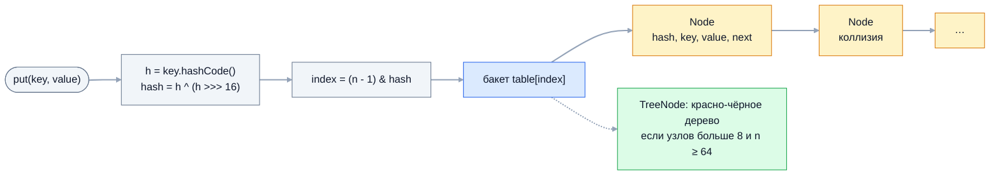

Устройство `HashMap` — самый частый вопрос по Java на собеседованиях любого
уровня. Junior рассказывает про бакеты и `equals`/`hashCode`, а от senior ждут
деталей: зачем перемешивать биты хеша, почему ёмкость — степень двойки, когда
бакет превращается в дерево, почему `new HashMap<>(100)` всё равно делает
resize и как на `LinkedHashMap` собрать LRU-кэш.

## Ключевые концепции

### Внутреннее устройство

#### Массив бакетов и индекс (n - 1) & hash
`HashMap` хранит данные в массиве `Node<K,V>[] table`. Каждая ячейка — бакет
(корзина), а узел `Node` содержит хеш ключа, ключ, значение и ссылку `next` на
следующий узел того же бакета. Массив создаётся лениво, при первом `put`, по
умолчанию длиной 16.

Номер бакета вычисляется как `(n - 1) & hash`, где `n` — длина массива. Длина
всегда степень двойки, поэтому `n - 1` — маска из единиц в младших битах, и
`&` даёт тот же результат, что остаток от деления, но без медленной операции
`%`. Именно поэтому любую запрошенную ёмкость `HashMap` округляет вверх до
степени двойки.


Поиск по ключу проходит тот же путь: хеш, индекс, затем сравнение с узлами
бакета — сначала по хешу, потом по `==` и `equals`.

#### hash(): h ^ (h >>> 16)
Индекс берёт только младшие биты хеша: при длине 16 — всего четыре. Если у
ключей различаются только старшие биты, все они попадут в один бакет. Поэтому
`HashMap.hash()` не использует `hashCode()` как есть, а смешивает старшую
половину с младшей: `h ^ (h >>> 16)`.

Это дешёвая защита от плохо распределённых хешей — например, у `Integer` и
`Float`, где хеш равен самому значению или его битам. Хеш `null`-ключа считается
равным 0, поэтому единственный `null`-ключ всегда лежит в бакете 0.

```java
static int spread(int h) { return h ^ (h >>> 16); }   // то же, что HashMap.hash()
// ...
int n = 16;
for (int key : new int[]{0x10000, 0x20000, 0x30000, 0x40000}) {
    int h = Integer.valueOf(key).hashCode();
    System.out.printf("key=0x%05X  без перемешивания: %2d   с перемешиванием: %2d%n",
            key, (n - 1) & h, (n - 1) & spread(h));
}
```
```
key=0x10000  без перемешивания:  0   с перемешиванием:  1
key=0x20000  без перемешивания:  0   с перемешиванием:  2
key=0x30000  без перемешивания:  0   с перемешиванием:  3
key=0x40000  без перемешивания:  0   с перемешиванием:  4
```
Все четыре ключа отличаются только старшими битами, и без перемешивания они
выстроились бы в одну цепочку в бакете 0. После `h ^ (h >>> 16)` они разошлись
по разным бакетам.

#### Коллизии: цепочка узлов в бакете
Коллизия — два разных ключа в одном бакете: либо их хеши совпали, либо
совпали младшие биты. Такие узлы связываются в односвязный список через `next`.
При `get` бакет просматривается последовательно: сначала сравнивается сохранённый
хеш (быстро), и только при совпадении — `equals`.

С Java 8 новый узел добавляется в конец цепочки. В Java 7 он вставлялся в
начало, и при одновременном resize из нескольких потоков цепочка могла
замкнуться в кольцо — `get` уходил в бесконечный цикл. В Java 8 бесконечного
цикла нет, но `HashMap` по-прежнему не потокобезопасна: параллельные `put`
теряют записи и портят `size`.

```java
System.out.println("\"Aa\".hashCode()=" + "Aa".hashCode() + ", \"BB\".hashCode()=" + "BB".hashCode()
        + ", индекс при n=16: " + ((16 - 1) & spread("Aa".hashCode())) + " и " + ((16 - 1) & spread("BB".hashCode())));
```
```
"Aa".hashCode()=2112, "BB".hashCode()=2112, индекс при n=16: 0 и 0
```
Разные строки с одинаковым хешем всегда попадают в один бакет при любой
ёмкости. Различить их может только `equals`.

### Resize и treeify (Java 8+)

#### Load factor 0.75 и порог resize
Load factor — допустимая заполненность таблицы. Порог `threshold = capacity ×
loadFactor`: как только после вставки `size` превысит его, таблица удваивается.
При 16 бакетах и коэффициенте 0.75 это происходит на 13-м элементе.

Значение 0.75 — компромисс между памятью и длиной цепочек. При нём средний
бакет почти пуст, а длина цепочки подчиняется распределению Пуассона:
вероятность встретить 8 элементов в одном бакете при хорошем хеше — порядка
одной на десять миллионов. Меньший коэффициент ускоряет поиск, но тратит больше
памяти.

Отсюда частая ошибка: `new HashMap<>(100)` не означает «100 элементов без
resize». Ёмкость округлится до 128, порог будет 96, и 97-я вставка удвоит
таблицу. Правильная ёмкость — `expected / 0.75`, а с Java 19 для этого есть
`HashMap.newHashMap(expected)`.

```java
HashMap<Integer, String> m = new HashMap<>();            // 25 ключей, печатаем каждое изменение длины table
HashMap<Integer, Integer> sized = new HashMap<>(100);    // 100 ключей
HashMap<Integer, Integer> exact = HashMap.newHashMap(100); // 100 ключей
// длину table читаем рефлексией (--add-opens java.base/java.util=ALL-UNNAMED)
```
```
new HashMap<>(): capacity=0
put #1: capacity 0 -> 16
put #13: capacity 16 -> 32
put #25: capacity 32 -> 64
после первого put: capacity=128
put #97: capacity 128 -> 256
HashMap.newHashMap(100): capacity после первого put=256, после 100 put=256
```
Первые четыре строки — карта по умолчанию: resize на 13-м и 25-м элементе,
ровно при превышении 75% заполнения. Следующие две — `new HashMap<>(100)`: он
всё равно сделал resize на 97-м элементе. А `newHashMap(100)` сразу выделил
таблицу, в которую 100 элементов помещаются без перестройки.

#### Удвоение и перераспределение
При resize создаётся массив вдвое длиннее, и все узлы раскладываются заново.
Пересчитывать хеши не нужно: они сохранены в узлах. Благодаря степени двойки
каждый узел из бакета `i` попадает либо в тот же бакет `i`, либо в
`i + oldCap` — это определяет один бит хеша, соответствующий старой ёмкости.

Поэтому Java 8 делит каждую цепочку на две — «младшую» и «старшую» — с
сохранением порядка узлов, без поиска нового места для каждого. Resize всё
равно стоит O(n) и вызывает скачок задержки на больших картах, отсюда совет
задавать ёмкость заранее.

```java
for (int key : new int[]{5, 21, 37, 53}) {
    int h = spread(Integer.hashCode(key));
    System.out.printf("key=%2d: индекс при 16 = %d, при 32 = %2d (бит oldCap: %d)%n",
            key, h & 15, h & 31, (h & 16) == 0 ? 0 : 1);
}
```
```
key= 5: индекс при 16 = 5, при 32 =  5 (бит oldCap: 0)
key=21: индекс при 16 = 5, при 32 = 21 (бит oldCap: 1)
key=37: индекс при 16 = 5, при 32 =  5 (бит oldCap: 0)
key=53: индекс при 16 = 5, при 32 = 21 (бит oldCap: 1)
```
Четыре ключа из бакета 5 после удвоения разошлись ровно на два бакета: 5 и
5 + 16 = 21. Куда уйдёт ключ, решает бит со значением 16.

#### Treeify: дерево вместо длинной цепочки
Если хеш-функция плохая или атакующий подбирает ключи с одинаковым хешем (hash
flooding), все записи сваливаются в один бакет, и поиск деградирует до O(n).
С Java 8 цепочка, которая выросла сверх `TREEIFY_THRESHOLD = 8` узлов,
превращается в красно-чёрное дерево из узлов `TreeNode`, и поиск в бакете
становится O(log n).

Есть условие: дерево строится, только если длина таблицы не меньше
`MIN_TREEIFY_CAPACITY = 64`. В маленькой таблице длинная цепочка скорее
означает тесноту, поэтому `HashMap` сначала удваивает таблицу. Узлы дерева
упорядочены по хешу, а при равных хешах — по `compareTo`, если ключи
`Comparable`, поэтому для ключей с плохим хешем полезно реализовать `Comparable`.

```java
record BadKey(int id) implements Comparable<BadKey> {
    @Override public int hashCode() { return 42; }           // у всех ключей один хеш
    @Override public int compareTo(BadKey o) { return Integer.compare(id, o.id); }
}
// кладём BadKey(1..11), после каждого put печатаем длину table и класс узла бакета
```
```
put #1: capacity=16, узел бакета: Node
...
put #8: capacity=16, узел бакета: Node
put #9: capacity=32, узел бакета: Node
put #10: capacity=64, узел бакета: Node
put #11: capacity=64, узел бакета: TreeNode
```
На 9-м ключе цепочка превысила порог, но таблица была меньше 64 — вместо дерева
случился resize до 32, на 10-м — до 64. Только на 11-м ключе бакет стал
деревом. Удвоения не помогли: при одинаковом хеше все ключи остаются в одном
бакете.

#### Untreeify: обратно в список
Дерево из `TreeNode` занимает примерно вдвое больше памяти, чем цепочка, поэтому
при уменьшении бакета `HashMap` сворачивает его обратно. При resize, если в
части разделённого дерева осталось не больше `UNTREEIFY_THRESHOLD = 6` узлов,
она становится обычным списком; при удалениях дерево сворачивается, когда
становится слишком маленьким.

Разные пороги — 8 для превращения в дерево и 6 для обратного — дают гистерезис.
Бакет, размер которого колеблется около одного значения, не перестраивается
туда-обратно на каждой вставке и удалении.

### Родственные структуры

#### LinkedHashMap и LRU-кэш
`LinkedHashMap` — наследник `HashMap`, где записи дополнительно связаны
двусвязным списком. По умолчанию список хранит порядок вставки, а с флагом
`accessOrder = true` в конструкторе — порядок доступа: `get` и `put`
перемещают запись в конец. В начале списка оказывается запись, к которой
обращались давнее всех.

Метод `removeEldestEntry` вызывается после каждой вставки и может вернуть
`true`, чтобы удалить самую старую запись. Вместе с порядком доступа это даёт
LRU-кэш (least recently used) в несколько строк. Для многопоточного кэша такой
класс нужно синхронизировать или взять готовую библиотеку вроде Caffeine.

```java
static class LruCache<K, V> extends LinkedHashMap<K, V> {
    private final int maxSize;
    LruCache(int maxSize) {
        super(16, 0.75f, true);   // accessOrder = true
        this.maxSize = maxSize;
    }
    @Override
    protected boolean removeEldestEntry(Map.Entry<K, V> eldest) {
        return size() > maxSize;
    }
}
// ...
LruCache<String, Integer> cache = new LruCache<>(3);
cache.put("a", 1); cache.put("b", 2); cache.put("c", 3);
cache.get("a");             // a стал самым свежим
cache.put("d", 4);          // вытесняется самый давний — b
System.out.println("после get(a) и put(d): " + cache.keySet());
```
```
после get(a) и put(d): [c, a, d]
```
Без `get("a")` вытеснился бы `a` как первый добавленный. Обращение перенесло его
в конец, и самым давним стал `b`.

#### TreeMap
`TreeMap` — карта на красно-чёрном дереве: ключи отсортированы по естественному
порядку или компаратору, все основные операции — O(log n) без деградации.
`TreeMap` реализует `NavigableMap`: `floorKey`, `ceilingEntry`, `headMap`,
`tailMap`, `subMap`, `firstEntry`, `pollFirstEntry`. Как и у `TreeSet`,
одинаковость ключей определяется компаратором, а не `equals`.

`TreeMap` выбирают, когда нужен порядок ключей или поиск по диапазону: тарифная
сетка, временные интервалы, лидерборд. Если порядок не нужен, `HashMap`
быстрее: O(1) против O(log n) и меньше накладных расходов на узлы.

```java
TreeMap<Integer, String> tariffs = new TreeMap<>(Map.of(0, "базовый", 1000, "серебряный", 5000, "золотой"));
for (int spent : new int[]{500, 1000, 4999, 12000}) {
    System.out.println("потрачено " + spent + " -> " + tariffs.floorEntry(spent).getValue());
}
System.out.println("headMap(5000)=" + tariffs.headMap(5000) + ", firstKey=" + tariffs.firstKey() + ", lastEntry=" + tariffs.lastEntry());
```
```
потрачено 500 -> базовый
потрачено 1000 -> серебряный
потрачено 4999 -> серебряный
потрачено 12000 -> золотой
headMap(5000)={0=базовый, 1000=серебряный}, firstKey=0, lastEntry=5000=золотой
```
`floorEntry` нашёл ближайший порог не выше суммы — тариф определяется одним
вызовом за O(log n), без цепочки `if`.

#### Hashtable, ConcurrentHashMap и HashMap
`Hashtable` — карта из Java 1.0: все методы `synchronized`, `null` в ключах и
значениях запрещён. Одна блокировка на всю таблицу делает её медленной под
нагрузкой и всё равно не защищает составные операции. В новом коде её не
используют.

`ConcurrentHashMap` — потокобезопасная карта для конкурентного доступа:
блокировки на уровне отдельных бакетов, чтение без блокировок, атомарные
`compute` и `merge`. `null` она тоже не принимает: в конкурентной карте `get`,
вернувший `null`, нельзя однозначно истолковать — ключа нет или значение
`null`, а проверить отдельно через `containsKey` без гонки нельзя. Обычная
`HashMap` допускает один `null`-ключ и любые `null`-значения, но не
потокобезопасна.

```java
Map<String, String> hm = new HashMap<>();
hm.put(null, "null-ключ");
hm.put("k", null);
System.out.println("HashMap: get(null)=" + hm.get(null) + ", containsKey(\"k\")=" + hm.containsKey("k") + ", get(\"k\")=" + hm.get("k"));
new Hashtable<String, String>().put("k", null);            // перехвачено
new ConcurrentHashMap<String, String>().put(null, "v");    // перехвачено
```
```
HashMap: get(null)=null-ключ, containsKey("k")=true, get("k")=null
Hashtable.put(k, null): NPE
ConcurrentHashMap.put(null, v): NPE
```
В `HashMap` `get("k")` вернул `null`, хотя ключ есть: отличить отсутствие от
`null`-значения можно только через `containsKey`.

### Полезные методы

#### compute, computeIfAbsent, computeIfPresent, merge
Методы Java 8 заменяют связку «прочитать — проверить — записать» одним вызовом.
`computeIfAbsent(k, f)` вычисляет и кладёт значение, если ключа нет, —
идиома для мультимапы. `computeIfPresent` пересчитывает существующее значение,
`compute` работает в обоих случаях, а `merge(k, v, f)` кладёт `v` или объединяет
его со старым — идиома счётчика.

Если функция возвращает `null`, запись удаляется. В `HashMap` эти методы — одна
операция с одним поиском бакета, но не потокобезопасная; атомарными в
многопоточном смысле они становятся в `ConcurrentHashMap`. Изменять ту же карту
из функции нельзя: с Java 9 `HashMap` обнаруживает это и бросает
`ConcurrentModificationException`.

```java
Map<String, Integer> counts = new TreeMap<>();
for (String w : "to be or not to be".split(" ")) counts.merge(w, 1, Integer::sum);
System.out.println("merge-счётчик: " + counts);
Map<String, List<String>> byDept = new TreeMap<>();
byDept.computeIfAbsent("dev", k -> new ArrayList<>()).add("Anna");
byDept.computeIfAbsent("dev", k -> new ArrayList<>()).add("Olga");
byDept.computeIfAbsent("ops", k -> new ArrayList<>()).add("Ivan");
System.out.println("computeIfAbsent-мультимапа: " + byDept);
counts.computeIfPresent("not", (k, v) -> null);   // null удаляет запись
counts.compute("be", (k, v) -> v == null ? 1 : v * 10);
System.out.println("после computeIfPresent(not -> null) и compute(be): " + counts);
```
```
merge-счётчик: {be=2, not=1, or=1, to=2}
computeIfAbsent-мультимапа: {dev=[Anna, Olga], ops=[Ivan]}
после computeIfPresent(not -> null) и compute(be): {be=20, or=1, to=2}
```
`merge` посчитал слова без единого `if`, `computeIfAbsent` создал список только
при первом обращении к отделу, а `null` из `computeIfPresent` удалил запись.

#### getOrDefault и putIfAbsent
`getOrDefault(k, def)` возвращает `def`, только если ключа нет. Если ключ есть,
но значение `null`, вернётся `null` — значение по умолчанию не подставится.
`putIfAbsent(k, v)` кладёт значение, если ключа нет или он связан с `null`, и
возвращает прежнее значение.

```java
Map<String, String> settings = new HashMap<>();
settings.put("mode", null);
System.out.println("getOrDefault(mode, dark)=" + settings.getOrDefault("mode", "dark")
        + ", getOrDefault(theme, dark)=" + settings.getOrDefault("theme", "dark"));
System.out.println("putIfAbsent(mode, light) вернул " + settings.putIfAbsent("mode", "light") + ", теперь mode=" + settings.get("mode"));
```
```
getOrDefault(mode, dark)=null, getOrDefault(theme, dark)=dark
putIfAbsent(mode, light) вернул null, теперь mode=light
```
Два метода по-разному трактуют `null`-значение: для `getOrDefault` ключ
«есть», для `putIfAbsent` — «нет». Это ещё один довод не хранить `null` в
картах.

## Частые вопросы на собеседовании

**Q: Как HashMap обрабатывает коллизии?**
A: Узлы с одинаковым индексом бакета связываются в односвязный список, новый
узел добавляется в конец. Поиск проходит цепочку, сравнивая сначала хеш, потом
`equals`. Если цепочка вырастает сверх 8 узлов, а в таблице не меньше 64 бакетов, бакет
превращается в красно-чёрное дерево с поиском за O(log n); при маленькой таблице
вместо этого происходит resize.

**Q: Что изменилось в HashMap в Java 8?**
A: Появились деревья в бакетах (treeify, когда цепочка превышает 8 узлов при
ёмкости от 64, обратное превращение при 6), что защищает от деградации до O(n) при плохих хешах и hash
flooding. Вставка в цепочку перешла с головы на хвост, а resize делит цепочку на
две с сохранением порядка — это убрало бесконечный цикл при конкурентном resize.
Добавились `compute`, `merge`, `getOrDefault` и другие методы.

**Q: Почему ёмкость HashMap — степень двойки?**
A: Индекс бакета вычисляется маской `(n - 1) & hash` вместо медленного деления с
остатком. Кроме того, при удвоении каждый узел остаётся в бакете `i` или
переходит в `i + oldCap` по одному биту хеша, и цепочки делятся без пересчёта.
Обратная сторона — используются только младшие биты, отсюда перемешивание
`h ^ (h >>> 16)`.

**Q: Как реализовать LRU-кэш?**
A: Унаследоваться от `LinkedHashMap` с `accessOrder = true` и переопределить
`removeEldestEntry`, возвращая `true`, когда размер превышает лимит. При порядке
доступа каждое обращение переносит запись в конец, а в начале остаётся самая
давно использованная. Для многопоточности такой кэш нужно синхронизировать или
взять Caffeine.

**Q: Сколько элементов поместится в new HashMap<>(100) без resize?**
A: 96. Ёмкость округлится до 128, порог при load factor 0.75 — 96, и 97-я вставка
удвоит таблицу. Чтобы вместить n элементов без resize, ёмкость задают как
`n / 0.75` или вызывают `HashMap.newHashMap(n)` (Java 19).

## Ловушки и частые ошибки

#### Изменяемый ключ
Если после `put` у ключа изменилось поле, участвующее в `hashCode`, запись
остаётся в старом бакете, а `get` ищет её в новом. Значение становится
недоступным, но продолжает занимать память. Ключи карт делают неизменяемыми:
`String`, `Integer`, `record` с неизменяемыми полями.

#### Плохой hashCode
`hashCode`, возвращающий константу или зависящий от малой части данных, сваливает
записи в один бакет. С Java 8 это деградация не до O(n), а до O(log n), но только
после роста таблицы до 64 и при `Comparable`-ключах; без `Comparable` поиск в
дереве с одинаковыми хешами снова почти линейный.

#### Порядок обхода HashMap
Порядок итерации зависит от хешей и ёмкости и меняется после resize. Код, который
неявно полагается на порядок `HashMap` (сериализация в JSON, вывод в тестах),
ломается при добавлении элементов или обновлении JDK. Нужен порядок — берут
`LinkedHashMap` или `TreeMap`.

#### HashMap в нескольких потоках
Параллельные `put` в `HashMap` без синхронизации теряют записи, портят `size` и
могут оставить структуру в несогласованном состоянии. Даже если «только один
поток пишет, остальные читают», без барьеров памяти читатели могут видеть
частично построенные узлы. Для разделяемых карт используют `ConcurrentHashMap`.

## Связанные темы
- [Set: HashSet, LinkedHashSet, TreeSet](03-set-implementations.md) — множества, построенные поверх `HashMap` и `TreeMap`.
- [Класс Object](../03-oop/06-object-class.md) — контракт `equals` и `hashCode`, без которого `HashMap` не работает.
- [Строки](../02-java-core/06-strings.md) — формула `String.hashCode` и коллизии вроде `"Aa"`/`"BB"`.
- [Операторы и управляющие конструкции](../02-java-core/03-operators-and-control-flow.md) — битовые операции `&`, `^` и `>>>`.
- [Выбор правильной коллекции](08-choosing-collection.md) — когда `HashMap`, `LinkedHashMap` или `TreeMap`.
- [Concurrent-коллекции и атомарные переменные](../08-concurrency/03-concurrency-utilities/07-concurrent-collections-and-atomics.md) — устройство `ConcurrentHashMap`.

## Источники
- Исходный код `java.util.HashMap` в OpenJDK — комментарий «Implementation notes» о treeify и распределении Пуассона.
- [javadoc java.util.HashMap](https://docs.oracle.com/en/java/javase/21/docs/api/java.base/java/util/HashMap.html), [java.util.LinkedHashMap](https://docs.oracle.com/en/java/javase/21/docs/api/java.base/java/util/LinkedHashMap.html).
- [JEP 180: Handle Frequent HashMap Collisions with Balanced Trees](https://openjdk.org/jeps/180).
- [javadoc HashMap.newHashMap(int)](https://docs.oracle.com/en/java/javase/21/docs/api/java.base/java/util/HashMap.html#newHashMap(int)) — фабрика для заранее известного числа элементов (Java 19).
