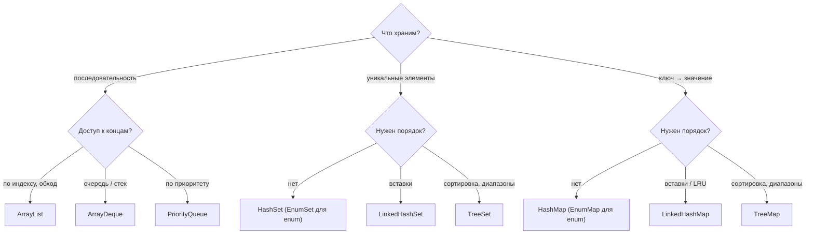

Выбор коллекции — практический навык, который проверяют и прямым вопросом
«какую структуру вы бы взяли», и косвенно — в задачах на код-ревью и системный
дизайн. Хороший ответ опирается на три вещи: какие операции нужны, нужен ли
порядок и сколько это стоит по памяти. Асимптотика здесь — только начало
разговора: константы и локальность памяти часто важнее.

## Ключевые концепции

### Критерии выбора

#### Списки и очереди
По умолчанию для последовательности берут `ArrayList`: быстрый доступ по
индексу, быстрый обход, компактная память. Если элементы добавляются и
забираются с концов — очередь, стек, обход в ширину, — нужен `ArrayDeque`.
`LinkedList` оправдан редко: частые вставки и удаления через уже
позиционированный `ListIterator` или необходимость хранить `null` в очереди.

Для обработки по приоритету — `PriorityQueue`. Если размер известен заранее,
ёмкость задают сразу, а для неизменяемых данных используют `List.of` и
`List.copyOf`.

#### Множества
Нужна уникальность без требований к порядку — `HashSet`. Нужен порядок
вставки — `LinkedHashSet`. Нужен отсортированный порядок или поиск ближайшего
и диапазоны — `TreeSet`. Если элементы — значения `enum`, лучший выбор —
`EnumSet`: это битовый вектор, быстрее и компактнее любого другого множества.

#### Карты
Быстрый доступ по ключу — `HashMap`. Порядок вставки или LRU — `LinkedHashMap`.
Сортировка по ключу и запросы по диапазону — `TreeMap`. Ключи-перечисления —
`EnumMap`, массив по `ordinal`. Для доступа из нескольких потоков —
`ConcurrentHashMap`, а не `Hashtable` и не `Collections.synchronizedMap`.


Для разделяемого между потоками состояния к этой схеме добавляется выбор
конкурентной реализации (раздел 8).

### Сводная таблица сложности операций

#### Асимптотика основных реализаций
| Коллекция | Доступ / поиск | Вставка | Удаление | Примечание |
|---|---|---|---|---|
| `ArrayList` | `get(i)` O(1), `contains` O(n) | в конец O(1)*, в середину O(n) | O(n) | * амортизированно |
| `LinkedList` | `get(i)` O(n) | на концах O(1) | на концах O(1) | O(1) в середине — только через итератор |
| `ArrayDeque` | только концы | на концах O(1)* | на концах O(1) | без `null` |
| `HashMap` / `HashSet` | O(1) в среднем | O(1) в среднем | O(1) в среднем | при коллизиях — до O(log n) после treeify |
| `LinkedHashMap` / `LinkedHashSet` | O(1) в среднем | O(1) в среднем | O(1) в среднем | порядок вставки или доступа |
| `TreeMap` / `TreeSet` | O(log n) | O(log n) | O(log n) | сортировка, `floor`/`ceiling` |
| `PriorityQueue` | `peek` O(1), `contains` O(n) | O(log n) | `poll` O(log n) | обход не отсортирован |

Таблица описывает рост времени, но не абсолютную скорость. Два алгоритма с
одинаковой асимптотикой могут различаться в разы из-за выделения памяти,
непрямых ссылок и промахов кэша, а O(n) на маленьком массиве бывает быстрее
O(1) с вычислением хеша.

#### Асимптотика и реальность
Разница между O(1), O(log n) и O(n) на поиске видна сразу: на 100 тысячах
элементов `contains` у `ArrayList` в тысячи раз медленнее, чем у `HashSet`. А
обход — операция O(n) у всех — у `LinkedList` идёт заметно медленнее, чем у
`ArrayList`: узлы разбросаны по памяти, и процессор не может эффективно
подгружать их в кэш.

```java
// 100 000 Integer в каждой коллекции; второй проход после прогрева
// contains: 10 000 поисков; обход: for-each по всей коллекции 100 раз
```
```
contains, 10 000 поисков среди 100 000 элементов:
  ArrayList 589234 мкс, HashSet 221 мкс, TreeSet 1545 мкс (найдено 10000/10000/10000)
обход 100 000 элементов 100 раз: ArrayList 27 ms, LinkedList 50 ms (true)
```
Линейный поиск занял больше полсекунды, хеш — доли миллисекунды, дерево — в
несколько раз дольше хеша, но несравнимо быстрее перебора. Обход `LinkedList`
вдвое медленнее при той же асимптотике O(n).

#### Память
Коллекции объектов дороги по памяти: каждый `Integer` — отдельный объект с
заголовком, а у `HashMap`, `TreeMap` и `LinkedList` на каждый элемент
добавляется ещё узел. На миллионах элементов это сотни мегабайт и нагрузка на
сборщик мусора. Для больших объёмов примитивов используют массивы или
специализированные библиотеки — fastutil, Eclipse Collections, — хранящие `int`
без упаковки.

```java
// Runtime.totalMemory() - freeMemory() до и после заполнения, с System.gc() между замерами
// по 1 000 000 чисел 0..999 999 в каждой структуре
```
```
память на 1 000 000 чисел:
int[]                        ~  3 МБ
ArrayList<Integer>           ~ 19 МБ
LinkedList<Integer>          ~ 38 МБ
HashSet<Integer>             ~ 54 МБ
TreeSet<Integer>             ~ 53 МБ
```
Один и тот же миллион чисел занимает от 4 до 54 МБ (у `int[]` вывод округлён
вниз). `ArrayList` в пять раз тяжелее массива из-за объектов `Integer`,
`LinkedList` добавляет к ним узлы, а множества — узлы хеш-таблицы или дерева.
Замер грубый, но порядок величин он показывает верно.

## Частые вопросы на собеседовании

**Q: Какую коллекцию выбрать для частого поиска по ключу?**
A: `HashMap` — поиск за O(1) в среднем при хорошем `hashCode`. Если нужен порядок
ключей или запросы по диапазону — `TreeMap` с O(log n). Если ключи — `enum`,
то `EnumMap`. Для доступа из нескольких потоков — `ConcurrentHashMap`.

**Q: Когда выбрать LinkedList вместо ArrayList?**
A: Практически никогда. `ArrayList` быстрее и на доступе по индексу, и на обходе,
и даже на вставке в середину, а памяти тратит вдвое меньше. Для очередей и
стеков есть `ArrayDeque`. `LinkedList` оправдан, только если много вставок и
удалений идёт через уже позиционированный `ListIterator`.

**Q: Почему одинаковая асимптотика не означает одинаковую скорость?**
A: O-нотация скрывает константы: выделение объектов, непрямые ссылки, вычисление
хеша, промахи кэша процессора. Обход `ArrayList` и `LinkedList` — оба O(n), но
массив лежит в памяти подряд, а узлы списка разбросаны. На малых размерах
линейный поиск по массиву может обогнать хеш-таблицу.

**Q: Как уменьшить расход памяти на большие коллекции чисел?**
A: Не упаковывать: использовать массивы примитивов или библиотеки примитивных
коллекций (fastutil, Eclipse Collections). Задавать начальную ёмкость, чтобы не
держать полупустые массивы. Выбирать структуры без узла на каждый элемент:
`ArrayList` вместо `LinkedList`, `EnumMap` вместо `HashMap` для enum-ключей.

## Ловушки и частые ошибки

#### contains по списку в цикле
`list.contains(x)` внутри цикла по другой коллекции превращает алгоритм в
O(n·m). На тестовых данных это незаметно, а на реальных объёмах запрос
выполняется минуты. Перед циклом список переводят в `HashSet` — один раз за
O(n), после чего каждая проверка O(1).

#### Выбор по одной строке таблицы
«Вставка в `LinkedList` — O(1), значит, берём `LinkedList`» — ошибочное рассуждение: вставке
в середину предшествует поиск позиции за O(n), а таблица не учитывает
константы и память. Выбор делают по всему набору операций и по замеру на
реалистичных данных.

#### Коллекция вместо специализированной структуры
`HashMap<Day, ...>` вместо `EnumMap`, `HashSet` флагов вместо `EnumSet`,
`List<Integer>` из миллионов элементов вместо `int[]` — частые случаи лишнего
расхода памяти и времени. Стандартная библиотека уже содержит
специализированные реализации для типичных случаев.

## Связанные темы
- [List: ArrayList, LinkedList, Vector](02-list-implementations.md) — устройство и замеры списков.
- [Set: HashSet, LinkedHashSet, TreeSet](03-set-implementations.md) — гарантии порядка множеств.
- [Map: HashMap изнутри](04-hashmap-internals.md) — откуда берётся O(1) и когда он деградирует.
- [Queue и Deque](05-queue-and-deque.md) — `ArrayDeque` и `PriorityQueue`.
- [Enum и аннотации](../02-java-core/12-enum-and-annotations/00-index.md) — `EnumMap` и `EnumSet`.
- [Алгоритмическое мышление: введение](../01-fundamentals/05-algorithmic-thinking-intro.md) — O-нотация и амортизированная сложность.
- Concurrent-коллекции и атомарные переменные (раздел 8) — выбор коллекции для многопоточного доступа.
- Оптимизация на разных уровнях (раздел 33) — когда структура данных — узкое место.

## Источники
- [Collections Framework Overview](https://docs.oracle.com/en/java/javase/21/docs/api/java.base/java/util/doc-files/coll-overview.html).
- Joshua Bloch, «Effective Java», 3rd ed.: Item 36 «Use EnumSet instead of bit fields», Item 37 «Use EnumMap instead of ordinal indexing».
- [fastutil](https://fastutil.di.unimi.it/), [Eclipse Collections](https://eclipse.dev/collections/) — библиотеки примитивных коллекций.
