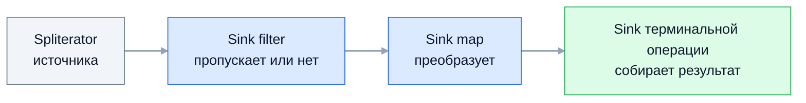

Stream API (Java 8) — декларативная обработка последовательностей: вместо цикла
с промежуточными списками описывается конвейер «отфильтровать — преобразовать —
собрать». На собеседовании проверяют модель выполнения: что такое ленивость,
почему `map().filter().map()` не создаёт промежуточных коллекций, почему стрим
нельзя использовать дважды и что меняют `sorted` и `distinct`.

## Ключевые концепции

### Операции

#### Intermediate-операции: ленивые этапы конвейера
Промежуточные (intermediate) операции — `filter`, `map`, `flatMap`, `distinct`,
`sorted`, `limit`, `skip`, `peek` — возвращают новый `Stream` и ничего не
вычисляют. Они лишь добавляют этап в описание конвейера (pipeline). Поэтому
цепочку можно строить по частям и передавать между методами.

`map` превращает каждый элемент ровно в один новый, а `flatMap` — в поток из
нуля или нескольких элементов, которые «расплющиваются» в общий поток. Отсюда
типичное применение `flatMap`: список списков в один список, строки текста в
слова. С Java 16 есть `mapMulti` — то же, что `flatMap`, но элементы отдаются
через callback без создания промежуточного стрима.

```java
List<List<Integer>> nested = List.of(List.of(1, 2), List.of(3), List.of());
System.out.println("map:     " + nested.stream().map(List::size).toList());
System.out.println("flatMap: " + nested.stream().flatMap(List::stream).toList());
System.out.println("слова:   " + Stream.of("a b", "c d e").flatMap(line -> Arrays.stream(line.split(" "))).toList());
System.out.println("mapMulti: " + Stream.of(1, 2, 3).<Integer>mapMulti((n, sink) -> { if (n != 2) { sink.accept(n); sink.accept(n * 10); } }).toList());
```
```
map:     [2, 1, 0]
flatMap: [1, 2, 3]
слова:   [a, b, c, d, e]
mapMulti: [1, 10, 3, 30]
```
`map` дал по одному числу на каждый внутренний список, `flatMap` — все элементы
подряд, а пустой список просто ничего не добавил. `mapMulti` выдал для каждого
элемента ноль или два значения.

#### Terminal-операции: запуск вычисления
Терминальные операции — `collect`, `toList`, `reduce`, `forEach`, `count`,
`min`/`max`, `findFirst`, `anyMatch`/`allMatch`/`noneMatch` — запускают
конвейер и возвращают результат или выполняют действие. После терминальной
операции стрим считается использованным.

`reduce` сворачивает поток в одно значение. Вариант с identity
(`reduce(0, Integer::sum)`) всегда возвращает значение, без identity —
`Optional`, потому что поток может быть пустым. Для чисел удобнее примитивные
стримы: `IntStream.sum()`, `average()` и `summaryStatistics()` без упаковки.

```java
System.out.println("distinct: " + Stream.of(3, 1, 3, 2, 1).distinct().toList());
System.out.println("reduce(0, Integer::sum)=" + Stream.of(1, 2, 3, 4).reduce(0, Integer::sum)
        + ", reduce(Integer::max)=" + Stream.of(4, 9, 2).reduce(Integer::max).orElseThrow());
IntSummaryStatistics stats = IntStream.rangeClosed(1, 5).summaryStatistics();
System.out.println("IntStream.rangeClosed(1,5): " + stats);
```
```
distinct: [3, 1, 2]
reduce(0, Integer::sum)=10, reduce(Integer::max)=9
IntStream.rangeClosed(1,5): IntSummaryStatistics{count=5, sum=15, min=1, average=3,000000, max=5}
```
`distinct` сохранил порядок первых вхождений. Запятая в `average=3,000000` — от
русской локали по умолчанию в `String.format`.

### Особенности

#### Ленивые вычисления
Пока не вызвана терминальная операция, ни одна лямбда конвейера не выполняется.
Это не просто оптимизация: благодаря лени стрим может быть бесконечным, а
конвейер — обработать только столько элементов, сколько нужно результату.

```java
Stream<String> pending = Stream.of("a", "b").peek(s -> System.out.println("  peek " + s));
System.out.println("pipeline собран, peek не вызывался");
System.out.println("count=" + pending.filter(s -> true).count());
```
```
pipeline собран, peek не вызывался
  peek a
  peek b
count=2
```
`peek` сработал только тогда, когда `count()` запустил конвейер.

Порядок выполнения тоже не «этап за этапом». Каждый элемент проходит всю цепочку
до конца, прежде чем начнётся следующий:
```java
List<String> result = Stream.of("one", "two", "three", "four")
        .filter(s -> { System.out.println("  filter " + s); return s.length() > 3; })
        .map(s -> { System.out.println("  map    " + s); return s.toUpperCase(); })
        .toList();
```
```
  filter one
  filter two
  filter three
  map    three
  filter four
  map    four
result=[THREE, FOUR]
```
`three` прошёл `filter` и сразу `map`, ещё до того, как `filter` увидел `four`.
Промежуточного списка «после фильтра» нет вовсе.

#### Short-circuit операции
Некоторые операции могут закончить работу, не просмотрев весь поток:
`findFirst`, `findAny`, `anyMatch`, `allMatch`, `noneMatch` и `limit`. Как только
результат известен, источник перестаёт выдавать элементы. Именно это позволяет
работать с бесконечными стримами `Stream.iterate` и `Stream.generate`.

```java
Optional<Integer> firstBig = Stream.of(5, 12, 7, 30, 1)
        .peek(n -> System.out.println("  смотрим " + n))
        .filter(n -> n > 10)
        .findFirst();
System.out.println("findFirst=" + firstBig.orElseThrow());
System.out.println("бесконечный iterate + limit(10): " + Stream.iterate(1, x -> x * 2).limit(10).toList());
System.out.println("anyMatch(> 1000) на бесконечном: " + Stream.iterate(1, x -> x * 2).anyMatch(x -> x > 1000));
```
```
  смотрим 5
  смотрим 12
findFirst=12
бесконечный iterate + limit(10): [1, 2, 4, 8, 16, 32, 64, 128, 256, 512]
anyMatch(> 1000) на бесконечном: true
```
Из пяти элементов просмотрены два. Бесконечные потоки завершились, потому что
`limit` и `anyMatch` остановили источник.

#### Стрим одноразовый
Стрим — не коллекция, а одноразовый конвейер над источником. Повторная
терминальная операция на том же объекте бросает `IllegalStateException`. Если
данные нужно обработать дважды, стрим создают заново из коллекции или передают
`Supplier<Stream<T>>`.

```java
Stream<Integer> once = Stream.of(1, 2, 3);
System.out.println("sum=" + once.mapToInt(Integer::intValue).sum());
once.count();   // перехвачено
```
```
sum=6
повторный terminal: stream has already been operated upon or closed
```
Первая терминальная операция исчерпала источник, и стрим помечен как закрытый.

### Под капотом: как на самом деле выполняется pipeline

#### Spliterator — источник данных
Любой источник стрима — коллекция, массив, `Files.lines`, генератор — сначала
оборачивается в `Spliterator` (splittable iterator). Он умеет две вещи:
последовательно отдавать элементы через `tryAdvance` и делить себя на две части
через `trySplit` — это основа параллельных стримов. Кроме того, он сообщает
характеристики: `SIZED` (размер известен), `ORDERED`, `DISTINCT`, `SORTED`.

Характеристики использует оптимизатор конвейера. Если источник `SIZED`, а
промежуточные операции размер не меняют, `count()` вернёт размер без обхода
элементов вообще.

```java
List<Integer> source = new ArrayList<>(List.of(1, 2, 3, 4, 5, 6, 7, 8));
Spliterator<Integer> right = source.spliterator();
System.out.println("SIZED=" + right.hasCharacteristics(Spliterator.SIZED) + " ORDERED=" + right.hasCharacteristics(Spliterator.ORDERED)
        + " SUBSIZED=" + right.hasCharacteristics(Spliterator.SUBSIZED) + ", estimateSize=" + right.estimateSize());
Spliterator<Integer> left = right.trySplit();
// обходим обе части через forEachRemaining
Spliterator<Integer> one = List.of(10, 20, 30).spliterator();
one.tryAdvance(x -> System.out.println("tryAdvance отдал " + x + ", осталось " + one.estimateSize()));
```
```
SIZED=true ORDERED=true SUBSIZED=true, estimateSize=8
trySplit: левая часть [1 2 3 4], правая [5 6 7 8]
tryAdvance отдал 10, осталось 2
```
`ArrayList` делится ровно пополам, потому что знает размер и индексы, — поэтому
он хорошо распараллеливается, а `LinkedList` нет.

#### Цепочка Sink: один проход вместо промежуточных коллекций
Каждая промежуточная операция при запуске конвейера оборачивает следующий этап в
объект `Sink` — потребитель элементов с методами `begin`, `accept` и `end`.
Получается цепочка: `filter`-sink решает, передавать ли элемент дальше,
`map`-sink преобразует и передаёт, последний sink складывает результат.
Терминальная операция гонит элементы из `Spliterator` в голову этой цепочки.

Поэтому этапы «сливаются» (fusion) в один проход: элемент проходит все стадии
подряд, и `map().filter().map()` не создаёт трёх промежуточных списков. Это видно
по порядку вывода в примере с `filter` и `map` выше.


Элементы идут по цепочке по одному. Пока терминальная операция не начала
обход, цепочки ещё нет — есть только её описание.

#### Откуда берётся лень
Лень — прямое следствие этой модели. Вызов `filter` или `map` лишь записывает
этап в описание конвейера, а цепочка `Sink` строится и запускается только
терминальной операцией. До этого момента обходить нечего: `Spliterator` никто не
трогает, лямбды не вызываются.

Это же объясняет ловушку с `peek`: если конвейер может посчитать результат без
обхода элементов, их не обойдут вовсе.
```java
long c = List.of(1, 2, 3).stream().peek(x -> System.out.println("  peek " + x)).count();
System.out.println("count=" + c + " — peek не вызывался: размер известен заранее");
long c2 = List.of(1, 2, 3).stream().filter(x -> x > 1).peek(x -> System.out.println("  peek после filter " + x)).count();
System.out.println("count после filter=" + c2);
```
```
count=3 — peek не вызывался: размер известен заранее
  peek после filter 2
  peek после filter 3
count после filter=2
```
С Java 9 `count()` на `SIZED`-источнике без фильтров не запускает обход, и
побочный эффект в `peek` пропадает. После `filter` размер неизвестен, и элементы
пришлось обойти.

#### Stateless и stateful операции
Stateless-операции — `filter`, `map`, `flatMap`, `peek` — обрабатывают каждый
элемент независимо от остальных и встраиваются в поэлементную цепочку. Stateful —
`sorted`, `distinct`, а в параллельном режиме и `limit`/`skip` — должны помнить
уже увиденные элементы.

`sorted` не может выдать первый элемент, пока не увидит последний: он
буферизует весь поток, сортирует и только потом передаёт дальше. Это разрывает
модель «по одному элементу» и стоит памяти — на большом потоке `sorted` держит в
памяти всё. `distinct` хранит множество уже встреченных элементов.

```java
Stream.of("c", "a", "b")
        .peek(s -> System.out.println("  до sorted " + s))
        .sorted()
        .forEach(s -> System.out.println("  после sorted " + s));
```
```
  до sorted c
  до sorted a
  до sorted b
  после sorted a
  после sorted b
  после sorted c
```
Все три элемента сначала дошли до `sorted`, и только потом начался вывод —
в отличие от `filter`/`map`, где элементы шли насквозь по одному.

#### Почему стрим нельзя обойти дважды
Терминальная операция исчерпывает `Spliterator` источника: позиция чтения ушла в
конец, а некоторые источники (сетевой поток, `Files.lines`, генератор) и вовсе
нельзя перемотать. Поэтому конвейер помечается как использованный, и повторный
запуск запрещён явно, чтобы не получить молча пустой результат.

## Частые вопросы на собеседовании

**Q: Чем map отличается от flatMap?**
A: `map` превращает каждый элемент ровно в один новый: например, каждый
внутренний список — в его размер. `flatMap` превращает каждый элемент в поток и
склеивает эти потоки в один: из `Stream<List<Integer>>` получается плоский
`Stream<Integer>`. Пустой внутренний поток во `flatMap` просто ничего не
добавляет.

**Q: Правда ли, что map().filter().map() создаёт промежуточные коллекции?**
A: Нет. При запуске терминальной операции этапы собираются в цепочку `Sink`, и
каждый элемент проходит все стадии подряд, прежде чем начнётся следующий.
Промежуточных списков нет — это видно, если вывести вызовы `filter` и `map`:
они чередуются. Исключение — stateful-операции вроде `sorted`, которые
буферизуют весь поток.

**Q: Почему стрим можно обойти только один раз?**
A: Стрим — одноразовый конвейер над `Spliterator` источника, а не коллекция.
Терминальная операция исчерпывает источник, и многие источники нельзя
перемотать. Повторный запуск запрещён явно и бросает `IllegalStateException`;
чтобы обработать данные снова, стрим создают заново.

**Q: Что такое ленивость стримов и зачем она?**
A: Промежуточные операции только описывают конвейер, а вычисление запускает
терминальная. Это позволяет работать с бесконечными потоками, останавливаться
досрочно (`findFirst`, `limit`, `anyMatch`) и не вычислять ненужное. Побочный
эффект — лямбды в промежуточных операциях могут не вызваться вовсе.

**Q: Чем stateless-операции отличаются от stateful?**
A: Stateless (`map`, `filter`) обрабатывают элемент независимо от других и
встраиваются в поэлементный проход. Stateful (`sorted`, `distinct`) должны
помнить предыдущие элементы: `sorted` буферизует весь поток, `distinct` хранит
множество увиденных. Они стоят памяти и хуже распараллеливаются.

## Ловушки и частые ошибки

#### Логика в peek
`peek` предназначен для отладки. Побочные эффекты в нём — запись в базу, счётчики
— могут не выполниться: как показано выше, `count()` на источнике известного
размера пропускает обход. Действия над элементами выполняют в терминальной
операции `forEach` или явно после сбора результата.

#### Изменение источника во время обхода
Изменять коллекцию-источник из лямбды конвейера нельзя: стримы над `ArrayList` и
`HashMap` проверяют `modCount` и бросают `ConcurrentModificationException`.
Результат собирают в новую коллекцию, а не дописывают в исходную.

#### Стрим ради стрима
Простой цикл с `break`, индексом или несколькими изменяемыми переменными в стриме
превращается в нечитаемую цепочку с `AtomicInteger` и `reduce`. Стримы хороши для
преобразований «вход — выход»; для сложной пошаговой логики обычный цикл часто
понятнее и не медленнее.

#### sorted на большом потоке
`sorted()` держит в памяти все элементы. На потоке из `Files.lines` огромного
файла это `OutOfMemoryError` там, где без сортировки конвейер прошёл бы
построчно. Если нужен только top-N, используют `PriorityQueue` или сортировку на
стороне базы.

## Связанные темы
- [Лямбда-выражения и замыкания](01-lambdas-and-closures.md) — синтаксис аргументов операций.
- [Стандартные функциональные интерфейсы](02-functional-interfaces.md) — `Function`, `Predicate` и примитивные варианты.
- [Collectors](04-collectors.md) — сбор результата: группировка, `toMap`, `joining`.
- [Параллельные стримы](05-parallel-streams.md) — `trySplit` и разбиение работы между потоками.
- [Иерархия коллекций](../05-collections/01-collections-hierarchy.md) — `Iterable` и `spliterator()`.
- [Итераторы и модификация коллекций](../05-collections/06-iterators-and-modification.md) — `ConcurrentModificationException`.

## Источники
- [javadoc пакета java.util.stream](https://docs.oracle.com/en/java/javase/21/docs/api/java.base/java/util/stream/package-summary.html) — разделы «Stream operations and pipelines», «Laziness», «Non-interference».
- [javadoc java.util.Spliterator](https://docs.oracle.com/en/java/javase/21/docs/api/java.base/java/util/Spliterator.html).
- Исходный код `java.util.stream.AbstractPipeline` и `Sink` в OpenJDK.
- Joshua Bloch, «Effective Java», 3rd ed.: Item 45 «Use streams judiciously», Item 46 «Prefer side-effect-free functions in streams».
