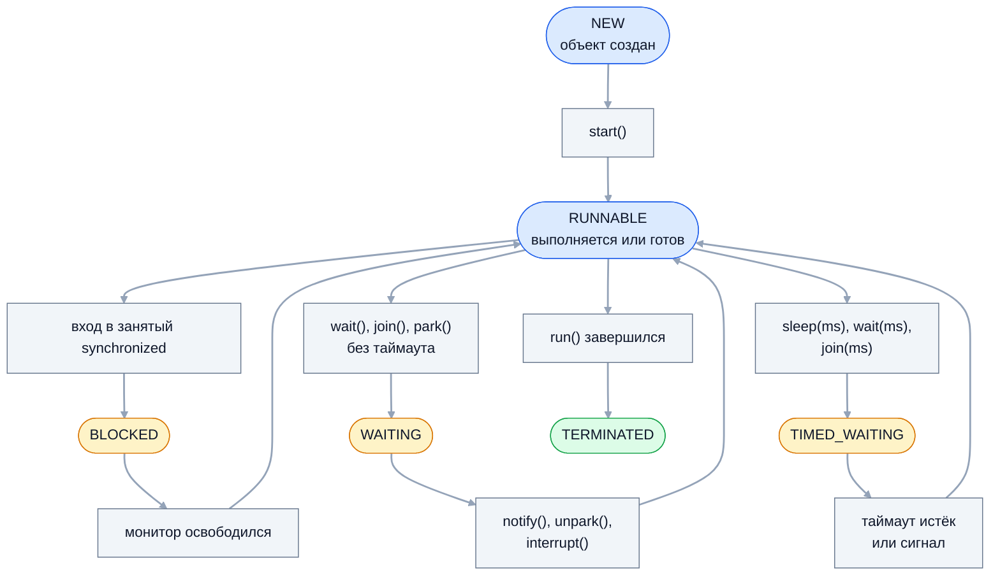

Поток — базовая единица выполнения, с которой начинается вся многопоточность в
Java. На собеседовании по этой теме проверяют не синтаксис `new Thread`, а
понимание жизненного цикла потока, разницы между `start()` и `run()`, поведения
daemon-потоков и, главное, кооперативного механизма прерывания: как правильно
остановить поток и почему нельзя глотать `InterruptedException`.

## Ключевые концепции

### Процессы и потоки

#### Что делят потоки процесса
Процесс — это изолированное адресное пространство со своими ресурсами ОС:
памятью, файловыми дескрипторами, сетевыми соединениями. Внутри процесса JVM
работает много потоков, и все они делят кучу и Metaspace: объект, созданный
одним потоком, доступен любому другому по ссылке.

Собственное у каждого потока — стек вызовов с локальными переменными, счётчик
команд и регистры процессора. Отсюда главное правило потокобезопасности:
локальные переменные и объекты, ссылка на которые не покидает метод, безопасны
сами по себе. Проблемы начинаются с общих объектов в куче — полей, статических
переменных, коллекций.

#### Платформенный поток и ОС
Обычный поток Java (platform thread) — тонкая обёртка над потоком
операционной системы, один к одному. Планирует его ОС: выделяет кванты
процессорного времени и переключает контекст, что стоит единицы микросекунд и
портит кэши процессора. Под стек каждого потока резервируется память — по
умолчанию до 1 МБ (флаг `-Xss`, `ThreadStackSize`).

Поэтому платформенных потоков не может быть миллион: тысячи потоков уже
заметно нагружают память и планировщик. Это ограничение и привело к пулам
потоков, а в Java 21 — к виртуальным потокам, которые JVM сама распределяет по
небольшому числу потоков ОС.

#### Конкурентность и параллелизм
Конкурентность (concurrency) — это структура программы, в которой несколько
задач выполняются в перекрывающиеся промежутки времени. Параллелизм
(parallelism) — одновременное физическое выполнение на нескольких ядрах.
Конкурентная программа на одном ядре работает за счёт чередования, а
параллельной ей нужно несколько ядер.

Различие важно для выбора инструментов. Веб-серверу с тысячами запросов,
которые в основном ждут базу данных, нужна конкурентность — много ожидающих
задач. Пересчёту большого массива нужен параллелизм — число потоков по числу
ядер, больше бесполезно.

### Создание

#### Thread, Runnable и Callable
Задачу для потока можно описать тремя способами. Наследование от `Thread` с
переопределением `run()` смешивает задачу и механизм её выполнения и занимает
единственную возможность наследования. `Runnable` — задача отдельно от потока,
её можно отдать и `Thread`, и пулу. `Callable<V>` возвращает результат и может
бросить проверяемое исключение, но запускается только через `ExecutorService`.

```java
class Worker extends Thread {
    @Override public void run() {
        System.out.println("extends Thread: " + getName());
    }
}
new Worker().start();
new Thread(() -> System.out.println("Runnable: " + Thread.currentThread().getName()),
        "runnable-thread").start();
try (ExecutorService ex = Executors.newSingleThreadExecutor()) {
    Future<Integer> f = ex.submit(() -> 6 * 7);
    System.out.println("Callable: " + f.get());
}
```
```
extends Thread: Thread-0
Runnable: runnable-thread
Callable: 42
```
Поток без явного имени получил безликое `Thread-0`, а второму имя задано в
конструкторе. Результат `Callable` возвращается через `Future`.

#### start() против run()
`start()` просит JVM создать новый поток ОС, и уже в нём вызывается `run()`.
Прямой вызов `run()` — обычный синхронный вызов метода в текущем потоке:
никакой многопоточности не возникает. Поток можно запустить только один раз —
повторный `start()` бросает `IllegalThreadStateException`, даже если поток уже
завершился.

```java
Thread r = new Thread(() -> System.out.println(
        "выполняется в потоке: " + Thread.currentThread().getName()), "new-thread");
r.run();
r.start();
r.join();
r.start();   // перехвачено
```
```
выполняется в потоке: main
выполняется в потоке: new-thread
повторный start(): java.lang.IllegalThreadStateException
```
`run()` выполнился в `main`, `start()` — в новом потоке. Отработавший поток
перезапустить нельзя: для повторного выполнения нужен новый объект `Thread` или
пул потоков.

#### Билдеры потоков (Java 21)
В Java 21 появились билдеры `Thread.ofPlatform()` и `Thread.ofVirtual()`. Они
задают имя (в том числе с автоматическим счётчиком), daemon-флаг, обработчик
исключений и могут вместо запуска вернуть `ThreadFactory` для пула. Осмысленное
имя потока стоит задавать всегда: именно его видно в thread dump, логах и
профилировщике, а `Thread-17` или `pool-3-thread-2` ничего не говорят о задаче.

```java
ThreadFactory factory = Thread.ofPlatform().name("worker-", 1).daemon(true).factory();
for (int i = 0; i < 2; i++) {
    Thread th = factory.newThread(() -> {
        Thread cur = Thread.currentThread();
        System.out.println(cur.getName() + " daemon=" + cur.isDaemon());
    });
    th.start();
    th.join();
}
Thread vt = Thread.ofVirtual().name("virtual-1")
        .start(() -> System.out.println(Thread.currentThread()));
vt.join();
```
```
worker-1 daemon=true
worker-2 daemon=true
VirtualThread[#46,virtual-1]/runnable@ForkJoinPool-1-worker-1
```
Фабрика пронумеровала потоки сама. Строка виртуального потока показывает и его
имя, и carrier-поток из `ForkJoinPool`, на котором он сейчас выполняется.

#### Необработанное исключение в потоке
Исключение, вылетевшее из `run()`, завершает только свой поток: остальные
потоки и `main` продолжают работу, а JVM по умолчанию лишь печатает стек в
`System.err`. Перехватить такие исключения можно обработчиком
`UncaughtExceptionHandler` — на конкретный поток через
`setUncaughtExceptionHandler` или на все потоки сразу через
`Thread.setDefaultUncaughtExceptionHandler`.

```java
Thread bad = new Thread(() -> { throw new IllegalStateException("сбой в задаче"); }, "bad");
bad.setUncaughtExceptionHandler((th, e) ->
        System.out.println("обработчик: " + th.getName() + " → " + e));
bad.start();
bad.join();
System.out.println("main продолжает работу");
```
```
обработчик: bad → java.lang.IllegalStateException: сбой в задаче
main продолжает работу
```
Обработчик вызывается в умирающем потоке и получает сам поток и исключение.
Подробно об исключениях в потоках, пулах и `CompletableFuture` — в отдельной
теме раздела об исключениях.

### Жизненный цикл

#### Шесть состояний потока
Состояния потока описывает перечисление `Thread.State`, текущее значение
возвращает `getState()`. Поток рождается в `NEW`, после `start()` переходит в
`RUNNABLE` и заканчивает в `TERMINATED`. Между ними он может ждать в одном из
трёх состояний ожидания, и разница между ними — частый вопрос.

`RUNNABLE` в Java объединяет «выполняется» и «готов выполняться»: JVM не
различает, выделил ли планировщик ОС потоку ядро прямо сейчас. Поток, читающий
из сокета на блокирующем вводе-выводе, тоже числится `RUNNABLE`, хотя
фактически ждёт данных в ядре ОС.


Синие узлы — активные состояния, жёлтые — три вида ожидания, серые — события,
которые переводят поток между ними. Поток, проснувшийся после `wait()`, сначала
снова захватывает монитор и может на время оказаться в `BLOCKED`.

#### BLOCKED, WAITING и TIMED_WAITING
`BLOCKED` — поток хочет войти в `synchronized`, но монитор занят другим
потоком. `WAITING` — поток сам решил ждать без ограничения времени: `wait()`,
`join()`, `LockSupport.park()`. `TIMED_WAITING` — то же с таймаутом: `sleep(ms)`,
`wait(ms)`, `join(ms)`. Важно: ожидание `ReentrantLock` — это `WAITING`, а не
`BLOCKED`, потому что под капотом блокировка паркует поток.

```java
Thread sleeper = new Thread(() -> {
    try { Thread.sleep(500); } catch (InterruptedException e) { }
});
System.out.println("после new:          " + sleeper.getState());
sleeper.start();
Thread.sleep(50);
System.out.println("во время sleep:     " + sleeper.getState());
// waiter вызывает lock.wait(), blocked пытается войти в synchronized (lock),
// пока монитор держит main
System.out.println("во время wait():    " + waiter.getState());
System.out.println("ждёт монитор:       " + blocked.getState());
System.out.println("после завершения:   " + sleeper.getState());
```
```
после new:          NEW
во время sleep:     TIMED_WAITING
во время wait():    WAITING
ждёт монитор:       BLOCKED
после завершения:   TERMINATED
```
В thread dump эти состояния — первое, на что смотрят при зависании: множество
потоков в `BLOCKED` на одном мониторе указывает на узкое место, а взаимное
ожидание — на deadlock.

#### join(), sleep() и wait()
`join()` блокирует текущий поток до завершения другого. Кроме ожидания он даёт
гарантию видимости: всё, что поток записал в память, видно после возврата из
`join()`, даже без `volatile`. Это одно из правил happens-before модели памяти
Java.

`sleep()` и `wait()` различаются отношением к монитору. `sleep()` просто
приостанавливает поток и захваченные мониторы не отпускает: все, кто ждёт этот
монитор, будут стоять. `wait()` вызывается внутри `synchronized` и отпускает
монитор на время ожидания, давая другим потокам войти в критическую секцию.

```java
Thread holder = new Thread(() -> {
    synchronized (lock) {
        try { Thread.sleep(300); } catch (InterruptedException e) { }
    }
});
// соперник пытается войти в synchronized (lock), пока holder спит
System.out.println("пока владелец в sleep(): соперник " + contender.getState());
// то же самое, но владелец вызывает lock.wait(300)
System.out.println("пока владелец в wait():  соперник " + contender2.getState());
```
```
пока владелец в sleep(): соперник BLOCKED
пока владелец в wait():  соперник TERMINATED
```
Во время `sleep()` соперник стоял на мониторе. Во время `wait()` монитор был
свободен, и соперник успел войти в блок и завершиться.

#### yield() и onSpinWait()
`Thread.yield()` подсказывает планировщику, что поток готов уступить процессор,
а `Thread.onSpinWait()` (Java 9) сообщает процессору, что поток крутится в
цикле активного ожидания, — на x86 это инструкция `PAUSE`. Оба метода — только
подсказки без гарантий. Строить на них синхронизацию нельзя: для ожидания
событий есть `wait`, блокировки и синхронизаторы.

### Daemon-потоки и приоритет

#### Daemon-потоки
JVM завершает работу, когда заканчиваются все не-daemon потоки. Daemon-поток
— фоновый: он не удерживает JVM, и когда последний обычный поток завершился,
daemon-потоки просто прекращают существовать. Флаг задают через
`setDaemon(true)` до `start()`, а новый поток наследует его от родителя.

Служебные потоки JVM — daemon. Список потоков только что запущенной программы
показывает, что `main` — единственный обычный поток:
```java
Thread.getAllStackTraces().keySet().stream()
        .sorted(Comparator.comparing(Thread::getName))
        .forEach(t -> System.out.printf("%-20s daemon=%b%n", t.getName(), t.isDaemon()));
```
```
Attach Listener      daemon=true
Common-Cleaner       daemon=true
Finalizer            daemon=true
Notification Thread  daemon=true
Reference Handler    daemon=true
Signal Dispatcher    daemon=true
main                 daemon=false
```
`Reference Handler` и `Common-Cleaner` обслуживают ссылочные объекты и
`Cleaner`, `Signal Dispatcher` — сигналы ОС. Потоки сборщика мусора и
JIT-компилятора — внутренние потоки HotSpot, в этом списке их нет.

#### Приоритеты потоков
`setPriority` принимает значения от 1 до 10, по умолчанию 5. Приоритет — лишь
подсказка планировщику ОС: на Linux без специальных прав JVM его фактически
игнорирует, на Windows он отображается на приоритеты потоков ОС. Поведение
программы не должно зависеть от приоритетов, а у виртуальных потоков
`setPriority` не действует вовсе.

#### Резкое завершение daemon-потоков
При остановке JVM daemon-потоки не получают ни прерывания, ни шанса доделать
работу: их `finally`-блоки и закрытие ресурсов в try-with-resources не
выполняются. Поэтому daemon-потоку нельзя поручать работу, которая должна
завершиться корректно, — запись в файл, отправку сообщения, фиксацию
транзакции.

```java
Thread daemon = new Thread(() -> {
    try {
        while (true) {
            Thread.sleep(100);
        }
    } catch (InterruptedException e) {
        // не дойдём
    } finally {
        System.out.println("finally в daemon-потоке");
    }
}, "background");
daemon.setDaemon(true);
daemon.start();
Thread.sleep(300);
System.out.println("main завершается, daemon жив: " + daemon.isAlive());
```
```
main завершается, daemon жив: true
```
Строки из `finally` в выводе нет: `main` закончился, JVM остановилась, и
daemon-поток исчез посреди цикла. Для корректного завершения нужен обычный
поток и явный сигнал остановки или shutdown hook.

### Прерывание потока (interrupt)

#### Кооперативная остановка
Остановить чужой поток силой в Java нельзя. `Thread.stop()` убивал поток в
произвольной точке, освобождая все его мониторы и оставляя объекты в
несогласованном состоянии; с Java 20 метод бросает
`UnsupportedOperationException`, а `suspend()` и `resume()` к Java 24 удалены
совсем.

Вместо этого есть кооперативный механизм: `interrupt()` лишь взводит у потока
флаг «прерван», а сам поток проверяет его и решает, как завершиться. Задача,
рассчитанная на отмену, должна регулярно проверять флаг в цикле и корректно
выходить, освобождая ресурсы.
```java
Thread worker = new Thread(() -> {
    long iterations = 0;
    while (!Thread.currentThread().isInterrupted()) {
        iterations++;
    }
    System.out.println("worker вышел из цикла по флагу, итераций > 0: " + (iterations > 0));
});
worker.start();
Thread.sleep(50);
worker.interrupt();
worker.join();
new Thread(() -> { }).stop();   // перехвачено
```
```
worker вышел из цикла по флагу, итераций > 0: true
stop(): java.lang.UnsupportedOperationException
```
Поток сам увидел флаг и вышел из цикла. `stop()` компилируется с
предупреждением `[removal]`, а в рантайме сразу бросает исключение.

#### isInterrupted() против interrupted()
Методы проверки флага легко перепутать. `isInterrupted()` — метод экземпляра:
проверяет флаг любого потока и не меняет его. Статический `Thread.interrupted()`
проверяет флаг текущего потока и сбрасывает его в `false`. Второй метод нужен,
когда код обрабатывает прерывание сам и хочет «погасить» сигнал.

```java
Thread.currentThread().interrupt();
System.out.println("isInterrupted():      " + Thread.currentThread().isInterrupted());
System.out.println("Thread.interrupted(): " + Thread.interrupted());
System.out.println("Thread.interrupted(): " + Thread.interrupted());
```
```
isInterrupted():      true
Thread.interrupted(): true
Thread.interrupted(): false
```
Первый вызов `interrupted()` вернул `true` и сбросил флаг, поэтому второй уже
видит `false`. Случайный вызов `interrupted()` в библиотечном коде «крадёт»
прерывание у вызывающего.

#### InterruptedException и сброс флага
Блокирующие методы — `sleep`, `wait`, `join`, `BlockingQueue.take`,
`Lock.lockInterruptibly` — реагируют на прерывание сразу: прекращают ожидание и
бросают `InterruptedException`. Перед выбросом исключения флаг сбрасывается,
так что внутри `catch` поток выглядит непрерванным. Если поток был прерван ещё
до вызова, метод бросает исключение немедленно.

```java
Thread sleeper = new Thread(() -> {
    try {
        Thread.sleep(10_000);
    } catch (InterruptedException e) {
        System.out.println("поймано " + e.getClass().getSimpleName()
                + ", флаг: " + Thread.currentThread().isInterrupted());
        Thread.currentThread().interrupt();
        System.out.println("после interrupt() в catch: " + Thread.currentThread().isInterrupted());
    }
});
sleeper.start();
Thread.sleep(100);
sleeper.interrupt();
sleeper.join();
```
```
поймано InterruptedException, флаг: false
после interrupt() в catch: true
```
Внутри `catch` флаг уже сброшен. Вызов `Thread.currentThread().interrupt()`
восстанавливает его, чтобы код выше по стеку тоже узнал об отмене.

#### Проглоченное прерывание
Пустой `catch (InterruptedException e) {}` — классическая ошибка. Исключение
уже сбросило флаг, и пустой обработчик окончательно теряет сигнал отмены:
поток продолжает работать, а код выше по стеку и пул потоков считают, что
прерывания не было. Правильных вариантов два: пробросить исключение, объявив
`throws InterruptedException`, или восстановить флаг вызовом `interrupt()`.

```java
Thread swallower = new Thread(() -> {
    while (!Thread.currentThread().isInterrupted()) {
        try {
            Thread.sleep(20);
        } catch (InterruptedException e) {
            // проглотили: флаг уже сброшен
        }
    }
});
swallower.start();
Thread.sleep(50);
swallower.interrupt();
Thread.sleep(300);
System.out.println("через 300 мс после interrupt() поток жив: " + swallower.isAlive());
```
```
через 300 мс после interrupt() поток жив: true
```
Прерывание пришло, пока поток спал: `sleep` бросил исключение и сбросил флаг,
`catch` его проглотил, и проверка в `while` больше никогда не сработает. Так
`shutdownNow()` пула потоков не может остановить задачу.

#### Что не прерывается
Прерывание будит только то, что умеет на него реагировать. Поток в состоянии
`BLOCKED`, ожидающий входа в `synchronized`, на `interrupt()` не реагирует:
флаг взводится, но поток продолжает ждать монитор. Блокирующий ввод-вывод из
`java.io` (чтение из `InputStream` сокета) тоже не прерывается — его разблокирует
только закрытие потока или сокета из другого потока.

Если нужно прерываемое ожидание блокировки, используют
`ReentrantLock.lockInterruptibly()`. Каналы NIO, реализующие
`InterruptibleChannel`, на прерывание реагируют, но радикально: канал
закрывается, а поток получает `ClosedByInterruptException`.
```java
synchronized (monitor) {
    lock.lock();
    // поток a ждёт synchronized (monitor), поток b — lock.lockInterruptibly()
    a.start();
    b.start();
    Thread.sleep(100);
    a.interrupt();
    b.interrupt();
    Thread.sleep(100);
    System.out.println("a после interrupt(): " + a.getState());
    lock.unlock();
}
```
```
b: lockInterruptibly() прерван
a после interrupt(): BLOCKED
a получил монитор, флаг прерывания: true
```
Поток `b` сразу вышел из ожидания с исключением, а `a` остался в `BLOCKED` и
вошёл в блок только после освобождения монитора — с взведённым, но
необработанным флагом.

## Частые вопросы на собеседовании

**Q: Как правильно остановить работающий поток, если Thread.stop() не должен использоваться?**
A: Через кооперативное прерывание: вызвать `interrupt()`, а в задаче
регулярно проверять `Thread.currentThread().isInterrupted()` и корректно
выходить, освобождая ресурсы. Если задача блокируется в `sleep`, `wait` или
`take`, прерывание разбудит её через `InterruptedException`. Для потоков пула —
`future.cancel(true)` или `shutdownNow()`, которые вызывают тот же `interrupt()`.
Альтернатива — `volatile`-флаг остановки, но он не будит поток, застрявший в
блокирующем вызове.

**Q: Что произойдёт, если проглотить InterruptedException и не восстановить флаг прерывания?**
A: Сигнал отмены потеряется. Исключение уже сбросило флаг, и после пустого
`catch` поток выглядит так, будто его никто не прерывал: циклы с проверкой
`isInterrupted()` продолжаются, `shutdownNow()` не останавливает задачу,
приложение не может корректно завершиться. Правильно — пробросить
`InterruptedException` выше или вызвать `Thread.currentThread().interrupt()` в
`catch`.

**Q: Чем start() отличается от run()?**
A: `start()` создаёт новый поток выполнения, и `run()` вызывается уже в нём.
Прямой вызов `run()` — обычный вызов метода в текущем потоке, без всякой
многопоточности. `start()` можно вызвать только один раз: повторный вызов
бросает `IllegalThreadStateException`.

**Q: Чем BLOCKED отличается от WAITING?**
A: `BLOCKED` — поток ждёт входа в `synchronized`, монитор которого занят; выйти
из этого состояния он может только получив монитор, прерывание не помогает.
`WAITING` — поток сам вызвал метод ожидания без таймаута (`wait`, `join`,
`park`) и ждёт сигнала, прерывание будит его. Ожидание `ReentrantLock` в thread
dump выглядит как `WAITING (parking)`, а не `BLOCKED`.

**Q: Что такое daemon-поток и когда JVM завершает работу?**
A: JVM завершается, когда закончились все не-daemon потоки (или вызван
`System.exit`). Daemon-потоки при этом обрываются без выполнения `finally` и
без прерывания. Поэтому daemon подходит для фоновой работы, которую не жалко
потерять, — мониторинга, периодической очистки кэша, но не для записи данных.

## Ловушки и частые ошибки

#### Вызов run() вместо start()
Код с `thread.run()` работает и даже печатает ожидаемый результат, но
выполняется последовательно в вызывающем потоке. Ошибку выдаёт имя потока в
логах или отсутствие ускорения. На ревью такой вызов — однозначный дефект.

#### volatile-флаг вместо прерывания
Флаг `volatile boolean running` останавливает цикл, но не будит поток,
застрявший в `sleep`, `take` или `wait`: он заметит флаг только когда ожидание
закончится само. Прерывание решает обе задачи, и его понимают пулы потоков и
библиотеки. Если флаг всё же используется, вместе с ним вызывают `interrupt()`.

#### interrupt() не останавливает поток
Частое заблуждение — считать, что `interrupt()` завершает поток. Он только
взводит флаг и будит прерываемые блокирующие вызовы. Поток, который не
проверяет флаг и не вызывает блокирующих методов, — например, долгий
вычислительный цикл — продолжит работать как ни в чём не бывало.

#### Сохранение ссылки на Thread.currentThread() в пуле
Задача в пуле выполняется в чужом, переиспользуемом потоке. Прерывание
такого потока «на будущее», смена его имени или приоритета влияют на следующие
задачи. Отменять задачи пула нужно через `Future.cancel` или `shutdownNow`, а не
через прямое управление потоками.

## Связанные темы
- [Основы ОС](../../01-fundamentals/01-os-basics.md) — процессы, потоки и переключение контекста на уровне ОС.
- [Исключения в многопоточном коде](../../04-exceptions/04-exceptions-in-concurrency.md) — `UncaughtExceptionHandler`, исключения в пулах и `InterruptedException`.
- [Синхронизация: synchronized](02-synchronized.md) — мониторы и состояние `BLOCKED`.
- [Взаимодействие потоков и deadlock](04-thread-interaction-and-deadlock.md) — `wait`/`notify` и анализ thread dump.
- [Пулы потоков](../02-executors-and-async/05-thread-pools.md) — почему потоки не создают вручную в продакшене.
- [Виртуальные потоки](../04-project-loom/10-virtual-threads.md) — лёгкие потоки Java 21 и билдер `Thread.ofVirtual()`.

## Источники
- [javadoc java.lang.Thread](https://docs.oracle.com/en/java/javase/21/docs/api/java.base/java/lang/Thread.html) — состояния, прерывание, билдеры.
- [Java Thread Primitive Deprecation](https://docs.oracle.com/en/java/javase/21/docs/api/java.base/java/lang/doc-files/threadPrimitiveDeprecation.html) — почему `stop`, `suspend` и `resume` опасны.
- Brian Goetz et al. «Java Concurrency in Practice», глава 7 — отмена и завершение потоков.
