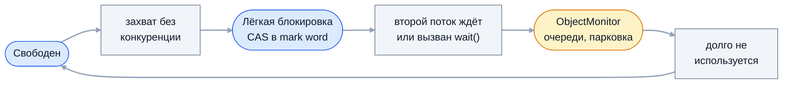

`synchronized` — встроенный в язык механизм взаимного исключения, с которого
начинается любой разговор о потокобезопасности. На собеседовании проверяют,
понимает ли кандидат, откуда берутся гонки, что именно блокирует
`synchronized`-метод, какие гарантии видимости даёт монитор и как блокировка
устроена в JVM: байткод, mark word и раздувание до тяжёлого монитора.

## Ключевые концепции

### Состояние гонки и потокобезопасность

#### Race condition
Состояние гонки (race condition) — ситуация, когда результат программы зависит
от того, как именно чередуются потоки. Самая частая форма — read-modify-write:
`count++` выглядит как одна операция, но это три шага — прочитать, прибавить,
записать. Если два потока прочитали одно и то же значение, одно из приращений
теряется.

```java
static int unsafeCount = 0;
static int safeCount = 0;
static synchronized void safeIncrement() { safeCount++; }

// два потока, каждый по 1 000 000 раз
runTwice(() -> { for (int i = 0; i < 1_000_000; i++) unsafeCount++; });
System.out.println("без синхронизации: " + unsafeCount);
runTwice(() -> { for (int i = 0; i < 1_000_000; i++) safeIncrement(); });
System.out.println("synchronized:      " + safeCount);
```
```
без синхронизации: 1058596
synchronized:      2000000
```
Без синхронизации потеряна почти половина приращений, и число меняется от
запуска к запуску. С `synchronized` результат точный: потоки выполняют
инкремент строго по очереди.

Вторая форма гонки — check-then-act: проверить условие и действовать по его
результату. Между проверкой и действием другой поток успевает изменить
состояние, и проверка оказывается устаревшей. Так появляются двойная
инициализация, повторная вставка и «невозможные» дубли.
```java
// 200 раундов: два потока одновременно стартуют по CountDownLatch
if (!map.containsKey("config")) {
    created.incrementAndGet();
    map.put("config", 1);
}
```
```
раундов из 200, где значение создано дважды: > 0
```
В части раундов оба потока увидели, что ключа нет, и оба создали значение.
Исправление — сделать проверку и действие одной атомарной операцией:
`synchronized` вокруг обоих шагов или `ConcurrentHashMap.putIfAbsent`.

#### Data race
Data race — более узкое понятие из модели памяти Java: два потока обращаются к
одной переменной, хотя бы одно обращение — запись, и между ними нет отношения
happens-before. Программа с data race может видеть устаревшие значения,
частично записанные объекты и переставленные операции.

Понятия пересекаются, но не совпадают. Гонка без data race возможна: два
атомарных `get` и `set` у `AtomicInteger` корректны по отдельности, но вместе
образуют check-then-act. Data race без логической гонки тоже бывает — например,
ленивое кэширование хэш-кода в `String`, где повторный расчёт безвреден.

#### Критическая секция
Критическая секция — участок кода, работающий с общим состоянием, который в
каждый момент времени должен выполнять не больше одного потока. Взаимное
исключение (mutual exclusion) — механизм, который это обеспечивает: поток
захватывает блокировку на входе и освобождает на выходе, остальные ждут.

Критическую секцию держат как можно короче. Всё, что не трогает общее
состояние, — вычисления, ввод-вывод, логирование, вызовы внешних сервисов —
выносят за её пределы. Длинная критическая секция превращает многопоточный код
в очередь из потоков, ждущих одну блокировку.

#### Стратегии потокобезопасности
Синхронизация — не единственный и не первый способ получить потокобезопасность.
Лучше всего вообще не разделять изменяемое состояние: локальные переменные и
объекты, ссылка на которые не покидает поток (thread confinement), безопасны
без блокировок. Следующий вариант — неизменяемые объекты: `String`, `record` с
неизменяемыми полями, коллекции из `List.of` можно свободно передавать между
потоками.

Если состояние всё же общее и изменяемое, доступ к нему синхронизируют — все
обращения, включая чтение, под одной и той же блокировкой. Часто проще взять
готовые потокобезопасные классы: `ConcurrentHashMap`, `AtomicLong`,
`BlockingQueue` — они реализованы экспертами и проверены годами.

### Механика

#### synchronized-метод
Модификатор `synchronized` у метода экземпляра означает, что перед входом
поток захватывает монитор объекта `this`, а при выходе освобождает. У
`static synchronized`-метода монитор — объект `Class` этого класса, например
`Counter.class`. Пока один поток внутри, все остальные потоки, вызывающие
`synchronized`-методы того же объекта, ждут в состоянии `BLOCKED`.

Синхронизированы только вызовы на одном и том же объекте. Два потока,
вызывающие `synchronized`-метод на разных экземплярах, друг другу не мешают —
и если эти экземпляры меняют общее статическое поле, гонка остаётся.

#### synchronized-блок
Блок `synchronized (obj) { ... }` захватывает монитор произвольного объекта и
охватывает только нужную часть метода. Это даёт два преимущества: критическая
секция короче, а монитор можно сделать приватным полем
`private final Object lock = new Object()`, недоступным чужому коду.

Отдельные мониторы для независимых частей состояния уменьшают конкуренцию:
счётчик запросов и кэш конфигурации не обязаны ждать друг друга. Но чем
больше блокировок, тем выше риск deadlock, если поток захватывает несколько из
них в разном порядке.

#### Монитор объекта
Монитор (intrinsic lock) встроен в каждый объект Java: отдельного объекта
блокировки создавать не нужно. Его состояние хранится в заголовке объекта, в
служебном слове mark word, а при реальной конкуренции JVM создаёт для объекта
отдельную структуру `ObjectMonitor`. Кроме захвата и освобождения монитор
поддерживает ожидание условия: методы `wait`, `notify` и `notifyAll` из
`Object`.

### Свойства

#### Реентерабельность
Монитор реентерабелен: поток, уже владеющий монитором, может захватить его
повторно и не заблокирует сам себя. JVM ведёт счётчик захватов и освобождает
монитор, когда счётчик возвращается к нулю. Без этого вызов одного
`synchronized`-метода из другого на том же объекте или переопределённого
`synchronized`-метода через `super` приводил бы к мгновенной взаимоблокировке.

```java
synchronized void outer() {
    System.out.println("outer: держит монитор = " + Thread.holdsLock(this));
    inner();
}
synchronized void inner() {
    System.out.println("inner: повторный захват того же монитора прошёл");
}
```
```
outer: держит монитор = true
inner: повторный захват того же монитора прошёл
```
`Thread.holdsLock(obj)` проверяет, держит ли текущий поток монитор объекта, —
удобно в `assert` для методов, которые обязаны вызываться под блокировкой.

#### this против Class
Метод экземпляра блокирует `this`, а `static synchronized`-метод — объект
`Class`. Это разные мониторы, поэтому статический и обычный
`synchronized`-методы одного класса выполняются одновременно. Если оба меняют
одно и то же статическое поле, такая «синхронизация» ничего не защищает.

```java
static synchronized void staticMethod() { enterAndHold(); }
synchronized void instanceMethod() { enterAndHold(); }
// enterAndHold() отмечает, сколько потоков одновременно внутри, и спит 200 мс
new Thread(Sync::staticMethod).start();
new Thread(obj::instanceMethod).start();
System.out.println("одновременно внутри synchronized-методов: " + maxInside.get());
```
```
одновременно внутри synchronized-методов: 2
```
Оба потока оказались внутри «синхронизированного» кода одновременно. Общее
статическое состояние защищают одним монитором — например,
`synchronized (Counter.class)` во всех методах, которые к нему обращаются.

#### Видимость изменений
`synchronized` решает две задачи, и вторую часто забывают. Помимо взаимного
исключения он гарантирует видимость: всё, что поток записал до освобождения
монитора, увидит любой поток, который захватит тот же монитор позже. Это
правило happens-before модели памяти Java.

Отсюда следствие: синхронизировать нужно и чтение, а не только запись. Геттер
без `synchronized` при синхронизированном сеттере может вечно видеть старое
значение — JIT вправе закэшировать поле в регистре. Подробно — в теме о модели
памяти и `volatile`.

#### Исключения и ожидание монитора
Монитор освобождается при любом выходе из блока, в том числе при исключении:
компилятор сам добавляет обработчик, который освобождает монитор и
перебрасывает исключение. Забыть `unlock`, как с `ReentrantLock`, невозможно.

```java
Thread failing = new Thread(() -> {
    synchronized (lock) {
        throw new IllegalStateException("ошибка в критической секции");
    }
});
failing.start();
failing.join();
synchronized (lock) {
    System.out.println("main захватил тот же монитор после падения");
}
```
```
поток упал: ошибка в критической секции
main захватил тот же монитор после падения
```
Монитор освободился, но инвариант объекта мог остаться нарушенным, если
исключение вылетело посреди изменения. Обратная сторона простоты — ожидание
монитора нельзя прервать и нельзя ограничить таймаутом; для этого есть
`ReentrantLock` с `lockInterruptibly()` и `tryLock(timeout)`.

#### Неподходящие мониторы
Монитором может быть любой объект, но не любой подходит. `synchronized (null)`
бросает `NullPointerException`. Строковые литералы интернируются, а `Integer`
от −128 до 127 берётся из кэша, поэтому `synchronized ("lock")` в двух разных
классах — один и тот же монитор на всё приложение. Публичный `this` или
`Class` может захватить чужой код и устроить deadlock.

Отдельный класс ошибок — синхронизация на поле, которое меняется. В примере
ниже `boxed++` каждый раз создаёт новый объект `Integer`, и потоки
синхронизируются на разных мониторах:
```java
static Integer boxed = 0;
runTwice(() -> {
    for (int k = 0; k < 1_000_000; k++) {
        synchronized (boxed) {
            boxed++;
        }
    }
});
System.out.println("synchronized (boxed) { boxed++; }: " + boxed);
Integer lockA = 100;
Integer lockB = 100;
System.out.println("два «независимых» монитора — один объект: " + (lockA == lockB));
```
```
synchronized (boxed) { boxed++; }: 1706438
два «независимых» монитора — один объект: true
```
Блокировка есть, а приращения теряются. Компилятор здесь предупреждает:
`attempt to synchronize on an instance of a value-based class`. Монитор должен
быть `private final` полем, ссылка в котором никогда не меняется.

### Под капотом: байткод и эскалация блокировки

#### monitorenter и monitorexit
`synchronized`-блок компилируется в инструкции `monitorenter` и `monitorexit`.
Чтобы монитор освободился и при исключении, компилятор добавляет скрытый
обработчик `any`: он выполняет ещё один `monitorexit` и перебрасывает
исключение. `synchronized`-метод отдельных инструкций не получает — у него
выставлен флаг `ACC_SYNCHRONIZED`, и JVM сама берёт монитор при вызове и
отпускает при выходе.

```java
void block() {
    synchronized (lock) {
        count++;
    }
}
synchronized void method() {
    count++;
}
```
```
$ javap -c -v Bytecode
  void block();
         4: dup
         5: astore_1
         6: monitorenter
         7: aload_0
        ...
        14: putfield      #13                 // Field count:I
        17: aload_1
        18: monitorexit
        19: goto          27
        22: astore_2
        23: aload_1
        24: monitorexit
        25: aload_2
        26: athrow
        27: return
      Exception table:
         from    to  target type
             7    19    22   any
            22    25    22   any
  synchronized void method();
    flags: (0x0020) ACC_SYNCHRONIZED
```
Ссылка на монитор сохраняется в локальную переменную (`astore_1`), поэтому
`monitorexit` освобождает тот же объект, даже если поле `lock` за это время
переприсвоили. Второй `monitorexit` по адресу 24 — путь для исключения из
таблицы `Exception table`.

#### Mark word
Каждый объект в HotSpot начинается с заголовка: mark word (8 байт на 64-битной
JVM) и указатель на класс. Mark word — многоцелевое слово: в нём хранятся
identity hash code, возраст объекта для сборщика мусора и состояние блокировки.
Два младших бита — тег, по которому JVM понимает, как трактовать остальное
содержимое: свободный объект, захваченный лёгкой блокировкой или связанный с
`ObjectMonitor`.

Поэтому блокировка не требует отдельной памяти, пока объект не стал предметом
реальной конкуренции. Подробнее устройство заголовка объекта разбирается в
теме об областях памяти JVM.

#### Biased locking
Смещённая блокировка (biased locking) оптимизировала случай, когда монитор
всегда берёт один и тот же поток: объект «привязывался» к первому владельцу, и
повторные захваты обходились без атомарных операций. Когда приходил другой
поток, привязку приходилось снимать (revocation) с остановкой потоков в
safepoint — это было дорого.

В современном коде однопоточных блокировок стало мало (`Vector` и `Hashtable`
вытеснены), а сложность реализации мешала развитию JVM. Biased locking
отключили по умолчанию в Java 15 (JEP 374) и удалили из HotSpot в Java 18.
Ответ «JVM использует biased locking» на собеседовании выдаёт устаревшие
знания.

#### Лёгкая блокировка
Лёгкая (thin, lightweight) блокировка — путь для случая, когда потоки берут
монитор по очереди, не сталкиваясь. Захват — одна CAS-операция над mark word:
если объект свободен, поток атомарно помечает его как захваченный. Никаких
системных вызовов и очередей — это стоит десятки наносекунд, а повторный
захват тем же потоком ещё дешевле.

#### Раздувание до ObjectMonitor
Если поток пытается захватить монитор, занятый другим, JVM сначала немного
крутится в цикле (адаптивный спиннинг), рассчитывая, что владелец скоро выйдет.
Не дождавшись, она раздувает (inflate) блокировку: создаёт `ObjectMonitor` с
владельцем, счётчиком рекурсии, очередью ожидающих входа и набором потоков в
`wait()`, а в mark word записывает указатель на него.

Ожидающие потоки паркуются средствами ОС и будятся при освобождении — это уже
микросекунды и переключения контекста. Вызов `wait()` тоже требует полного
монитора. Когда объект перестаёт использоваться под конкуренцией, JVM может
выполнить обратное сдутие (deflation) и освободить `ObjectMonitor`.


Пока потоки не сталкиваются, блокировка остаётся в mark word. Тяжёлый монитор
появляется только при реальной конкуренции или вызове `wait()`, а после
затишья JVM может вернуть объект в исходное состояние.

#### Стоимость synchronized
Из этой схемы следует практический вывод: `synchronized` без конкуренции
почти бесплатен, а под конкуренцией — дорог. JIT дополнительно убирает
блокировки на объектах, которые не покидают поток (lock elision по результатам
escape analysis), и объединяет соседние блоки на одном мониторе (lock
coarsening). Под конкуренцией потоки большую часть времени ждут и
переключаются, а не работают.

```java
static final Object LOCK = new Object();
// total = 20 000 000 инкрементов, поровну между потоками, после прогрева
for (int i = 0; i < perThread; i++) {
    synchronized (LOCK) {
        counter++;
    }
}
```
```
ядер: 20
1 поток,  без конкуренции: 39 мс
4 потока, одна блокировка: 187 мс
счётчик: 20000000
```
Ту же работу четыре потока выполнили почти в пять раз медленнее одного:
вместо параллелизма они стоят в очереди за одной блокировкой. Цифры зависят от
машины, но соотношение типично. Лекарство — уменьшать общее состояние, а не
добавлять потоки.

## Частые вопросы на собеседовании

**Q: Что именно блокирует synchronized-метод экземпляра и static synchronized-метод?**
A: Метод экземпляра захватывает монитор объекта `this`, статический — монитор
объекта `Class`, например `Counter.class`. Это разные мониторы, поэтому
статический и обычный синхронизированные методы одного класса не исключают
друг друга. Синхронизированные методы на разных экземплярах тоже выполняются
параллельно.

**Q: Какие гарантии, кроме взаимного исключения, даёт synchronized?**
A: Видимость и упорядочивание: освобождение монитора happens-before любого
последующего захвата того же монитора, поэтому все записи, сделанные внутри
блока, видны следующему владельцу. Ещё одна гарантия — автоматическое
освобождение монитора при исключении. Атомарность при этом распространяется
только на код под одним и тем же монитором.

**Q: Почему synchronized под реальной конкуренцией дорогой, а без неё почти бесплатный?**
A: Без конкуренции захват — одна CAS-операция над mark word в заголовке
объекта, а JIT может вовсе убрать блокировку, если объект не покидает поток.
При конкуренции JVM раздувает блокировку до `ObjectMonitor`: ожидающие потоки
сначала крутятся, затем паркуются средствами ОС, и каждое пробуждение — это
системный вызов и переключение контекста.

**Q: Можно ли synchronized на String или Integer?**
A: Технически можно, но это ошибка. Строковые литералы интернированы, а
маленькие `Integer` кэшированы, поэтому несвязанные части приложения могут
случайно делить один монитор. А синхронизация на изменяемом поле с
`Integer`-счётчиком вообще ломается: `count++` создаёт новый объект, и потоки
захватывают разные мониторы. Монитором должен быть приватный `final`-объект.

**Q: Что такое biased locking и используется ли он сейчас?**
A: Это была оптимизация для мониторов, которые всегда захватывает один поток:
объект привязывался к нему, и повторные захваты обходились без CAS. Снятие
привязки требовало safepoint и стоило дорого, а выигрыш в современном коде
стал мал. Biased locking отключён по умолчанию в Java 15 и удалён в Java 18.

## Ловушки и частые ошибки

#### Синхронизирована только запись
Классическая ошибка — `synchronized` на сеттере и обычный геттер. Взаимного
исключения для чтения отдельного поля может и не требоваться, но без общей
блокировки нет и happens-before: читатель вправе видеть устаревшее значение.
Синхронизируют все обращения к общему состоянию или делают поле `volatile`.

#### Разные мониторы для одного состояния
Если один метод защищает список через `synchronized (this)`, а другой — через
`synchronized (list)`, они не исключают друг друга. То же происходит при
смешении `static synchronized` и обычных методов. Для каждой части состояния
должна быть одна документированная блокировка.

#### Синхронизированная обёртка без синхронизации составных действий
`Collections.synchronizedList` защищает каждый вызов по отдельности, но
`if (!list.contains(x)) list.add(x)` остаётся гонкой check-then-act. Составное
действие нужно обернуть в `synchronized (list)` — именно на этом объекте
синхронизируется обёртка.

#### Ввод-вывод под блокировкой
Сетевой вызов или запрос к базе внутри `synchronized` заставляет все остальные
потоки ждать сетевой задержки. Из-за этого сервис под нагрузкой деградирует
до однопоточного. Под блокировкой оставляют только работу с общим состоянием,
а медленные операции выполняют до или после неё.

## Связанные темы
- [Основы потоков](01-thread-basics.md) — состояние `BLOCKED` и жизненный цикл потока.
- [Java Memory Model и volatile](03-jmm-and-volatile.md) — happens-before для монитора и видимость.
- [Взаимодействие потоков и deadlock](04-thread-interaction-and-deadlock.md) — `wait`/`notify` на мониторе и взаимоблокировки.
- [Concurrent-коллекции и атомарные переменные](../03-concurrency-utilities/07-concurrent-collections-and-atomics.md) — потокобезопасность без явных блокировок.
- [Явные блокировки и примитивы синхронизации](../03-concurrency-utilities/08-locks-and-synchronizers.md) — `ReentrantLock` с таймаутами и прерыванием.
- [Виртуальные потоки](../04-project-loom/10-virtual-threads.md) — pinning из-за `synchronized` до Java 24.
- Области памяти JVM (раздел 9) — заголовок объекта и mark word.
- JIT-компиляция и оптимизации (раздел 9) — escape analysis, lock elision и lock coarsening.

## Источники
- [JLS §17.1 Synchronization](https://docs.oracle.com/javase/specs/jls/se21/html/jls-17.html#jls-17.1) — мониторы в спецификации языка.
- [JVMS §2.11.10 Synchronization](https://docs.oracle.com/javase/specs/jvms/se21/html/jvms-2.html#jvms-2.11.10) — `monitorenter`, `monitorexit` и `ACC_SYNCHRONIZED`.
- [JEP 374: Deprecate and Disable Biased Locking](https://openjdk.org/jeps/374).
- Brian Goetz et al. «Java Concurrency in Practice», главы 2 и 3 — потокобезопасность и разделяемые объекты.
