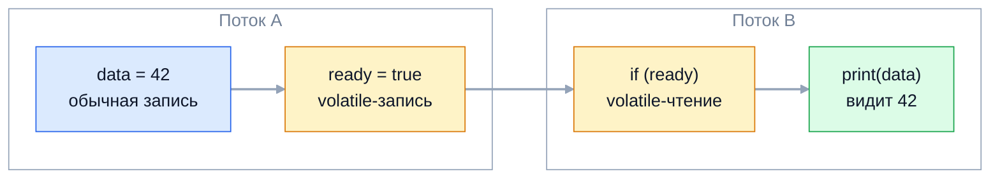

Модель памяти Java (JMM) отвечает на вопрос, который в однопоточном коде даже
не возникает: какое значение увидит поток, читающий переменную, которую пишет
другой поток. Без этой теории невозможно объяснить, почему цикл с флагом
остановки может не завершиться, зачем `volatile` в double-checked locking и чем
видимость отличается от атомарности. На senior-собеседовании ждут правила
happens-before, понимание переупорядочивания и способов безопасной публикации.

## Ключевые концепции

### Зачем нужна модель памяти

#### Кэширование и устаревшие значения
Интуитивная модель «все потоки читают и пишут одну общую память по очереди»
неверна. JIT-компилятор держит часто используемые значения в регистрах, а
процессор складывает записи в буфер (store buffer) и сбрасывает их в кэш
позже. Без синхронизации поток вправе бесконечно видеть старое значение
переменной, которую другой поток уже изменил.

```java
static boolean running = true;           // обычное поле
static volatile boolean vRunning = true; // volatile
// поток крутит цикл while (running) n++; через 500 мс main пишет running = false
check("обычное поле  ", () -> { long n = 0; while (running) n++; }, () -> running = false);
check("volatile      ", () -> { long n = 0; while (vRunning) n++; }, () -> vRunning = false);
check("synchronized  ", () -> { long n = 0; while (sRunning()) n++; },
        () -> { synchronized (LOCK) { sRunning = false; } });
```
```
обычное поле  : поток НЕ остановился за 1 с
volatile      : поток остановился
synchronized  : поток остановился
```
За 500 мс JIT скомпилировал цикл и, раз в нём нет синхронизации, вынес чтение
`running` из цикла: поток проверяет флаг один раз и крутится вечно. С
`volatile` или чтением под монитором каждое обращение идёт к актуальному
значению.

#### Переупорядочивание операций
Компилятор, JIT и процессор вправе переставлять операции, если в однопоточном
выполнении результат не меняется. Для одного потока это незаметно, но другой
поток наблюдает операции в «чужом» порядке. Классический тест: поток 1 пишет
`x = 1` и читает `y`, поток 2 пишет `y = 1` и читает `x`. Интуитивно хотя бы
один из них должен увидеть единицу.

```java
static class Plain { int x, y, r1, r2; }
// оба потока одновременно проходят по массиву из 4096 таких объектов
for (Plain p : s) { p.x = 1; p.r1 = p.y; }   // поток 1
for (Plain p : s) { p.y = 1; p.r2 = p.x; }   // поток 2
// то же самое с volatile-полями x и y
```
```
обычные поля: r1 == 0 и r2 == 0 — 69219 раз из 8192000
volatile:     r1 == 0 и r2 == 0 — 0 раз из 8192000
```
Тысячи раз оба потока прочитали ноль: каждая запись ещё лежала в буфере
своего ядра, когда выполнялось чтение. Даже на x86 с его строгой моделью
процессор переставляет запись с последующим чтением. `volatile` запрещает эту
перестановку.

#### JMM и гарантия DRF-SC
Модель памяти Java (JSR-133, Java 5, глава 17 JLS) описывает, какие значения
может вернуть каждое чтение. Она не перечисляет запрещённые оптимизации, а
определяет отношение happens-before и разрешает чтению видеть только записи,
согласованные с ним.

Главное практическое следствие — гарантия DRF-SC: программа без data race
ведёт себя последовательно согласованно, как будто операции всех потоков
выполняются по очереди в одном порядке. Значит, программисту не нужно думать
о барьерах и буферах — достаточно корректно расставить синхронизацию. А
программа с data race может наблюдать практически любые перестановки.

### Happens-before

#### Определение
Happens-before — отношение между действиями в программе. Если действие A
happens-before действия B, то все записи, сделанные до A, видны в B, и B не
может наблюдать их в переставленном порядке. Отношение транзитивно: если A
happens-before B, а B happens-before C, то A happens-before C. Именно
транзитивность позволяет одной `volatile`-записи «опубликовать» множество
обычных записей перед ней.


Стрелки внутри потоков — порядок программы, стрелка между потоками — правило
`volatile`. По транзитивности запись `data = 42` happens-before её чтения в
потоке B, хотя само поле `data` обычное.

#### Правила happens-before
JLS задаёт базовые правила. Внутри одного потока каждое действие
happens-before следующего по порядку программы. Освобождение монитора
happens-before каждого последующего захвата того же монитора. Запись в
`volatile`-поле happens-before каждого последующего чтения этого поля.

Ещё несколько правил связаны с жизненным циклом потоков. `Thread.start()`
happens-before любого действия запущенного потока, поэтому данные,
подготовленные до `start()`, поток видит без синхронизации. Все действия
потока happens-before успешного возврата из `join()` у этого потока.

Реже вспоминают два последних правила. Вызов `interrupt()` happens-before
момента, когда прерванный поток обнаружил прерывание. Запись значения по
умолчанию в поле happens-before первого действия любого потока.

#### Гарантии java.util.concurrent
Классы `java.util.concurrent` документируют собственные гарантии,
построенные на базовых правилах. Помещение объекта в любую потокобезопасную
коллекцию или `BlockingQueue` happens-before его извлечения из неё другим
потоком. Действия перед отправкой задачи в `ExecutorService` happens-before
начала задачи, а действия задачи happens-before возврата из `Future.get()`.

То же для синхронизаторов: действия перед `countDown()` happens-before
возврата из `await()` у `CountDownLatch`, освобождение `Lock` — перед его
следующим захватом. Поэтому объект, переданный через очередь или пул, можно
спокойно читать без дополнительной синхронизации.

### volatile

#### Семантика volatile
`volatile`-поле гарантирует две вещи. Видимость: чтение всегда видит последнюю
запись в это поле из любого потока. Порядок: обычные операции до
`volatile`-записи нельзя перенести после неё (семантика release), а операции
после `volatile`-чтения нельзя перенести до него (семантика acquire). Вместе
это и даёт правило happens-before из схемы выше.

`volatile` не создаёт блокировки и не заставляет потоки ждать друг друга.
Это самый лёгкий механизм синхронизации, но и самый узкий: он годится для
одной переменной, которая читается и пишется целиком.

#### Где volatile уместен
Типичные применения `volatile` — флаг остановки фонового потока, публикация
полностью построенного объекта (конфигурация, кэш, снимок состояния),
значение, которое пишет один поток, а читают многие, например текущая
температура датчика или время последнего heartbeat. Условие корректности —
новое значение не зависит от старого, либо писатель единственный.

Неуместен `volatile` там, где нужен инвариант между несколькими полями
(«нижняя граница меньше верхней») или read-modify-write: счётчики, флаги
вида «проверить и установить». Для этого нужны атомарные классы или
блокировки.

#### Барьеры памяти
JVM реализует `volatile` барьерами памяти — инструкциями, запрещающими
процессору определённые перестановки. Различают четыре вида: LoadLoad,
LoadStore, StoreStore и StoreLoad. На x86 первые три соблюдаются аппаратно
бесплатно, поэтому `volatile`-чтение стоит почти как обычное.

Дорог только StoreLoad после `volatile`-записи: он заставляет процессор
дождаться опустошения буфера записей. HotSpot на x86 использует для этого
инструкцию с префиксом `lock` — несколько десятков тактов. На ARM дороже обе
стороны: чтение превращается в `ldar`, запись — в `stlr`. Поэтому частые
`volatile`-записи в горячем цикле заметны, а частые чтения — почти нет.

### Атомарность vs видимость

#### volatile и составные операции
Самое частое заблуждение о `volatile` — что он делает `count++` безопасным.
Он гарантирует, что каждое чтение видит свежее значение, но между чтением и
записью другой поток успевает вклиниться. Инкремент остаётся тремя
операциями, и приращения теряются так же, как без `volatile`.

```java
static volatile int count = 0;
Runnable r = () -> { for (int i = 0; i < 1_000_000; i++) count++; };
// два потока, join обоих
System.out.println("volatile int, 2 × 1 000 000 инкрементов: " + count);
```
```
volatile int, 2 × 1 000 000 инкрементов: 1267098
```
Потеряна почти треть приращений. Для атомарного инкремента нужен
`AtomicInteger.incrementAndGet()`, `LongAdder` или `synchronized`.

#### Word tearing для long и double
JLS гарантирует атомарность чтения и записи ссылок и примитивов до 32 бит.
Для `long` и `double` без `volatile` спецификация разрешает разбить операцию на
две 32-битные половины: поток может прочитать старшие биты одной записи и
младшие — другой. На 64-битных JVM такого на практике не бывает, но
спецификация это допускает.

С `volatile` чтение и запись `long`/`double` атомарны всегда. Важно не путать:
атомарность отдельной записи ничего не говорит о видимости. Атомарно
записанное `int`-поле без синхронизации другой поток может не увидеть вовсе.

#### Три механизма happens-before
Три основных механизма дают разные комбинации гарантий. `synchronized` —
взаимное исключение плюс видимость всего, что сделано под монитором.
`volatile` — видимость и порядок для одной переменной без взаимного
исключения. `final`-поля — видимость значений, записанных в конструкторе, без
всякой синхронизации при чтении.

Выбор следует из задачи. Инвариант между полями или составное действие —
блокировка. Одна переменная с независимыми записями — `volatile`. Объект,
который после создания не меняется, — неизменяемый класс с `final`-полями.

### Безопасная публикация

#### Частично сконструированный объект
Публикация — момент, когда ссылка на объект становится доступна другому
потоку. Если опубликовать её без синхронизации, другой поток может увидеть
ссылку раньше, чем значения полей: запись ссылки и записи полей в
конструкторе — независимые операции, и их вправе переставить. Поток получает
объект с нулями и `null` вместо инициализированных полей.

Так ломается наивная ленивая инициализация: поле `instance` уже не `null`, а
объект внутри ещё пустой. Ошибка проявляется редко, на конкретном железе и под
нагрузкой — поэтому её почти невозможно поймать тестами.

#### Способы безопасной публикации
Безопасная публикация связывает запись ссылки и её чтение отношением
happens-before. Способов пять: инициализировать объект в статическом
инициализаторе (JVM синхронизирует инициализацию класса), сохранить ссылку в
`volatile`-поле или `AtomicReference`, в `final`-поле правильно построенного
объекта, в поле, защищённое той же блокировкой, что и чтение, или передать
через потокобезопасную коллекцию или очередь.

Неизменяемым объектам с `final`-полями безопасная публикация не нужна вовсе:
JMM гарантирует их корректную видимость даже при передаче через data race.
Поэтому неизменяемость — самый надёжный способ делиться данными между
потоками.

#### Семантика final-полей
Для `final`-полей JMM даёт особую гарантию: после завершения конструктора
любой поток, получивший ссылку на объект, видит значения `final`-полей,
записанные в конструкторе, — и всё, что достижимо через них, по состоянию на
конец конструктора. JIT ставит после конструктора барьер, запрещающий выпускать
ссылку раньше записей.

Гарантия действует при одном условии: ссылка `this` не утекла из конструктора.
Регистрация слушателя `source.addListener(this)`, запуск потока или запись
`this` в статическое поле внутри конструктора публикуют недостроенный объект,
и гарантия `final` для него пропадает.

#### Double-checked locking и holder
Double-checked locking — ленивая инициализация, где первая проверка идёт без
блокировки, а вторая — под ней. Без `volatile` у поля `instance` шаблон сломан:
другой поток может увидеть ссылку на частично сконструированный объект. С
`volatile` (начиная с Java 5) он корректен, но требует аккуратности.

```java
private static volatile Config instance;

static Config getInstance() {
    Config local = instance;
    if (local == null) {
        synchronized (Config.class) {
            local = instance;
            if (local == null) {
                instance = local = new Config();
            }
        }
    }
    return local;
}
```
Локальная переменная экономит лишнее `volatile`-чтение на быстром пути. Без
`volatile` у поля код компилируется и почти всегда работает — что и делает
ошибку опасной.

Проще и надёжнее — идиома holder-класса. Экземпляр живёт в статическом поле
вложенного класса, а JVM загружает и инициализирует класс лениво, при первом
обращении, и потокобезопасно:
```java
static class Singleton {
    static { System.out.println("загружен класс Singleton"); }
    private Singleton() { System.out.println("создан экземпляр Singleton"); }

    private static class Holder {
        static final Singleton INSTANCE = new Singleton();
    }

    static Singleton getInstance() { return Holder.INSTANCE; }
    static void other() { System.out.println("вызван другой статический метод"); }
}
Singleton.other();
System.out.println("первый getInstance():");
Singleton s1 = Singleton.getInstance();
Singleton s2 = Singleton.getInstance();
System.out.println("один и тот же объект: " + (s1 == s2));
```
```
загружен класс Singleton
вызван другой статический метод
первый getInstance():
создан экземпляр Singleton
один и тот же объект: true
```
Загрузка внешнего класса не создала экземпляр: `Holder` инициализировался
только при первом `getInstance()`. Синхронизацию обеспечивает сама JVM, а
последующие вызовы — обычное чтение статического поля. Ещё проще — синглтон
в виде `enum` с одним элементом.

### Кэши процессора и false sharing

#### Кэш-линии и когерентность
Процессор работает с памятью не байтами, а кэш-линиями — блоками обычно по 64
байта. У каждого ядра свои кэши L1 и L2, и протокол когерентности (MESI и его
варианты) следит, чтобы ядра не держали противоречивые копии одной линии.
Когда ядро пишет в линию, её копии в кэшах других ядер становятся
недействительными, и при следующем обращении те загружают её заново.

Это касается любой записи, а не только `volatile`. Но обычные записи JIT
может копить в регистрах, а `volatile`-запись обязана сразу стать видимой,
поэтому инвалидации из-за неё особенно часты.

#### False sharing
Ложное разделение (false sharing) возникает, когда независимые переменные,
которые часто пишут разные потоки, оказываются в одной кэш-линии. Логически
потоки не делят данные, но физически перебрасывают одну линию между ядрами
при каждой записи, и производительность падает в разы.

```java
static class Plain {
    volatile long a;
    volatile long b;
}
static class Padded {
    @Contended volatile long a;
    @Contended volatile long b;
}
// один поток 50 000 000 раз пишет a, другой столько же — b
```
```
$ java --add-exports java.base/jdk.internal.vm.annotation=ALL-UNNAMED \
       -XX:-RestrictContended FalseSharing.java
соседние volatile-поля: 1390 мс
поля с @Contended:      326 мс
```
Код потоков одинаковый, данные независимые, а разница — в четыре с лишним
раза. В первом классе поля `a` и `b` лежат рядом в одной линии, во втором JVM
разнесла их отступами.

#### @Contended
Аннотация `@Contended` просит JVM окружить поле отступом (по умолчанию 128
байт), чтобы оно гарантированно заняло собственную кэш-линию. В Java 8 она
называлась `sun.misc.Contended`, с Java 9 — `jdk.internal.vm.annotation.Contended`
и вне JDK действует только с флагом `-XX:-RestrictContended`, а для компиляции
нужен `--add-exports`. Внутри JDK так размечены ячейки `LongAdder` (класс
`Striped64.Cell`) и счётчики `ConcurrentHashMap`.

Отступы стоят памяти, поэтому `@Contended` применяют точечно — к горячим
полям, которые пишут разные потоки. Без аннотации false sharing избегают,
разнося данные по разным объектам или собирая значения каждого потока локально
и объединяя в конце.

## Частые вопросы на собеседовании

**Q: Чем volatile отличается от synchronized?**
A: `volatile` даёт видимость и запрет переупорядочивания для одной переменной,
но не взаимное исключение: два потока могут одновременно читать и писать.
`synchronized` даёт и взаимное исключение, и видимость всего, что сделано под
монитором, поэтому годится для составных действий и инвариантов между полями.
`volatile` дешевле и никогда не блокирует поток, зато подходит только для
независимых записей одной переменной.

**Q: Гарантирует ли volatile атомарность операции инкремента (i++)?**
A: Нет. `i++` — это чтение, сложение и запись; `volatile` гарантирует, что
чтение увидит свежее значение, но другой поток может записать своё между
чтением и записью, и одно приращение потеряется. Для атомарного инкремента
используют `AtomicInteger`, `LongAdder` или `synchronized`. Атомарность
`volatile` даёт только отдельным чтению и записи — в том числе для `long` и
`double`.

**Q: Что такое false sharing и как его избежать?**
A: Это деградация производительности, когда независимые переменные, которые
пишут разные потоки, попадают в одну кэш-линию: каждая запись инвалидирует
линию в кэшах других ядер. Лечится разнесением данных — `@Contended`, ручными
отступами, разными объектами или накоплением значений локально в каждом
потоке. Пример из JDK — `LongAdder`, у которого ячейки размечены `@Contended`.

**Q: Что такое happens-before? Назовите основные правила.**
A: Это отношение гарантированной видимости: если A happens-before B, то все
записи до A видны в B. Правила: порядок программы внутри потока, освобождение
монитора перед его захватом, `volatile`-запись перед чтением того же поля,
`Thread.start()` перед действиями потока, действия потока перед возвратом из
`join()`. Отношение транзитивно, поэтому одна синхронизирующая операция
публикует все записи перед ней.

**Q: Почему double-checked locking без volatile сломан?**
A: Запись ссылки в поле и записи полей в конструкторе можно переставить,
поэтому второй поток на первой, несинхронизированной проверке может увидеть
не-`null` ссылку на объект, конструктор которого для него ещё «не выполнился».
`volatile` у поля запрещает такую перестановку. Альтернатива без тонкостей —
holder-класс или `enum`.

## Ловушки и частые ошибки

#### «volatile пишет прямо в основную память»
Популярное объяснение «`volatile` обходит кэш процессора» неверно: кэши
когерентны, и `volatile`-записи идут через них, как и обычные. Реальная
разница — в запрете переупорядочивания и в том, что JIT не держит значение в
регистре. На собеседовании лучше объяснять через happens-before и барьеры.

#### Проверка корректности тестом
Код с data race может годами работать на x86 и сломаться на ARM-серверах или
после обновления JIT. Обычный юнит-тест редко ловит такие ошибки. Корректность
доказывают рассуждением о happens-before, а для проверки граничных случаев есть
jcstress — инструмент OpenJDK, который тысячи раз прогоняет тесты вроде
примера с `x` и `y` выше.

#### Утечка this из конструктора
Запуск потока, регистрация слушателя или запись в статическое поле внутри
конструктора публикуют объект до его завершения. Другой поток видит
недостроенный объект, и даже `final`-поля теряют гарантии. Поток создают в
конструкторе, а запускают отдельным методом `start()`; слушателя регистрируют в
фабричном методе после создания объекта.

#### volatile-ссылка на изменяемый объект
`volatile` у ссылки делает видимой только саму ссылку. Если после публикации
объект продолжают менять — добавлять элементы в опубликованный `ArrayList`,
менять поля, — эти изменения уже не защищены. Публиковать через `volatile`
стоит неизменяемые объекты или снимки, заменяя ссылку целиком.

## Связанные темы
- [Синхронизация: synchronized](02-synchronized.md) — монитор как источник взаимного исключения и видимости.
- [Concurrent-коллекции и атомарные переменные](../03-concurrency-utilities/07-concurrent-collections-and-atomics.md) — атомарные операции, `VarHandle` и режимы доступа к памяти.
- [Практические задачи на собеседовании](../05-interview-practice/12-practical-tasks.md) — ленивый синглтон и потокобезопасные структуры.
- [final и static](../../02-java-core/11-final-and-static.md) — `final`-поля и неизменяемость.
- [Инкапсуляция](../../03-oop/01-encapsulation.md) — неизменяемые объекты.
- JIT-компиляция и оптимизации (раздел 9) — вынос инвариантов из цикла и escape analysis.

## Источники
- [JLS, глава 17: Threads and Locks](https://docs.oracle.com/javase/specs/jls/se21/html/jls-17.html) — формальное описание модели памяти.
- [JSR-133 (Java Memory Model) FAQ](https://www.cs.umd.edu/~pugh/java/memoryModel/jsr-133-faq.html) — Jeremy Manson и Brian Goetz.
- [Aleksey Shipilev: Close Encounters of The Java Memory Model Kind](https://shipilev.net/blog/2016/close-encounters-of-jmm-kind/) — разбор типичных заблуждений.
- [javadoc пакета java.util.concurrent](https://docs.oracle.com/en/java/javase/21/docs/api/java.base/java/util/concurrent/package-summary.html) — раздел Memory Consistency Properties.
