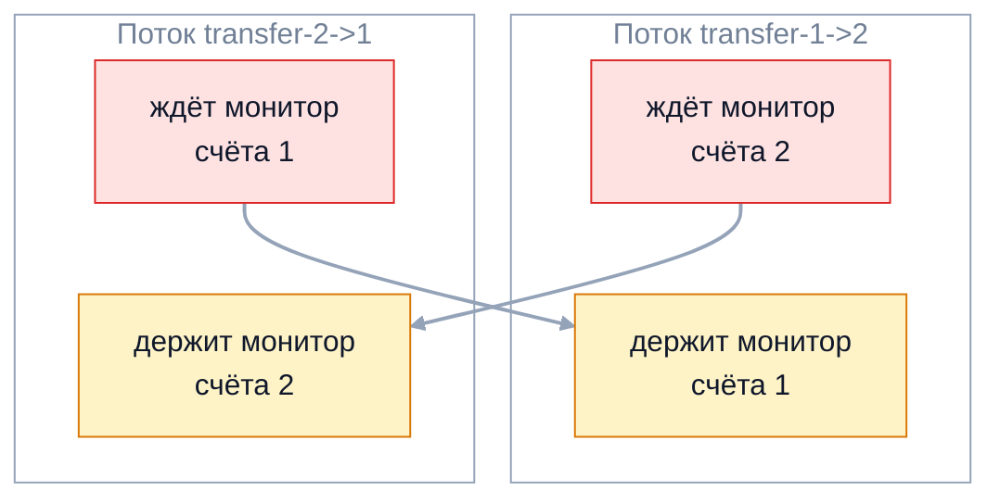

Потокам мало не мешать друг другу — им нужно договариваться: ждать, пока в
буфере появятся данные, сигналить о готовности, передавать работу. Встроенный
механизм для этого — `wait`/`notify` на мониторе объекта. Вторая половина темы
— то, что идёт не так: deadlock, livelock и голодание. На собеседовании ждут
условия Коффмана, способы предотвращения взаимоблокировки и умение найти её в
работающем приложении по thread dump.

## Ключевые концепции

### wait/notify

#### Вызов только под монитором
Методы `wait`, `notify` и `notifyAll` объявлены в `Object` и работают с
монитором конкретного объекта. Вызывать их можно только из потока, который
владеет этим монитором, то есть внутри `synchronized` на том же объекте.
Иначе JVM бросает `IllegalMonitorStateException`.

```java
Object lock = new Object();
lock.wait();   // перехвачено
```
```
wait() вне synchronized: java.lang.IllegalMonitorStateException: current thread is not owner
```
Требование не формальное: проверка условия и засыпание должны быть одним
атомарным действием под той же блокировкой, что защищает условие. Иначе
сигнал может прийти между проверкой и `wait()` и потеряться.

#### Как работают wait и notify
`wait()` атомарно освобождает монитор и переводит поток в `WAITING` — в набор
ожидания (wait set) этого монитора. `notify()` переносит один произвольный
поток из набора ожидания обратно в очередь за монитором, `notifyAll()` —
все потоки. Сам вызов `notify()` монитор не освобождает: разбуженный поток
продолжит работу, только когда уведомивший выйдет из `synchronized` и он сам
снова захватит монитор.

Поэтому между `notify()` и пробуждением ожидающего успевает пройти что
угодно: другой поток может войти в монитор раньше и изменить состояние. Это
главная причина, по которой условие после пробуждения нужно проверять заново.

#### Условие в цикле while
Ожидание всегда пишут в цикле: `while (!условие) wait();`. Причин три.
Во-первых, спецификация допускает ложные пробуждения (spurious wakeup) — выход
из `wait()` без всякого `notify`. Во-вторых, пока разбуженный поток ждал
монитор, другой поток мог успеть «съесть» то, ради чего его будили. В-третьих,
`notifyAll()` будит всех, а условие выполнено, возможно, лишь для одного.

```java
synchronized int take() throws InterruptedException {
    if (items.isEmpty()) wait();     // if вместо while
    return items.remove();
}
// два потребителя ждут, производитель кладёт один элемент и вызывает notifyAll()
```
```
consumer-1 взял 42
consumer-2: java.util.NoSuchElementException
```
Оба потребителя проснулись, первый забрал единственный элемент, а второй с
`if` не проверил условие повторно и обратился к пустой очереди. С `while` он
снова уснул бы до следующего элемента.

#### notify() против notifyAll()
`notify()` будит один произвольный поток из набора ожидания. Это безопасно,
только если все ожидающие ждут одного и того же условия и любой из них сможет
продолжить. В типичном ограниченном буфере на одном мониторе ждут и
производители («есть место»), и потребители («есть элемент»), и `notify()`
может разбудить не того.

```java
synchronized void put(int v) throws InterruptedException {
    while (items.size() == capacity) wait();
    items.add(v);
    notify();                        // во втором прогоне — notifyAll()
}
synchronized int take() throws InterruptedException {
    while (items.isEmpty()) wait();
    int v = items.remove();
    notify();
    return v;
}
// 2 производителя и 2 потребителя, буфер на 1 элемент, по 20 000 элементов
```
```
notify():    зависло, передано 4 из 40000; состояния: WAITING WAITING WAITING WAITING
notifyAll(): все 40000 элементов переданы
```
Потребитель забрал элемент и разбудил второго потребителя вместо
производителя; тот увидел пустой буфер и тоже уснул — и вскоре в ожидании
оказались все четыре потока. Число переданных элементов меняется от запуска к
запуску, но зависание воспроизводится каждый раз. `notifyAll()` или отдельные
`Condition` для разных условий решают проблему.

### Проблемы конкурентности

#### Deadlock и условия Коффмана
Взаимоблокировка (deadlock) — ситуация, когда каждый поток в группе ждёт
ресурс, занятый другим потоком той же группы, и никто не может продолжить.
Классический пример — перевод денег: один поток блокирует счёт 1 и ждёт счёт 2,
другой — наоборот.

```java
static void transferNaive(Account from, Account to, long amount) {
    synchronized (from) {
        pause();                     // 50 мс, чтобы потоки гарантированно пересеклись
        synchronized (to) {
            from.balance -= amount;
            to.balance += amount;
        }
    }
}
new Thread(() -> transferNaive(a, b, 10), "transfer-1->2").start();
new Thread(() -> transferNaive(b, a, 10), "transfer-2->1").start();
```
```
через 500 мс: transfer-1->2 BLOCKED, transfer-2->1 BLOCKED
```
Оба потока навсегда остались в `BLOCKED`. Без пауз взаимоблокировка
случалась бы редко — и именно поэтому такие ошибки проходят тесты и
проявляются под нагрузкой.

Deadlock возможен, только когда одновременно выполняются четыре условия
Коффмана: взаимное исключение (ресурс в каждый момент у одного владельца),
удержание и ожидание (поток держит один ресурс и ждёт другой), отсутствие
вытеснения (ресурс нельзя отобрать силой) и циклическое ожидание (потоки
образуют цикл, где каждый ждёт следующего).


Каждая стрелка ведёт от ожидания к потоку, который держит нужный монитор. Две
встречные стрелки замыкают цикл — это и есть циклическое ожидание. Чтобы
предотвратить deadlock, достаточно разрушить любое из четырёх условий, и на
практике чаще всего разрывают именно цикл.

#### Livelock
Динамическая взаимоблокировка (livelock) — потоки не заблокированы, активно
работают, но не продвигаются: они постоянно реагируют друг на друга и
откатываются. Бытовая аналогия — два человека в коридоре, которые одновременно
шагают в одну сторону, уступая дорогу, и так снова и снова.

В коде livelock возникает, например, когда два потока захватывают первую
блокировку через `tryLock`, не получают вторую, освобождают первую и сразу
повторяют попытку в том же ритме. Лекарство — случайная задержка перед
повтором (jitter), как в сетевых протоколах.

#### Starvation
Голодание (starvation) — поток долго или бесконечно не получает нужный ресурс,
хотя система в целом работает. Причины — несправедливая блокировка, которую
постоянно перехватывают другие потоки, «жадные» потоки, надолго занимающие
монитор, приоритеты. В отличие от deadlock, остальные потоки продвигаются.

Пример — `ReentrantReadWriteLock` при непрерывном потоке читателей: писатель
может долго не получить блокировку. Справедливые (fair) блокировки уменьшают
голодание ценой пропускной способности.

### Предотвращение deadlock

#### Порядок захвата блокировок
Самый надёжный способ — глобальный порядок: все потоки захватывают блокировки в
одном и том же порядке, и цикл ожидания становится невозможен. Для переводов
порядок задают по уникальному ключу, например по id счёта, независимо от того,
откуда и куда идут деньги.

```java
static void transferOrdered(Account from, Account to, long amount) {
    Account first = from.id < to.id ? from : to;
    Account second = first == from ? to : from;
    synchronized (first) {
        pause();
        synchronized (second) {
            from.balance -= amount;
            to.balance += amount;
        }
    }
}
// встречные переводы 3 -> 4 на 10 и 4 -> 3 на 30
```
```
оба перевода выполнены: c=120, d=80
```
Оба потока сначала захватывают счёт с меньшим id, поэтому второй просто ждёт
первого, а не держит «его» блокировку. Если уникального ключа нет, порядок
задают по `System.identityHashCode`, а при совпадении хэшей используют
дополнительную общую блокировку.

#### tryLock с таймаутом
Второй способ — разрушить условие «удержание и ожидание». `ReentrantLock.tryLock`
с таймаутом не ждёт вечно: если вторую блокировку получить не удалось, поток
отпускает первую и пробует снова. Случайная пауза между попытками защищает от
livelock.

```java
static boolean transferTry(Account from, Account to, long amount) throws InterruptedException {
    while (true) {
        if (from.lock.tryLock(50, TimeUnit.MILLISECONDS)) {
            try {
                pause();
                if (to.lock.tryLock(50, TimeUnit.MILLISECONDS)) {
                    try {
                        from.balance -= amount;
                        to.balance += amount;
                        return true;
                    } finally { to.lock.unlock(); }
                }
            } finally { from.lock.unlock(); }
        }
        Thread.sleep(ThreadLocalRandom.current().nextInt(10));
    }
}
```
```
оба перевода выполнены: e=120, f=80
```
Встречные переводы с той же «опасной» последовательностью захвата завершились:
один из потоков отступил и повторил попытку. Цена — более сложный код и
повторные попытки под конкуренцией.

#### Открытые вызовы
Deadlock часто прячется не в собственном коде, а на стыке модулей: метод под
блокировкой вызывает слушателя, коллбэк или переопределяемый метод, а тот
захватывает свою блокировку — в обратном порядке. Правило открытых вызовов
(open calls) — не вызывать чужой код, удерживая свою блокировку.

На практике это значит: скопировать под блокировкой нужные данные, например
список слушателей, отпустить блокировку и только потом уведомлять. Короткие
критические секции без внешних вызовов уменьшают и риск deadlock, и
конкуренцию.

#### Thread starvation deadlock
Взаимоблокировка бывает и без явных блокировок. Если задача в пуле с
ограниченным числом потоков отправляет в тот же пул подзадачу и ждёт её
результат, а свободных потоков нет, подзадача никогда не начнётся. Крайний
случай — однопоточный пул.

```java
ExecutorService single = Executors.newSingleThreadExecutor();
Future<String> outer = single.submit(() -> {
    Future<String> inner = single.submit(() -> "результат подзадачи");
    return inner.get();          // ждёт задачу, которой не хватает потока
});
outer.get(1, TimeUnit.SECONDS);   // перехвачено
```
```
внешняя задача не завершилась за 1 с: TimeoutException
```
Единственный поток пула занят внешней задачей, которая ждёт внутреннюю, а та
стоит в очереди за этим же потоком. Лечится раздельными пулами для зависимых
задач или неблокирующей композицией через `CompletableFuture`.

### Диагностика

#### Thread dump
Первое, что делают при подозрении на зависание, — снимают thread dump:
`jstack <pid>`, `jcmd <pid> Thread.print` или `kill -3 <pid>` (вывод уйдёт в
stdout приложения). Дамп показывает для каждого потока состояние, стек и
захваченные мониторы, а взаимоблокировки на мониторах и `ReentrantLock` JVM
находит сама и печатает в конце отдельным блоком.

```
$ jstack 21188
"transfer-1->2" #40 [540] daemon prio=5 os_prio=0 cpu=0.00ms elapsed=5.80s tid=0x00000205578dc700 nid=540 waiting for monitor entry  [0x00000061ab6ff000]
   java.lang.Thread.State: BLOCKED (on object monitor)
	at Deadlock.transferNaive(Deadlock.java:21)
	- waiting to lock <0x0000000622f11b60> (a Deadlock$Account)
	- locked <0x0000000622f11a48> (a Deadlock$Account)
...
Found one Java-level deadlock:
=============================
"transfer-1->2":
  waiting to lock monitor 0x0000020557d89960 (object 0x0000000622f11b60, a Deadlock$Account),
  which is held by "transfer-2->1"

"transfer-2->1":
  waiting to lock monitor 0x0000020557d86f60 (object 0x0000000622f11a48, a Deadlock$Account),
  which is held by "transfer-1->2"
...
Found 1 deadlock.
```
Строки `locked` и `waiting to lock` с адресами объектов показывают цикл
напрямую: каждый поток держит объект, которого ждёт другой. Осмысленные имена
потоков сразу говорят, какая операция зависла.

#### ThreadMXBean
Тот же анализ доступен программно через `ThreadMXBean`.
`findDeadlockedThreads()` возвращает id потоков в цикле ожидания — и по
мониторам, и по `ReentrantLock` и другим ownable synchronizers, а
`findMonitorDeadlockedThreads()` — только по мониторам. На этом строят
health-check: сервис с взаимоблокировкой честнее перезапустить, чем оставить
висеть.

```java
ThreadMXBean mx = ManagementFactory.getThreadMXBean();
long[] ids = mx.findDeadlockedThreads();
for (ThreadInfo info : mx.getThreadInfo(ids)) {
    System.out.println("  " + info.getThreadName() + " ждёт " + info.getLockName()
            + ", который держит " + info.getLockOwnerName());
}
```
```
findDeadlockedThreads(): 2 потока
  transfer-1->2 ждёт Deadlock$Account@57af006c, который держит transfer-2->1
  transfer-2->1 ждёт Deadlock$Account@446293d, который держит transfer-1->2
```
`ThreadInfo` содержит имя блокировки и её владельца — достаточно, чтобы
залогировать цикл перед перезапуском. Метод недешёвый, поэтому вызывают его
периодически, а не на каждый запрос.

#### Livelock и starvation в дампе
Livelock и голодание не находятся автоматически: формального цикла ожидания
нет. Потоки в livelock обычно `RUNNABLE` и стабильно жгут процессор,
голодающий поток раз за разом оказывается в `BLOCKED` или `WAITING` у одной и
той же блокировки. Поэтому снимают несколько дампов с интервалом в несколько
секунд и сравнивают: поток, стоящий в одной точке во всех дампах, — подозреваемый.

Дополнительно помогают JFR (события `jdk.JavaMonitorEnter` и
`jdk.ThreadPark` показывают, кто и сколько ждал блокировку) и профилировщики
вроде async-profiler в режиме lock-профилирования.

## Частые вопросы на собеседовании

**Q: Какие четыре условия необходимы для deadlock и какое из них проще всего нарушить?**
A: Взаимное исключение, удержание и ожидание, отсутствие вытеснения и
циклическое ожидание — deadlock возможен, только если выполнены все четыре.
Проще всего разорвать цикл: ввести глобальный порядок захвата блокировок.
Условие «удержание и ожидание» разрушает `tryLock` с таймаутом и откатом.
Взаимное исключение обходят, отказываясь от блокировок: неизменяемые объекты,
атомарные операции, передача данных через очереди.

**Q: Как найти deadlock в работающем приложении?**
A: Снять thread dump через `jstack <pid>` или `jcmd <pid> Thread.print`: JVM
сама найдёт цикл по мониторам и `ReentrantLock` и напечатает блок `Found one
Java-level deadlock` с потоками, адресами объектов и стеками. Программно — через
`ThreadMXBean.findDeadlockedThreads()`, например в health-check. Для livelock и
голодания снимают несколько дампов подряд и сравнивают их.

**Q: Почему wait() вызывают в цикле while, а не в if?**
A: После пробуждения условие может снова оказаться ложным: спецификация
допускает ложные пробуждения, другой поток мог перехватить монитор и забрать
данные раньше, а `notifyAll()` будит всех ожидающих сразу. Цикл заново
проверяет условие после каждого пробуждения и при необходимости снова
засыпает.

**Q: Чем notify() отличается от notifyAll() и что безопаснее?**
A: `notify()` будит один произвольный ожидающий поток, `notifyAll()` — все.
`notify()` корректен, только если все ожидающие ждут одного условия и любой
может продолжить, иначе сигнал достаётся «не тому» потоку и программа
зависает. По умолчанию используют `notifyAll()`, а для разных условий лучше
отдельные `Condition` у `ReentrantLock`.

**Q: Чем livelock отличается от deadlock?**
A: При deadlock потоки заблокированы и ничего не делают, JVM видит цикл
ожидания в thread dump. При livelock потоки активны и потребляют процессор,
но постоянно откатываются, реагируя друг на друга, и работа не продвигается.
Livelock лечат случайными задержками перед повтором, deadlock — порядком
захвата или таймаутами.

## Ловушки и частые ошибки

#### wait() и sleep() внутри synchronized
`sleep()` внутри `synchronized` держит монитор всё время сна, и все остальные
потоки стоят. `wait()` монитор отпускает. Путать их опасно: «подождать
секунду, пока другой поток обновит данные» через `sleep` под блокировкой
гарантированно мешает этому другому потоку.

#### Уведомление до ожидания
Если `notify()` вызван раньше, чем другой поток дошёл до `wait()`, сигнал
теряется: у монитора нет памяти о прошлых уведомлениях. Поэтому ожидание
всегда привязывают к условию в общем состоянии (флаг, размер очереди),
проверяемому под той же блокировкой, а не к самому факту уведомления.

#### wait/notify в новом коде
Ручной `wait`/`notify` — низкоуровневый механизм с множеством ловушек. В
прикладном коде его заменяют готовые средства: `BlockingQueue` для
производителей и потребителей, `CountDownLatch` и `CompletableFuture` для
ожидания событий, `Condition` для нескольких условий. На собеседовании
`wait`/`notify` спрашивают, чтобы проверить понимание, а не как рекомендацию.

#### Таймаут как лечение deadlock
`tryLock` с таймаутом и ожидание `Future.get(timeout)` не дают потоку зависнуть
навсегда, но не устраняют причину. Если после таймаута операция просто
повторяется в том же порядке захвата, система деградирует до бесконечных
повторов. Таймаут — страховка, а лечение — правильный порядок блокировок или
отказ от вложенных захватов.

## Связанные темы
- [Основы потоков](01-thread-basics.md) — состояния `BLOCKED` и `WAITING`.
- [Синхронизация: synchronized](02-synchronized.md) — монитор, на котором работают `wait` и `notify`.
- [Пулы потоков](../02-executors-and-async/05-thread-pools.md) — ограниченные пулы и thread starvation deadlock.
- [Явные блокировки и примитивы синхронизации](../03-concurrency-utilities/08-locks-and-synchronizers.md) — `tryLock`, `Condition` и синхронизаторы.
- [Практические задачи на собеседовании](../05-interview-practice/12-practical-tasks.md) — producer-consumer, перевод денег, обедающие философы.
- [Класс Object](../../03-oop/06-object-class.md) — `wait`, `notify` и `notifyAll` как методы `Object`.
- Диагностика и профилирование (раздел 9) — thread dump, JFR и async-profiler.

## Источники
- [javadoc java.lang.Object#wait](https://docs.oracle.com/en/java/javase/21/docs/api/java.base/java/lang/Object.html#wait()) — требования к монитору и ложные пробуждения.
- [javadoc java.lang.management.ThreadMXBean](https://docs.oracle.com/en/java/javase/21/docs/api/java.management/java/lang/management/ThreadMXBean.html) — поиск взаимоблокировок.
- [Руководство по устранению неполадок: jstack](https://docs.oracle.com/en/java/javase/21/troubleshoot/diagnostic-tools.html) — инструменты диагностики JDK.
- Brian Goetz et al. «Java Concurrency in Practice», глава 10 — избегание проблем живучести.
