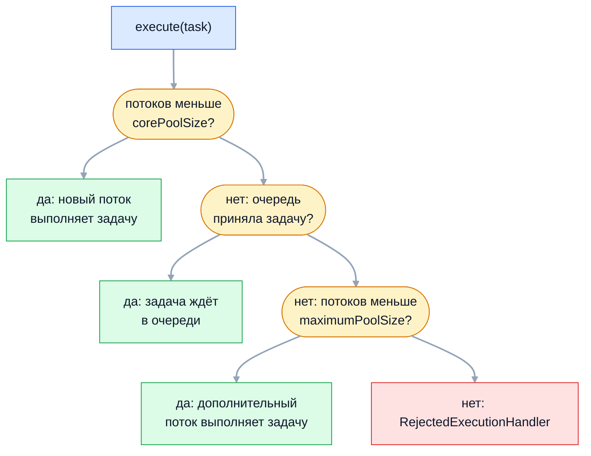

В продакшене потоки почти никогда не создают вручную: задачи отдают пулу,
который переиспользует ограниченное число потоков. На собеседовании по этой
теме проверяют, знает ли кандидат порядок роста `ThreadPoolExecutor` (он
контринтуитивен), чем опасны фабрики `Executors`, как рассчитать размер пула и
как корректно его остановить. Это вопросы, по которым видно реальный опыт
эксплуатации.

## Ключевые концепции

### ExecutorService

#### Зачем нужны пулы
Создание платформенного потока — дорогая операция: системный вызов,
резервирование стека, регистрация в планировщике ОС. Поток на каждую задачу
под нагрузкой означает тысячи потоков, переключения контекста и в итоге
`OutOfMemoryError: unable to create native thread`. Пул держит фиксированный
набор рабочих потоков и очередь задач.

Второе преимущество — разделение постановки задачи и способа её выполнения.
Код, который вызывает `executor.submit(task)`, не знает, сколько потоков в
пуле, как они создаются и что происходит при перегрузке. Эти решения
принимаются в одном месте конфигурации и меняются без правки бизнес-логики.

#### Иерархия интерфейсов
`Executor` — минимальный интерфейс с одним методом `execute(Runnable)`.
`ExecutorService` добавляет управление жизненным циклом (`shutdown`,
`awaitTermination`) и задачи с результатом (`submit`, `invokeAll`,
`invokeAny`). `ScheduledExecutorService` умеет запускать задачи с задержкой и
периодически. Основные реализации — `ThreadPoolExecutor`,
`ScheduledThreadPoolExecutor` и `ForkJoinPool`.

#### submit() против execute()
`execute()` принимает `Runnable` и ничего не возвращает, `submit()` принимает
`Runnable` или `Callable` и возвращает `Future`. Главное различие — судьба
исключений. Исключение из `execute()` вылетает из рабочего потока: он
умирает, обработчик печатает стек, а пул создаёт новый поток. Исключение из
`submit()` перехватывается и сохраняется в `Future` — его увидит только тот,
кто вызовет `get()`.

```java
ExecutorService pool = Executors.newFixedThreadPool(1);
pool.execute(() -> System.out.println("задача 1 в " + Thread.currentThread().getName()));
pool.execute(() -> { throw new IllegalStateException("сбой в execute"); });
pool.execute(() -> System.out.println("задача 3 в " + Thread.currentThread().getName()));
Future<?> f = pool.submit(() -> { throw new IllegalStateException("сбой в submit"); });
System.out.println("submit: isDone=" + f.isDone() + ", исключение видно только через get()");
f.get();   // перехвачено
```
```
задача 1 в pool-1-thread-1
Exception in thread "pool-1-thread-1" java.lang.IllegalStateException: сбой в execute
	at Pools.lambda$main$1(Pools.java:14)
	at java.base/java.util.concurrent.ThreadPoolExecutor.runWorker(ThreadPoolExecutor.java:1144)
	...
задача 3 в pool-1-thread-2
submit: isDone=true, исключение видно только через get()
get(): java.lang.IllegalStateException: сбой в submit
```
После сбоя в `execute()` третья задача выполнилась уже в `pool-1-thread-2`:
упавший поток заменён новым. Сбой в `submit()` не оставил никаких следов в
логе — если бы никто не вызвал `get()`, ошибка потерялась бы. Подробнее — в
теме об исключениях в многопоточном коде.

#### invokeAll, invokeAny и CompletionService
`invokeAll` отправляет набор задач и ждёт завершения всех, возвращая `Future`
в порядке исходного списка. `invokeAny` возвращает результат первой успешно
завершившейся задачи, а остальные отменяет — удобно для запроса к нескольким
репликам. `ExecutorCompletionService` выдаёт результаты в порядке готовности,
а не отправки: обработка начинается, как только готова любая задача.

```java
List<Callable<String>> tasks = List.of(
        () -> { sleep(300); return "медленная"; },
        () -> { sleep(100); return "быстрая"; },
        () -> { sleep(200); return "средняя"; });
for (Future<String> fu : ex.invokeAll(tasks)) all.add(fu.get());
System.out.println("invokeAll (в порядке задач): " + all);
System.out.println("invokeAny: " + ex.invokeAny(tasks));
CompletionService<String> cs = new ExecutorCompletionService<>(ex);
tasks.forEach(cs::submit);
for (int i = 0; i < tasks.size(); i++) order.add(cs.take().get());
System.out.println("CompletionService (по готовности): " + order);
```
```
invokeAll (в порядке задач): [медленная, быстрая, средняя]
invokeAny: быстрая
CompletionService (по готовности): [быстрая, средняя, медленная]
```
`invokeAll` сохранил порядок списка, `invokeAny` вернул самую быструю, а
`CompletionService` отдал результаты в порядке их появления.

### ThreadPoolExecutor

#### Параметры конструктора
`ThreadPoolExecutor` настраивается семью параметрами. `corePoolSize` — сколько
потоков пул держит постоянно, `maximumPoolSize` — верхняя граница при
перегрузке, `keepAliveTime` — сколько простаивают «лишние» потоки сверх core,
прежде чем завершиться. `workQueue` — очередь задач, `ThreadFactory` создаёт
потоки, `RejectedExecutionHandler` решает, что делать с задачей, которую
некуда деть.

#### Порядок роста пула
Логика `execute()` удивляет многих. Пока потоков меньше `corePoolSize`, на
каждую задачу создаётся новый поток — даже если остальные простаивают. Когда
core заполнен, задачи идут в очередь. Только когда очередь полна, пул
создаёт дополнительные потоки до `maximumPoolSize`. Если и это не помогло —
задачу отклоняют.


Очередь стоит между core и max: пул сначала копит задачи и только при полной
очереди расширяется. Интуиция «сначала добавить потоки до максимума, потом
ставить в очередь» соответствует обратному порядку.

```java
ThreadPoolExecutor tpe = new ThreadPoolExecutor(2, 4, 60, TimeUnit.SECONDS,
        new ArrayBlockingQueue<>(2));
for (int i = 1; i <= 7; i++) {
    tpe.execute(() -> sleep(500));   // для седьмой задачи — перехвачено
    System.out.printf("задача %d: потоков=%d, в очереди=%d%n", i, tpe.getPoolSize(), tpe.getQueue().size());
}
```
```
задача 1: потоков=1, в очереди=0
задача 2: потоков=2, в очереди=0
задача 3: потоков=2, в очереди=1
задача 4: потоков=2, в очереди=2
задача 5: потоков=3, в очереди=2
задача 6: потоков=4, в очереди=2
задача 7: отклонена (RejectedExecutionException)
```
Третий поток появился только на пятой задаче, когда очередь заполнилась. Ещё
одна тонкость: пятая и шестая задачи выполняются новыми потоками сразу, обгоняя
третью и четвёртую, которые уже ждут в очереди, — строгого FIFO у пула нет.

#### Выбор очереди
Очередь определяет поведение пула больше, чем числа потоков. `SynchronousQueue`
не хранит задачи вовсе: задача передаётся свободному потоку напрямую, иначе
сразу создаётся новый поток. `ArrayBlockingQueue` — ограниченная очередь
фиксированной ёмкости, при её заполнении пул растёт до максимума, а потом
отклоняет задачи.

`LinkedBlockingQueue` без указанной ёмкости фактически неограниченна
(`Integer.MAX_VALUE`). Она никогда не бывает полной, поэтому пул не растёт
выше `corePoolSize`, а `maximumPoolSize` теряет смысл:
```java
ThreadPoolExecutor unbounded = new ThreadPoolExecutor(2, 10, 60, TimeUnit.SECONDS,
        new LinkedBlockingQueue<>());
for (int i = 0; i < 20; i++) unbounded.execute(() -> sleep(200));
System.out.println("после 20 задач: потоков=" + unbounded.getPoolSize() + ", в очереди=" + unbounded.getQueue().size());
```
```
после 20 задач: потоков=2, в очереди=18
```
Максимум в 10 потоков ни разу не понадобился: все лишние задачи легли в
очередь. Под устойчивой перегрузкой такая очередь растёт до исчерпания памяти.

#### Политики отказа
Когда очередь полна и потоков максимум, задачу получает
`RejectedExecutionHandler`. `AbortPolicy` (по умолчанию) бросает
`RejectedExecutionException`, `DiscardPolicy` молча выбрасывает задачу,
`DiscardOldestPolicy` выбрасывает самую старую задачу из очереди и повторяет
попытку. `CallerRunsPolicy` выполняет задачу в потоке, который её отправил, —
это естественное обратное давление (backpressure).

```java
ThreadPoolExecutor callerRuns = new ThreadPoolExecutor(1, 1, 0, TimeUnit.SECONDS,
        new ArrayBlockingQueue<>(1), new ThreadPoolExecutor.CallerRunsPolicy());
for (int i = 1; i <= 3; i++) {
    int n = i;
    callerRuns.execute(() -> { System.out.println("задача " + n + " в " + Thread.currentThread().getName()); sleep(200); });
}
```
```
задача 3 в main
задача 1 в pool-5-thread-1
задача 2 в pool-5-thread-1
```
Поток пула занят первой задачей, вторая в очереди, и третью выполнил сам
`main`. Пока он занят ею, новые задачи не поступают — производитель
притормаживается до скорости обработки. Молчаливые `Discard`-политики
допустимы только для данных, потерю которых бизнес действительно переживёт.

#### ThreadFactory и хуки
Через `ThreadFactory` пулу задают имена потоков (`orders-1` вместо
`pool-3-thread-1`), daemon-флаг и `UncaughtExceptionHandler`. Наследник
`ThreadPoolExecutor` может переопределить хуки `beforeExecute`,
`afterExecute` и `terminated` — для метрик, логирования ошибок и передачи
контекста (MDC). `allowCoreThreadTimeOut(true)` позволяет завершаться и
core-потокам, `prestartAllCoreThreads()` создаёт их заранее.

```java
ThreadFactory named = r -> new Thread(r, "orders-" + seq.incrementAndGet());
ThreadPoolExecutor monitored = new ThreadPoolExecutor(2, 2, 0, TimeUnit.SECONDS,
        new LinkedBlockingQueue<>(100), named) {
    @Override protected void afterExecute(Runnable r, Throwable t) {
        if (t == null && r instanceof Future<?> fut && fut.isDone()) {
            try { fut.get(); } catch (ExecutionException e) { t = e.getCause(); }
            catch (InterruptedException e) { Thread.currentThread().interrupt(); }
        }
        if (t != null) System.out.println("afterExecute в " + Thread.currentThread().getName() + ": " + t);
    }
};
monitored.submit(() -> { throw new IllegalArgumentException("неверный заказ"); });
```
```
afterExecute в orders-1: java.lang.IllegalArgumentException: неверный заказ
```
Для задач из `submit()` параметр `t` всегда `null`: исключение спрятано в
`FutureTask`. Этот шаблон из javadoc достаёт его оттуда, и ошибки перестают
теряться независимо от того, вызвал ли кто-то `get()`.

### Фабрики Executors и их ловушки

#### newFixedThreadPool и newSingleThreadExecutor
Обе фабрики создают пул с неограниченной `LinkedBlockingQueue`. Пока задачи
обрабатываются быстрее, чем поступают, всё хорошо. Но при всплеске нагрузки
или медленной зависимости очередь растёт без предела: задержка увеличивается,
память заканчивается, а пул так и работает на `corePoolSize` потоках, не
сигнализируя о проблеме.

```java
ThreadPoolExecutor fixed = (ThreadPoolExecutor) Executors.newFixedThreadPool(4);
System.out.println("newFixedThreadPool(4): core=" + fixed.getCorePoolSize() + ", max=" + fixed.getMaximumPoolSize()
        + ", очередь " + fixed.getQueue().getClass().getSimpleName() + " ёмкостью " + fixed.getQueue().remainingCapacity());
ExecutorService singleEx = Executors.newSingleThreadExecutor();
System.out.println("newSingleThreadExecutor(): " + singleEx.getClass().getSimpleName()
        + ", это ThreadPoolExecutor? " + (singleEx instanceof ThreadPoolExecutor));
```
```
newFixedThreadPool(4): core=4, max=4, очередь LinkedBlockingQueue ёмкостью 2147483647
newSingleThreadExecutor(): AutoShutdownDelegatedExecutorService, это ThreadPoolExecutor? false
```
Ёмкость очереди — `Integer.MAX_VALUE`. Однопоточный исполнитель вдобавок
обёрнут, чтобы его нельзя было привести к `ThreadPoolExecutor` и случайно
увеличить число потоков, — его гарантия последовательного выполнения задач
не должна ломаться.

#### newCachedThreadPool
Кэширующий пул устроен наоборот: `corePoolSize = 0`, `maximumPoolSize =
Integer.MAX_VALUE` и `SynchronousQueue`. Каждая задача либо достаётся
свободному потоку, либо порождает новый, а простаивающие потоки умирают через
60 секунд. Для коротких редких задач это удобно, но при всплеске нагрузки пул
создаст тысячи потоков.

```java
ThreadPoolExecutor cached = (ThreadPoolExecutor) Executors.newCachedThreadPool();
System.out.println("newCachedThreadPool(): core=" + cached.getCorePoolSize() + ", max=" + cached.getMaximumPoolSize()
        + ", очередь " + cached.getQueue().getClass().getSimpleName());
```
```
newCachedThreadPool(): core=0, max=2147483647, очередь SynchronousQueue
```
Верхней границы нет. Медленный внешний сервис превращает такой пул в фабрику
потоков, и сервис падает с `unable to create native thread`.

#### Специализированные фабрики
`newScheduledThreadPool(n)` создаёт `ScheduledThreadPoolExecutor` для
отложенных и периодических задач. `newWorkStealingPool()` возвращает
`ForkJoinPool` с work-stealing, рассчитанный на много мелких независимых задач.
`newVirtualThreadPerTaskExecutor()` (Java 21) — вообще не пул: на каждую
задачу создаётся новый виртуальный поток, потому что виртуальные потоки
дешёвые и переиспользовать их незачем.

#### Явная конфигурация в продакшене
Вывод из ловушек фабрик: пулы для серверного кода создают явно через
конструктор `ThreadPoolExecutor`. Конфигурация фиксирует четыре решения:
ограниченная очередь с осознанной ёмкостью, именованные потоки через
`ThreadFactory`, политика отказа (обычно `CallerRunsPolicy` или `AbortPolicy`
с обработкой) и метрики — размер очереди и число активных потоков. В Spring
то же самое настраивают через `ThreadPoolTaskExecutor`.

### Размер пула

#### CPU-bound задачи
Для задач, которые только вычисляют, оптимум — число ядер:
`Runtime.getRuntime().availableProcessors()`. Больше потоков не ускорит
работу, а добавит переключения контекста и вытеснит данные из кэшей. Часто
берут ядра + 1, чтобы занять процессор, если поток ненадолго остановится на
page fault или паузе GC.

`availableProcessors()` учитывает ограничения контейнера: в Docker с лимитом
`--cpus=2` метод вернёт 2, а не число ядер хоста (начиная с Java 10 и 8u191).
Жёстко прописанное число потоков из конфигурации ноутбука в контейнере часто
оказывается неверным.

#### IO-bound задачи
Задачи, которые большую часть времени ждут — базу, HTTP, диск, — требуют
больше потоков, чем ядер: пока одни ждут, другие считают. Формула из «Java
Concurrency in Practice»: `Nthreads = Ncpu × U × (1 + W/C)`, где `U` — целевая
загрузка процессора от 0 до 1, а `W/C` — отношение времени ожидания к времени
вычислений.

Например, обработка запроса тратит 10 мс процессора и 90 мс ждёт базу: `W/C =
9`. На 20 ядрах при целевой загрузке 80% получается `20 × 0,8 × 10 = 160`
потоков. Формула даёт порядок величины, а не точное значение: `W/C` измеряют
профилировщиком под реальной нагрузкой.

#### Закон Литтла
Закон Литтла связывает три величины любой стабильной системы очередей: `L = λ
× W`, где `L` — среднее число задач в системе, `λ` — интенсивность
поступления, `W` — среднее время пребывания задачи. Если сервис получает 1000
запросов в секунду и каждый обрабатывается 100 мс, одновременно в работе в
среднем 100 запросов — и пулу нужно не меньше 100 потоков.

Закон работает и в обратную сторону: при фиксированном пуле в 50 потоков и
времени обработки 100 мс пропускная способность не превысит 500 запросов в
секунду. Дальше растёт очередь и время ответа.

#### Ограничения за пулом
Размер пула ограничен не только процессором, но и ресурсами, которые задачи
используют. Пул из 200 потоков перед пулом соединений к базе на 20 соединений
даст 180 потоков, ждущих соединения. Лимиты внешнего API, файловых
дескрипторов, памяти на стеки — такие же ограничения. Итоговые числа проверяют
нагрузочным тестом с метриками пула.

### Планирование задач

#### fixedRate против fixedDelay
`ScheduledExecutorService` запускает задачи однократно с задержкой
(`schedule`) или периодически. У `scheduleAtFixedRate` период отсчитывается от
начала предыдущего запуска: задача стремится выполняться строго N раз в
минуту. У `scheduleWithFixedDelay` пауза отсчитывается от конца предыдущего
запуска: между выполнениями всегда есть промежуток.

```java
// задача длится 300 мс, период и задержка — 200 мс; now() — мс от старта
ses.scheduleAtFixedRate(() -> {
    System.out.printf("fixedRate  старт на ~%d мс%n", now() / 100 * 100);
    sleep(300);
}, 0, 200, TimeUnit.MILLISECONDS);
// через секунду первую задачу отменяют и запускают вторую
ses.scheduleWithFixedDelay(() -> {
    System.out.printf("fixedDelay старт на ~%d мс%n", now() / 100 * 100);
    sleep(300);
}, 0, 200, TimeUnit.MILLISECONDS);
```
```
fixedRate  старт на ~0 мс
fixedRate  старт на ~300 мс
fixedRate  старт на ~600 мс
fixedRate  старт на ~900 мс
fixedDelay старт на ~0 мс
fixedDelay старт на ~500 мс
fixedDelay старт на ~1000 мс
```
Задача длиннее периода, поэтому `fixedRate` запускает её сразу после
окончания предыдущей — каждые 300 мс, а не 200. `fixedDelay` выдерживает 200
мс паузы после каждого запуска, получая интервал 500 мс.

#### Периодическая задача и исключение
Одна и та же периодическая задача никогда не выполняется параллельно сама с
собой: если запуск затянулся, следующий ждёт. Опаснее другое: если запуск
бросил исключение, все последующие запуски молча отменяются. В лог ничего не
пишется — исключение сохраняется в `ScheduledFuture`, которое обычно никто не
проверяет.

```java
ScheduledFuture<?> failing = ses.scheduleAtFixedRate(() -> {
    int n = runs.incrementAndGet();
    System.out.println("запуск " + n);
    if (n == 3) throw new IllegalStateException("сбой на третьем запуске");
}, 0, 100, TimeUnit.MILLISECONDS);
sleep(800);
System.out.println("запусков за 800 мс: " + runs.get() + ", isDone=" + failing.isDone());
failing.get();   // перехвачено
```
```
запуск 1
запуск 2
запуск 3
запусков за 800 мс: 3, isDone=true
get(): java.lang.IllegalStateException: сбой на третьем запуске
```
После третьего запуска задача остановилась навсегда, хотя пул жив. Тело
периодической задачи всегда оборачивают в `try`/`catch` с логированием.

#### Timer
`java.util.Timer` — предшественник `ScheduledExecutorService` из Java 1.3. Все
задачи `Timer` выполняются в одном потоке: долгая задача задерживает
остальные, а необработанное исключение убивает поток, и `Timer` перестаёт
работать целиком. Кроме того, он планирует по системным часам, и перевод
времени сбивает расписание. В новом коде используют `ScheduledExecutorService`.

### Завершение работы

#### shutdown()
`shutdown()` переводит пул в состояние завершения: новые задачи отклоняются с
`RejectedExecutionException`, а уже принятые — и выполняющиеся, и стоящие в
очереди — доделываются. Метод не ждёт завершения, а возвращается сразу.
Потоки пула не daemon, поэтому незавершённый пул не даёт JVM остановиться.

#### shutdownNow()
`shutdownNow()` — жёсткая остановка: задачи из очереди удаляются и
возвращаются списком, а выполняющимся вызывается `interrupt()`. Остановятся
ли они, зависит от самих задач: код, который проверяет флаг прерывания или
блокируется в прерываемых методах, завершится, а вычислительный цикл без
проверок — нет.

#### awaitTermination
`awaitTermination(timeout)` блокирует вызывающий поток, пока пул не завершится
или не истечёт таймаут, и возвращает `true`, если пул завершился. Сам по себе
метод ничего не останавливает — его вызывают после `shutdown()` или
`shutdownNow()`.

#### Шаблон корректной остановки
Стандартный шаблон из javadoc сочетает все три метода: `shutdown()`, ожидание
с таймаутом, при неудаче `shutdownNow()` и повторное ожидание. Если сам
ожидающий поток прерван, он тоже вызывает `shutdownNow()` и восстанавливает
флаг прерывания.
```java
ex2.shutdown();
ex2.submit(() -> { });                                   // перехвачено
System.out.println("awaitTermination(200 мс): " + ex2.awaitTermination(200, TimeUnit.MILLISECONDS));
List<Runnable> pending = ex2.shutdownNow();
System.out.println("shutdownNow() вернул не начатых задач: " + pending.size());
System.out.println("awaitTermination(1 с): " + ex2.awaitTermination(1, TimeUnit.SECONDS));
```
```
submit после shutdown(): RejectedExecutionException
awaitTermination(200 мс): false
выполняющаяся задача получила interrupt
shutdownNow() вернул не начатых задач: 2
awaitTermination(1 с): true
```
Долгая задача не успела за 200 мс, `shutdownNow()` прервал её и вернул две
задачи из очереди, после чего пул завершился.

С Java 19 `ExecutorService` реализует `AutoCloseable`: метод `close()`
вызывает `shutdown()` и ждёт завершения всех задач, а при прерывании
ожидающего потока переходит к `shutdownNow()`. Поэтому короткоживущий пул
удобно открывать в try-with-resources:
```java
try (ExecutorService ex3 = Executors.newFixedThreadPool(2)) {
    ex3.submit(() -> sleep(300));
    ex3.submit(() -> sleep(300));
}
System.out.println("close() дождался задач за ~" + elapsedMs + " мс");
```
```
close() дождался задач за ~300 мс
```
Выход из блока случился только после завершения обеих задач. Для пулов,
живущих всё время работы приложения, остановку вызывают из shutdown hook или
жизненного цикла контейнера, например `@PreDestroy` в Spring.

## Частые вопросы на собеседовании

**Q: Как правильно рассчитать размер пула потоков для CPU-bound и для IO-bound задач?**
A: Для CPU-bound — число доступных ядер (`availableProcessors()`, с учётом
лимитов контейнера) или ядра + 1: больше потоков только добавит переключений
контекста. Для IO-bound — по формуле `Ncpu × U × (1 + W/C)`, где `W/C` —
отношение времени ожидания к вычислениям, измеренное профилировщиком. Сверху
размер ограничивают ресурсы за пулом — соединения с базой, лимиты внешних
API, — а итог проверяют нагрузочным тестом. Для IO-bound задач на Java 21
альтернатива — виртуальные потоки.

**Q: В каком порядке растёт ThreadPoolExecutor?**
A: До `corePoolSize` на каждую задачу создаётся новый поток. Затем задачи
кладутся в очередь. Только когда очередь заполнена, создаются дополнительные
потоки до `maximumPoolSize`, а дальше срабатывает `RejectedExecutionHandler`.
Следствие — с неограниченной очередью пул никогда не вырастет выше
`corePoolSize`.

**Q: Почему фабрики Executors не рекомендуют для продакшена?**
A: У них скрытые неограниченные ресурсы. `newFixedThreadPool` и
`newSingleThreadExecutor` используют неограниченную очередь — при перегрузке
она растёт до `OutOfMemoryError`. `newCachedThreadPool` не ограничивает число
потоков и при всплеске нагрузки создаёт их тысячами. Явный `ThreadPoolExecutor`
с ограниченной очередью, именованными потоками и политикой отказа делает
поведение при перегрузке предсказуемым.

**Q: Чем shutdown() отличается от shutdownNow()?**
A: `shutdown()` перестаёт принимать задачи, но доделывает уже принятые,
включая очередь. `shutdownNow()` очищает очередь, возвращая не начатые задачи,
и прерывает выполняющиеся через `interrupt()`. Оба метода не ждут завершения —
для этого есть `awaitTermination`, а с Java 19 ещё и `close()`.

**Q: Что произойдёт с исключением в задаче пула?**
A: Зависит от способа отправки. В `execute()` исключение убивает рабочий
поток, печатается обработчиком, и пул заменяет поток новым. В `submit()` оно
сохраняется в `Future` и становится видно только при вызове `get()`, иначе
теряется молча. В периодической задаче `ScheduledExecutorService` исключение
вдобавок отменяет все будущие запуски.

## Ловушки и частые ошибки

#### Пул на каждый запрос
Создание `Executors.newFixedThreadPool` внутри метода, обрабатывающего запрос,
без `shutdown()` оставляет живые потоки после каждого вызова: они не daemon и
не завершаются сами. Через несколько тысяч запросов приложение упирается в
лимит потоков. Пул создают один раз на всё приложение или используют
try-with-resources для короткоживущего.

#### Блокирующие задачи в общем пуле
Если одни задачи пула ждут результатов других задач того же пула, ограниченный
пул может целиком уйти в ожидание — thread starvation deadlock. Ещё опаснее
смешивать в одном пуле быстрые задачи и медленные блокирующие вызовы: медленные
занимают все потоки, и быстрые ждут в очереди. Независимые классы задач
разводят по отдельным пулам (bulkhead).

#### Потерянные исключения
`submit()` без последующего `get()` и периодические задачи без `try`/`catch` —
главный источник «тихих» отказов: задача не выполнилась, а в логах пусто.
Ошибки перехватывают внутри задачи, в `afterExecute` или через
`CompletableFuture` с обработчиком.

#### Контекст потока в пуле
Потоки пула переиспользуются, поэтому `ThreadLocal`, MDC и контекст
безопасности, оставленные одной задачей, достаются следующей. Каждая задача
должна очищать свой контекст в `finally`, а передавать контекст из потока,
отправившего задачу, нужно явно — обёрткой над `Runnable` или `TaskDecorator`
в Spring.

## Связанные темы
- [Основы потоков](../01-threads-and-memory-model/01-thread-basics.md) — стоимость платформенного потока и прерывание.
- [Взаимодействие потоков и deadlock](../01-threads-and-memory-model/04-thread-interaction-and-deadlock.md) — thread starvation deadlock.
- [Future и CompletableFuture](06-future-and-completablefuture.md) — результаты задач и асинхронные цепочки.
- [Concurrent-коллекции и атомарные переменные](../03-concurrency-utilities/07-concurrent-collections-and-atomics.md) — `BlockingQueue` как очередь пула.
- [Виртуальные потоки](../04-project-loom/10-virtual-threads.md) — когда пул заменяют потоком на задачу.
- [Исключения в многопоточном коде](../../04-exceptions/04-exceptions-in-concurrency.md) — исключения в `execute`, `submit` и периодических задачах.
- Планирование задач: @Scheduled и Quartz (раздел 18) — планировщики в Spring.

## Источники
- [javadoc ThreadPoolExecutor](https://docs.oracle.com/en/java/javase/21/docs/api/java.base/java/util/concurrent/ThreadPoolExecutor.html) — порядок роста, очереди, политики отказа, хуки.
- [javadoc ExecutorService](https://docs.oracle.com/en/java/javase/21/docs/api/java.base/java/util/concurrent/ExecutorService.html) — шаблон корректной остановки.
- Brian Goetz et al. «Java Concurrency in Practice», главы 6–8 — исполнители задач и настройка пулов.
