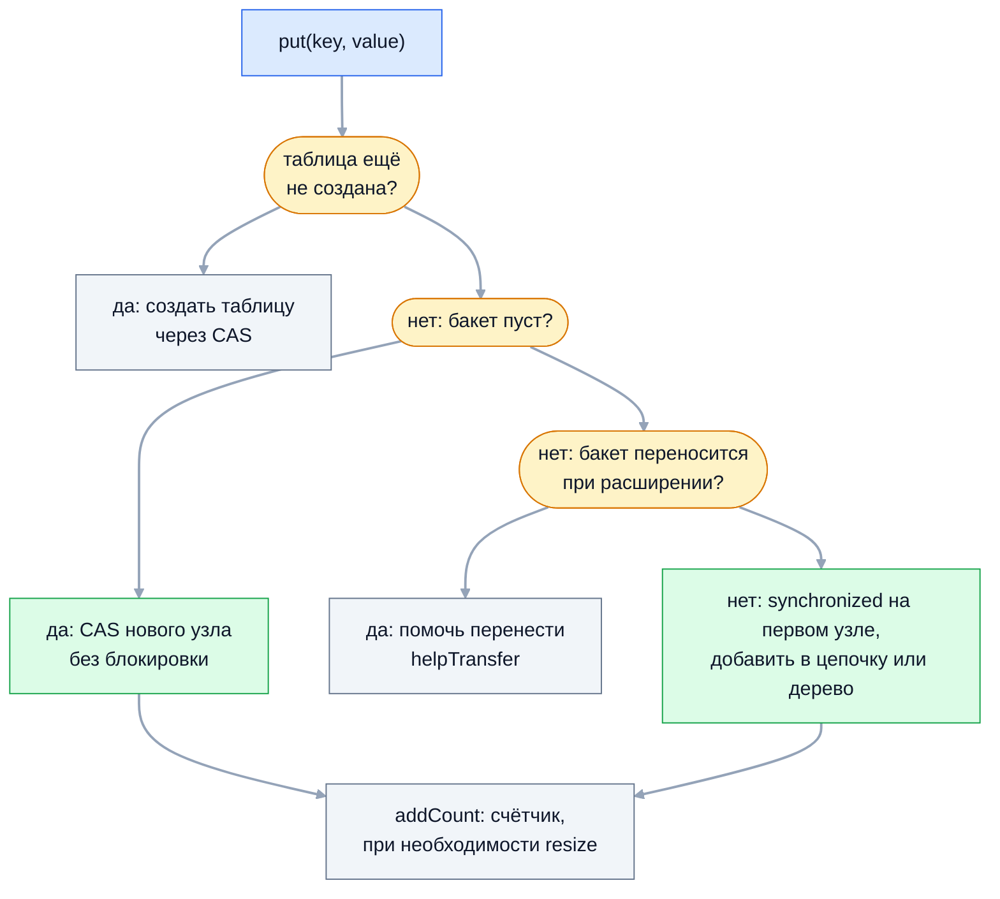

Пакет `java.util.concurrent` даёт потокобезопасные структуры данных и
атомарные переменные, которые избавляют от ручных блокировок в большинстве
задач. На собеседовании это одна из самых «глубоких» тем: устройство
`ConcurrentHashMap` в Java 8, почему связка `get` + `put` на нём — гонка, чем
отличаются реализации `BlockingQueue`, как работает CAS, что такое ABA и
почему `LongAdder` быстрее `AtomicLong`.

## Ключевые концепции

### ConcurrentHashMap

#### Сегменты до Java 8
В Java 5–7 `ConcurrentHashMap` состоял из массива сегментов — по сути
маленьких независимых хэш-таблиц, каждая со своей блокировкой
(`ReentrantLock`). По умолчанию сегментов было 16, и это число
(`concurrencyLevel`) задавало, сколько потоков может писать одновременно.
Чтение шло без блокировок.

В Java 8 класс переписали целиком, а сегменты остались только ради
совместимости сериализации. Ответ «ConcurrentHashMap делит карту на 16
сегментов» описывает реализацию десятилетней давности — на собеседовании это
сразу заметно.

#### Устройство с Java 8
Современный `ConcurrentHashMap` устроен как `HashMap`: массив бакетов, в каждом
— цепочка узлов или дерево. Блокировка стала гранулярной до одного бакета.
Вставка в пустой бакет — одна CAS-операция без блокировок. Вставка в непустой
бакет захватывает `synchronized` на его первом узле, так что потоки, пишущие в
разные бакеты, не мешают друг другу.

Как и в `HashMap`, длинная цепочка (от 8 узлов при таблице от 64 бакетов)
превращается в красно-чёрное дерево — здесь его обёртка называется `TreeBin`.
Схема вставки:

Блокировка появляется только в последнем варианте и только на один бакет.
Поток, наткнувшийся на перенос, не ждёт, а помогает его выполнить.

```java
Map<Integer, Integer> hm = new HashMap<>();
Map<Integer, Integer> chm = new ConcurrentHashMap<>();
// 4 потока, каждый кладёт по 25 000 уникальных ключей
inParallel(4, () -> { for (int i = 0; i < 25_000; i++) hm.put(ids.incrementAndGet(), i); });
inParallel(4, () -> { for (int i = 0; i < 25_000; i++) chm.put(ids2.incrementAndGet(), i); });
```
```
HashMap: size=67030 из 100000
ConcurrentHashMap: size=100000 из 100000
```
Обычная `HashMap` потеряла треть записей без единого исключения, а
`ConcurrentHashMap` сохранила все.

#### Чтение и расширение
`get()` не захватывает блокировок вообще: элементы массива читаются с
семантикой `volatile`, а поля узлов, которые могут меняться, объявлены
`volatile`. Поэтому чтение масштабируется почти линейно с числом потоков и
никогда не ждёт писателей.

Расширение таблицы тоже конкурентное. При переполнении создаётся массив вдвое
больше, а бакеты переносятся порциями; перенесённый бакет помечается
специальным узлом `ForwardingNode`. Читатель, увидевший его, идёт за данными в
новую таблицу, а писатель присоединяется к переносу. Так несколько потоков
делят работу по расширению, и никто не блокирует всю карту.

#### size() и mappingCount()
Точный размер конкурентной карты в каждый момент — понятие условное: пока
считаешь, другие потоки добавляют и удаляют. `ConcurrentHashMap` хранит размер
как `baseCount` плюс массив ячеек `CounterCell` — тот же приём, что у
`LongAdder`: под конкуренцией потоки увеличивают разные ячейки, не толкаясь на
одном счётчике. `size()` суммирует их без блокировки и даёт оценку, верную
только в отсутствие параллельных изменений.

`size()` возвращает `int`, а карта может содержать больше `Integer.MAX_VALUE`
элементов, поэтому для больших карт есть `mappingCount()` с результатом `long`.
Строить логику на точном размере конкурентной карты, например «если размер
меньше N — добавить», нельзя: это та же гонка check-then-act.

#### null запрещён
`ConcurrentHashMap` не принимает `null` ни в ключах, ни в значениях:
`put(null, v)` и `put(k, null)` бросают `NullPointerException`. В обычной
`HashMap` `get(k) == null` неоднозначно — ключа нет или значение `null`, — и
это разрешают отдельным `containsKey`. В конкурентной карте между `get` и
`containsKey` другой поток успеет всё изменить, поэтому неоднозначность
устранили запретом.

В итоге `get(k) == null` в `ConcurrentHashMap` всегда означает «ключа нет».
Пример с `NullPointerException` разобран в теме об устройстве `HashMap`.

#### Атомарные составные операции
Каждый отдельный метод `ConcurrentHashMap` потокобезопасен, но
последовательность вызовов — нет. Классическая ошибка — подсчёт через `get` и
`put`: два потока читают одно значение, оба прибавляют единицу, одно
приращение теряется. Для таких случаев есть атомарные методы: `putIfAbsent`,
`computeIfAbsent`, `computeIfPresent`, `compute`, `merge`,
`replace(key, old, new)` и `remove(key, value)`.

```java
inParallel(4, () -> {
    for (int i = 0; i < 100_000; i++) {
        String w = words[i % words.length];
        Integer old = racy.get(w);
        racy.put(w, old == null ? 1 : old + 1);
        atomic.merge(w, 1, Integer::sum);
    }
});
System.out.println("get + put: " + new TreeMap<>(racy));
System.out.println("merge:     " + new TreeMap<>(atomic));
```
```
get + put: {groovy=79535, java=82491, kotlin=86651, scala=85671}
merge:     {groovy=100000, java=100000, kotlin=100000, scala=100000}
```
Связка `get` + `put` на потокобезопасной карте потеряла до 20% приращений.
`merge` выполняет чтение и запись под блокировкой бакета как одну операцию.
Для счётчиков с высокой конкуренцией ещё лучше хранить в карте `LongAdder`:
`map.computeIfAbsent(k, x -> new LongAdder()).increment()`.

#### Функция в computeIfAbsent
`computeIfAbsent` гарантирует, что функция для отсутствующего ключа будет
вызвана не больше одного раза, даже если ключ запрашивают многие потоки
одновременно. Это делает метод готовым кэшем с ленивой загрузкой. Цена
гарантии — функция выполняется под блокировкой бакета: остальные потоки,
обращающиеся к этому бакету, ждут.

```java
inParallel(8, () -> cache.computeIfAbsent("config", k -> {
    loads.incrementAndGet();
    try { Thread.sleep(100); } catch (InterruptedException e) { }
    return "loaded";
}));
System.out.println("8 потоков запросили ключ, загрузок: " + loads.get());
```
```
8 потоков запросили ключ, загрузок: 1
```
Загрузка выполнилась один раз, остальные семь потоков дождались её
результата.

Отсюда два правила: функция должна быть короткой (никаких сетевых вызовов
длиной в секунды), и она не должна изменять ту же карту. Рекурсивное
вычисление с мемоизацией в той же карте — частая ошибка:
```java
static final Map<Integer, Long> memo = new ConcurrentHashMap<>();
static long fib(int n) {
    if (n < 2) return n;
    return memo.computeIfAbsent(n, k -> fib(k - 1) + fib(k - 2));
}
fib(30);   // перехвачено
```
```
fib(30): java.lang.IllegalStateException: Recursive update
```
Внутренний `computeIfAbsent` попал в бакет, который уже зарезервирован
внешним вызовом. С Java 9 карта обнаруживает это и бросает исключение, а в
Java 8 такой код мог зависнуть в бесконечном цикле.

### Другие коллекции

#### CopyOnWriteArrayList
`CopyOnWriteArrayList` при каждом изменении копирует весь внутренний массив и
подменяет ссылку на новый. Чтение и обход идут по неизменному снимку без
блокировок, а итератор никогда не бросает `ConcurrentModificationException`.
Запись стоит O(n) и создаёт мусор, поэтому структура хороша только при редких
изменениях и частом чтении — классический пример список слушателей событий.

`CopyOnWriteArraySet` построен поверх него, а атомарный `addIfAbsent`
закрывает гонку check-then-act при регистрации:
```java
CopyOnWriteArrayList<String> listeners = new CopyOnWriteArrayList<>();
inParallel(4, () -> listeners.addIfAbsent("audit"));
System.out.println("4 потока добавили одного слушателя: " + listeners);
```
```
4 потока добавили одного слушателя: [audit]
```
Поведение итератора-снимка подробно разобрано в теме об итераторах.

#### ConcurrentLinkedQueue и ConcurrentLinkedDeque
`ConcurrentLinkedQueue` — неограниченная неблокирующая очередь на связном
списке, построенная на CAS по алгоритму Майкла — Скотта. `offer` и `poll`
никогда не блокируют поток: если очередь пуста, `poll` возвращает `null`.
`ConcurrentLinkedDeque` — двусторонний вариант.

Важная особенность — `size()` работает за O(n): чтобы посчитать элементы,
очередь обходит весь список, и результат может устареть ещё до возврата.
Проверять пустоту нужно через `isEmpty()`. Такие очереди подходят, когда
потребитель не должен ждать; если ждать нужно — берут `BlockingQueue`.

#### ConcurrentSkipListMap и ConcurrentSkipListSet
Для отсортированных данных `TreeMap` не подходит, а конкурентного
красно-чёрного дерева в JDK нет: его перебалансировку трудно сделать без
глобальной блокировки. Вместо него есть `ConcurrentSkipListMap` — список с
пропусками (skip list), многоуровневый связный список, где верхние уровни
служат «экспрессами» для быстрого поиска. Операции стоят O(log n) и
реализованы без блокировок.

```java
ConcurrentSkipListMap<Integer, String> prices = new ConcurrentSkipListMap<>();
inParallel(4, () -> {
    for (int i = 0; i < 5; i++) {
        int p = ThreadLocalRandom.current().nextInt(100, 1000);
        prices.put(p, Thread.currentThread().getName());
    }
});
System.out.println("ключей: " + prices.size() + ", первый: " + prices.firstKey() + " ≤ последний: " + prices.lastKey()
        + ", отсортировано: " + isSorted(prices.keySet()));
```
```
ключей: 20, первый: 105 ≤ последний: 816, отсортировано: true
```
Четыре потока писали одновременно, а ключи остались упорядоченными. Доступны
все навигационные методы `NavigableMap` — `ceilingKey`, `headMap`, `pollFirstEntry`.
`ConcurrentSkipListSet` — множество на той же основе.

#### synchronizedMap и Hashtable
`Collections.synchronizedMap` и устаревший `Hashtable` защищают все операции
одной блокировкой на всю коллекцию. Под нагрузкой потоки выстраиваются в
очередь даже за чтением. Итерация требует внешней синхронизации на самой
коллекции, а составные действия всё равно надо оборачивать вручную.

Обёртки оправданы, когда нужна потокобезопасность для редко используемой
коллекции специфического типа (например, `LinkedHashMap` с порядком доступа).
Для обычной разделяемой карты выбирают `ConcurrentHashMap`, для списка —
`CopyOnWriteArrayList` или явную блокировку.

### BlockingQueue

#### Четыре группы методов
`BlockingQueue` добавляет к `Queue` операции, которые умеют ждать. При
невозможности операции методы ведут себя по-разному. `add` и `remove` бросают
исключение, `offer` и `poll` возвращают `false` или `null`, `put` и `take`
блокируют поток до появления места или элемента, а `offer` и `poll` с таймаутом
ждут ограниченное время.

```java
BlockingQueue<String> q = new ArrayBlockingQueue<>(2);
q.put("a");
q.put("b");
q.add("c");                                            // перехвачено
System.out.println("offer: " + q.offer("c"));
System.out.println("offer(200 мс): " + q.offer("c", 200, TimeUnit.MILLISECONDS));
// поток producer вызывает q.put("c")
System.out.println("put: поток " + producer.getState());
System.out.println("take: " + q.take() + ", после этого put прошёл, очередь: " + q);
```
```
add:   java.lang.IllegalStateException: Queue full
offer: false
offer(200 мс): false через ~200 мс
put: поток WAITING
take: a, после этого put прошёл, очередь: [b, c]
poll на пустой: null
remove на пустой: NoSuchElementException
```
На полной очереди каждая группа повела себя по-своему, а `put` ждал, пока
`take` не освободит место. Все реализации запрещают `null`: `null` из `poll`
означает «пусто».

#### ArrayBlockingQueue и LinkedBlockingQueue
`ArrayBlockingQueue` — ограниченная очередь на кольцевом массиве с одной
`ReentrantLock` и двумя условиями (`notEmpty`, `notFull`). Ёмкость задаётся
при создании, память выделяется сразу, есть опция справедливой блокировки.
`LinkedBlockingQueue` — очередь на связном списке с двумя блокировками,
отдельно для головы и хвоста, поэтому производитель и потребитель не мешают
друг другу.

Ёмкость `LinkedBlockingQueue` необязательна, и без неё очередь фактически
неограниченна (`Integer.MAX_VALUE`) — в этом виде её используют
`Executors.newFixedThreadPool` и это источник `OutOfMemoryError` при
перегрузке. В серверном коде ёмкость указывают всегда.

#### Специализированные очереди
`PriorityBlockingQueue` — неограниченная очередь с приоритетом, как
`PriorityQueue`: `take` выдаёт наименьший элемент. `DelayQueue` хранит
элементы, реализующие `Delayed`, и выдаёт элемент только после истечения его
задержки — основа планировщиков и кэшей с истечением срока.
`SynchronousQueue` вообще не имеет ёмкости: `put` ждёт, пока другой поток не
вызовет `take`, — это прямая передача из рук в руки.

```java
SynchronousQueue<String> handoff = new SynchronousQueue<>();
System.out.println("offer без потребителя: " + handoff.offer("x") + ", size=" + handoff.size());
PriorityBlockingQueue<Integer> pq = new PriorityBlockingQueue<>(List.of(5, 1, 3));
System.out.println("PriorityBlockingQueue take: " + pq.take() + ", " + pq.take() + ", " + pq.take());
DelayQueue<Job> dq = new DelayQueue<>();
dq.put(new Job("через 300 мс", now + 300_000_000));
dq.put(new Job("через 100 мс", now + 100_000_000));
System.out.println("poll сразу: " + dq.poll());
Job first = dq.take();
```
```
offer без потребителя: false, size=0
PriorityBlockingQueue take: 1, 3, 5
poll сразу: null
take: через 100 мс на ~100 мс
```
`SynchronousQueue` отказала в `offer`, потому что никто не ждал элемента.
`DelayQueue` не отдала ни одного элемента сразу, а `take` вернул первым тот,
чья задержка истекла раньше.

`LinkedTransferQueue` (Java 7) объединяет обычную очередь и прямую передачу:
`transfer` ждёт, пока элемент не заберёт потребитель, а `tryTransfer` передаёт
элемент только ожидающему потребителю.
```java
System.out.println("tryTransfer без потребителя: " + tq.tryTransfer("t"));
// получатель вызовет take() через 200 мс
tq.transfer("важное сообщение");
```
```
tryTransfer без потребителя: false
получатель взял: важное сообщение
transfer вернулся через ~200 мс — после take()
```
Производитель узнаёт, что сообщение действительно забрали, — это полезно для
обратного давления без ограничения ёмкости.

#### Producer-consumer и drainTo
`BlockingQueue` — готовая основа схемы производитель — потребитель:
производители вызывают `put`, потребители — `take`, и очередь сама
синхронизирует их скорости, без единого `wait`/`notify`. Ограниченная очередь
даёт обратное давление: быстрый производитель засыпает на `put`, пока
потребители не разгребут работу. Это же очередь задач внутри
`ThreadPoolExecutor`.

`drainTo(collection, max)` забирает накопившиеся элементы пачкой за одну
операцию, что удобно для пакетной записи в базу или отправки в брокер:
```java
BlockingQueue<Integer> events = new LinkedBlockingQueue<>(List.of(1, 2, 3, 4, 5));
List<Integer> batch = new ArrayList<>();
int n = events.drainTo(batch, 3);
System.out.println("drainTo(batch, 3): " + n + " → " + batch + ", осталось " + events);
```
```
drainTo(batch, 3): 3 → [1, 2, 3], осталось [4, 5]
```
Остановку потребителей обычно делают через «ядовитую пилюлю» (poison pill) —
специальный элемент-маркер, — или через прерывание потоков.

### Atomic-классы

#### AtomicInteger, AtomicLong и AtomicReference
Атомарные классы из `java.util.concurrent.atomic` хранят одно значение и
выполняют над ним операции чтение-изменение-запись атомарно, без блокировок.
`AtomicInteger` и `AtomicLong` — для счётчиков и идентификаторов,
`AtomicBoolean` — для флагов «выполнить один раз», `AtomicReference<V>` — для
атомарной замены ссылки на неизменяемый объект. Чтение `get()` и запись
`set()` имеют семантику `volatile`.

```java
AtomicInteger counter = new AtomicInteger();
inParallel(4, () -> { for (int i = 0; i < 250_000; i++) counter.incrementAndGet(); });
System.out.println("incrementAndGet, 4 × 250 000: " + counter.get());
System.out.println("compareAndSet(1000000, 0): " + counter.compareAndSet(1_000_000, 0) + ", теперь " + counter.get());
System.out.println("compareAndSet(5, 10): " + counter.compareAndSet(5, 10) + ", осталось " + counter.get());
System.out.println("getAndAdd(5)=" + counter.getAndAdd(5) + ", addAndGet(5)=" + counter.addAndGet(5));
```
```
incrementAndGet, 4 × 250 000: 1000000
compareAndSet(1000000, 0): true, теперь 0
compareAndSet(5, 10): false, осталось 0
getAndAdd(5)=0, addAndGet(5)=10
```
Ни одно приращение не потерялось. Пары методов `getAndX` и `xAndGet`
различаются только тем, какое значение возвращают — до или после операции.

#### CAS
В основе атомарных классов — инструкция процессора compare-and-swap (CAS):
«если в памяти лежит ожидаемое значение, атомарно записать новое и сообщить об
успехе, иначе ничего не менять». На x86 это `lock cmpxchg`, на ARM — пара
инструкций эксклюзивного чтения и условной записи или `cas` в новых
процессорах. Успешный CAS имеет семантику `volatile`-чтения и записи.

CAS не блокирует поток: неудача означает лишь, что другой поток успел первым,
и операцию можно повторить с новым значением. На этом построены все
неблокирующие алгоритмы, включая сами `incrementAndGet` и очереди
`java.util.concurrent`.

#### updateAndGet и побочные эффекты
`updateAndGet(fn)` и `accumulateAndGet(x, fn)` позволяют атомарно применить
произвольную функцию. Внутри это CAS-цикл: прочитать значение, вычислить
новое, попытаться записать CAS и при неудаче повторить. Значит, под
конкуренцией функция вызывается несколько раз, и в ней не должно быть
побочных эффектов — отправки сообщений, записи в лог, изменения других
переменных.

```java
AtomicLong total = new AtomicLong();
LongAdder calls = new LongAdder();
inParallel(8, () -> {
    for (int i = 0; i < 100_000; i++) {
        total.updateAndGet(x -> { calls.increment(); return x + 1; });
    }
});
System.out.println("обновлений: " + total.get() + ", вызовов функции: " + calls.sum());
```
```
обновлений: 800000, вызовов функции: 1799619
```
На каждое успешное обновление пришлось больше двух вызовов функции. Если бы в
ней отправлялось письмо, адресат получил бы его дважды.

#### LongAdder и LongAccumulator
Под высокой конкуренцией `AtomicLong` становится узким местом: все потоки
бьются CAS-ом в одну ячейку памяти, проигравшие повторяют попытку, а
кэш-линия мечется между ядрами. `LongAdder` (Java 8) разносит счётчик по
ячейкам: без конкуренции увеличивается базовое значение, а при конфликтах
каждый поток получает свою ячейку `Cell`, размеченную `@Contended`, чтобы
избежать false sharing.

```java
// 8 потоков × 5 000 000 инкрементов, после прогрева
inParallel(8, () -> { for (int i = 0; i < 5_000_000; i++) al.incrementAndGet(); });
inParallel(8, () -> { for (int i = 0; i < 5_000_000; i++) la.increment(); });
```
```
AtomicLong: 479 мс
LongAdder:  47 мс
```
Разница — на порядок. Плата — чтение: `sum()` складывает все ячейки без
блокировки и при параллельных изменениях даёт не атомарный снимок, а оценку.
Поэтому `LongAdder` идеален для метрик и статистики, но не для
последовательностей и `compareAndSet`.

`LongAccumulator` обобщает идею на любую ассоциативную и коммутативную
операцию: `new LongAccumulator(Long::max, Long.MIN_VALUE)` даёт конкурентный
максимум. Есть и варианты для `double` — `DoubleAdder` и `DoubleAccumulator`.

#### Field updaters и атомарные массивы
Если атомарных объектов миллионы — например, состояние в каждом узле
структуры, — отдельный `AtomicInteger` на каждый стоит лишних 16 байт и
косвенного обращения. `AtomicIntegerFieldUpdater`, `AtomicLongFieldUpdater` и
`AtomicReferenceFieldUpdater` выполняют CAS прямо над `volatile`-полем обычного
объекта. Один статический updater обслуживает все экземпляры класса.

```java
static class Connection {
    volatile int state;     // 0 — новое, 1 — открыто, 2 — закрыто
    private static final AtomicIntegerFieldUpdater<Connection> STATE =
            AtomicIntegerFieldUpdater.newUpdater(Connection.class, "state");
    boolean open() { return STATE.compareAndSet(this, 0, 1); }
}
// 8 потоков одновременно вызывают open()
```
```
8 потоков открывают соединение, успешно: 1, state=1
AtomicIntegerArray: [40000, 40000, 40000]
```
Переход «новое → открыто» выиграл ровно один поток. `AtomicIntegerArray`,
`AtomicLongArray` и `AtomicReferenceArray` дают атомарные операции над
отдельными элементами массива — обычный массив `volatile` здесь не помог бы,
потому что `volatile` относится к ссылке на массив, а не к элементам. С Java 9
те же задачи решает `VarHandle`.

### Lock-free алгоритмы

#### CAS-цикл
Алгоритм называется lock-free, если хотя бы один поток гарантированно
продвигается, даже если остальные приостановлены. Блокировки этого не дают:
поток, вытесненный планировщиком с захваченной блокировкой, останавливает всех.
Типовая конструкция lock-free кода — CAS-цикл: прочитать текущее состояние,
вычислить новое, попытаться установить его CAS и при неудаче начать заново.

Классический пример — стек Трайбера: голова стека хранится в
`AtomicReference`, а `push` и `pop` меняют её CAS-ом.
```java
private final AtomicReference<Node<T>> head = new AtomicReference<>();

void push(T value) {
    Node<T> current, next;
    do {
        current = head.get();
        next = new Node<>(value, current);
    } while (!head.compareAndSet(current, next));
}

T pop() {
    Node<T> current;
    do {
        current = head.get();
        if (current == null) return null;
    } while (!head.compareAndSet(current, current.next()));
    return current.value();
}
```
```
push 400 000, pop 400000, повторов CAS: > 0
```
Четыре потока одновременно положили и сняли 400 000 элементов без единой
блокировки, ничего не потеряв. Повторы CAS показывают, что потоки
действительно сталкивались и уступали друг другу.

#### ABA-проблема
CAS сравнивает только значение. Если между чтением и CAS значение успело
смениться с A на B и обратно на A, CAS посчитает, что ничего не изменилось.
Для чисел это обычно безвредно, а в структурах на ссылках опасно: узел A мог
быть удалён и вставлен заново уже с другим `next`, и CAS восстановит
испорченную структуру.

Решение — добавить к значению версию. `AtomicStampedReference` хранит пару
«ссылка + целочисленная метка» и меняет обе атомарно; `AtomicMarkableReference`
хранит ссылку и булев флаг, например «узел логически удалён». Сценарий ниже
воспроизводит чередование двух потоков последовательно:
```java
AtomicReference<String> ref = new AtomicReference<>(a);
String seen = ref.get();                 // поток 1 прочитал A
ref.set(b); ref.set(a);                  // поток 2: A → B → A
System.out.println("AtomicReference: CAS(A, C) = " + ref.compareAndSet(seen, cVal) + " — изменения не замечены");
AtomicStampedReference<String> sref = new AtomicStampedReference<>(a, 0);
String seenS = sref.get(stampHolder);    // поток 1: A, версия 0
sref.compareAndSet(a, b, 0, 1);          // поток 2: A → B
sref.compareAndSet(b, a, 1, 2);          // поток 2: B → A
sref.compareAndSet(seenS, cVal, seenStamp, seenStamp + 1);
```
```
AtomicReference: CAS(A, C) = true — изменения не замечены
AtomicStampedReference: CAS(A, C, версия 0) = false, текущая версия 2
```
Обычная ссылка не заметила двух промежуточных изменений. Версия выросла до 2,
и CAS с устаревшей версией 0 не прошёл. В Java ABA встречается реже, чем в C:
сборщик мусора не переиспользует память объекта, пока на него есть ссылка.

#### Когда lock-free проигрывает
Lock-free не значит «всегда быстрее». Под очень высокой конкуренцией потоки
тратят процессор на неудачные CAS и повторы, а кэш-линия с общей переменной
постоянно мигрирует между ядрами. Блокировка в такой ситуации усыпляет
лишние потоки и может дать большую пропускную способность.

Лекарства — уменьшать разделяемое состояние: разносить его по ячейкам, как
`LongAdder`, накапливать локально и объединять в конце, или разбивать данные
на независимые части. Кроме того, lock-free код сложно писать и проверять:
вне стандартных структур его используют редко.

### Unsafe и VarHandle — что на самом деле стоит за CAS

#### sun.misc.Unsafe
`sun.misc.Unsafe` — внутренний класс JDK с прямым доступом к памяти: чтение и
запись полей по смещению, CAS, выделение памяти вне кучи, барьеры. Публичного
конструктора нет, экземпляр достают рефлексией из поля `theUnsafe`. На нём
десятилетиями строились `java.util.concurrent`, а также Netty, Kryo, Hazelcast
и другие высокопроизводительные библиотеки.

```java
Field f = Unsafe.class.getDeclaredField("theUnsafe");
f.setAccessible(true);
Unsafe unsafe = (Unsafe) f.get(null);
long offset = unsafe.objectFieldOffset(Point.class.getDeclaredField("x"));
System.out.println("смещение поля x: " + offset);
System.out.println("compareAndSwapInt(0 → 7): " + unsafe.compareAndSwapInt(p, offset, 0, 7) + ", x=" + p.x);
```
```
смещение поля x: 12
compareAndSwapInt(0 → 7): true, x=7
```
Поле `x` лежит в 12 байтах от начала объекта — сразу за 12-байтным
заголовком. CAS выполнен по «сырому» адресу, без всяких проверок типов: ошибка
в смещении портит память и роняет JVM.

#### Закат Unsafe
Модульная система Java 9 закрыла внутренние API, но `sun.misc.Unsafe`
оставили доступным в модуле `jdk.unsupported` — слишком много кода от него
зависело. Сворачивать его начали позже. В Java 23 (JEP 471) методы доступа к
памяти объявлены deprecated for removal, а с Java 24 (JEP 498) их первый
вызов по умолчанию печатает предупреждение. Тот же код на JDK 25:
```
WARNING: A terminally deprecated method in sun.misc.Unsafe has been called
WARNING: sun.misc.Unsafe::objectFieldOffset has been called by UnsafeDemo (file:/.../UnsafeDemo.java)
WARNING: Please consider reporting this to the maintainers of class UnsafeDemo
WARNING: sun.misc.Unsafe::objectFieldOffset will be removed in a future release
смещение поля x: 12
compareAndSwapInt(0 → 7): true, x=7
```
Код пока работает, но поведение переключается флагом
`--sun-misc-unsafe-memory-access` (`allow`, `warn`, `debug`, `deny`), а в
следующих версиях методы будут удалены. Замены — `VarHandle` для полей и
массивов и Foreign Function & Memory API (Java 22) для памяти вне кучи.

#### VarHandle
`VarHandle` (Java 9, JEP 193) — официальная типобезопасная замена `Unsafe` для
доступа к полям и элементам массивов. Его получают через
`MethodHandles.lookup().findVarHandle(класс, имя, тип)` один раз и хранят в
`static final` поле — тогда JIT превращает вызовы в те же инструкции, что и
`Unsafe`. Проверки доступа выполняются при создании, а не при каждом вызове.

```java
static class Counter {
    private volatile long value;
    private static final VarHandle VALUE;
    static {
        try {
            VALUE = MethodHandles.lookup().findVarHandle(Counter.class, "value", long.class);
        } catch (ReflectiveOperationException e) {
            throw new ExceptionInInitializerError(e);
        }
    }
    long increment() { return (long) VALUE.getAndAdd(this, 1L) + 1; }
    boolean cas(long expected, long next) { return VALUE.compareAndSet(this, expected, next); }
    void publish(long v) { VALUE.setRelease(this, v); }
    long read() { return (long) VALUE.getAcquire(this); }
}
```
```
getAndAdd, 4 × 250 000: 1000000
compareAndSet(1000000, 0): true
setRelease/getAcquire: 42
```
Счётчик на `VarHandle` так же точен, как `AtomicLong`, но без отдельного
объекта-обёртки. Приведение `(long)` у результата обязательно: методы
`VarHandle` сигнатурно-полиморфны, и тип результата берётся из приведения.

Главное отличие `VarHandle` от атомарных классов — режимы доступа к памяти,
от слабого к сильному:
- plain (`get`/`set`) — обычное чтение и запись, без гарантий порядка;
- opaque (`getOpaque`/`setOpaque`) — атомарно и без кэширования в регистре, но без happens-before;
- acquire/release (`getAcquire`/`setRelease`) — односторонние барьеры, достаточные для публикации данных одним потоком;
- volatile (`getVolatile`/`setVolatile`, `compareAndSet`) — полная семантика `volatile`.

Ослабленные режимы нужны авторам низкоуровневых структур: на ARM
release-запись заметно дешевле `volatile`-записи. В прикладном коде хватает
`volatile` и атомарных классов.

#### Что внутри Atomic-классов
С появлением `VarHandle` атомарные классы JDK частично переписали. Сейчас
`AtomicBoolean`, `AtomicReference`, атомарные массивы и field updaters
реализованы на `VarHandle`. А `AtomicInteger` и `AtomicLong` используют
внутренний `jdk.internal.misc.Unsafe` — не публичный `sun.misc.Unsafe`, а его
внутренний аналог.

Причина записана в комментарии исходников: эти классы собирались перевести
на `VarHandle`, но мешают нерешённые циклические зависимости при старте JVM —
`AtomicInteger` нужен раньше, чем инфраструктура `VarHandle` готова к работе.
Так что популярный ответ
«с Java 9 все Atomic-классы работают через `VarHandle`» верен лишь частично.

## Частые вопросы на собеседовании

**Q: Как устроен ConcurrentHashMap в Java 8 и почему он не допускает null?**
A: Это массив бакетов, как у `HashMap`, с цепочками и деревьями. Вставка в
пустой бакет — CAS без блокировок, в непустой — `synchronized` на первом узле
бакета, чтение не блокируется вовсе, а расширение выполняют несколько потоков
совместно. `null` запрещён, потому что в конкурентной карте нельзя без гонки
отличить «ключа нет» от «значение `null`»: между `get` и `containsKey` карту
успеют изменить. До Java 8 карта делилась на 16 сегментов с отдельными
блокировками.

**Q: Почему связка get + put на ConcurrentHashMap не потокобезопасна?**
A: Каждый метод по отдельности атомарен, но между `get` и `put` другой поток
успевает выполнить свои `get` и `put`, и одно из обновлений теряется —
классическая гонка read-modify-write. Составные операции нужно выражать одним
атомарным методом: `merge`, `compute`, `computeIfAbsent`, `putIfAbsent` или
`replace(key, old, new)`.

**Q: Чем LongAdder лучше AtomicLong?**
A: Под высокой конкуренцией `AtomicLong` упирается в одну ячейку памяти: все
потоки делают CAS в неё, проигравшие повторяют, кэш-линия мигрирует между
ядрами. `LongAdder` разносит счётчик по ячейкам с отступами против false
sharing, и потоки увеличивают разные ячейки — в замере выше это дало выигрыш
на порядок. Минус — `sum()` не даёт атомарного снимка и нет `compareAndSet`,
поэтому `LongAdder` хорош для метрик, а не для генерации идентификаторов.

**Q: Что такое CAS и ABA-проблема?**
A: CAS — атомарная инструкция «если значение равно ожидаемому, заменить на
новое»; на ней построены атомарные классы и lock-free алгоритмы с циклом
повторов. ABA — ситуация, когда значение успело смениться с A на B и обратно
на A, и CAS этого не заметил. В структурах на ссылках это может испортить
данные; лечится версией рядом со значением — `AtomicStampedReference`.

**Q: Чем отличаются ArrayBlockingQueue, LinkedBlockingQueue и SynchronousQueue?**
A: `ArrayBlockingQueue` — ограниченная очередь на массиве с одной блокировкой.
`LinkedBlockingQueue` — на связном списке с раздельными блокировками головы и
хвоста, ёмкость необязательна, и без неё очередь неограниченна.
`SynchronousQueue` не хранит элементов: каждый `put` ждёт соответствующего
`take`. В пулах потоков это три разные стратегии: ограниченный буфер,
неограниченный буфер и прямая передача.

## Ловушки и частые ошибки

#### Потокобезопасная коллекция — потокобезопасный код
Использование `ConcurrentHashMap` или `CopyOnWriteArrayList` не делает
потокобезопасной логику вокруг них. Проверка `containsKey` и последующий `put`,
размер карты как условие добавления, обход с изменением по результатам чтения —
всё это гонки. Составные действия выражают атомарными методами коллекции или
защищают общей блокировкой.

#### Долгая функция в computeIfAbsent
Сетевой вызов или тяжёлое вычисление внутри `computeIfAbsent` держит
блокировку бакета: все потоки, которым нужен этот бакет — включая другие ключи
с тем же хэшем бакета, — ждут. Если загрузка долгая, в карту кладут
`CompletableFuture` или `FutureTask`, который вычисляется вне блокировки, — так
устроен классический memoizer.

#### volatile-массив вместо атомарного
Объявление `volatile int[] counters` делает `volatile` только ссылку на массив.
Чтение и запись элементов остаются обычными, а `counters[i]++` — гонкой. Для
элементов нужен `AtomicIntegerArray`, `VarHandle` для массивов или массив
`LongAdder`.

#### LongAdder как источник идентификаторов
`LongAdder.sum()` при параллельных изменениях может вернуть значение, которого
счётчик ни в один момент не имел, а `increment()` ничего не возвращает. Для
уникальных номеров и последовательностей нужен `AtomicLong.incrementAndGet()`.

## Связанные темы
- [Синхронизация: synchronized](../01-threads-and-memory-model/02-synchronized.md) — гонки read-modify-write и check-then-act.
- [Java Memory Model и volatile](../01-threads-and-memory-model/03-jmm-and-volatile.md) — семантика `volatile`, false sharing и `@Contended`.
- [Пулы потоков](../02-executors-and-async/05-thread-pools.md) — очереди внутри `ThreadPoolExecutor`.
- [Явные блокировки и примитивы синхронизации](08-locks-and-synchronizers.md) — `ReentrantLock` и `Condition` внутри блокирующих очередей.
- [Практические задачи на собеседовании](../05-interview-practice/12-practical-tasks.md) — producer-consumer, кэш и счётчики.
- [Map: HashMap изнутри](../../05-collections/04-hashmap-internals.md) — бакеты, treeify и запрет `null` в конкурентных картах.
- [Queue и Deque](../../05-collections/05-queue-and-deque.md) — методы `Queue` и однопоточные очереди.
- [Итераторы и модификация коллекций](../../05-collections/06-iterators-and-modification.md) — итераторы-снимки и weakly consistent итераторы.

## Источники
- [javadoc ConcurrentHashMap](https://docs.oracle.com/en/java/javase/21/docs/api/java.base/java/util/concurrent/ConcurrentHashMap.html) — гарантии атомарности и требования к функциям `compute`.
- [javadoc BlockingQueue](https://docs.oracle.com/en/java/javase/21/docs/api/java.base/java/util/concurrent/BlockingQueue.html) — таблица методов.
- [javadoc пакета java.util.concurrent.atomic](https://docs.oracle.com/en/java/javase/21/docs/api/java.base/java/util/concurrent/atomic/package-summary.html).
- [JEP 193: Variable Handles](https://openjdk.org/jeps/193) и [JEP 471: Deprecate the Memory-Access Methods in sun.misc.Unsafe for Removal](https://openjdk.org/jeps/471).
