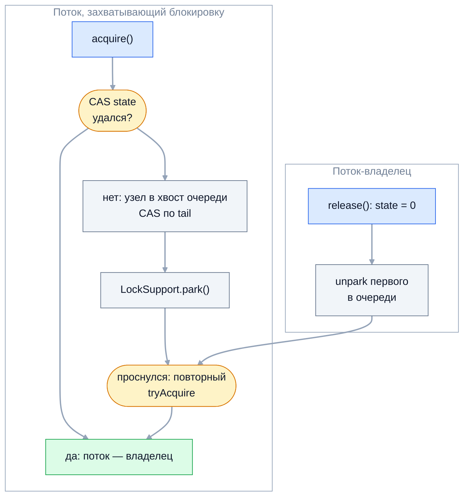

Пакет `java.util.concurrent.locks` и синхронизаторы `java.util.concurrent`
закрывают то, чего не умеет `synchronized`: ожидание с таймаутом и
прерыванием, несколько условий на одной блокировке, раздельные блокировки
чтения и записи, координацию групп потоков. На собеседовании спрашивают,
когда `ReentrantLock` лучше `synchronized`, чем справедливая блокировка
отличается от несправедливой, почему нельзя повысить блокировку чтения до
записи, как устроен AQS и чем `CountDownLatch` отличается от `CyclicBarrier`.

## Ключевые концепции

### ReentrantLock

#### lock() и unlock() в finally
`ReentrantLock` — явная блокировка с той же семантикой, что у монитора:
взаимное исключение, реентерабельность и видимость изменений между
освобождением и следующим захватом. Разница в том, что захват и освобождение —
обычные вызовы методов, и освобождать блокировку нужно самому, строго в
`finally`. Иначе исключение в критической секции оставит её захваченной
навсегда.

```java
lock.lock();
try {
    // критическая секция
} finally {
    lock.unlock();
}
```
`lock()` ставят перед `try`, а не внутри: если захват не удался, `finally` не
должен вызывать `unlock()`. Освобождение блокировки, которую текущий поток не
держит, бросает `IllegalMonitorStateException` — в отличие от `Semaphore`, у
`ReentrantLock` есть владелец.

#### Возможности сверх synchronized
`ReentrantLock` нужен там, где `synchronized` не справляется. `tryLock()`
пытается захватить блокировку без ожидания, а `tryLock(timeout)` ждёт
ограниченное время — так разрывают взаимоблокировки и не висят на занятом
ресурсе. `lockInterruptibly()` ждёт, но реагирует на прерывание. Кроме того,
доступны справедливый режим, несколько `Condition` и методы диагностики:
`isLocked`, `getQueueLength`, `hasQueuedThreads`.

```java
// поток holder держит busy 500 мс
System.out.println("tryLock(): " + busy.tryLock());
System.out.println("tryLock(100 мс): " + busy.tryLock(100, TimeUnit.MILLISECONDS));
System.out.println("tryLock(1 с): " + busy.tryLock(1, TimeUnit.SECONDS));
```
```
tryLock(): false
tryLock(100 мс): false через ~100 мс, в очереди: 0
tryLock(1 с): true
```
Мгновенная попытка и попытка со 100 мс не удались, а секундного ожидания
хватило, чтобы владелец освободил блокировку. Прерываемое ожидание
`lockInterruptibly()` показано в теме об основах потоков.

Если эти возможности не нужны, `synchronized` предпочтительнее: он короче,
его невозможно забыть освободить, а JVM умеет его оптимизировать. По
производительности без конкуренции они сравнимы, а под конкуренцией
`ReentrantLock` больше не даёт заметного выигрыша, как это было в Java 5.

#### Справедливая и несправедливая блокировка
По умолчанию `ReentrantLock` несправедливая (unfair): освободившуюся блокировку
может перехватить поток, который только что пришёл, в обход стоящих в очереди
(barging). Это выгодно для пропускной способности — пришедший поток уже
работает на процессоре, и не нужно будить спящий. Справедливая блокировка
`new ReentrantLock(true)` выдаёт доступ строго в порядке очереди.

```java
// 3 потока, каждый 6 раз подряд захватывает блокировку и дописывает своё имя
System.out.println("unfair: " + order(false));
System.out.println("fair:   " + order(true));
```
```
unfair: AAAAAACCCCCCBBBBBB
fair:   ABCABCABCABCABCABC
```
В несправедливом режиме поток, отпустив блокировку, тут же захватывает её
снова, пока остальные спят в очереди. Справедливая блокировка передаёт её
следующему по очереди. Цена справедливости — переключения контекста на каждом
захвате и заметно меньшая пропускная способность, поэтому её включают только
при реальном голодании. Нюанс: `tryLock()` без таймаута игнорирует
справедливость и захватывает свободную блокировку сразу.

#### Реентерабельность и счётчик захватов
Как и монитор, `ReentrantLock` реентерабелен: поток может захватить его
повторно, а блокировка ведёт счётчик захватов. Освобождается она, только
когда `unlock()` вызван столько же раз, сколько `lock()`. Лишний `unlock()`
бросает исключение, а недостающий оставляет блокировку захваченной.

```java
lock.lock();
lock.lock();
System.out.println("захватов: " + lock.getHoldCount() + ", isHeldByCurrentThread=" + lock.isHeldByCurrentThread());
lock.unlock();
System.out.println("после одного unlock: isLocked=" + lock.isLocked());
lock.unlock();
System.out.println("после второго unlock: isLocked=" + lock.isLocked());
lock.unlock();   // перехвачено
```
```
захватов: 2, isHeldByCurrentThread=true
после одного unlock: isLocked=true
после второго unlock: isLocked=false
лишний unlock: IllegalMonitorStateException
```
После первого `unlock()` блокировка всё ещё занята. `isHeldByCurrentThread()`
удобен в `assert` для методов, которые обязаны вызываться под блокировкой.

### Condition

#### Несколько условий на одной блокировке
`Condition` — аналог `wait`/`notify` для явных блокировок. Его создают методом
`lock.newCondition()`, и у одной блокировки может быть сколько угодно условий.
Это решает проблему монитора с единственным набором ожидания: в ограниченном
буфере производители ждут условия `notFull`, а потребители — `notEmpty`, и
`signal()` будит именно того, кого нужно.

Именно так устроены `ArrayBlockingQueue` и `LinkedBlockingQueue`. С двумя
условиями `signal()` вместо `signalAll()` становится безопасным: в наборе
ожидания каждого условия только потоки, которым это условие и нужно. Полная
реализация буфера — в практических задачах раздела.

#### await() и signal()
`await()` атомарно отпускает блокировку и усыпляет поток, а после пробуждения
снова её захватывает — как `wait()`. Вызывать `await` и `signal` можно только
под той блокировкой, которой принадлежит условие. Ложные пробуждения тоже
возможны, поэтому ожидание пишут в цикле `while`.

```java
Thread waiter = new Thread(() -> {
    cl.lock();
    try {
        while (!flag[0]) ready.await();
        System.out.println("waiter дождался сигнала");
    } catch (InterruptedException e) { } finally { cl.unlock(); }
});
// main захватывает cl, пока waiter ждёт
System.out.println("main захватил блокировку, пока waiter в await(): " + waiter.getState());
flag[0] = true;
ready.signal();
```
```
main захватил блокировку, пока waiter в await(): WAITING
waiter дождался сигнала
```
`main` смог захватить блокировку, потому что `await()` её отпустил. Сам
`signal()` блокировку не отдаёт: `waiter` проснулся только после `unlock()` в
`main`.

#### Варианты ожидания
Кроме бесконечного `await()` есть `await(time, unit)`, который возвращает
`false`, если время истекло без сигнала, и `awaitNanos(nanos)`, возвращающий
оставшееся время для повторного ожидания в цикле. `awaitUntil(deadline)` ждёт
до момента времени, а `awaitUninterruptibly()` не реагирует на прерывание.

```java
System.out.println("await(100 мс) без сигнала: " + ready.await(100, TimeUnit.MILLISECONDS));
```
```
await(100 мс) без сигнала: false
```
Таймауты защищают от вечного ожидания потерянного сигнала, а `awaitNanos` в
цикле `while` позволяет соблюсти общий срок, несмотря на ложные пробуждения.

### ReadWriteLock и StampedLock

#### ReentrantReadWriteLock
`ReentrantReadWriteLock` содержит две связанные блокировки. Блокировку чтения
могут держать одновременно сколько угодно потоков, блокировка записи
эксклюзивна и исключает и других писателей, и читателей. Это выгодно, когда
чтений намного больше, чем записей, и чтения достаточно длинные — например,
кэш справочника, который обновляется раз в час.

```java
// 3 читателя держат readLock по 200 мс, через 50 мс приходит писатель
System.out.println("писатель ждёт: " + writer.getState() + ", читателей одновременно: " + maxReaders.get());
```
```
писатель ждёт: WAITING, читателей одновременно: 3
писатель вошёл, читателей внутри: 0
```
Три читателя работали параллельно, а писатель дождался, пока выйдут все.
Для коротких критических секций `ReadWriteLock` часто проигрывает обычной
блокировке: учёт читателей сам по себе стоит CAS-операций над общим
счётчиком.

#### Downgrade и upgrade
Понижение блокировки (downgrade) разрешено: поток, держащий запись, может
захватить чтение и затем отпустить запись. Так обновляют данные и продолжают
их читать без окна, в котором вклинился бы другой писатель. Повышение
(upgrade) — захват записи при удержании чтения — невозможно: писатель ждёт,
пока выйдут все читатели, включая его самого.

```java
rw.writeLock().lock();
rw.readLock().lock();          // downgrade: чтение под записью
rw.writeLock().unlock();
System.out.println("downgrade: держим только чтение, writeLocked=" + rw.isWriteLocked() + ", readHolds=" + rw.getReadHoldCount());
System.out.println("upgrade: writeLock().tryLock(200 мс) при удержании чтения: "
        + rw.writeLock().tryLock(200, TimeUnit.MILLISECONDS));
```
```
downgrade: держим только чтение, writeLocked=false, readHolds=1
upgrade: writeLock().tryLock(200 мс) при удержании чтения: false
```
С `tryLock` попытка повышения просто вернула `false`, а обычный `lock()`
повис бы навсегда — поток ждал бы сам себя. Правильно — отпустить чтение,
захватить запись и перепроверить состояние, которое могло измениться.

#### StampedLock и оптимистичное чтение
`StampedLock` (Java 8) добавляет к чтению и записи третий режим —
оптимистичное чтение без блокировки. `tryOptimisticRead()` возвращает
штамп (stamp), поток читает поля в локальные переменные, а `validate(stamp)`
проверяет, не было ли за это время записи. Если была — прочитанное выбрасывают
и перечитывают под обычной блокировкой чтения.

```java
long stamp = sl.tryOptimisticRead();
x = point[0];
// другой поток успел записать point[0] = 10, point[1] = 20
y = point[1];
System.out.println("между чтениями была запись: validate=" + sl.validate(stamp) + ", прочитано (" + x + ", " + y + ") — несогласованно");
```
```
оптимистичное чтение без записей: validate=true, (1.0, 2.0)
между чтениями была запись: validate=false, прочитано (1.0, 20.0) — несогласованно
```
Во втором случае прочитана половина старой и половина новой точки, и
`validate` это обнаружил. Пользоваться прочитанными значениями до проверки
нельзя — они могут быть несогласованными.

Оптимистичное чтение не пишет в общую память, поэтому читатели не мешают
друг другу и писателю — это самый быстрый вариант при редких записях. Типичный
шаблон: оптимистичная попытка, при неудаче `readLock()`, чтение и
`unlockRead(stamp)`.

#### Ограничения StampedLock
За скорость `StampedLock` платит удобством. Он не реентерабелен: повторный
захват записи тем же потоком ждёт сам себя вечно. У него нет `Condition`, а
освобождать блокировку нужно штампом, полученным при захвате. Ожидание
`writeLock()` нельзя прервать — для этого есть `writeLockInterruptibly()`.

```java
long ws = sl.writeLock();
System.out.println("повторный захват записи тем же потоком: tryWriteLock()=" + sl.tryWriteLock() + " (0 — не удалось)");
sl.unlockWrite(ws);
```
```
повторный захват записи тем же потоком: tryWriteLock()=0 (0 — не удалось)
```
`tryWriteLock()` вернул нулевой штамп, а `writeLock()` на его месте завис бы
навсегда. Поэтому `StampedLock` используют внутри небольших классов с простой
логикой, где повторный вход исключён, и никогда не вызывают из-под него
чужой код.

### Под капотом: AQS

#### AbstractQueuedSynchronizer
`ReentrantLock`, `ReentrantReadWriteLock`, `Semaphore` и `CountDownLatch`
построены на одном каркасе — `AbstractQueuedSynchronizer` (AQS) Дуга Ли. AQS
хранит одно число `volatile int state` и очередь ожидающих потоков, а
наследник определяет только смысл состояния. Для `ReentrantLock` `state` —
счётчик захватов, для `Semaphore` — число свободных разрешений, для
`CountDownLatch` — оставшийся счёт.

Наследник переопределяет `tryAcquire`/`tryRelease` для эксклюзивного режима
или `tryAcquireShared`/`tryReleaseShared` для разделяемого, а всю работу с
очередью, парковкой, таймаутами и прерываниями AQS берёт на себя. Так за
два десятка строк получается полноценная блокировка:
```java
static class Mutex {
    private static class Sync extends AbstractQueuedSynchronizer {
        @Override protected boolean tryAcquire(int ignored) {
            if (compareAndSetState(0, 1)) {
                setExclusiveOwnerThread(Thread.currentThread());
                return true;
            }
            return false;
        }
        @Override protected boolean tryRelease(int ignored) {
            if (getState() == 0) throw new IllegalMonitorStateException();
            setExclusiveOwnerThread(null);
            setState(0);
            return true;
        }
    }
    private final Sync sync = new Sync();
    void lock() { sync.acquire(1); }
    void unlock() { sync.release(1); }
}
// main держит мьютекс, ещё три потока пытаются его захватить
```
```
в очереди AQS: 3, состояние потока: WAITING
после unlock все прошли, в очереди: 0
```
Свой код — только CAS по `state`. Очередь из трёх ожидающих, их парковку и
пробуждение по одному обеспечил AQS.

#### Захват, очередь и парковка
Захват начинается с быстрого пути: попытки CAS по `state` без всякой очереди.
Если она не удалась, поток создаёт узел и добавляет его в хвост очереди —
вариант CLH-очереди, тоже через CAS. Затем он ещё раз пробует захватить
блокировку, если стоит первым, и, не получив, паркуется.


Освобождение будит только одного преемника, а не всех ожидающих, — так нет
лавины пробуждений. Проснувшийся поток снова пробует CAS: в несправедливом
режиме его может опередить новичок, и тогда он паркуется снова.

Ожидающие потоки в AQS находятся в состоянии `WAITING` (parking), а не
`BLOCKED`, как у монитора. В thread dump такие потоки показаны как `parking to
wait for <...> (a java.util.concurrent.locks.ReentrantLock$NonfairSync)`.

#### LockSupport
Парковку обеспечивает `LockSupport` — низкоуровневый примитив, на котором
стоит весь AQS. У каждого потока есть одно разрешение (permit): `unpark(t)`
выдаёт его, а `park()` забирает, если оно есть, или усыпляет поток до его
появления. Разрешение не накапливается, но и не теряется: `unpark` до `park`
означает, что `park` вернётся сразу.

```java
LockSupport.unpark(self);
LockSupport.park();
System.out.println("unpark до park: park вернулся за " + elapsedMs + " мс");
// поток parked вызывает LockSupport.park()
System.out.println("parked: " + parked.getState());
LockSupport.unpark(parked);
```
```
unpark до park: park вернулся за 0 мс
parked: WAITING
parked проснулся
```
В отличие от `notify()`, сигнал, отправленный заранее, не пропадает. Но
`park()` может вернуться и без причины, поэтому его вызывают в цикле с
проверкой условия. В прикладном коде `LockSupport` почти не используют — он
нужен авторам синхронизаторов.

### Координация потоков

#### CountDownLatch
`CountDownLatch` — одноразовая защёлка со счётчиком. Потоки вызывают
`countDown()`, уменьшая счётчик, а `await()` блокирует ожидающих, пока счётчик
не дойдёт до нуля. Два типичных применения — стартовый сигнал (защёлка на 1,
все потоки ждут команды «марш») и ожидание завершения N задач.

```java
CountDownLatch startSignal = new CountDownLatch(1);
CountDownLatch done = new CountDownLatch(3);
// три потока: startSignal.await(), работа, done.countDown() в finally
startSignal.countDown();
done.await();
System.out.println("все три готовы, count=" + done.getCount());
done.countDown();
```
```
все ждут старта, count=3
сервис 1 готов
сервис 2 готов
сервис 3 готов
все три готовы, count=0
лишний countDown(): count=0, await() возвращается сразу
```
Счётчик не уходит ниже нуля и не сбрасывается: защёлка срабатывает один раз.
`countDown()` вызывают в `finally` — иначе упавшая задача оставит `await()`
ждать вечно.

#### CyclicBarrier
`CyclicBarrier` — многоразовая точка встречи фиксированного числа потоков.
Каждый вызывает `await()` и ждёт, пока соберутся все, после чего барьер
открывается и сразу готов к следующему кругу. Необязательное действие
`barrierAction` выполняет последний пришедший поток до того, как остальные
продолжат, — например, объединяет результаты фазы.

```java
CyclicBarrier barrier = new CyclicBarrier(3,
        () -> System.out.println("  барьер пройден, действие выполнил " + Thread.currentThread().getName()));
// три потока по две фазы: работа случайной длительности, затем barrier.await()
```
```
  барьер пройден, действие выполнил worker-1
  барьер пройден, действие выполнил worker-2
```
Один и тот же барьер отработал две фазы, и действие каждый раз выполнял
пришедший последним.

Если один из потоков прерван или вышел по таймауту, барьер ломается для всех:
остальные получают `BrokenBarrierException`, а повторно использовать барьер
можно только после `reset()`.
```java
CyclicBarrier fragile = new CyclicBarrier(3);
// other: fragile.await(); slowpoke: fragile.await(100, TimeUnit.MILLISECONDS)
```
```
slowpoke: TimeoutException
other: BrokenBarrierException
isBroken=true
```
Третий участник так и не пришёл, `slowpoke` вышел по таймауту, а `other`
узнал о поломке через исключение. Это защищает от ситуации, когда группа
вечно ждёт упавшего участника.

#### Semaphore
`Semaphore` хранит набор разрешений: `acquire()` забирает разрешение или ждёт
его, `release()` возвращает. Семафор на N разрешений ограничивает число
потоков, одновременно работающих с ресурсом, — соединения к базе, вызовы
внешнего API, тяжёлые операции. С виртуальными потоками это основной способ
ограничить параллелизм.

```java
Semaphore permits = new Semaphore(3);
// 10 клиентов: acquire(), 50 мс работы, release() в finally
System.out.println("10 клиентов, максимум одновременно: " + maxInside.get());
Semaphore signal = new Semaphore(0);
new Thread(signal::release).start();
signal.acquire();
signal.release(5);
System.out.println("release(5) без acquire: разрешений стало " + signal.availablePermits());
```
```
10 клиентов, максимум одновременно: 3
release() из другого потока разблокировал acquire(), разрешений: 0
release(5) без acquire: разрешений стало 5
```
Одновременно работали не больше трёх клиентов. У разрешений нет владельца:
`release()` может вызвать любой поток, и семафор с нулём разрешений работает
как сигнал между потоками. Обратная сторона — лишний `release()` молча
увеличивает число разрешений сверх начального.

#### Phaser
`Phaser` (Java 7) — многоразовый барьер с переменным числом участников.
Участники регистрируются (`register`) и выбывают (`arriveAndDeregister`) на
ходу, а фазы нумеруются. Переопределённый метод `onAdvance` вызывается при
завершении каждой фазы, и если он вернёт `true`, фазер завершается.

```java
Phaser phaser = new Phaser(1) {
    @Override protected boolean onAdvance(int phase, int parties) {
        System.out.println("  фаза " + phase + " завершена, участников: " + parties);
        return parties == 0;
    }
};
// три задачи регистрируются и работают 1, 2 и 3 фазы соответственно
```
```
  фаза 0 завершена, участников: 3
  фаза 1 завершена, участников: 2
  фаза 2 завершена, участников: 1
  фаза 3 завершена, участников: 0
isTerminated=true
```
Участники выбывали по одному, фазы продолжались с оставшимися, а когда вышел
последний — координатор, — фазер завершился. `CyclicBarrier` так не умеет: его
число участников фиксировано при создании.

#### Exchanger
`Exchanger<V>` — точка встречи ровно двух потоков, которые обмениваются
объектами: каждый вызывает `exchange(свой)` и получает объект партнёра.
Классический сценарий — двойная буферизация: один поток заполняет буфер,
другой обрабатывает, и при встрече они меняются буферами.

```java
// наполнитель: exchanger.exchange(List.of("e1", "e2", "e3"))
List<String> full = exchanger.exchange(new ArrayList<>());
System.out.println("обработчик получил " + full);
```
```
наполнитель получил буфер размером 0
обработчик получил [e1, e2, e3]
```
Полный буфер ушёл обработчику, пустой — наполнителю. На практике `Exchanger`
встречается редко, но о нём иногда спрашивают как о «пятом синхронизаторе».

## Частые вопросы на собеседовании

**Q: Когда ReentrantLock лучше synchronized, а когда наоборот?**
A: `ReentrantLock` нужен, когда требуется то, чего нет у монитора: захват с
таймаутом или без ожидания (`tryLock`), прерываемое ожидание
(`lockInterruptibly`), справедливая очередь, несколько условий ожидания или
захват и освобождение в разных методах. Во всех остальных случаях лучше
`synchronized`: он короче, его невозможно забыть освободить, и JVM его
оптимизирует. Производительность у них сравнима, а с Java 24 исчез и довод
про pinning виртуальных потоков.

**Q: Чем CountDownLatch отличается от CyclicBarrier?**
A: `CountDownLatch` одноразовый, и ждут на нём одни потоки, а считают вниз
другие — например, главный поток ждёт завершения N задач. `CyclicBarrier`
многоразовый, и его участники ждут друг друга: все вызывают `await()` и
продолжают вместе, причём барьер можно пройти много раз и выполнить общее
действие на каждом круге. Если участник барьера прерван или вышел по таймауту,
барьер ломается для всех.

**Q: Почему read lock нельзя «повысить» до write lock?**
A: Блокировка записи ждёт, пока выйдут все читатели, а поток, держащий
чтение, сам и есть читатель — он будет ждать себя вечно. Если же два читателя
одновременно попытаются повыситься, они заблокируют друг друга. Правильно —
отпустить чтение, захватить запись и перепроверить данные. Обратное
понижение — захватить чтение под записью и отпустить запись — разрешено.

**Q: Что такое AQS?**
A: `AbstractQueuedSynchronizer` — каркас, на котором построены
`ReentrantLock`, `ReentrantReadWriteLock`, `Semaphore` и `CountDownLatch`. Он
хранит `volatile int state` и очередь ожидающих потоков; наследник определяет
только смысл состояния через `tryAcquire`/`tryRelease` или их разделяемые
варианты. Захват — CAS по `state`, при неудаче поток встаёт в очередь и
паркуется через `LockSupport.park`, освобождение будит одного преемника.

**Q: Чем справедливая блокировка отличается от несправедливой?**
A: Справедливая выдаёт блокировку строго в порядке очереди ожидания.
Несправедливая позволяет только что пришедшему потоку перехватить свободную
блокировку в обход очереди, что экономит переключения контекста и даёт
большую пропускную способность, но допускает голодание. По умолчанию
`ReentrantLock` и `Semaphore` несправедливые, и справедливость включают только
при реальной проблеме.

## Ловушки и частые ошибки

#### lock() внутри try
Если `lock()` стоит внутри `try`, а захват бросил исключение (например,
`lockInterruptibly` получил прерывание), `finally` вызовет `unlock()` для
незахваченной блокировки и получит `IllegalMonitorStateException`, скрыв
исходную причину. `lock()` ставят непосредственно перед `try`.

#### Несимметричные lock и unlock
Захват в одном методе и освобождение в другом возможны, но каждый путь
выполнения, включая исключения и ранние `return`, должен заканчиваться ровно
одним `unlock()` на каждый `lock()`. Пропущенный `unlock()` проявляется
deadlock-ом далеко от места ошибки. Если логика это позволяет, захват и
освобождение держат в одном методе.

#### ReadWriteLock для коротких операций
Замена `synchronized` на `ReentrantReadWriteLock` ради «параллельного
чтения» часто замедляет код: каждый захват чтения — CAS по общему счётчику,
и при коротких чтениях это дороже обычной блокировки. Кроме того, под
непрерывным потоком читателей писатель может голодать. Выигрыш бывает при
длинных чтениях и редких записях — это проверяют замером.

#### Лишний release() у семафора
`Semaphore` не отслеживает, кто брал разрешения. `release()` в `finally` без
успешного `acquire()` (например, после прерывания в ожидании) увеличивает
число разрешений, и ограничение тихо ослабевает. `acquire()` выполняют до
`try`, а `release()` — только после успешного захвата.

## Связанные темы
- [Синхронизация: synchronized](../01-threads-and-memory-model/02-synchronized.md) — монитор, с которым сравнивают `ReentrantLock`.
- [Взаимодействие потоков и deadlock](../01-threads-and-memory-model/04-thread-interaction-and-deadlock.md) — `wait`/`notify`, `tryLock` против взаимоблокировок.
- [Concurrent-коллекции и атомарные переменные](07-concurrent-collections-and-atomics.md) — CAS и блокирующие очереди на `ReentrantLock` и `Condition`.
- [Виртуальные потоки](../04-project-loom/10-virtual-threads.md) — `Semaphore` как ограничитель параллелизма.
- [Практические задачи на собеседовании](../05-interview-practice/12-practical-tasks.md) — ограниченный буфер на `Lock` и `Condition`.

## Источники
- [javadoc пакета java.util.concurrent.locks](https://docs.oracle.com/en/java/javase/21/docs/api/java.base/java/util/concurrent/locks/package-summary.html) — `Lock`, `Condition`, `StampedLock`, AQS.
- Doug Lea. [The java.util.concurrent Synchronizer Framework](https://gee.cs.oswego.edu/dl/papers/aqs.pdf) — статья об устройстве AQS.
- Brian Goetz et al. «Java Concurrency in Practice», главы 5, 13 и 14 — синхронизаторы, явные блокировки, собственные синхронизаторы.
