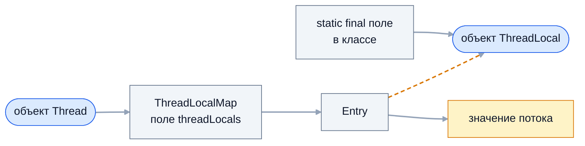
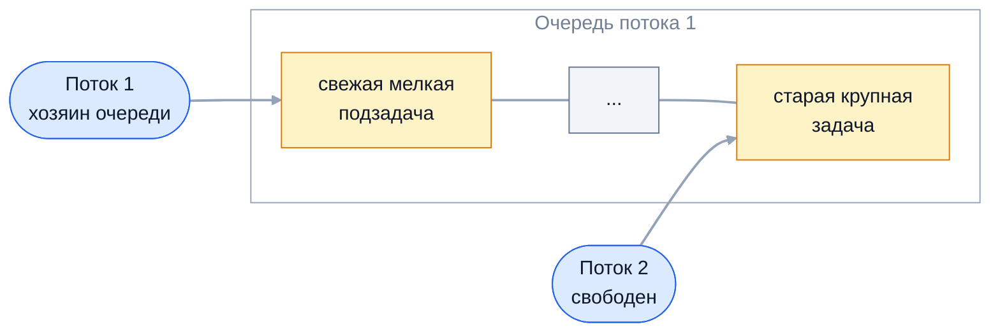

Два специализированных инструмента с разными задачами. `ThreadLocal` даёт
каждому потоку собственную копию переменной и лежит в основе контекстов
фреймворков — транзакций, безопасности, логирования; его спрашивают в связке
с утечками памяти в пулах. `ForkJoinPool` — пул для задач «разделяй и
властвуй» с алгоритмом work-stealing; на нём работают parallel streams и
`CompletableFuture` по умолчанию.

## Ключевые концепции

### ThreadLocal

#### Копия значения на поток
`ThreadLocal<T>` — переменная, у которой в каждом потоке своё значение.
`get()` и `set()` работают со значением текущего потока, и другие потоки его
не видят. Это способ сделать нестатическое по смыслу состояние доступным в
глубине стека вызовов без передачи через параметры и без синхронизации:
данные не разделяются, значит, гонок нет.

```java
static final ThreadLocal<Integer> COUNTER = ThreadLocal.withInitial(() -> 0);
Runnable inc = () -> {
    for (int i = 0; i < 3; i++) COUNTER.set(COUNTER.get() + 1);
    System.out.println(Thread.currentThread().getName() + ": " + COUNTER.get());
};
// запускаем inc в потоках thread-A и thread-B
System.out.println("main: " + COUNTER.get());
```
```
thread-A: 3
thread-B: 3
main: 0
```
Каждый поток насчитал свои три приращения, а у `main` осталось начальное
значение. Одна статическая переменная — три независимых значения.

#### Где хранятся значения
Интуиция «`ThreadLocal` хранит карту поток → значение» неверна. Значения
лежат в самих потоках: у каждого объекта `Thread` есть поле `threadLocals`
типа `ThreadLocalMap` — специализированной хэш-таблицы с открытой адресацией.
Ключ в ней — сам объект `ThreadLocal`, значение — данные потока. `get()` —
это `Thread.currentThread().threadLocals.get(this)`.

Ключ записи `Entry` хранится через слабую ссылку (`WeakReference`), а значение
— через обычную, сильную:

Оранжевый пунктир — слабая ссылка. Если `ThreadLocal` больше нигде не используется,
сборщик мусора уберёт ключ, но значение останется: на него сильно ссылается
`Entry`, а на `Entry` — поток. Такие «осиротевшие» записи вычищаются лишь
попутно при последующих операциях с картой.

Из этой схемы следуют оба практических вывода. Пока поток жив, живы и все его
значения. А раз значения живут в потоке, `ThreadLocal` разных потоков
действительно не пересекаются без всякой синхронизации.

#### SimpleDateFormat и контекст запроса
Классическое применение — дать каждому потоку свой экземпляр дорогого
потоконебезопасного объекта. `SimpleDateFormat` хранит промежуточное
состояние разбора в полях, и общий экземпляр из нескольких потоков выдаёт
мусор и исключения.

```java
static final SimpleDateFormat SHARED = new SimpleDateFormat("yyyy-MM-dd");
static final ThreadLocal<SimpleDateFormat> PER_THREAD =
        ThreadLocal.withInitial(() -> new SimpleDateFormat("yyyy-MM-dd"));
// 4 потока по 10 000 раз разбирают и форматируют свою дату
System.out.println("общий экземпляр:      ошибок " + errors(() -> SHARED));
System.out.println("ThreadLocal-экземпляр: ошибок " + errors(PER_THREAD::get));
```
```
общий экземпляр:      ошибок 33267
ThreadLocal-экземпляр: ошибок 0
```
Общий экземпляр ошибся в 83% операций, свой на поток — ни разу. В новом коде
проблема решается проще: `DateTimeFormatter` из `java.time` неизменяем и
потокобезопасен.

Второе типичное применение — контекст текущего запроса: пользователь,
идентификатор трассировки, локаль. Фильтр кладёт их в `ThreadLocal` в начале
обработки, и любой слой ниже читает без передачи через параметры. Так устроен
MDC (Mapped Diagnostic Context) в логгерах: поля из MDC автоматически попадают
в каждую строку лога этого потока.

#### Утечки и протекание в пулах
У потока пула нет конца жизни на каждую задачу: он выполняет тысячи задач
подряд. Значение, которое задача положила в `ThreadLocal` и не убрала,
остаётся в потоке и достаётся следующей задаче. Это две проблемы сразу:
утечка памяти — значение живёт, пока жив поток, — и протекание данных одного
запроса в другой.

```java
ExecutorService pool = Executors.newSingleThreadExecutor();
pool.submit(() -> { CURRENT_USER.set("alice"); System.out.println("запрос 1 от " + CURRENT_USER.get()); }).get();
pool.submit(() -> System.out.println("запрос 2 (анонимный) видит пользователя: " + CURRENT_USER.get())).get();
pool.submit(() -> {
    CURRENT_USER.set("bob");
    try { System.out.println("запрос 3 от " + CURRENT_USER.get()); }
    finally { CURRENT_USER.remove(); }
}).get();
pool.submit(() -> System.out.println("запрос 4 после remove(): " + CURRENT_USER.get())).get();
```
```
запрос 1 от alice
запрос 2 (анонимный) видит пользователя: alice
запрос 3 от bob
запрос 4 после remove(): null
```
Анонимный запрос 2 получил права пользователя `alice` — в реальном сервисе это
уязвимость. После `remove()` в `finally` следующий запрос начинает с чистого
листа.

В серверах приложений утечка тяжелее: значение, класс которого загружен
веб-приложением, удерживает весь его загрузчик классов. После нескольких
передеплоев без перезапуска сервера заканчивается Metaspace.

#### Правильный шаблон
`ThreadLocal` объявляют как `private static final` поле: одно на класс, а не
новое на каждый экземпляр объекта, иначе ключей в картах потоков становится
столько же, сколько объектов. Начальное значение задают через
`ThreadLocal.withInitial(supplier)` — оно создаётся лениво при первом `get()`
в каждом потоке. Каждая установка значения сопровождается очисткой: `set()`,
затем `try` с работой и `remove()` в `finally`.

Чистить нужно именно `remove()`, а не `set(null)`: запись `null` оставляет
`Entry` в карте. В фильтрах и перехватчиках установку и очистку ставят в одно
место, чтобы они не разошлись.

#### InheritableThreadLocal
`InheritableThreadLocal` копирует значения родительского потока в дочерний в
момент создания дочернего потока. Это удобно для простых схем «запрос
порождает рабочий поток». Но копия делается один раз, при конструировании
`Thread`, а не при каждой задаче, — и с пулами это работает неожиданно.

```java
ExecutorService early = Executors.newSingleThreadExecutor();
early.submit(() -> { }).get();          // поток пула создан до установки значения
REQUEST_ID.set("req-1");
// новый Thread, пул early и новый пул late печатают REQUEST_ID.get()
REQUEST_ID.set("req-2");
late.submit(() -> System.out.println("тот же поток пула во время req-2: " + REQUEST_ID.get())).get();
```
```
дочерний поток: req-1
поток пула, созданный раньше: null
поток пула, созданный при req-1: req-1
тот же поток пула во время req-2: req-1
```
Поток пула, созданный до запроса, ничего не унаследовал, а созданный во время
первого запроса навсегда запомнил `req-1` и выдаёт его во время второго.
Значение зависит от того, когда пул случайно создал поток.

Метод `childValue` позволяет переопределить копирование, например сделать
глубокую копию. Для передачи контекста в пулы используют не наследование, а
явную обёртку задач: декоратор, который захватывает значение при отправке и
устанавливает его в рабочем потоке, — `TaskDecorator` в Spring или
`ContextSnapshot` в Micrometer.

#### Контексты фреймворков
На `ThreadLocal` построены ключевые механизмы Spring. `SecurityContextHolder`
хранит аутентификацию текущего запроса, `TransactionSynchronizationManager` —
соединение с базой и ресурсы транзакции, `RequestContextHolder` — атрибуты
HTTP-запроса. Отсюда частые сюрпризы: метод с `@Async`, задача в своём пуле или
стадия `CompletableFuture` выполняется в другом потоке и не видит ни
пользователя, ни транзакции вызывающего кода.

Транзакция при этом не «продлевается» на новый поток — асинхронная часть
работает вне неё со своим соединением. Контекст безопасности переносят через
`DelegatingSecurityContextExecutor` или стратегию
`MODE_INHERITABLETHREADLOCAL`, а MDC — декоратором задач.

### Fork/Join

#### ForkJoinPool и work-stealing
`ForkJoinPool` (Java 7) — пул, рассчитанный на задачи, которые делятся на
подзадачи: сортировка, суммирование, обход дерева. Его отличие от
`ThreadPoolExecutor` — у каждого рабочего потока своя очередь задач, а не одна
общая. Поток, у которого закончилась работа, не простаивает, а крадёт задачи
из очередей других потоков — это и есть work-stealing.

Отдельные очереди устраняют конкуренцию за общую очередь: большую часть
времени поток работает со своей очередью без синхронизации. Кража происходит
только при дисбалансе, и благодаря ей задачи неравного размера автоматически
распределяются между потоками.

#### Двусторонние очереди
Очередь рабочего потока двусторонняя (deque). Свои задачи поток кладёт и
берёт с одного конца — по принципу LIFO, начиная с самых свежих и мелких
подзадач, которые ещё горячие в кэше. Воры забирают задачи с противоположного
конца — самые старые, а значит, самые крупные, ещё не разделённые.


Хозяин и вор работают с разных концов очереди и почти не сталкиваются. Вор,
украв крупную задачу, сам делит её и дальше работает со своей очередью, —
поэтому краж немного.

#### RecursiveTask и RecursiveAction
Задачу для `ForkJoinPool` описывают наследником `ForkJoinTask`. Обычно это
`RecursiveTask<V>`, если задача возвращает результат, или `RecursiveAction`,
если не возвращает. Логику пишут в методе `compute()`, а запускают задачу через
`pool.invoke(task)` — выполнить и дождаться, `submit()` — получить `Future`, или
`execute()` — запустить без ожидания.

```java
static class Normalize extends RecursiveAction {
    @Override protected void compute() {
        if (to - from <= 10_000) {
            for (int i = from; i < to; i++) data[i] = data[i] / 100;
            return;
        }
        int mid = (from + to) >>> 1;
        invokeAll(new Normalize(data, from, mid), new Normalize(data, mid, to));
    }
}
pool.invoke(new Normalize(values, 0, values.length));
```
```
RecursiveAction: values[0]=2.5, values[999999]=2.5
```
`RecursiveAction` изменил массив по месту без возвращаемого значения.
`invokeAll(a, b)` — удобный способ запустить две подзадачи и дождаться обеих.
Третий вариант, `CountedCompleter`, используется внутри parallel streams для
задач с продолжениями.

#### Шаблон fork, compute, join
Типичный `compute()`: если задача меньше порога — посчитать напрямую, иначе
разделить на две части. Левую отправить в свою очередь вызовом `fork()`, правую
посчитать в текущем потоке через `compute()`, затем дождаться левой через
`join()`. Пока текущий поток считает правую половину, левую может украсть
свободный поток.

```java
SumTask left = new SumTask(data, from, mid, threshold, wrongOrder);
SumTask right = new SumTask(data, mid, to, threshold, wrongOrder);
left.fork();                        // левую — в очередь, её может украсть другой поток
long r = right.compute();           // правую считаем сами
return r + left.join();             // ждём левую
// неправильный вариант: left.fork(); left.join(); right.compute();
```
```
последовательно:                      62 мс, сумма 257142853
ForkJoinPool(8), порог 10 000:         13 мс, сумма 257142853, потоков участвовало: 8, краж: > 0
fork() и сразу join():                99 мс
```
Правильный порядок дал почти пятикратное ускорение на восьми потоках. Вариант
с `join()` сразу после `fork()` оказался медленнее последовательного: поток
ждёт левую половину, прежде чем начать правую, и параллелизма нет, а накладные
расходы на задачи остаются.

`join()` в `ForkJoinPool` не просто ждёт: если задача ещё лежит в очереди, поток
выполнит её сам, а если её украли — может помочь вору, выполняя чужие задачи.
Поэтому рабочие потоки почти не простаивают в ожидании.

#### Порог разбиения
Каждая задача стоит памяти, постановки в очередь и возможной кражи. Если
дробить до одного элемента, накладные расходы перевешивают полезную работу.
Порог (threshold) — размер, ниже которого задача решается последовательно.
Эмпирическое правило из документации — задача должна выполнять от 100 до 10
000 базовых операций.

```java
pool.invoke(new SumTask(data, 0, data.length, 16, false));
```
```
порог 16 элементов:                   57 мс
```
С порогом в 16 элементов восемь потоков едва обогнали один: три миллиона
крошечных задач съели весь выигрыш. Порог подбирают замером — так, чтобы задач
было в несколько раз больше, чем потоков, но каждая выполняла ощутимую работу.

#### commonPool и блокирующие задачи
`ForkJoinPool.commonPool()` — общий пул на всю JVM. Его используют parallel
streams, `CompletableFuture` без явного executor и `Arrays.parallelSort`.
Число потоков по умолчанию — ядра минус один, потому что вызывающий поток
тоже участвует в работе; меняется свойством
`-Djava.util.concurrent.ForkJoinPool.common.parallelism=N`.
```
ядер: 20, commonPool parallelism: 19
```

`ForkJoinPool` рассчитан на вычисления. Блокирующий ввод-вывод в рабочем
потоке занимает его, и пул теряет параллелизм — а в общем пуле это тормозит
всё приложение. Если блокировка неизбежна, её оборачивают в
`ForkJoinPool.ManagedBlocker`: пул узнаёт о блокировке и временно добавляет
компенсирующий поток. Так поступает `CompletableFuture.join()`, но
универсальное решение — вынести ввод-вывод в отдельный пул.

## Частые вопросы на собеседовании

**Q: Почему ThreadLocal в пуле потоков приводит к утечкам и протеканию данных между запросами?**
A: Значения `ThreadLocal` хранятся в самом потоке, в его `ThreadLocalMap`, и
живут, пока жив поток. Поток пула живёт долго и выполняет множество задач,
поэтому значение, которое задача не удалила, остаётся в памяти и достаётся
следующей задаче — например, пользователь одного запроса оказывается в другом.
Слабая ссылка на ключ не спасает: значение удерживается сильной ссылкой.
Лечится `remove()` в `finally` после каждой установки.

**Q: Как работает work-stealing в ForkJoinPool?**
A: У каждого рабочего потока своя двусторонняя очередь. Свои подзадачи поток
кладёт и берёт с одного конца (LIFO), а свободный поток крадёт задачи с
другого конца чужой очереди (FIFO) — самые крупные, ещё не разделённые. Так
потоки почти не конкурируют за очереди, а неравномерная работа
перераспределяется автоматически.

**Q: Зачем ключ ThreadLocalMap — слабая ссылка?**
A: Чтобы `ThreadLocal`, на который больше нет ссылок в программе, не
удерживался в памяти картами всех потоков. После сборки ключа запись
становится «осиротевшей», и карта вычищает такие записи попутно при
следующих операциях. Но значение до этого остаётся, поэтому слабый ключ — лишь
страховка, а не замена `remove()`.

**Q: Чем ForkJoinPool отличается от ThreadPoolExecutor?**
A: `ThreadPoolExecutor` держит одну общую очередь и рассчитан на независимые
задачи. `ForkJoinPool` даёт каждому потоку свою очередь с work-stealing и
рассчитан на задачи, которые порождают подзадачи и ждут их: `join()` в нём не
блокирует поток впустую, а выполняет другие задачи. Для вычислений «разделяй
и властвуй» лучше `ForkJoinPool`, для обычных задач сервера — `ThreadPoolExecutor`.

**Q: Почему в compute() сначала fork() левой части, а потом compute() правой?**
A: `fork()` кладёт левую задачу в очередь, где её может украсть свободный
поток, а текущий поток тем временем считает правую сам. К моменту `join()`
левая уже посчитана вором или будет выполнена текущим потоком без
переключения. Если вызвать `join()` сразу после `fork()`, поток будет ждать
левую часть, прежде чем начать правую, и параллелизм пропадёт.

## Ловушки и частые ошибки

#### ThreadLocal как неявный параметр
`ThreadLocal` скрывает зависимости: метод читает данные, которых нет в его
сигнатуре, и его поведение зависит от того, что положил кто-то выше по стеку.
Такой код трудно тестировать и легко сломать переносом в другой поток. Для
бизнес-данных лучше явные параметры, а `ThreadLocal` оставляют для
инфраструктурного контекста.

#### ThreadLocal и асинхронность
Контекст в `ThreadLocal` не переходит в `@Async`-методы, задачи пулов, стадии
`CompletableFuture` и реактивные цепочки. Код, который читает
`SecurityContextHolder` в асинхронной части, получит пустой контекст. Перенос
делают явно — декоратором задач или переходом на `ScopedValue` в
структурированной конкурентности.

#### Тяжёлые объекты в ThreadLocal виртуальных потоков
С виртуальными потоками «копия на поток» означает миллион копий: буфер на
64 КБ в `ThreadLocal` у миллиона потоков — 64 ГБ. `ThreadLocal` с виртуальными
потоками работает корректно, но кэширование дорогих объектов через него
теряет смысл — их кэшируют в пуле объектов или передают явно.

#### Блокирующие вызовы в parallel streams
Parallel stream с HTTP-вызовами внутри `map` занимает потоки `commonPool` на
время сетевых ожиданий. Пока они ждут, все остальные parallel streams и
`CompletableFuture` приложения стоят в очереди. Для ввода-вывода используют
свой пул или виртуальные потоки.

## Связанные темы
- [Пулы потоков](../02-executors-and-async/05-thread-pools.md) — переиспользование потоков и очистка контекста задач.
- [Future и CompletableFuture](../02-executors-and-async/06-future-and-completablefuture.md) — `commonPool` по умолчанию и компенсация при `join()`.
- [Виртуальные потоки](../04-project-loom/10-virtual-threads.md) — `ThreadLocal` при миллионах потоков и планировщик на `ForkJoinPool`.
- [Structured Concurrency и Scoped Values](../04-project-loom/11-structured-concurrency-and-scoped-values.md) — `ScopedValue` как замена `ThreadLocal`.
- [Параллельные стримы](../../07-streams-functional/05-parallel-streams.md) — `Spliterator`, `commonPool` и стоимость разбиения.
- [Дата и время](../../02-java-core/08-date-time.md) — неизменяемый `DateTimeFormatter` вместо `SimpleDateFormat`.
- GC Roots, типы ссылок и утечки памяти (раздел 9) — слабые ссылки и утечки загрузчиков классов.

## Источники
- [javadoc ThreadLocal](https://docs.oracle.com/en/java/javase/21/docs/api/java.base/java/lang/ThreadLocal.html) и [InheritableThreadLocal](https://docs.oracle.com/en/java/javase/21/docs/api/java.base/java/lang/InheritableThreadLocal.html).
- [javadoc ForkJoinTask](https://docs.oracle.com/en/java/javase/21/docs/api/java.base/java/util/concurrent/ForkJoinTask.html) — рекомендации по размеру задач и порядку `fork`/`join`.
- Doug Lea. [A Java Fork/Join Framework](https://gee.cs.oswego.edu/dl/papers/fj.pdf) — исходная статья о work-stealing в Java.
