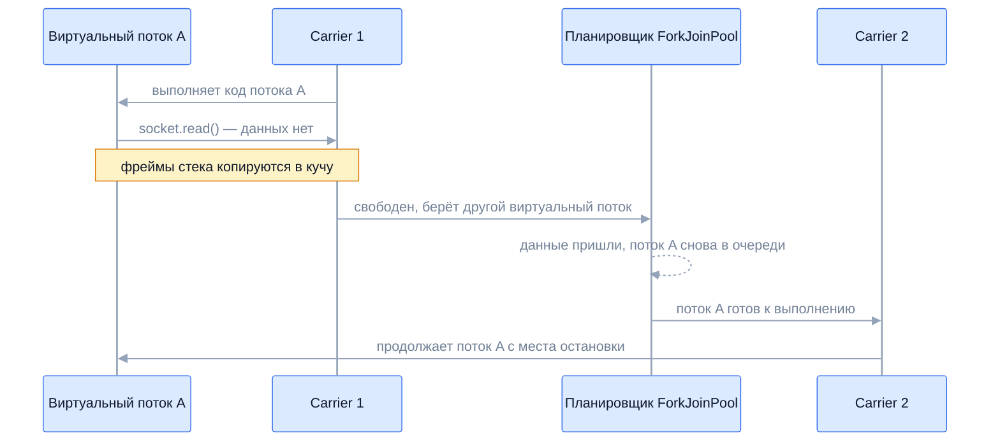

Виртуальные потоки (JEP 444, Java 21) — главное изменение модели потоков Java
за двадцать лет. Они позволяют писать простой блокирующий код в стиле «поток
на запрос» и при этом обслуживать сотни тысяч одновременных операций, как
асинхронные фреймворки. На собеседовании проверяют, понимает ли кандидат, как
они устроены, когда дают выигрыш, почему их не пуллят и что такое pinning —
включая то, что изменилось в Java 24.

## Ключевые концепции

### Отличия от платформенных потоков

#### Платформенный поток 1:1
Обычный, платформенный поток Java — обёртка над потоком ОС, один к одному.
Под его стек заранее резервируется до мегабайта, создание и переключение
требуют системных вызовов, а планирует его ядро ОС. Поэтому платформенных
потоков в приложении — сотни или тысячи, и они дефицитный ресурс.

В модели «поток на запрос» это ограничивает сервер: если запрос 100 мс ждёт
базу, пул из 200 потоков обслуживает не больше 2000 запросов в секунду, а
процессор при этом простаивает. Раньше выход был в асинхронном коде —
`CompletableFuture`, реактивные библиотеки, — сложном в написании и отладке.

#### Виртуальный поток
Виртуальный поток — лёгкая сущность, которой управляет JVM, а не ОС. Он
выполняется на обычном платформенном потоке — carrier-потоке, — но только пока
действительно работает. Когда виртуальный поток блокируется на вводе-выводе,
`sleep` или ожидании блокировки, JVM снимает его с carrier, и тот берёт другой
виртуальный поток.

```java
// 10 000 задач, каждая 100 мс ждёт (имитация вызова базы или HTTP)
run(Executors.newFixedThreadPool(200), 10_000, 100);
run(Executors.newVirtualThreadPerTaskExecutor(), 10_000, 100);
try (var ex = Executors.newVirtualThreadPerTaskExecutor()) {
    IntStream.range(0, 100_000).forEach(i -> ex.submit(() -> { Thread.sleep(Duration.ofSeconds(1)); return i; }));
}
```
```
пул из 200 платформенных потоков: 5217 мс
поток на задачу (виртуальные):    169 мс
100 000 виртуальных потоков по 1 с: 2192 мс
```
Пул из 200 потоков обрабатывал задачи партиями по 200, и 10 000 задач заняли
50 «волн» по 100 мс. Виртуальные потоки ждали все одновременно. Сто тысяч
одновременно спящих потоков — немыслимая для платформенных потоков цифра — уложились
в пару секунд.

#### Тот же java.lang.Thread
Виртуальный поток — экземпляр `java.lang.Thread` с тем же API: `interrupt`,
`join`, `ThreadLocal`, `getName`, стектрейсы, отладчик и thread dump работают
как обычно. Поэтому существующий блокирующий код, JDBC-драйверы и библиотеки
работают в виртуальных потоках без переписывания. Отличить виртуальный поток
можно методом `isVirtual()`.

#### Daemon и приоритет
У виртуальных потоков есть ограничения, которые проверяют на собеседовании.
Они всегда daemon и не удерживают JVM от завершения, а попытка сделать их
обычными бросает исключение. Приоритет фиксирован — `setPriority` молча
игнорируется. Все виртуальные потоки входят в одну группу `VirtualThreads`.

```java
Thread vt = Thread.ofVirtual().name("vt-1").unstarted(() -> { });
vt.setPriority(Thread.MAX_PRIORITY);
vt.setDaemon(true);
System.out.println("isVirtual=" + vt.isVirtual() + ", isDaemon=" + vt.isDaemon() + ", priority=" + vt.getPriority());
vt.setDaemon(false);   // перехвачено
```
```
isVirtual=true, isDaemon=true, priority=5
setDaemon(false): java.lang.IllegalArgumentException: 'false' not legal for virtual threads
```
Приоритет остался 5, несмотря на `MAX_PRIORITY`. Раз потоки daemon, приложение
должно само дожидаться их задач — например, через `close()` исполнителя или
`join()`.

### Устройство

#### Continuation и стек в куче
В основе виртуального потока — continuation: объект, который умеет
приостановить выполнение кода в точке блокировки и позже продолжить с того же
места. При приостановке (yield) фреймы стека виртуального потока копируются из
стека carrier-потока в кучу — в объекты stack chunk. При возобновлении нужные
фреймы копируются обратно, причём лениво: только верхние, остальные — по мере
возврата из методов.

Стек виртуального потока растёт и сжимается по потребности и стоит сотни байт
или килобайты, а не мегабайт. Это обычные объекты в куче, которые собирает GC,
поэтому миллион простаивающих виртуальных потоков — это память кучи, а не
памяти стеков ОС.


Блокирующий вызов освобождает carrier, а не держит его. Поток A
продолжает выполнение, возможно, уже на другом carrier-потоке — для кода это
незаметно, а видимость памяти гарантируется так же, как при обычной передаче
задачи между потоками.

#### Планировщик и carrier-потоки
Виртуальные потоки планирует отдельный `ForkJoinPool` в FIFO-режиме — не
`commonPool`, а собственный пул JVM. Его параллелизм по умолчанию равен числу
ядер, а при временной компенсации он может вырасти до 256 потоков. Настройки
— системные свойства `jdk.virtualThreadScheduler.parallelism`,
`maxPoolSize` и `minRunnable`; подменить сам планировщик публичным API нельзя.

```java
// 20 виртуальных потоков, каждый 5 раз засыпает на 10 мс
// и запоминает, на каком carrier-потоке выполнялся
System.out.println("потоков, сменивших carrier за 5 засыпаний: " + moved.get() + " из 20");
System.out.println("всего задействовано carrier-потоков: " + carriers.size()
        + " (ядер " + Runtime.getRuntime().availableProcessors() + ")");
```
```
потоков, сменивших carrier за 5 засыпаний: 20 из 20
всего задействовано carrier-потоков: 8 (ядер 20)
```
Каждый виртуальный поток после пробуждения продолжал на другом carrier, а всю
работу двадцати потоков сделали восемь платформенных. Поэтому код не должен
полагаться на то, что `Thread.currentThread()` соответствует постоянному
потоку ОС.

#### Блокирующие операции JDK
Чтобы блокировка снимала виртуальный поток с carrier, в JDK переписали
блокирующие операции: `Thread.sleep`, сокеты и каналы, `BlockingQueue`,
`ReentrantLock` и другие синхронизаторы на `LockSupport`, `Future.get`. Сетевой
ввод-вывод внутри работает в неблокирующем режиме: поток паркуется, а
служебный поток-поллер будит его, когда данные готовы.

Не всё удалось сделать неблокирующим. Файловый ввод-вывод в большинстве ОС
блокирует поток ОС, поэтому JVM временно добавляет в планировщик
компенсирующий carrier, чтобы остальные виртуальные потоки не простаивали. То
же происходит с `Object.wait()` в Java 21–23.

### Применение

#### IO-bound против CPU-bound
Виртуальные потоки ускоряют не вычисления, а ожидание. Их выигрыш — в
пропускной способности сервера, где задачи большую часть времени ждут сеть,
базу или другой сервис. Каждый виртуальный поток выполняется на carrier-потоке,
а carrier-потоков столько же, сколько ядер, поэтому для вычислительной работы
виртуальный поток — тот же платформенный поток с дополнительными накладными
расходами.

```java
// по 4 вычислительные задачи на ядро, после прогрева
Callable<Long> cpu = () -> { long x = 0; for (long i = 0; i < 200_000_000L; i++) x += i % 7; return x; };
timeCpu(Executors.newFixedThreadPool(Runtime.getRuntime().availableProcessors()), n, cpu);
timeCpu(Executors.newVirtualThreadPerTaskExecutor(), n, cpu);
```
```
80 вычислительных задач, пул по числу ядер: 1078 мс
80 вычислительных задач, виртуальные:      1076 мс
```
Время одинаковое: ядер столько же, и вычисления упираются в них. Для
вычислительных задач остаются пулы по числу ядер и `ForkJoinPool`.

#### Создание виртуальных потоков
Виртуальный поток создают через билдер `Thread.ofVirtual().start(task)` или
короче — `Thread.startVirtualThread(task)`. Для задач с результатом и
управления жизненным циклом есть `Executors.newVirtualThreadPerTaskExecutor()`:
он создаёт новый виртуальный поток на каждую задачу. Фабрика
`Thread.ofVirtual().factory()` подходит для фреймворков, принимающих
`ThreadFactory`.

В Spring Boot 3.2+ свойство `spring.threads.virtual.enabled=true` переводит на
виртуальные потоки обработку HTTP-запросов во встроенном Tomcat или Jetty,
`@Async`, `@Scheduled` и слушателей сообщений. В большинстве сервисов этого
достаточно для перехода — код контроллеров не меняется.

#### Не пуллить, а ограничивать
Пул существует, чтобы переиспользовать дорогие потоки и ограничить их число.
Виртуальные потоки дешёвые, поэтому пул для них бессмыслен: на каждую задачу
создают новый поток. Но ограничение числа одновременных операций с ресурсом
по-прежнему нужно — пул соединений к базе на 20 соединений не выдержит 10 000
одновременных запросов. Ограничивают не потоки, а доступ к ресурсу — через
`Semaphore`.

```java
Semaphore dbConnections = new Semaphore(10);
try (var ex = Executors.newVirtualThreadPerTaskExecutor()) {
    for (int i = 0; i < 1_000; i++) {
        ex.submit(() -> {
            dbConnections.acquire();
            try {
                maxInside.accumulateAndGet(inside.incrementAndGet(), Math::max);
                Thread.sleep(5);
                inside.decrementAndGet();
            } finally { dbConnections.release(); }
            return null;
        });
    }
}
```
```
1000 виртуальных потоков, одновременно у базы: 10
```
Тысяча потоков стартовала сразу, но к ресурсу одновременно обращались не
больше десяти. Остальные ждали разрешения, не занимая carrier-потоков.

#### ThreadLocal при миллионе потоков
`ThreadLocal` в виртуальных потоках работает корректно: значение привязано к
виртуальному потоку, а не к carrier, и сохраняется при переезде с одного
carrier на другой. Проблема в масштабе. Приём «закэшировать дорогой объект в
`ThreadLocal` на поток» был рассчитан на сотню потоков пула, а при миллионе
виртуальных потоков даёт миллион копий.

```java
ThreadLocal<String> user = new ThreadLocal<>();
// два виртуальных потока: user.set(name), sleep(20), чтение
```
```
bob после sleep видит: bob
alice после sleep видит: alice
```
После засыпания, а значит, и возможного переезда на другой carrier, каждый
поток видит своё значение. Для передачи контекста вниз по вызовам в новом коде
рекомендуют `ScopedValue`, а кэши дорогих объектов выносят из `ThreadLocal`.

### Pinning

#### Что такое pinning
Pinning (закрепление) — ситуация, когда виртуальный поток не может сняться с
carrier при блокировке и занимает его на всё время ожидания. Carrier-потоков
мало, поэтому несколько закреплённых потоков снижают пропускную способность,
а если закреплены все, остальные виртуальные потоки перестают продвигаться.

Причин две. Первая — native-фреймы в стеке: вызов через JNI или Foreign
Function API, в середине которого случилась блокировка, — нативный стек
нельзя скопировать в кучу. Вторая, в Java 21–23, — `synchronized`: блокировка
внутри синхронизированного блока или метода, а также `Object.wait()`
закрепляли поток, потому что монитор был привязан к потоку ОС.

#### JEP 491: synchronized без pinning
В Java 24 (JEP 491) реализацию мониторов переделали: монитор теперь
принадлежит виртуальному потоку, а не carrier, и виртуальный поток может
сняться с carrier внутри `synchronized` и в `Object.wait()`. Разница хорошо
видна, если оставить планировщику один carrier-поток:
```java
// -Djdk.virtualThreadScheduler.parallelism=1 -Djdk.virtualThreadScheduler.maxPoolSize=1
// 4 виртуальных потока, у каждого свой монитор или своя блокировка
synchronized (lock) { sleep(200); }
lock.lock();
try { sleep(200); } finally { lock.unlock(); }
```
```
Java 21, один carrier-поток
4 потока, sleep(200) внутри synchronized: 800 мс
4 потока, sleep(200) под ReentrantLock:   200 мс
событий jdk.VirtualThreadPinned: 4 [200 мс, 200 мс, 200 мс, 200 мс]

Java 25, один carrier-поток
4 потока, sleep(200) внутри synchronized: 200 мс
4 потока, sleep(200) под ReentrantLock:   200 мс
событий jdk.VirtualThreadPinned: 0 []
```
На Java 21 потоки с `synchronized` спали по очереди: каждый держал
единственный carrier все 200 мс. На Java 25 тот же код выполнился за 200 мс,
как с `ReentrantLock`, и JFR не зафиксировал ни одного закрепления.

Отсюда практический вывод. Совет «заменить `synchronized` на `ReentrantLock` в
коде для виртуальных потоков» был обязательным для Java 21–23, а с Java 24
потерял смысл. Закрепление осталось только для native-фреймов и нескольких
редких случаев вроде блокировки внутри инициализатора класса.

#### Диагностика pinning
Основной инструмент — JFR-событие `jdk.VirtualThreadPinned`: оно записывается,
когда виртуальный поток был закреплён дольше порога (по умолчанию 20 мс), и
содержит стек и длительность. Событие включено в стандартные профили JFR и
читается программно через `RecordingStream`, как в примере выше. На Java 21–23
есть ещё системное свойство `-Djdk.tracePinnedThreads=full` или `short`,
которое печатает стек при закреплении:
```
VirtualThread[#44]/runnable@ForkJoinPool-1-worker-1 reason:MONITOR
    Pinning.lambda$main$1(Pinning.java:27) <== monitors:1
```
В Java 24 вместе с JEP 491 это свойство удалили — остался JFR. Thread dump
в формате JSON (`jcmd <pid> Thread.dump_to_file -format=json файл`) показывает
все виртуальные потоки, включая те, что не смонтированы.

#### Последствия массового закрепления
Когда закреплены все carrier-потоки, ни один другой виртуальный поток не может
выполниться — даже тот, который освободил бы ресурс, нужный закреплённым.
Например, на Java 21 сотни виртуальных потоков ждут соединения из пула
внутри `synchronized`-метода драйвера, а поток, который должен вернуть
соединение, не получает carrier. Приложение зависает, хотя формального
deadlock нет.

JVM частично компенсирует блокировки `Object.wait()` дополнительными
carrier-потоками, но их число ограничено `maxPoolSize`. Поэтому при переходе
на виртуальные потоки на Java 21 проверяли библиотеки на `synchronized` вокруг
ввода-вывода, а надёжное решение — обновиться до Java 24+.

## Частые вопросы на собеседовании

**Q: Чем виртуальный поток отличается от платформенного?**
A: Платформенный поток — один к одному поток ОС: дорогой в создании, с
зарезервированным стеком до мегабайта, их тысячи. Виртуальный поток управляется
JVM, выполняется на carrier-потоке только пока работает, а при блокировке его
стек копируется в кучу и carrier освобождается; их могут быть миллионы. API у
них общий — `java.lang.Thread`, но виртуальные всегда daemon и с фиксированным
приоритетом.

**Q: Почему виртуальные потоки не пуллят?**
A: Пул нужен, чтобы переиспользовать дорогие потоки и ограничить их число.
Виртуальный поток создаётся дешевле, чем задача ставится в очередь пула,
поэтому на каждую задачу создают новый, через
`newVirtualThreadPerTaskExecutor()`. Ограничение же переносят на ресурс:
одновременный доступ к базе или внешнему API ограничивают `Semaphore`, а не
размером пула.

**Q: Что такое pinning и что изменилось в Java 24?**
A: Pinning — когда виртуальный поток при блокировке не может сняться с carrier
и занимает его. В Java 21–23 это происходило при блокировке внутри
`synchronized` и в `Object.wait()`, а также при native-фреймах в стеке. JEP 491
в Java 24 привязал мониторы к виртуальным потокам, и `synchronized` больше не
закрепляет поток; остались native-вызовы. Диагностика — JFR-событие
`jdk.VirtualThreadPinned`.

**Q: Когда виртуальные потоки не дают выигрыша?**
A: Для вычислительных задач: carrier-потоков столько же, сколько ядер, и
вычисления упираются в процессор. Также выигрыша нет, если узкое место —
ресурс за потоками (пул соединений, лимит внешнего API), или если код постоянно
закрепляет потоки на Java 21–23. Выигрыш получают серверы, где задачи в
основном ждут ввода-вывода.

**Q: Нужно ли переписывать код для виртуальных потоков?**
A: Как правило, нет: это тот же `Thread`, блокирующие API JDK уже адаптированы,
и обычный синхронный код работает. Пересматривают три вещи: пулы потоков
заменяют на поток на задачу с `Semaphore` для ограничений, кэши дорогих
объектов в `ThreadLocal` выносят, а на Java 21–23 ещё и проверяют
`synchronized` вокруг ввода-вывода.

## Ловушки и частые ошибки

#### Виртуальные потоки в пуле
`Executors.newFixedThreadPool(100, Thread.ofVirtual().factory())` формально
работает, но сохраняет все ограничения пула — очередь и 100 одновременных
задач — и теряет главное преимущество. Виртуальные потоки создают по одному на
задачу, а ограничения выражают через `Semaphore`.

#### Ожидание ускорения вычислений
Перевод вычислительного кода на виртуальные потоки не ускоряет его, а иногда
слегка замедляет из-за накладных расходов. Виртуальные потоки увеличивают
пропускную способность, а не скорость отдельной операции: время ответа одного
запроса не меняется, меняется число запросов, обрабатываемых одновременно.

#### Неограниченная нагрузка на зависимости
Раньше пул из 200 потоков неявно ограничивал нагрузку на базу и внешние
сервисы. С виртуальными потоками это ограничение исчезает: 10 000 запросов
одновременно приходят в базу или в API партнёра и роняют их. При переходе
лимиты на обращения к зависимостям нужно задать явно.

#### Устаревшие советы про synchronized
Рекомендация «никакого `synchronized` с виртуальными потоками» встречается во
многих статьях 2023 года. Для Java 24+ она неверна, а замена работающего
`synchronized` на `ReentrantLock` добавляет риск забытого `unlock()` без всякой
пользы. На собеседовании стоит назвать версию, в которой это изменилось.

## Связанные темы
- [Основы потоков](../01-threads-and-memory-model/01-thread-basics.md) — платформенные потоки, билдеры `Thread.ofVirtual()`, прерывание.
- [Пулы потоков](../02-executors-and-async/05-thread-pools.md) — что заменяет поток на задачу и что остаётся пулам.
- [Явные блокировки и примитивы синхронизации](../03-concurrency-utilities/08-locks-and-synchronizers.md) — `Semaphore` и `ReentrantLock`.
- [ThreadLocal и Fork/Join](../03-concurrency-utilities/09-threadlocal-and-forkjoin.md) — `ThreadLocal` и `ForkJoinPool` под планировщиком.
- [Structured Concurrency и Scoped Values](11-structured-concurrency-and-scoped-values.md) — структурированные группы виртуальных потоков и контекст.
- Java 21 (LTS) и далее (раздел 10) — виртуальные потоки среди нововведений LTS-версии.

## Источники
- [JEP 444: Virtual Threads](https://openjdk.org/jeps/444) — устройство, планировщик, ограничения.
- [JEP 491: Synchronize Virtual Threads without Pinning](https://openjdk.org/jeps/491) — мониторы без закрепления в Java 24.
- [Oracle: Virtual Threads](https://docs.oracle.com/en/java/javase/21/core/virtual-threads.html) — руководство по применению и диагностике.
