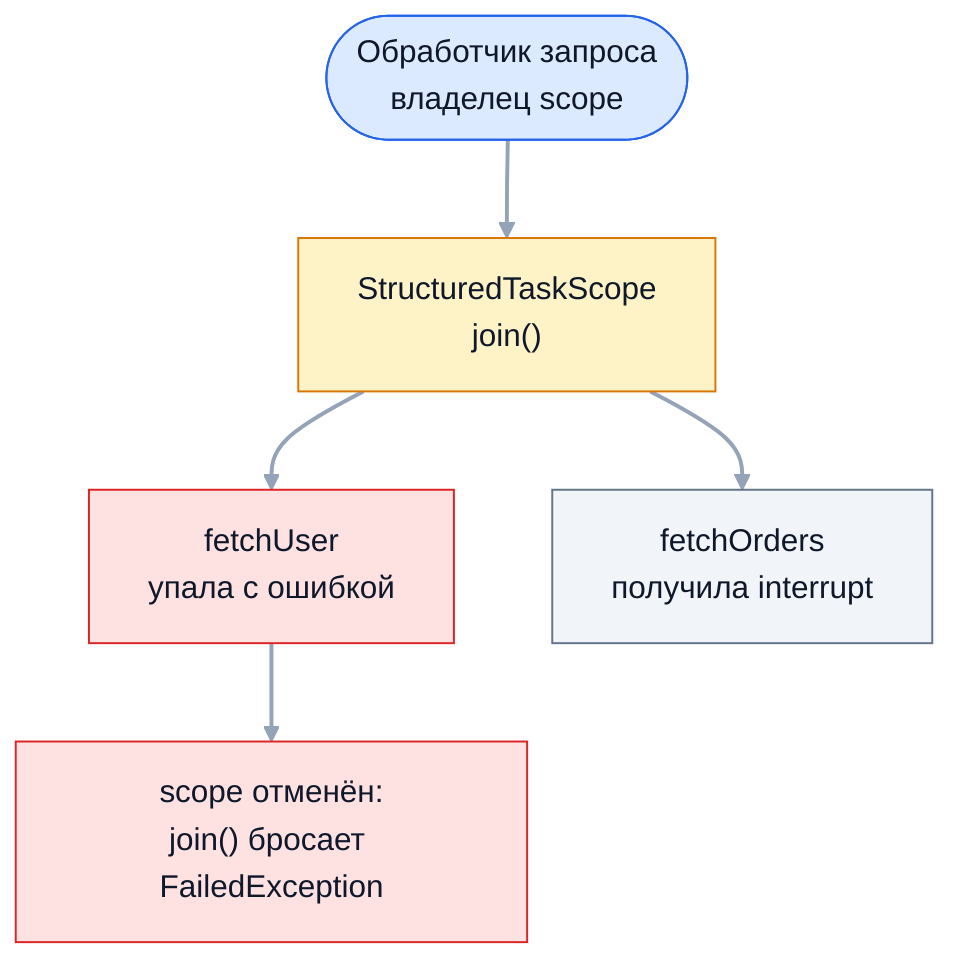

Два API из Project Loom дополняют виртуальные потоки. Structured concurrency
(`StructuredTaskScope`) делает группу параллельных подзадач единым целым: они
живут внутри блока кода, а ошибка одной отменяет остальные. Scoped values
(`ScopedValue`) передают неизменяемый контекст вниз по вызовам и в подзадачи —
безопаснее и дешевле `ThreadLocal`. На собеседовании ждут понимания, какие
проблемы `CompletableFuture` и `ThreadLocal` они решают, и честного знания
статуса: какие части финальные, а какие ещё в preview.

## Ключевые концепции

### Structured Concurrency

#### Идея структурированности
Структурное программирование когда-то заменило `goto` блоками и вызовами
методов: управление входит в блок и выходит из него, а метод возвращается
туда, откуда вызван. С потоками этого не было — задача, отправленная в пул,
живёт сама по себе, может пережить метод, который её запустил, а её ошибка
никак не связана со стеком вызывающего.

Structured concurrency переносит идею блоков на конкурентный код: подзадачи
запускаются внутри блока и гарантированно завершаются до выхода из него. Задачи
образуют дерево, как вызовы методов: ошибка подзадачи доходит до родителя,
отмена родителя отменяет подзадачи, а thread dump показывает эту иерархию.

#### Проблема CompletableFuture
Типичный обработчик запроса параллельно загружает пользователя и его заказы.
С `CompletableFuture` между двумя задачами нет никакой связи: если загрузка
пользователя упала, загрузка заказов продолжает работать и тратить ресурсы, а
её результат никому не нужен. Отменять соседние задачи приходится вручную.

```java
CompletableFuture<String> user = CompletableFuture.supplyAsync(() -> failingUser());   // падает через 100 мс
CompletableFuture<String> orders = CompletableFuture.supplyAsync(() -> {
    Thread.sleep(500);
    System.out.println("  orders всё ещё работал и завершился на ~" + ms() + " мс");
    return "orders";
});
user.thenCombine(orders, (u, o) -> u + o).join();   // перехвачено
```
```
  orders всё ещё работал и завершился на ~500 мс
ошибка получена на ~500 мс: сервис пользователей недоступен
```
Пользователь упал на 100 мс, но задача заказов доработала до конца. Более
того, ошибка дошла до вызывающего только через 500 мс: `thenCombine` ждёт обе
стадии, даже если одна уже завершилась ошибкой.

#### StructuredTaskScope
`StructuredTaskScope` — область, внутри которой запускаются подзадачи. Порядок
работы всегда один: открыть scope в try-with-resources, запустить подзадачи
через `fork()`, дождаться их через `join()` и забрать результаты из объектов
`Subtask`. Каждая подзадача по умолчанию выполняется в новом виртуальном
потоке, а `close()` гарантирует, что к выходу из блока все подзадачи
завершены.

```java
try (var scope = StructuredTaskScope.open()) {
    Subtask<String> u = scope.fork(Structured::fetchUser);     // 200 мс
    Subtask<String> o = scope.fork(Structured::fetchOrders);   // 500 мс
    scope.join();
    System.out.println(u.get() + " + " + o.get() + " за ~" + ms() + " мс");
}
```
```
user(anna) + orders(3) за ~500 мс
```
Подзадачи выполнялись параллельно, и общее время равно самой долгой из них.
Код читается как последовательный: никаких колбэков и цепочек, а исключения
`join()` бросает прямо в этот блок.

`fork()` возвращает не `Future`, а `Subtask` — у него есть `get()`, `state()` и
`exception()`, но нет блокирующего ожидания: результаты читают только после
`join()`. Вызывать `fork()` и `join()` может только поток-владелец scope, и
scope нельзя передать в другой поток — это часть «структурности».

#### Политика завершения: Joiner
Когда считать работу завершённой и что вернуть, определяет `Joiner`,
передаваемый в `StructuredTaskScope.open(joiner)`. Без аргумента используется
политика «все успешно или ошибка»: при первом сбое остальные подзадачи
отменяются, а `join()` бросает исключение. `anySuccessfulResultOrThrow()`
возвращает результат первой успешной подзадачи и отменяет остальные.
`allSuccessfulOrThrow()` отдаёт поток всех подзадач, `awaitAll()` просто ждёт
всех, не реагируя на ошибки.

```java
try (var scope = StructuredTaskScope.open(Joiner.<String>anySuccessfulResultOrThrow())) {
    scope.fork(() -> replica("реплика A", 300));
    scope.fork(() -> replica("реплика B", 100));
    scope.fork(() -> replica("реплика C", 200));
    String winner = scope.join();
    System.out.println("победила " + winner + " на ~" + ms() + " мс");
}
try (var scope = StructuredTaskScope.open(Joiner.<Integer>allSuccessfulOrThrow())) {
    for (int i = 1; i <= 3; i++) {
        int n = i;
        scope.fork(() -> n * 10);
    }
    System.out.println("результаты: " + scope.join().map(Subtask::get).toList());
}
```
```
  реплика C отменена
  реплика A отменена
победила реплика B на ~100 мс
результаты: [10, 20, 30]
```
Быстрая реплика победила, а медленные получили прерывание и завершились — в
отличие от `CompletableFuture.anyOf`, который остальные задачи не трогает.
Тип результата `join()` зависит от политики: строка победителя или поток
подзадач.

В Java 21–24 API было другим: вместо `open()` и `Joiner` создавали подклассы
`new StructuredTaskScope.ShutdownOnFailure()` и `ShutdownOnSuccess<T>()`, а
ошибку проверяли отдельным вызовом `throwIfFailed()`. В Java 25 эти классы
удалены. Тот же сценарий на Java 21 с `--enable-preview`:
```java
try (var scope = new StructuredTaskScope.ShutdownOnFailure()) {
    Subtask<String> user = scope.fork(() -> { Thread.sleep(200); return "user(anna)"; });
    Subtask<String> orders = scope.fork(() -> { Thread.sleep(300); return "orders(3)"; });
    scope.join().throwIfFailed();
    System.out.println("Java " + Runtime.version().feature() + ", ShutdownOnFailure: " + user.get() + " + " + orders.get());
}
```
```
Java 21, ShutdownOnFailure: user(anna) + orders(3)
ShutdownOnSuccess: реплика B
```
На собеседовании полезно знать обе формы: в статьях и докладах 2023–2024 годов
встречается старая.

#### Отмена при ошибке
Главное отличие от ручной работы с `Future` — автоматическая отмена. Когда
подзадача падает, политика по умолчанию отменяет scope: остальные подзадачи
получают `interrupt()`, `join()` бросает исключение с исходной причиной, а
`close()` дожидается, пока прерванные подзадачи действительно завершатся.
Таймаут на весь scope задаётся конфигурацией при открытии.

```java
try (var scope = StructuredTaskScope.open()) {
    Subtask<String> u = scope.fork(Structured::failingUser);   // падает через 100 мс
    Subtask<String> o = scope.fork(Structured::fetchOrders);   // 500 мс
    scope.join();
} catch (StructuredTaskScope.FailedException e) {
    System.out.println(e.getClass().getSimpleName() + " на ~" + ms() + " мс, причина: " + e.getCause().getMessage());
}
try (var scope = StructuredTaskScope.open(Joiner.<String>awaitAllSuccessfulOrThrow(),
        cf -> cf.withTimeout(Duration.ofMillis(300)))) {
    scope.fork(Structured::fetchUser);
    scope.fork(Structured::fetchOrders);
    scope.join();
} catch (StructuredTaskScope.TimeoutException e) {
    System.out.println(e.getClass().getSimpleName() + " на ~" + ms() + " мс");
}
```
```
  fetchOrders отменён на ~100 мс
FailedException на ~100 мс, причина: сервис пользователей недоступен
  fetchOrders отменён на ~300 мс
TimeoutException на ~300 мс
```
Ошибка пришла через 100 мс вместо 500, и загрузка заказов была отменена в тот
же момент. Таймаут тоже отменил незавершённую подзадачу. Отмена работает
через прерывание, поэтому подзадачи должны корректно на него реагировать.


Подзадачи — дочерние узлы своего scope. Сбой одной поднимается к владельцу и
отменяет её соседей, так что ни одна подзадача не переживает обработчик
запроса.

Политика `awaitAll()` никого не отменяет, и состояние каждой подзадачи
проверяют вручную через `state()`:
```java
try (var scope = StructuredTaskScope.open(Joiner.awaitAll())) {
    Subtask<String> ok = scope.fork(() -> "готово");
    Subtask<String> bad = scope.fork(() -> { throw new IllegalArgumentException("плохой id"); });
    scope.join();
    System.out.println("ok: " + ok.state() + " → " + ok.get());
    System.out.println("bad: " + bad.state() + " → " + bad.exception());
    bad.get();   // перехвачено
}
```
```
ok: SUCCESS → готово
bad: FAILED → java.lang.IllegalArgumentException: плохой id
bad.get(): IllegalStateException
```
`get()` у неуспешной подзадачи бросает `IllegalStateException`: результат
читают только у подзадач в состоянии `SUCCESS`, а у остальных — `exception()`.

#### Статус: preview
Structured concurrency до сих пор не финальная. Она появилась инкубатором в
Java 19–20, была preview в Java 21–24 со старым API, в Java 25 (JEP 505) API
переработали на `open()` и `Joiner`, и в Java 26–27 preview продолжилось с
доработками обработки исключений. Финализация предложена для Java 28 (JEP 543).
Для запуска нужен флаг `--enable-preview`, а детали API от версии к версии
меняются.

Поэтому в продакшен-коде на LTS-версиях structured concurrency пока
используют осторожно. Но идею — подзадачи с общим временем жизни и
автоматической отменой — на собеседовании объяснить нужно, как и показать
разницу со старым API.

### Scoped Values

#### where().run() и call()
`ScopedValue<T>` — значение, привязанное к ограниченному участку выполнения.
`ScopedValue.where(KEY, value).run(task)` выполняет `task`, и всё время его
выполнения — включая все вызванные методы на любой глубине — `KEY.get()`
возвращает `value`. Вариант `call(task)` делает то же для задачи с результатом.
После выхода из блока привязка исчезает сама.

```java
static final ScopedValue<String> REQUEST_ID = ScopedValue.newInstance();
ScopedValue.where(REQUEST_ID, "req-42").run(() -> {
    System.out.println("внутри: " + REQUEST_ID.get() + ", isBound=" + REQUEST_ID.isBound());
});
String result = ScopedValue.where(REQUEST_ID, "req-7").call(() -> "обработан " + REQUEST_ID.get());
System.out.println("call(): " + result);
```
```
внутри: req-42, isBound=true
call(): обработан req-7
```
Никакого `remove()` в `finally` не нужно: время жизни значения задано блоком, и
забыть очистить его невозможно. Как и `ThreadLocal`, `ScopedValue` объявляют
`static final` полем.

#### Неизменяемость и перепривязка
У `ScopedValue` нет метода `set()`. Код, получивший значение, может только
прочитать его, а изменить привязку внутри блока нельзя. Если вложенному коду
нужно другое значение, его перепривязывают (rebinding) новым вложенным
`where().run()` — новое значение действует только внутри вложенного блока, а
после выхода снова видно прежнее.

```java
ScopedValue.where(ROLE, "USER").run(() -> {
    System.out.println("роль: " + ROLE.get());
    ScopedValue.where(ROLE, "ADMIN").run(() -> System.out.println("  во вложенном блоке: " + ROLE.get()));
    System.out.println("после вложенного блока: " + ROLE.get());
});
```
```
роль: USER
  во вложенном блоке: ADMIN
после вложенного блока: USER
```
Привязки ведут себя как стек: значение передаётся строго вниз по вызовам и не
может «утечь» вверх. С `ThreadLocal` вызванный метод мог незаметно изменить
значение для всего оставшегося кода потока.

#### Наследование подзадачами
Привязки `ScopedValue` автоматически видны в подзадачах `StructuredTaskScope`:
`fork()` передаёт дочернему виртуальному потоку ссылку на текущий набор
привязок, без копирования. Это безопасно именно благодаря структурности —
подзадачи гарантированно завершаются раньше, чем родитель выйдет из блока, а
значит, раньше, чем исчезнет привязка.

```java
ScopedValue.where(REQUEST_ID, "req-99").call(() -> {
    try (var scope = StructuredTaskScope.open()) {
        Subtask<String> s = scope.fork(() -> "подзадача видит " + REQUEST_ID.get());
        scope.join();
        System.out.println(s.get());
    }
    try (ExecutorService ex = Executors.newVirtualThreadPerTaskExecutor()) {
        Future<Boolean> f = ex.submit(REQUEST_ID::isBound);
        System.out.println("задача ExecutorService: isBound=" + f.get());
    }
    return null;
});
```
```
подзадача видит req-99
задача ExecutorService: isBound=false
```
Подзадача scope увидела идентификатор запроса, а задача обычного
`ExecutorService` — нет: пул ничего не знает о привязках, и задача может
пережить блок. В такие задачи значение передают явно.

#### get() вне привязки
Если значение не привязано, `get()` бросает `NoSuchElementException` — в
отличие от `ThreadLocal.get()`, который вернул бы `null` или начальное
значение. Безопасные способы чтения — проверка `isBound()`, `orElse(default)`
и `orElseThrow(supplier)`.

```java
System.out.println("снаружи: isBound=" + REQUEST_ID.isBound() + ", orElse=" + REQUEST_ID.orElse("нет запроса"));
REQUEST_ID.get();   // перехвачено
```
```
снаружи: isBound=false, orElse=нет запроса
get() вне привязки: NoSuchElementException
```
Явная ошибка лучше молчаливого `null`: код, который рассчитывает на контекст
запроса и вызван вне запроса, падает сразу и понятно.

#### Статус: финальная версия в Java 25
В отличие от structured concurrency, scoped values уже финальные. Инкубатор
был в Java 20, preview — в Java 21–24, а в Java 25 (JEP 506) API
финализировано. Единственное изменение при финализации — `orElse()` больше не
принимает `null`. Значит, на Java 25 `ScopedValue` можно использовать без
флагов, а наследование в подзадачи доступно вместе с preview-API
`StructuredTaskScope`.

### Сравнение с прежними API

#### StructuredTaskScope против CompletableFuture
`StructuredTaskScope` даёт то, чего `CompletableFuture` не умеет из коробки:
автоматическую отмену соседних задач при ошибке, гарантию, что ни одна задача
не переживёт метод, ошибки прямо в блоке вызывающего кода и иерархию задач в
thread dump. Код при этом выглядит как обычный последовательный.

`CompletableFuture` остаётся уместным для длинных асинхронных конвейеров
преобразований, для интеграции с API, которые уже возвращают
`CompletableFuture`, и на версиях Java без виртуальных потоков. Structured
concurrency рассчитана на блокирующий код в виртуальных потоках, а не на
неблокирующие цепочки.

#### ScopedValue против ThreadLocal
`ThreadLocal` — изменяемая переменная потока: любой код может вызвать `set()`,
значение живёт до `remove()` или смерти потока, а `InheritableThreadLocal`
копирует значения в каждый дочерний поток. `ScopedValue` — неизменяемое
значение с временем жизни, ограниченным блоком, которое передаётся только вниз
и наследуется подзадачами без копирования.

`ThreadLocal` по-прежнему нужен там, где значение действительно должно
меняться по ходу работы потока или кэшировать объект на поток, а также в
коде, работающем с пулами и библиотеками, которые не знают о scoped values.
Для передачи контекста запроса — пользователя, трассировки, транзакции — в
новом коде предпочтителен `ScopedValue`.

## Частые вопросы на собеседовании

**Q: Какие проблемы CompletableFuture решает StructuredTaskScope?**
A: С `CompletableFuture` параллельные задачи не связаны между собой: упавшая
задача не отменяет соседние, задачи могут пережить метод, который их запустил,
а ошибки приходят через цепочки обработчиков. `StructuredTaskScope` привязывает
подзадачи к блоку кода: при сбое политика отменяет остальные подзадачи через
прерывание, `close()` гарантирует их завершение, а исключение бросается прямо в
вызывающий блок. Дополнительно иерархия задач видна в thread dump.

**Q: Чем ScopedValue лучше ThreadLocal и когда ThreadLocal всё ещё нужен?**
A: `ScopedValue` неизменяем, живёт ровно в пределах блока и очищается сам,
передаётся только вниз по вызовам и наследуется подзадачами
`StructuredTaskScope` без копирования. Утечек в пулах и протекания между
запросами с ним не бывает. `ThreadLocal` нужен, когда значение должно меняться
по ходу работы потока, для кэширования объектов на поток и в коде, который
работает с пулами и библиотеками без поддержки scoped values.

**Q: Каков статус этих API?**
A: `ScopedValue` финализирован в Java 25 (JEP 506). `StructuredTaskScope` всё
ещё preview: в Java 21–24 API строилось на подклассах `ShutdownOnFailure` и
`ShutdownOnSuccess`, в Java 25 его переработали на `open()` и `Joiner`, а
финализация предложена для Java 28. Использование требует `--enable-preview`.

**Q: Наследуется ли ScopedValue в задачи ExecutorService?**
A: Нет. Привязки передаются только подзадачам `StructuredTaskScope`, потому что
только они гарантированно завершаются до выхода из блока, где действует
привязка. Задача обычного пула может пережить блок, поэтому внутри неё
`isBound()` возвращает `false`. В такие задачи значение передают явно —
параметром или захватом в лямбду.

**Q: Что произойдёт, если подзадача StructuredTaskScope упадёт?**
A: При политике по умолчанию scope отменяется: остальные подзадачи получают
прерывание, `join()` бросает исключение с причиной из упавшей подзадачи, а
`close()` ждёт, пока прерванные подзадачи завершатся. При `awaitAll()` никто
не отменяется, и состояния подзадач проверяют вручную через `state()` и
`exception()`.

## Ловушки и частые ошибки

#### Подзадачи, игнорирующие прерывание
Отмена в `StructuredTaskScope` — это `interrupt()`. Подзадача, которая
глотает `InterruptedException` или крутит вычислительный цикл без проверки
флага, не остановится, и `close()` будет ждать её до конца. Структурность не
отменяет кооперативной природы прерывания в Java.

#### Чтение Subtask до join()
`Subtask.get()` до `join()` или у неуспешной подзадачи бросает
`IllegalStateException`. Результаты читают строго после `join()` и только у
подзадач в состоянии `SUCCESS`. Это не `Future` — блокирующего ожидания у
`Subtask` нет намеренно.

#### Код из статей про Java 21
Примеры с `new StructuredTaskScope.ShutdownOnFailure()` и `throwIfFailed()`
не компилируются на Java 25: эти классы удалены при переработке API. При
чтении материалов и на собеседовании стоит уточнять версию, а в коде
учитывать, что preview-API может меняться и в следующих версиях.

#### ScopedValue как изменяемое состояние
Попытка накапливать в `ScopedValue` данные — счётчики, списки, результаты —
обходным путём через изменяемый объект внутри возвращает все проблемы
разделяемого состояния. `ScopedValue` предназначен для неизменяемого контекста,
а результаты работы подзадач возвращают через `Subtask.get()`.

## Связанные темы
- [Future и CompletableFuture](../02-executors-and-async/06-future-and-completablefuture.md) — асинхронные цепочки, `anyOf` и ручная отмена.
- [ThreadLocal и Fork/Join](../03-concurrency-utilities/09-threadlocal-and-forkjoin.md) — устройство `ThreadLocal`, утечки и `InheritableThreadLocal`.
- [Виртуальные потоки](10-virtual-threads.md) — потоки, в которых выполняются подзадачи scope.
- Java 21 (LTS) и далее (раздел 10) — preview-возможности и их статус по версиям.

## Источники
- [JEP 505: Structured Concurrency (Fifth Preview)](https://openjdk.org/jeps/505) — переработанное API с `Joiner`.
- [JEP 453: Structured Concurrency (Preview)](https://openjdk.org/jeps/453) — исходный вариант API в Java 21.
- [JEP 543: Structured Concurrency](https://openjdk.org/jeps/543) — предложение финализировать API в Java 28.
- [JEP 506: Scoped Values](https://openjdk.org/jeps/506) — финальная версия в Java 25.
- [javadoc StructuredTaskScope, Java 25](https://docs.oracle.com/en/java/javase/25/docs/api/java.base/java/util/concurrent/StructuredTaskScope.html).
